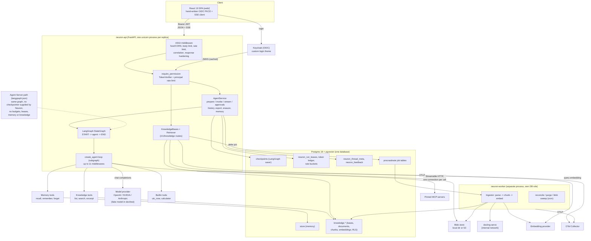
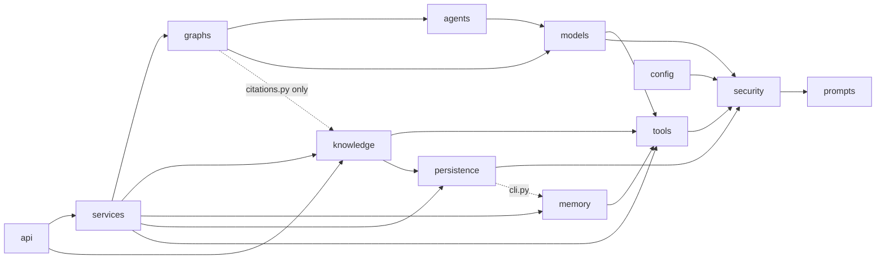

# Neuron: Current Architecture Assessment

| | |
| --- | --- |
| Assessed revision | `main` at `fa6f6cd` (v1.1.0, "Knowledge Engine") |
| Date | 2026-11-10 |
| Scope | `src/neuron_agent` (about 19,200 lines of Python), `web/`, `keycloak-theme/`, `tests/`, `deploy/`, `.github/workflows/`, the 14 ADRs and the top-level docs |

## How this was produced

This is a static assessment. The execution path was traced by reading the code: every file on the request path was read in full (`api/main.py` routes and wiring, `services/agent_service.py`, `graphs/main_graph.py`, `models/factory.py`, `agents/factory.py`, `tools/`, `memory/`, `security/`, `persistence/checkpointer.py`, `run_guard.py`, `thread_index.py`, `tools/mcp/`), and the Knowledge Engine, migrations, settings, evaluation and web client were read by outline plus their main code paths.

What was **not** done:

- No test suite, load test or eval was run for this assessment. Test counts below are counts of `def test_` functions, not pass results.
- No deployment was exercised. The repository's own records say no hosted environment has ever run.
- Database behaviour claims (round trips per turn, checkpoint growth) come from reading the code, not from measurement. They are marked "from reading" where they matter.

## 1. Executive summary

Neuron is a single-agent conversational backend with a private RAG subsystem. It is a FastAPI service that wraps one LangChain `create_agent` loop inside a one-node LangGraph, with Postgres for everything durable (conversation checkpoints, memory, limits, knowledge, job queue).

Three findings shape the rest of this document:

1. **The security and correctness engineering is well ahead of the agent capability.** Identity, authorization, tool gating, SSRF defence, citation validation, budgets and failure handling are built with unusual care and are heavily tested. The agent itself is one ReAct loop with a fixed model, no planning, lossy conversation memory and a small tool set.
2. **The architecture is a secure single-agent chat service, not yet an agent platform.** The parts a platform needs are absent or fixed at start-up: durable and resumable execution, per-request model or agent selection, dynamic tools, multi-step planning, background runs.
3. **Nothing has run in production.** Every release, including v1.0.0 and v1.1.0, was verified on a local Docker Compose stack with a fake model for load. `render.yaml` states that the production service is not deployable yet. Capacity and reliability figures are therefore unproven beyond 8 simulated users.

The largest structural risks are three oversized modules that hold most of the behaviour, two entry points with different guarantees, and a run model that lives entirely in one process's memory.

## 2. Actual architecture

### 2.1 Runtime topology

### 2.2 Layering as built

`schemas`, `errors`, `state`, `prompts` and `observability` are leaves used almost everywhere and are omitted. The dotted and less obvious edges are discussed in section 7.

### 2.3 Agent middleware stack

The top-level graph has one node. The real control flow is the middleware list in `models/factory.py::agent_middleware`, outermost first (7 and 10 are present only when gated tools or fallback models are configured):

| # | Middleware | Wraps | Purpose |
| --- | --- | --- | --- |
| 1 | `_EmptyReplyRetryMiddleware` | model | Re-call up to twice when a reasoning model returns no text and no tool call |
| 2 | `_StructuredOutputRetryMiddleware` | model | Bound invalid `AgentAnswer` attempts to two retries |
| 3 | `_FinalAnswerMiddleware` | model | Offer no tools on the last allowed model call, so it must answer |
| 4 | `_TracingMiddleware` | model, tool | `chat` and `execute_tool` spans and metrics |
| 5 | `_ToolAuthorizationMiddleware` | model, tool | Filter tools by scope; deny at execution; record token usage |
| 6 | `_KnowledgeFirstMiddleware` | model | Force `search_knowledge` on the run's first model call |
| 7 | `HumanInTheLoopMiddleware` | tool | Interrupt for `mutating` tools and for MCP read tools after taint |
| 8 | tool failure isolation | tool | Map tool failures to the error taxonomy |
| 9 | tool timeout | tool | `APP_TOOL_TIMEOUT_SECONDS` per call |
| 10 | `_ModelFallbackMiddleware` | model | Try `APP_FALLBACK_MODELS` in order |
| 11 | `ModelRetryMiddleware` | model | Bounded provider retries |

## 3. Component inventory

Maturity scale: **Production-ready**, **Functional (needs improvement)**, **Experimental**, **Incomplete**, **Problematic** (architecturally). "Production-ready" here means the design and tests would support production use; none of it has production evidence.

| Subsystem | Location | Size | What it does | Maturity |
| --- | --- | --- | --- | --- |
| HTTP API | `api/main.py`, `api/multipart.py` | 1,570 lines | 29 routes (27 under `/v1`, 2 health), 5 middlewares, proxy-aware client IP, body limits, SSE response, drain-aware server | Functional; module is too large |
| Authentication | `security/auth.py` | 528 | JWT verify (JWKS cache, `kid` refresh cooldown, algorithm pinning), `Principal`, HMAC owner key, route dependency | Production-ready |
| Authorization | `security/authorization.py`, `tools/registry.py` | 256 | Scope permissions, per-run `AuthorizationContext`, `ToolSpec` policy (scope, risk, taint) | Production-ready |
| Input/output policy, egress | `security/input_policy.py`, `output_policy.py`, `egress.py` | 371 | Message validation, URL classification, DNS-pinned public-only connections, system-prompt leak guard | Production-ready |
| Application service | `services/agent_service.py` | 1,628 | Run preparation, invoke, stream, approvals, history, feedback, export, erasure, memory, drain | Functional; a god object |
| Streaming | `services/streaming.py`, `AgentService.stream` | about 350 | Producer task, queue, incremental `answer` extraction from structured-output JSON, 7 event types | Functional; not resumable |
| Graph | `graphs/main_graph.py`, `state/main.py` | 484 | One node, atomic turn commit, history trim and eviction, citation and taint stamping, output guard | Functional |
| Agent and model boundary | `models/factory.py`, `agents/factory.py` | 1,076 | Middleware stack, provider factory, error classification, fake model | Functional; high complexity, model-coupled |
| Builtin tools | `tools/calculator.py`, `time.py` | 100 | Two read-only tools | Production-ready, minimal |
| MCP integration | `tools/mcp/` | 710 | Operator-configured Streamable HTTP servers, sha256-pinned tool definitions, schema validation, capped text results | Functional; static, hardened |
| Memory | `memory/` | 319 | Per-user notes on LangGraph `BaseStore`; `recall`/`remember`/`forget` tools | Functional; basic |
| Conversation persistence | `persistence/checkpointer.py`, `thread_index.py`, `thread_meta.py`, `feedback.py` | about 700 | Checkpointer selection, pool, start-up checks, thread listing, titles, ratings | Functional; data model is thin |
| Limits | `persistence/run_guard.py`, `token_budget.py`, `rate_limiter.py`, `security/*` in-memory twins | about 1,100 | Run leases, rolling token budget with exactly-once settlement, token-bucket rate limits | Production-ready |
| Migrations and roles | `persistence/migrations.py`, `roles.py`, `startup_checks.py`, `cli.py` | about 1,840 | Advisory-locked migrations, least-privilege grants verified at start-up, identity-key check | Production-ready |
| Knowledge storage and API | `knowledge/service.py`, `blobs.py`, `authorization.py` | about 880 | Bases, documents, uploads with idempotency, quotas, tombstones, export and erasure | Functional |
| Knowledge ingestion | `knowledge/worker.py`, `ingest.py`, `parsing.py`, `chunking.py`, `docling_serve.py`, `reconcile.py`, `purge.py` | about 1,830 | Procrastinate worker, untrusted-file checks, heading-aware chunking, reconcile and orphan sweep | Functional |
| Knowledge retrieval | `knowledge/retrieval.py`, `tools.py`, `citations.py`, `providers.py` | about 950 | Hybrid dense + full-text with RRF, authorization in SQL plus RLS, server-minted citations | Functional |
| Observability | `observability/` | about 1,000 | structlog JSON, audit events, OTel traces and metrics with GenAI semantic conventions, LangSmith governance | Production-ready |
| Evaluation | `evaluation.py`, `eval_compare.py`, `retrieval_metrics.py`, `tests/evals`, `evals/baselines` | about 1,350 | Single-turn, multi-turn, security and approval suites; Wilson intervals; baseline comparison; retrieval metrics | Functional |
| Agent Server path | `langgraph.json`, `security/agent_server.py`, module-level `graph` | about 150 | Same graph under LangGraph Agent Server with owner-filter auth handlers | Problematic (second, weaker entry point) |
| Web client | `web/` | 113 files under `web/src` (40 of them tests) | Chat, threads, knowledge, data-rights screens; SSE client; OIDC PKCE without a library | Functional |
| Deployment | `Dockerfile`, compose files, `render.yaml`, `deploy/` | n/a | Non-root digest-pinned image, reference stack with 2 replicas, Render blueprint, alerts | Incomplete (never deployed) |
| CI and supply chain | `.github/workflows/` (11) | n/a | Lint, types, tests, Postgres integration, CodeQL, secret scan, dependency review, image attestation, mutation tests, nightly eval, DAST | Production-ready |

Test inventory (function counts): unit 1,051; security 325; integration 225 (Postgres and live-provider, marker-gated); evals 42; graph 40; e2e 10; resilience 7; plus 40 web test files and 3 Playwright specs.

## 4. Execution lifecycle

The requested chain was "User request -> API -> Authentication -> Conversation -> Agent -> Planning -> Model -> Tools -> Memory -> Persistence -> Streaming -> Response". Two of those stages do not exist as separate steps: there is **no planning stage**, and **memory is not loaded automatically** (it is a tool the model may call).

Trace of `POST /v1/agent/stream` on an existing thread, JWT mode, Postgres backends:

| Step | Where | What happens | State change |
| --- | --- | --- | --- |
| 1 | ASGI middlewares in `api/main.py` | Host and CORS check, body size cap on received bytes, correlation binding, security headers | None |
| 2 | `security/auth.py::require_principal` | Bearer token parsed; header checked; signing key from JWKS cache; claims verified (`iss`, `aud`, `exp`, `nbf`, `iat`, `sub`); roles mapped to permissions | `Principal` created. On failure the IP limiter is charged |
| 3 | `require_permission("agent:invoke")` | Owner key = HMAC(identity key, issuer + subject). Principal rate limiter checked. Scope checked | One rate-bucket write |
| 4 | `AgentService.prepare` | Drain check; `request_id`, `run_id` minted; message validated; budget reserved for `max_output_tokens` + prompt estimate | Ledger row upserted |
| 5 | `_resolve_thread` -> `_owned_snapshot` | `graph.aget_state`; `values["owner_key"]` must equal the caller's. Missing and foreign threads return the same 404 | Full state read |
| 6 | `_claim` -> `PostgresRunGuard.claim` | Per-process stream slot; advisory lock per owner; expired leases deleted; per-user run count checked; lease inserted (unique on `thread_id`) | Lease row |
| 7 | `_pending_interrupts` (only when gated tools exist) | Second `aget_state`; a thread waiting for approval refuses new turns | Full state read |
| 8 | `_stream_prepared` | Returns `_CleanupEventSourceResponse`; all failures up to here are plain HTTP errors | HTTP 200 starts |
| 9 | `AgentService.stream` | Emits `run_started`; starts `_produce` as an asyncio task; relays a queue; watches the shutdown event | In-process task |
| 10 | `_produce` -> `graph.astream(..., stream_mode=["messages","updates"], subgraphs=True)` under `asyncio.timeout(run_timeout)` | Graph loads the checkpoint (third read) | Input checkpoint written |
| 11 | `agent_node` -> `call_agent` | History = stored messages + new `HumanMessage`, trimmed to `max_history_tokens` (approximate count), starting on a user turn | None |
| 12 | `agent.ainvoke` (the `create_agent` subgraph) | Middleware stack runs. First model call is forced to `search_knowledge` when the caller holds that scope. Loop continues until an `AgentAnswer` or the step limit | Tool messages exist only inside this run, unless gated tools make the subgraph checkpoint |
| 13 | Tool call | Scope check, taint check, optional interrupt, timeout, isolation. Knowledge search embeds the query, runs SQL scoped by owner and RLS, mints `cite_id`s | Taint is implied by tool messages |
| 14 | Streaming | Model chunks from node `model` go through `AnswerTokenExtractor` (decodes the `answer` string out of partial JSON) and `StreamLeakGuard` (holds back 8 words) | `token` and `tool_call` events |
| 15 | `_final_answer`, `_guard_answer` | `used_tools` rebuilt from tool messages; citations validated against this run's minted ids; system-prompt leak replaced by a fixed refusal | None |
| 16 | Commit | Node returns `HumanMessage` + final `AIMessage` (stamped with `run_id`, taint, citations) and `RemoveMessage`s for evicted old turns | One checkpoint holds the whole turn, or nothing |
| 17 | `_produce` epilogue | Audit `thread_created`, title, `final` event (or `approval_required`, or `error`) | Title row on a new thread |
| 18 | `stream` `finally` | Budget settled with real usage (or the whole reservation when unknown); lease released; stats logged; span ended | Ledger adjusted, lease deleted |

`POST /v1/agent/invoke` shares steps 1 to 7 and 11 to 16 through `_execute`, using `graph.ainvoke`.

**Approval path.** A gated tool raises a LangGraph interrupt. The run ends with `approval_required`, the lease and budget are released, and the pending call lives in the checkpoint. `POST /v1/threads/{id}/approvals/{approval_id}` starts a new run with `Command(resume=...)`, its own lease, reservation and timeout.

**Failure path.** Any exception in the node is classified by `classify_agent_error` into the `AppError` taxonomy (code, HTTP status, retryable, user-visible, alert). Because the user turn is only committed with the answer, a failed run leaves the thread unchanged.

From reading, an existing-thread turn makes about ten separate database transactions outside the model loop (rate bucket, reserve, two or three state reads, lease insert, checkpoint writes, settle, lease delete), all on one pool whose default maximum is 10 connections.

## 5. Component assessment

Ratings are relative judgements from the code: high, medium, low.

| Subsystem | Modularity | Coupling | Extensibility | Reliability | Scalability | Security | Testability |
| --- | --- | --- | --- | --- | --- | --- | --- |
| API layer | Low (one 1,438-line module, import-time singletons) | Medium | Medium | High | Medium | High | Medium |
| Authentication and authorization | High | Low | High | High | High | High | High |
| AgentService | Low (about ten responsibilities) | High | Low | High | Medium | High | Medium |
| Graph and state | High | Medium (imports `models` helpers) | Low (one node by design) | High | High | High | High |
| Agent middleware and models | Medium | High (order-dependent, provider-specific) | Medium | Medium | High | High | Medium |
| Tool registry | High | Low | High | High | High | High | High |
| MCP | High | Low | Medium (static, text only) | Medium | Medium (connection per call) | High | High |
| Memory | High | Low | Low | High | Medium (full scan) | High | High |
| Conversation persistence | Medium | High (tied to LangGraph checkpoint format) | Low | Medium | Medium | High | Medium |
| Limits | High (protocol + two implementations) | Low | High | High | Medium (a write per request) | High | High |
| Knowledge ingestion | High | Medium | Medium | High | Medium | High | High |
| Knowledge retrieval | High | Medium | Medium (one index profile) | High | Medium | High | High |
| Streaming | Medium | High (parses the `AgentAnswer` JSON shape) | Low | Medium | Medium (per-process cap) | High | High |
| Observability | High | Low | High | High | High | High | High |
| Evaluation | Medium (lives in `src/`, drives `AgentService`) | Medium | Medium | n/a | n/a | n/a | High |
| Deployment | Medium | Medium | Medium | Unproven | Unproven | High | Medium |

## 6. Architectural strengths

1. **Identity never comes from the request or the model.** The owner key is an HMAC of the verified issuer and subject. It reaches tools only through the runtime `AuthorizationContext`, never through tool arguments or graph input. Under Agent Server, where state is client input, `_run_authorization` ignores the client `context` and reads reserved `configurable` keys instead.
2. **One policy record per tool.** `ToolSpec` carries scope, risk class, source and taint. Filtering what the model sees and denying at execution read the same registry, so they cannot drift.
3. **Taint tracking for the "lethal trifecta".** A run that has read private or untrusted data (memory, knowledge, MCP output) needs human approval before any MCP call can carry data out. The taint persists across turns through a stamp on stored answers.
4. **Atomic turns.** The user message and the answer are committed in one checkpoint. Failed, cancelled and timed-out runs leave no dangling user turn.
5. **Server-side truth for model claims.** `used_tools` is rebuilt from tool messages, and citations are kept only when a knowledge tool minted that `cite_id` in the same run.
6. **Fail-closed limits with careful accounting.** Token reservations settle exactly once (settlement ids survive an ambiguous commit), unknown usage keeps the whole reservation, and guard failures return 503 before any model call.
7. **Defence in depth in the database.** Separate migration, app and worker roles; grants verified at start-up; row-level security on chunks and embeddings in addition to owner filters in SQL; TLS and identity-key checks in staging and production.
8. **Hardened outbound calls.** MCP uses a network backend that resolves once, rejects any non-public address and connects to the checked address, with response byte caps and no proxy from the environment. MCP tool definitions are pinned by hash and never re-read.
9. **Clean seams where they exist.** `RunGuard`, `TokenBudget`, `RateLimiter`, `BlobStore`, `DocumentParser`, `ThreadTitles` and `FeedbackStore` are protocols with in-memory and Postgres or remote implementations. This is why the suite runs without external services.
10. **Operational detail.** Readiness that reflects real dependencies, drain on SIGTERM with a delay for load-balancer convergence, lease clean-up on every response path, DSN redaction in pool logs, content-free telemetry.
11. **Decision records and honest release notes.** 14 ADRs with amendments, and release records that state plainly what was not verified.
12. **Verification breadth.** About 1,700 Python test functions, a security suite, Postgres integration tests, mutation testing, CodeQL, DAST, dependency-age checks and image attestation.

## 7. Weaknesses

Ordered by architectural impact.

### 7.1 Three modules hold most of the behaviour

- `services/agent_service.py` (1,628 lines): run preparation, execution, streaming, approvals, history, feedback, thread listing, export, erasure, memory CRUD, tool composition and drain. The same audit expression (`owner_key[:12] if auth_mode == "jwt" ...`) appears 18 times.
- `api/main.py` (1,438 lines): every route, five middlewares, forwarded-header parsing, upload slots, the SSE response subclass and the uvicorn server subclass.
- `models/factory.py` (1,026 lines): nine custom middlewares, provider construction, error classification, taint logic and a scripted fake model.

The consequence is that most changes touch one of three files, and those files are also the critical-tier security paths.

### 7.2 Import-time composition

`api/main.py` builds settings, persistence, the service, the knowledge service and the token verifier at import. `graphs/main_graph.py` configures logging and telemetry and compiles a graph at import, because Agent Server loads only that module. There is no application factory, so tests and tools reach in through module globals, and `_DrainingServer.handle_exit` has to re-import the module to find the live service.

### 7.3 Two entry points with different guarantees

The FastAPI path enforces budgets, run leases, rate limits, memory, knowledge, approvals and the streamed leak guard. The Agent Server path (`langgraph.json`) runs the same graph with none of those: no token budget, no run guard, no rate limiter, no memory or knowledge tools, mutating tools removed, and (per the code comment in `_guard_answer`) live message streams not covered by the leak guard. Ownership is also modelled differently: Agent Server filters on thread metadata, the service checks a field in graph state. Maintaining both doubles the security surface for a path the product does not use.

### 7.4 Runs are not durable and streams are not resumable

A run is an asyncio task in one process. If the process dies, the run is gone, the thread stays blocked until the lease expires (run timeout + 15 s, 135 s by default), and the client sees `stream_interrupted`. A client disconnect cancels the run. Streams cannot be resumed or replayed (ADR 0005 lists this as a non-goal). Leases have no heartbeat and no fencing (documented in `run_guard.py`), so a run whose final write is slow can overlap a new one after expiry. `/v1/agent/invoke` and `/stream` take no idempotency key, so a retry after a lost response can produce a duplicate turn. There are no background or long-running runs.

### 7.5 The conversation data model is the LangGraph checkpoint

There is no `threads` or `messages` table. A thread exists when a checkpoint with values exists. Consequences, from reading:

- Thread listing aggregates the `checkpoints` table by a JSON metadata field, then loads each listed thread's full latest checkpoint to count messages (an N+1 pattern in `list_user_threads` and `export_user_data`).
- Ownership is recorded twice: `owner_key` (or `user_id_hash` when auth is off) in state, and `owner` in checkpoint metadata. Different code paths check different copies.
- Each turn performs two or three full state reads before the model is called.
- Checkpoints accumulate within a thread; the only pruning is whole-thread retention after `APP_THREAD_RETENTION_DAYS`.
- The public message shape depends on LangChain message classes and `additional_kwargs` stamps, so a framework upgrade is a data migration risk.

### 7.6 Conversation memory is lossy and there is no context management beyond trimming

Only the user turn and the final answer are stored. Tool calls and results are discarded after each run, so a follow-up question cannot refer to passages retrieved one turn earlier without searching again, and `cite_id`s are valid only inside the run that minted them. History is trimmed by an approximate, model-agnostic token count; there is no summarisation, and threads are capped by dropping the oldest turns at 200 messages.

### 7.7 Model coupling

- One global `APP_DEFAULT_MODEL`, compiled into the agent at start-up. No per-request, per-user or per-thread model choice.
- `create_chat_model` hard-codes three providers with branches; adding one means editing the function and `SUPPORTED_PROVIDERS`.
- Three middlewares exist to work around provider behaviour with structured output (empty replies from reasoning models, invalid `AgentAnswer` calls, providers that ignore `tool_choice`).
- The streaming extractor finds the answer by matching `"answer": "` in partial JSON and depends on `AgentAnswer` staying flat.
- `_TracingMiddleware` sits outside the fallback middleware and labels metrics with the primary model, so calls served by a fallback are recorded under the wrong model name (the response model is set on the span, not on the metric).
- Embedding provider logic in `knowledge/providers.py` duplicates the retry and quota classification of `models/factory.py`, because `knowledge/` may not import `models/`.

### 7.8 No planning; behaviour is steered by order-dependent middleware

There is no planner, no task decomposition, no reflection and no sub-agents (ADR 0001 chose this). Control flow is instead encoded in up to eleven middlewares whose correctness depends on their order and on counters derived by scanning messages back to the last `HumanMessage`, plus a `ContextVar` retry counter.

`_KnowledgeFirstMiddleware` is the clearest case of policy in the wrong place: when the caller holds `tools:search_knowledge`, the first model call of **every** run is forced to be a knowledge search, whether or not the user has any knowledge base and whatever they asked. A greeting costs an extra model call, an embedding call and a database search. It was added to pass a grounding eval (RAG-08.01) and is keyed on a tool-name string.

### 7.9 Tooling is static

Tools are fixed at start-up. MCP discovery runs once; an unreachable server contributes no tools until the process restarts, and start-up does not fail. Each MCP call opens a new connection. Results are text only. Each server has one operator bearer token, so there is no per-user delegation to MCP servers. There is no stdio transport (a deliberate security choice). `agents/factory.py` is documented as the place for approved-tool wiring, but memory and knowledge tools are actually composed in `AgentService._compose_tools`.

### 7.10 One Postgres pool, no bulkheads

The checkpointer, the memory store, three guards, two rate limiters, thread metadata, feedback and all knowledge queries share one `AsyncConnectionPool` (default maximum 10). Only the token budget has a per-owner gate. A slow knowledge search or checkpoint write competes with rate limiting, which fails closed, so pool exhaustion turns into 503s on every route. Postgres is also the single point of failure for authentication-adjacent limits, by design.

### 7.11 Memory is minimal

Notes are key-value entries listed in full; there is no semantic recall and nothing is injected into context automatically. `remember` accepts only text that appears verbatim in the user's messages and needs a human approval per write. `remember` scans the whole namespace to check the item cap. This is safe and simple, and is far from an agent memory system.

### 7.12 Knowledge Engine limits

- One index profile (`KNOWLEDGE_PROFILE_ID = 1`); `setup` refuses a changed embedding model or dimension, so re-embedding has no path yet.
- No reranker; `knowledge_search_min_similarity` defaults to 0.0.
- Uploads are held in memory while checked (50 MB cap, 4 concurrent per process).
- A `grants` table exists but only owner grants are written; sharing is a v1.2.0 proposal.
- The API and the agent tools each build their own `KnowledgeBases` and cached `Retriever`.
- Token estimates for chunking use bytes / 3.

### 7.13 Layering is enforced only in part

`CLAUDE.md` calls the module boundaries "enforced". Tests enforce two things: knowledge imports (`test_knowledge_boundaries.py`) and environment reads (`test_entrypoint.py`). Nothing checks the rest, and the import graph shows edges the stated rules do not describe:

- `config/settings.py` imports `security/input_policy.py` (configuration depends on security).
- `security/auth.py` imports FastAPI and defines route dependencies (HTTP concerns inside `security/`).
- `security/output_policy.py` imports `prompts/`.
- `persistence/cli.py` imports `memory/`.
- `graphs/main_graph.py` imports taint and retry-counter helpers from `models/factory.py`.
- `services/` imports `tools/`, `memory/` and `knowledge/` to compose the registry.

### 7.14 Scale is unproven

The v1.1.0 record measures 8 users at 0.8 requests a second for 60 seconds, with two replicas on one host, a fake embedding provider and a Markdown parser. The stream cap and the in-flight counter are per process. Each replica is one uvicorn process. `render.yaml` carries a "NOT DEPLOYABLE TO PRODUCTION YET" notice about `sslmode=verify-full`.

## 8. Documentation discrepancies

| Document | Says | Code |
| --- | --- | --- |
| `ARCHITECTURE.md` (system diagram; "Security" section), `CLAUDE.md` ("Tools are currently read-only"), `README.md`, `SECURITY.md` ("Read-only initial tools") | Tools are read-only | `remember` and `forget` are `mutating`, and MCP tools default to `mutating`. Approvals exist precisely for them |
| `CLAUDE.md` | Module boundaries are "enforced" | Only knowledge imports and env reads are tested (section 7.13) |
| `CLAUDE.md` | `agents/` owns "approved-tool wiring" | Memory and knowledge tools are wired in `AgentService._compose_tools` |
| `CLAUDE.md` | Enforcement lives in `security/input_policy.py` | Tool enforcement lives in `tools/registry.py` and `_ToolAuthorizationMiddleware`. `input_policy.require_allowed_tool` has no caller in `src/` |
| `ARCHITECTURE.md` ("Scaling") | "The service is stateless except for provider clients and graph construction" | Each process also holds the stream-slot count, the in-flight count, an in-memory IP pre-limiter and unsettled budget retries |
| `ARCHITECTURE.md`, `CLAUDE.md` | The graph is "intentionally trivial" | True for the outer graph; the behaviour is in a middleware stack of up to eleven layers, which the architecture overview does not present as the control flow |
| `docs/ROADMAP.md` | v1.0.0 "Production AI Application" | Released with no production environment. The roadmap says so itself; the theme name overstates the evidence |

Unused code noticed while tracing (not removed): `security/input_policy.py::require_allowed_tool`, and the `error` field of `MainGraphState`, which nothing reads or writes.

## 9. Technical debt

| Debt | Where | Cost of leaving it |
| --- | --- | --- |
| God modules | `agent_service.py`, `api/main.py`, `models/factory.py` | Every feature edits a critical-tier file; reviews exceed the repo's own 400-line PR budget easily |
| Module-level singletons | `api/main.py`, `graphs/main_graph.py` | Hard to run two configurations in one process; tests patch globals |
| Duplicated audit boilerplate | 18 call sites in `agent_service.py` | A change to the actor rule must be made everywhere |
| Dual ownership fields | state `owner_key` / `user_id_hash`, metadata `owner` | Two sources of truth for authorization |
| Duplicated provider logic | `models/factory.py` and `knowledge/providers.py` | Retry and quota rules drift |
| Fake model with scripted prefixes (`search:`, `remember:`) in a production module | `models/factory.py` | Test behaviour ships in the image; guarded by environment and settings checks |
| Evaluation harness inside `src/` | `evaluation.py`, `eval_compare.py`, `retrieval_metrics.py` at package root | Outside the layering, imports `services`, `models`, `memory` |
| Agent Server path | `langgraph.json`, `security/agent_server.py`, branches in `main_graph.py` | Extra branches in authorization and telemetry for an unused path |
| Policy keyed on tool-name strings | `_KNOWLEDGE_SEARCH`, `_STRUCTURED_OUTPUT_TOOL` (defined twice), `MINTING_TOOLS` | Renaming a tool silently disables behaviour |
| Documentation drift | section 8 | New contributors and coding agents act on wrong rules |

## 10. Missing capabilities

For "an advanced AI agent platform", relative to what exists:

- **Execution:** durable, resumable runs; background and long-running tasks; stream resume; cancellation as an API; idempotent run creation.
- **Agent design:** planning, task decomposition, reflection, sub-agents, multiple agent definitions, per-thread or per-request model selection, routing by cost or capability.
- **Context:** summarisation, retention of tool results across turns, automatic memory injection, semantic memory.
- **Tools:** runtime tool registration, per-user credentials for MCP, non-text tool results, connection reuse, MCP health and re-discovery, any web or code tool (deliberately excluded so far).
- **Multi-tenancy:** organisations, shared knowledge bases (grants exist in schema only), admin APIs, per-tenant quotas and models.
- **Conversation features:** message edit and regenerate, branching, attachments in chat, thread search.
- **Knowledge:** reranking, re-embedding and profile migration, incremental document updates, connectors.
- **Operations:** a proven hosted deployment, restore and rollback exercised outside a laptop, an external penetration test (the roadmap lists these as deferred), cost accounting beyond token counts.
- **Evaluation:** online evaluation from production traces, feedback forwarded to LangSmith (ADR 0013 is a proposal), eval coverage for MCP tools.

## 11. Priority-ranked improvements

Each item names the weakness it addresses. Items that add retrieval, queues, persistence or orchestration need an ADR under the repo's own rule.

### P0: correctness of the record and of the foundation

1. **Fix the documentation drift** (section 8): tools are not all read-only; state what is and is not enforced; describe the middleware stack as the control flow. Small, and it stops future work from building on wrong statements.
2. **Decide the Agent Server path** (7.3): remove it, or bring it to parity. Removal deletes the import-time graph, the dual authorization branch and one ownership model.
3. **Prove one hosted deployment** (7.14): resolve the `verify-full` blocker in `render.yaml`, run the load baseline with a real model against it, and record restore and rollback there. Until then every capacity and reliability claim is local.

### P1: structural changes that unblock everything else

4. **Split `AgentService`** (7.1) into a run service (prepare, execute, stream, approvals), a thread service (history, titles, feedback, listing) and a data-rights service (export, erasure), with one audit helper. Behaviour-preserving, covered by the existing suite.
5. **Introduce an application factory** (7.2): build settings, persistence and services in a function, attach them to `app.state`, and split `api/main.py` into routers (agent, threads, me, knowledge), middleware and server modules.
6. **Give conversations their own tables** (7.5): a `threads` row (owner, title, timestamps, message count) and optionally a `messages` projection written in the same transaction as the turn. This removes the N+1 listing, the JSON-metadata aggregation, the dual owner field and the repeated full state reads used only for ownership checks.
7. **Make run creation idempotent and cancellable** (7.4): accept an `Idempotency-Key` on `/invoke` and `/stream` (the upload route already has the pattern), and add a heartbeat to leases so expiry can be short and overlap is detectable.

### P2: agent capability

8. **Replace the forced first search** (7.8) with a conditional step: skip it when the caller has no ready documents in scope (a cheap indexed lookup), or express it as an explicit graph node before the agent rather than a middleware keyed on a tool name.
9. **Keep tool context across turns** (7.6): persist a bounded summary of tool results or the cited passages with the turn, and add summarisation when history is trimmed.
10. **Model registry** (7.7): a table of model identifiers to provider factories and capabilities (structured-output strategy, usage reporting), per-request selection within an operator allow-list, and metrics labelled with the model that actually served the call.
11. **Durable runs and resumable streams** (7.4): persist stream events per run (Postgres is already there) so a client can reconnect with `Last-Event-ID`, and decouple the run from the HTTP connection. This is the largest item and needs an ADR that supersedes the ADR 0005 non-goal.
12. **Pool bulkheads** (7.10): separate pools, or per-subsystem limits, for guards and rate limiting versus checkpoints and knowledge, so a slow query cannot starve admission control.

### P3: platform breadth

13. **MCP lifecycle** (7.9): periodic re-discovery with pin checks, readiness that reports missing servers, connection reuse, and per-user token exchange where a server supports it.
14. **Memory that helps without being asked** (7.11): inject the user's notes (framed, tainting) at the start of a run when they are few, and add semantic recall when they are not.
15. **Knowledge quality and lifecycle** (7.12): a second index profile with a re-embedding job, a reranker behind the existing `Retriever` seam, streaming uploads to the blob store, and the sharing model the `grants` table anticipates.
16. **Enforce the layering** (7.13): one import-contract test for all packages (the knowledge test is the template), and move the FastAPI dependencies out of `security/`.
17. **Move evaluation out of `src/`** (section 9) or into its own package, and add eval cases for MCP tools and approvals under a real model.

## 12. Closing judgement

The foundation is sound where it is hardest to retrofit: identity, authorization, tool safety, data isolation, accounting and failure handling. Those parts are careful, consistent and tested, and they should be kept as they are.

The parts that would make Neuron an agent platform are the ones the ADRs deliberately postponed: durable execution, richer agent structure, context management, dynamic tools and model choice. The current structure will resist adding them, because the run lifecycle, the conversation record and the agent's control flow are concentrated in three large modules and bound to one process and one checkpoint format. The P1 items are therefore the precondition for the P2 and P3 items, and the first hosted deployment is the precondition for trusting any of the numbers.
