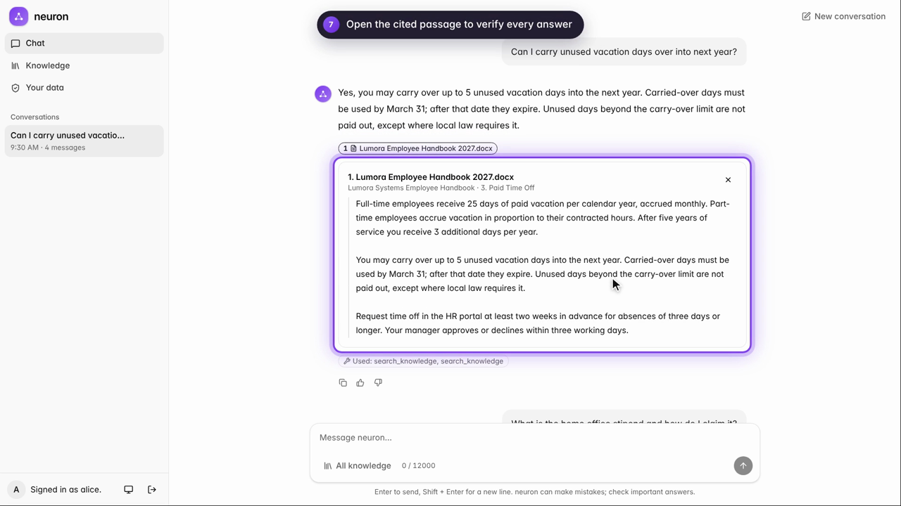

# Knowledge Bases launch demo

`neuron-knowledge-demo.mp4`: 71 s, 1920×1080, 30 fps, H.264, silent audio track. Recorded
2026-11-19 from a local stack, not a hosted deployment.

## What it shows

1. Sign-in through the development identity provider (Keycloak with Neuron's login theme), as
   the realm's throwaway demo user `alice`.
2. Creating the knowledge base "Company Knowledge Hub".
3. Uploading `lumora-employee-handbook-2027.docx` (in this folder). The worker parses it with
   docling-serve and the row goes from Queued to Ready.
4. Two questions in chat, each answered from the handbook with a citation:
   - "Can I carry unused vacation days over into next year?"
   - "What is the home office stipend and how do I claim it?"
5. Opening the citation to show the cited passage.

## How it was made, and what to know before publishing it

- The journey runs live in the real app: no mocked responses. A Playwright script drove a
  headed Chromium on an Xvfb display, and `ffmpeg` recorded the screen.
- The cursor, click ripples, highlight rings and step captions are an overlay injected into
  the page only for the recording. They are not part of the product.
- Answers come from `nvidia:nvidia/nemotron-3-ultra-550b-a55b` through NVIDIA's API catalog.
  Answer text varies from run to run.
- Embeddings used the `fake` provider, because NVIDIA's embedding endpoint was failing at
  recording time (503s and timeouts). Retrieval therefore relied on the exact-word part of
  hybrid search.
- The two waits for an answer (about 8 s and 13 s) play at 3× and 4× speed. Everything else is
  real time.
- Lumora Systems and its handbook are fictional.
