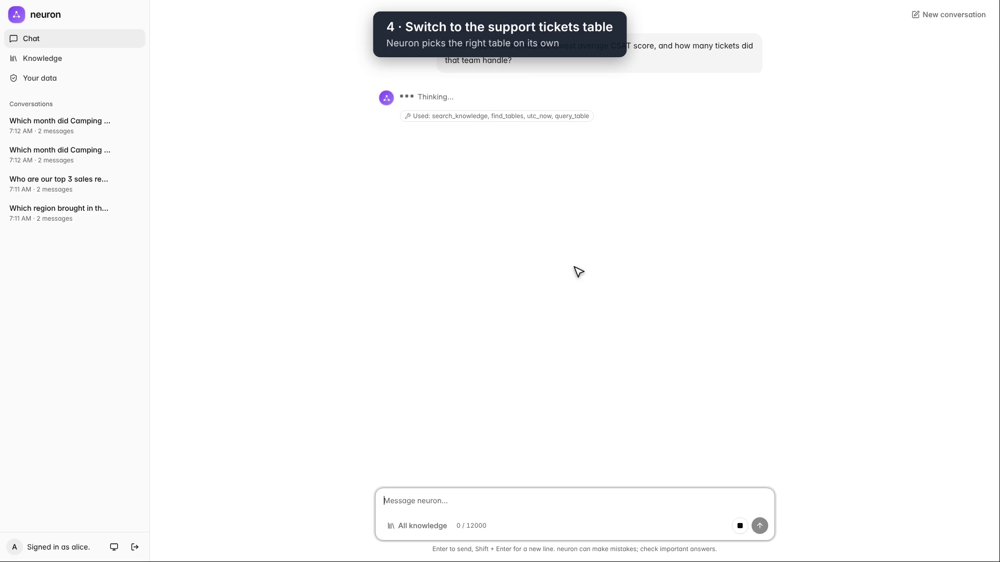

# Knowledge Bases launch demo

`neuron-knowledge-demo.mp4`: 71 s, 1920×1080, 30 fps, H.264, silent audio track. Recorded
2026-11-19 from a local stack, not a hosted deployment.

## What it shows

1. Sign-in through the development identity provider (Keycloak with Neuron's login theme), as
   the realm's throwaway demo user `alice`.
2. Creating the knowledge base "Company Knowledge Hub".
3. Uploading `lumora-employee-handbook-2027.docx` (in this folder). The worker parses it with
   docling-serve and the row goes from Queued to Ready.
4. Two questions in chat, each answered from the handbook with a citation:
   - "Can I carry unused vacation days over into next year?"
   - "What is the home office stipend and how do I claim it?"
5. Opening the citation to show the cited passage.

## How it was made, and what to know before publishing it

- The journey runs live in the real app: no mocked responses. A Playwright script drove a
  headed Chromium on an Xvfb display, and `ffmpeg` recorded the screen.
- The cursor, click ripples, highlight rings and step captions are an overlay injected into
  the page only for the recording. They are not part of the product.
- Answers come from `nvidia:nvidia/nemotron-3-ultra-550b-a55b` through NVIDIA's API catalog.
  Answer text varies from run to run.
- Embeddings used the `fake` provider, because NVIDIA's embedding endpoint was failing at
  recording time (503s and timeouts). Retrieval therefore relied on the exact-word part of
  hybrid search.
- The two waits for an answer (about 8 s and 13 s) play at 3× and 4× speed. Everything else is
  real time.
- Lumora Systems and its handbook are fictional.

# CSV tables demo (RAG-11.01)

`neuron-csv-tables-demo.mp4`: about 153 s, 1920×1080, 30 fps, H.264, silent audio track.
Recorded 2026-11-23 against a local stack, not a hosted deployment.

## What it shows

Sign in as `alice`, create the knowledge base "Meridian Outdoor — Business Data", upload two
CSV files, then ask five questions in chat. Each answer is calculated by `query_table` over
the whole table and cites it ("Calculated from the table Table 1 in this document").

| File | Rows | Question | Answer in the video | Check (SQLite over the same file) |
|---|---|---|---|---|
| `meridian-sales-orders-2026.csv` | 640 | Region with the most revenue (Delivered and Shipped) | North America, $163,489.40 | same |
| same | | Top 3 sales reps in Q3 | Dana Whitfield $24,542.00, Tom Becker $16,914.10, Mei Lin Tan $14,526.20 | same |
| same | | Best month for Camping | July, $19,211.20 | same |
| `meridian-support-tickets-q3-2026.csv` | 420 | Team with the lowest average CSAT, and its ticket count | Shipping, 3.43, 122 tickets | same |
| same | | Worst team at resolving High and Urgent tickets within 24 hours | Technical, 57.9% of 38 | same |

The data is synthetic (`generate-csv-demo-data.py`, fixed seed); Meridian Outdoor is fictional.

## How it was made, and what to know

- Stack: Postgres (pgvector) and Keycloak from `docker-compose.reference.yml` in Docker; the
  API, the ingestion worker and the web app ran directly on the host, because the container
  image could not be built in the recording sandbox (no route from the build to PyPI). The
  docling parser was not started, so XLSX was not exercised; CSV is parsed by the worker itself.
- Chat model `nvidia:nvidia/nemotron-3-ultra-550b-a55b` and embeddings
  `nvidia/nemotron-3.5-embed-1b`, both through NVIDIA's API catalog. Answer wording varies
  from run to run.
- A Playwright script drove a headed Chromium on Xvfb and `ffmpeg` recorded the screen. The
  cursor, click ripples, highlight ring and captions are an overlay injected for the recording.
- Each question starts in a new conversation. In some runs the model replied with "let me query
  the table" and stopped, without running `query_table`. The script detected that, asked again
  in a fresh conversation, and the failed attempt is cut from the video. It still shows as an
  extra conversation in the sidebar. This happened for the Camping question in this recording.
- Waits for ingestion (3×) and for answers (4×) are sped up; everything else is real time.
