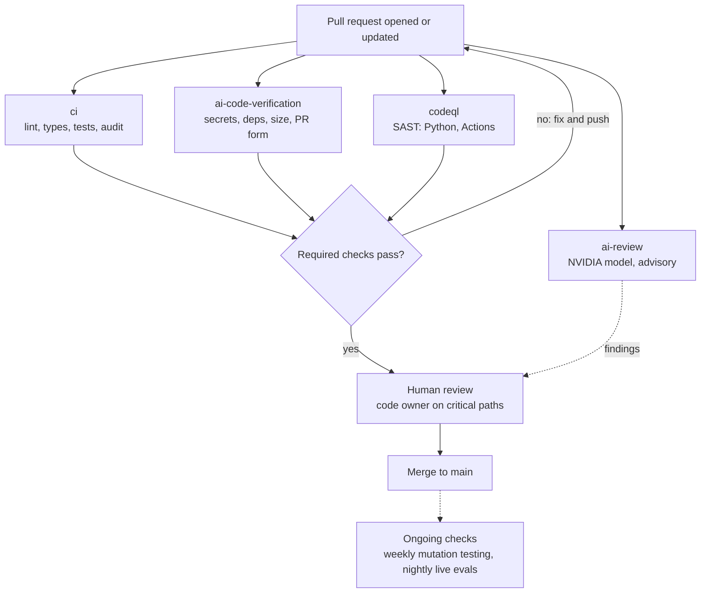

# AI Code Verification: Implementation in Neuron

October 18, 2026 · Exported from the [living doc](https://claude.ai/code/artifact/6c1e5769-d27e-4fb6-bc3e-9e27eddce19a). Companion: [research.md](research.md); policy: [../AI_CODE_VERIFICATION.md](../AI_CODE_VERIFICATION.md)

## Overview

The `neuron` repository (Md-Nisar/neuron) now verifies every pull request in layers: blocking deterministic gates, an advisory AI review on NVIDIA's free API catalog, weekly mutation testing, and code owner review for high-risk paths. It puts the recommendations of the companion research doc, [Verifying and Reviewing AI-Generated Code](https://claude.ai/code/artifact/d004ef16-157a-41e3-bd63-790b9173c615), into practice.

The repo already had strong foundations, which were kept unchanged: ruff with bandit rules, mypy strict, five test suites on Linux and Windows, bandit, pip-audit, nightly live evals with a pass^k security gate, and Claude Code hooks that format every edit and block writes to `.env` and `uv.lock`. The new work adds what was missing:

- Secret scanning, dependency review and CodeQL on every PR.
- A check that rejects hallucinated or brand-new PyPI packages.
- PR size limits and a PR template that records AI assistance, risk tier and an author attestation.
- An AI reviewer that uses the repo's own checklists and verifies its findings before posting.
- Mutation testing of `security/` and `tools/` to prove the tests catch bugs.
- `CODEOWNERS`, a branch-protection script and a written policy (`docs/AI_CODE_VERIFICATION.md`).

All changes are uncommitted in the working tree as of this doc, ready for review.

## How a pull request flows



Every PR triggers four workflows in parallel; only when the three blocking ones pass does the PR reach a human, who also sees the AI review's findings. Dashed lines are advisory signals that never block.

## Components

Six workflows run on GitHub Actions: ci, ai-code-verification and codeql block merges once branch protection is on; the AI review, mutation testing and nightly evals are signals for humans.

| Component | Trigger | What it checks | Blocks merge |
| --- | --- | --- | --- |
| `ci.yml` (existing) | Every push and PR | ruff format and lint, mypy strict, unit/graph/security/resilience/eval tests on Ubuntu and Windows, bandit, pip-audit | Yes |
| `ai-code-verification.yml` → `secrets-scan` | PR | Leaked keys and tokens across the PR history (gitleaks) | Yes |
| `ai-code-verification.yml` → `dependency-review` | PR | New dependencies with moderate+ vulnerabilities or AGPL/GPL-3.0 licenses | Yes |
| `ai-code-verification.yml` → `new-dependencies` | PR | Each package added to `pyproject.toml` must exist on PyPI and be at least 90 days old (`scripts/check_new_dependencies.py`) | Yes; `new-dependency-approved` label overrides the age rule |
| `ai-code-verification.yml` → `pr-hygiene` | PR, incl. label and description edits | Size: warn over 400 changed lines, fail over 5,000 (excluding `uv.lock` and eval baselines). Description must contain the AI assistance, risk tier and verification sections and a ticked author attestation | Yes; `large-pr-approved` label overrides size |
| `codeql.yml` | PR, push to main, weekly | CodeQL `security-extended` queries for Python and GitHub Actions workflows | Yes |
| `ai-review.yml` | Non-draft PR | Frontier model on NVIDIA's free API reviews the diff against repo checklists; verified findings posted as a comment-only review | No, advisory |
| `mutation-testing.yml` | Weekly (Sunday) and manual | mutmut plants faults in `security/` and `tools/`; surviving mutants reveal missing tests | No, report only |
| `nightly-eval.yml` (existing) | Nightly | Live agent evals; security gate pass^k = 100% with k ≥ 3 | Nightly signal |

**Policy and process files**

| File | Purpose |
| --- | --- |
| `.github/pull_request_template.md` | AI assistance disclosure (none, assisted, agent-generated + tool), risk tier, verification checklist with author attestation |
| `.github/CODEOWNERS` | Code owner review for critical paths: `security/`, `config/`, `tools/`, `prompts/`, `persistence/`, `api/`, CI, `.claude/`, Dockerfile, deploy, dependencies |
| `docs/AI_CODE_VERIFICATION.md` | The policy: principles, pipeline, risk tiers, rules for AI-assisted changes, reviewer checklist, setup, metrics, rollout |
| `scripts/setup_branch_protection.sh` | Creates the override labels and applies branch protection to `main` via the `gh` CLI |
| `AGENTS.md`, `CLAUDE.md`, `CONTRIBUTING.md` | Short sections pointing coding agents and contributors to the policy |
| `pyproject.toml`, `.gitignore` | `[tool.mutmut]` configuration; `mutants/` ignored |

**Risk tiers used by the template and CODEOWNERS**

| Tier | Paths | Required |
| --- | --- | --- |
| Critical | security, config, tools, prompts, persistence, api, tests/security, CI, .claude, Dockerfile, deploy, dependencies, SECURITY.md, AGENTS.md, ADRs | All gates + AI findings answered + code owner approval |
| Standard | services, graphs, agents, models, observability, schemas, state | All gates + one approval |
| Low | Docs, tests only, comments | All gates + one approval |

## AI review on NVIDIA's free API

`scripts/ai_review.py` gives every PR a two-pass AI review using the repo's existing `NVIDIA_API_KEY` secret, so no Anthropic key is needed. It uses only the Python standard library, so it adds no dependencies.

**How it works**

1. Takes the PR diff with `git diff BASE...HEAD`, excluding `uv.lock`, eval baselines and `dist/`; diffs over 150,000 characters are truncated and the review says so.
2. Builds the prompt from the repo's own rules: `.claude/agents/security-reviewer.md`, `.claude/agents/architecture-conformance-reviewer.md`, `AGENTS.md` and `SECURITY.md`. It also asks for logic errors, weak tests and suspicious dependencies.
3. Calls the OpenAI-compatible endpoint `https://integrate.api.nvidia.com/v1/chat/completions`, trying each configured model in order until one answers.
4. Parses the JSON findings (file, line, severity, title, explanation, fix), keeps at most 15, sorted by severity.
5. Runs a second, verification call that sees the findings and the diff and keeps only those it confirms; this mirrors the precision filters used by Uber, Atlassian and Anthropic. If that call fails, findings are posted marked as unverified.
6. Posts one GitHub review with `event: COMMENT`: inline comments on changed lines, everything else in the summary. If GitHub rejects a line, it falls back to a summary-only review.

**Safeguards**

- Advisory only: it never approves, and any error ends with a warning and exit code 0.
- The diff is treated as untrusted data; the prompts tell the model to ignore instructions inside it.
- @-mentions in model text are neutralized and comment length is capped.
- Commit SHAs are validated before being passed to git; the workflow runs on `pull_request`, so fork PRs get no secrets and are skipped.

**Models**

| Setting | Value |
| --- | --- |
| Default order | `z-ai/glm-5.3`, `moonshotai/kimi-k3`, `deepseek-ai/deepseek-v4.1-flash` |
| Override | Repository variable `AI_REVIEW_MODELS`, comma-separated ids |
| Rate limit | About 40 requests per minute on the free tier (community-reported); each review uses 2 |
| Caveat | Free-tier catalog changes often; NVIDIA recommends paid endpoints for production |

Confirm available ids with your key before relying on the defaults:

```bash
curl -s -H "Authorization: Bearer $NVIDIA_API_KEY" https://integrate.api.nvidia.com/v1/models
```

To try it locally without posting, set `AI_REVIEW_DRY_RUN=true` along with `NVIDIA_API_KEY`, `BASE_SHA` and `HEAD_SHA`, then run `python scripts/ai_review.py`.

## Setup

Five one-time steps turn the files into enforced gates; until branch protection is on, the checks run but do not block.

- [ ] Review the uncommitted changes, commit them on a branch and open a PR so every check runs once (GitHub can only require checks that have run).
- [ ] Confirm the `NVIDIA_API_KEY` repository secret exists (already used by `nightly-eval`) and list available models with the curl command above; set the `AI_REVIEW_MODELS` variable if the defaults are not available.
- [ ] Enable the dependency graph; for a private repo, enable GitHub Advanced Security (needed by `dependency-review` and CodeQL).
- [ ] Run `CODE_OWNER_REVIEWS=false scripts/setup_branch_protection.sh` while you are the only maintainer; it creates the `large-pr-approved` and `new-dependency-approved` labels and protects `main`.
- [ ] Add a second maintainer or team to `CODEOWNERS`, then re-run the script without the override to require code owner review.

**Required status checks applied by the script**

`checks (ubuntu-latest)`, `checks (windows-latest)`, `secrets-scan`, `dependency-review`, `new-dependencies`, `pr-hygiene`, `analyze (python)`, `analyze (actions)`. The script also requires one approval, dismisses stale approvals, requires approval of the last push and conversation resolution, enforces rules for admins and blocks force pushes.

## Verification status and known issues

The new scripts and workflows pass the repo's own gates locally; the parts that depend on GitHub or NVIDIA have not run end to end yet.

| Item | Status |
| --- | --- |
| `check_new_dependencies.py` + 6 unit tests | Pass ruff, mypy strict, bandit; tested live against PyPI: a fake package was rejected as a possible hallucination, `requests` passed |
| `ai_review.py` + 6 unit tests | Pass ruff, mypy strict, bandit; dry run confirmed it exits cleanly with a warning when the model is unreachable |
| All workflow files | Pass actionlint |
| AI review against NVIDIA | Not run: the sandbox could not reach the NVIDIA API, so model ids and output quality are unconfirmed |
| Mutation testing | Not run locally (too slow for the sandbox); first scheduled run will validate the `[tool.mutmut]` config |
| Existing test suite | 5 tests failed before these changes, e.g. `test_settings_defaults_are_openai_production_safe` expects `max_agent_iterations == 8` but gets 5; they will also fail in CI and need fixing before branch protection |

**Other notes**

- `git status` shows about 69 files modified that are line-ending (CRLF) differences in the working copy, not real changes; only `AGENTS.md`, `CLAUDE.md`, `CONTRIBUTING.md`, `pyproject.toml` and `.gitignore` were edited.
- GitHub does not let authors approve their own PRs, so code owner review needs a second maintainer.
- Free-tier NVIDIA models are rate limited and change often; a paid NVIDIA endpoint only needs the URL changed in `ai_review.py`.

**Next steps**

1. Fix the 5 failing tests, then complete the setup checklist.
2. After two weeks, review AI comment quality (target 40%+ acted on) and tune prompts or models.
3. After a month, triage surviving mutants, add tests, and consider making mutation testing blocking for `security/`.
4. Track revert rate, escaped defects, PR size and review time monthly (see the metrics table in `docs/AI_CODE_VERIFICATION.md`).

## File inventory and sources

| Path | Change |
| --- | --- |
| `.github/workflows/ai-code-verification.yml` | New |
| `.github/workflows/ai-review.yml` | New |
| `.github/workflows/codeql.yml` | New |
| `.github/workflows/mutation-testing.yml` | New |
| `.github/pull_request_template.md` | New |
| `.github/CODEOWNERS` | New |
| `scripts/ai_review.py` | New |
| `scripts/check_new_dependencies.py` | New |
| `scripts/setup_branch_protection.sh` | New |
| `tests/unit/test_ai_review.py` | New |
| `tests/unit/test_check_new_dependencies.py` | New |
| `docs/AI_CODE_VERIFICATION.md` | New, the policy |
| `docs/ai-code-verification/research.md` | New, export of the research doc |
| `docs/ai-code-verification/implementation.md` | New, export of this doc |
| `AGENTS.md`, `CLAUDE.md`, `CONTRIBUTING.md` | Short policy pointer added |
| `pyproject.toml`, `.gitignore` | mutmut config; `mutants/` ignored |

**Sources**

- [Verifying and Reviewing AI-Generated Code (research doc)](https://claude.ai/code/artifact/d004ef16-157a-41e3-bd63-790b9173c615)
- [Kimi K3, DeepSeek and GLM free from NVIDIA (DEV Community)](https://dev.to/klukyanov/kimi-k3-deepseek-and-glm-free-from-nvidia-i-tested-the-claim-and-here-is-the-catch-2m9b)
- [NVIDIA NIM free models list 2026](https://uygarduzgun.com/blog/tech/nvidia-nim-free-models-list-2026)
- [build.nvidia.com model catalog](https://build.nvidia.com/models?q=agent)
