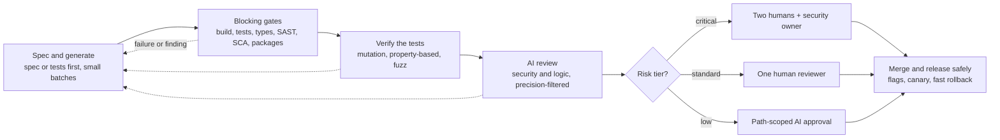

# Verifying and Reviewing AI-Generated Code: Research and Industry Practices

October 18, 2026 · Exported from the [living doc](https://claude.ai/code/artifact/d004ef16-157a-41e3-bd63-790b9173c615). Companion: [implementation.md](implementation.md); policy: [../AI_CODE_VERIFICATION.md](../AI_CODE_VERIFICATION.md)

## Executive summary

AI-generated code needs verification that is automated, layered and risk-tiered, with a human still accountable for every merge. Leading organizations do not trust either the model or a single human reviewer; they make generated code pass deterministic gates first, then use precision-filtered AI reviewers, then concentrate scarce human attention where risk is highest.

**What the evidence says**

- Syntax is solved; security is not. Veracode's syntax pass rate rose from about 50% to over 95% since 2023, while the security pass rate stayed flat at 45–55% across 150+ models.
- AI raises volume and instability. AI co-authored PRs carried about 1.7x more issues (CodeRabbit), and DORA 2025 links AI adoption to higher throughput but rising delivery instability.
- People over-trust AI output. In controlled studies, AI users wrote less secure code yet rated it more secure, and 32% accepted insecure code even after an explicit warning.
- AI reviewers help with speed, not as a safety net. Industrial reviewers cut PR cycle time (Atlassian about 31%) but independent tests show they miss many security flaws.

**What reputed organizations converge on**

1. Generated code must compile, pass tests, linters and type checks before a human sees it (Google, Meta, Airbnb, Stripe, Shopify).
2. AI reviewers filter their own comments for precision: confidence grading, a second model as judge, de-duplication (Uber, Atlassian, Anthropic, Cloudflare).
3. A named human stays accountable; autonomous approval is limited to low-risk, path-scoped changes (Meta RADAR, GitHub opt-in approvals, Cloudflare).
4. Test generation is itself verified, e.g. mutation-guided tests at Meta that must catch planted bugs.

**Top recommendations for us**

- Adopt a five-layer verification pipeline (section 4) and the playbook in section 7.
- Tier review depth by risk, not by whether AI wrote the code; NIST SP 800-218A applies the same controls to all code.
- Measure outcomes (revert rate, escaped defects, security findings per KLOC), not AI comment counts.

## The problem: what the evidence says

Across independent and vendor studies, AI-generated code is syntactically strong but carries more security flaws, more duplication and more churn, and humans reviewing it tend to over-trust it. Treat individual vendor figures with caution; the direction is consistent across sources.

| Study | Scope | Key finding | Caveat |
| --- | --- | --- | --- |
| [Veracode Spring 2026](https://veracode.com/blog/spring-2026-genai-code-security) | 150+ LLMs, 80 tasks | Security pass rate about 55%, flat since 2023; syntax over 95%. XSS pass rate 15%, Java 29% | Vendor, synthetic tasks |
| [Veracode GenAI report 2025](https://www.veracode.com/press-release/ai-generated-code-poses-major-security-risks-in-nearly-half-of-all-development-tasks-veracode-research-reveals/) | 100+ LLMs | 45% of outputs introduced OWASP Top 10 flaws; larger models no safer | Vendor |
| [CodeRabbit AI vs human](https://www.coderabbit.ai/blog/state-of-ai-vs-human-code-generation-report) (Dec 2025) | 470 GitHub PRs | 10.83 vs 6.45 issues per PR (1.7x); logic +75%, security up to 2.74x | Vendor; authorship inferred |
| [Sonar LLM personalities](https://www.sonarsource.com/company/press-releases/the-coding-personalities-of-leading-llms/) (Aug 2025) | 4,400+ Java tasks, 5 models | 60–70% of vulnerabilities BLOCKER severity; newer model passed more tests but had 93% more high-severity bugs | Vendor |
| [Spracklen et al., USENIX Security 2025](https://arxiv.org/html/2406.10279v3) | 576k samples, 16 LLMs | 19.7% of recommended packages did not exist; 43% of fake names recur, enabling slopsquatting | Peer reviewed |
| [GitClear 2025](https://devclass.com/2025/02/20/ai-is-eroding-code-quality-states-new-in-depth-report/) | 211M changed lines | Duplicated blocks rose about 8x in 2024; copy-paste overtook refactoring for the first time | Vendor |
| [Apiiro](https://theregister.com/2025/09/05/ai_code_assistants_security_problems) (Sep 2025) | Fortune 50 repos | 3–4x more commits, 10x more security findings; privilege-escalation paths +322% | Vendor telemetry |
| [DORA 2025](https://blog.google/technology/developers/dora-report-2025/) | About 5,000 respondents | 90% use AI; throughput up but delivery instability still rising; 30% trust AI output little or not at all | Survey |
| [METR RCT](https://arxiv.org/pdf/2507.09089) (Jul 2025) | 16 experienced OSS devs, 246 tasks | 19% slower with AI while believing they were 20% faster; a [2026 update](https://evals.alignment.org/blog/2026-02-24-uplift-update/) calls its own later data weak | Small sample |
| [Perry et al., CCS 2023](https://arxiv.org/html/2211.03622v3) | 47 participants | AI users wrote less secure code (SQL injection 36% vs 7%) and rated it more secure | Mostly students |
| [RUB manipulated-ChatGPT, CHI 2025](https://casa.rub.de/forschung/publikationen/detail/exploring-the-impact-of-intervention-methods-on-developers-security-behavior-in-a-manipulated-chatgpt-study) | 76 freelancers | 32% accepted insecure MD5 hashing even after an explicit warning | Peer reviewed |
| [Stack Overflow 2025 survey](https://shiftmag.dev/stack-overflow-survey-2025-ai-5653/) | 48,000+ devs | 46% distrust AI accuracy; 66% cite "almost right" code as top frustration | Survey |
| [Queen's University, 2026](https://arxiv.org/pdf/2607.13196) | 1.02M PRs, 207 projects | AI-involved reviews faster but 78–94% had review smells vs 69–76% human-only; changesets larger | Preprint |
| [Copilot review security test](https://arxiv.org/html/2509.13650v1) (2025) | 7 vulnerable codebases | Fewer than 20 comments, mostly style; missed SQLi, XSS, deserialization | Preprint |

**Implications for review design**

- The main risks are semantic: security flaws, logic errors, hallucinated dependencies and architectural drift. Linters alone will not catch them.
- Larger PRs and higher volume overload human reviewers, so batch size and triage matter as much as tooling.
- Automation bias is real, so review processes must force active verification rather than passive approval.

## How reputed organizations do it

Every large organization studied keeps a human accountable and puts deterministic checks before human review; they differ mainly in how much they let AI reviewers block or approve. Most figures below are self-reported by the organization.

| Organization | Verification and review approach | Human-in-the-loop policy | Reported results |
| --- | --- | --- | --- |
| [Google](https://research.google/blog/accelerating-code-migrations-with-ai/) | AI migrations must compile and pass unit tests with auto-repair before engineer and owner review; [ML-suggested fixes](https://research.google/blog/resolving-code-review-comments-with-ml/) for reviewer comments; AutoCommenter for best practices; [Jules critic](https://developers.googleblog.com/meet-jules-sharpest-critic-and-most-valuable-ally/) reviews agent patches | All AI code is reviewed and accepted by engineers | About 80% of edits in migrations AI-written, \~50% time saved; 40–50% of previewed fix suggestions applied; AI share of new code reported at 25% (2024) rising to \~75% (2026, press reports) |
| [Microsoft](https://devblogs.microsoft.com/engineering-at-microsoft/enhancing-code-quality-at-scale-with-ai-powered-code-reviews/) | Internal AI reviewer on every PR: categorized comments, suggested fixes, PR summary | AI never commits; author applies each suggestion | 90%+ of PRs (600K/month); median PR completion time down 10–20% |
| [Meta](https://engineering.fb.com/2025/02/05/security/revolutionizing-software-testing-llm-powered-bug-catchers-meta-ach/) | TestGen-LLM keeps a test only if it builds, passes reliably and adds coverage; ACH plants realistic bugs and generates tests that catch them; [Diff Risk Score](https://engineering.fb.com/2025/08/06/developer-tools/diff-risk-score-drs-ai-risk-aware-software-development-meta/) predicts incident risk | RADAR (2026) lands qualifying low-risk diffs without a human reviewer, after gates, risk score and AI review | 73% of ACH tests accepted; RADAR reportedly reviewed 535K+ diffs with lower revert rates (selection bias likely) |
| [Amazon / AWS](https://www.geekwire.com/2026/aws-targets-ai-slop-with-new-spec-check-in-kiro-coding-tool-amid-scrutiny-of-agent-reliability/) | Q Developer Java upgrades; Kiro spec-driven development with property-based tests and a formal-logic spec check that finds contradictory requirements | Retail reportedly required senior sign-off on AI-assisted changes after incidents (Mar 2026, disputed) | 79% of auto-generated upgrade reviews shipped unchanged; \~4,500 developer-years saved (CEO claim) |
| [GitHub](https://github.blog/ai-and-ml/github-copilot/60-million-copilot-code-reviews-and-counting/) | Agentic Copilot code review; [Copilot Autofix](https://github.blog/security/vulnerability-research/found-means-fixed-introducing-code-scanning-autofix-powered-by-github-copilot-and-codeql/) with CodeQL | Reviews are "Comment" only by default; opt-in path-scoped approvals since Sep 2026, dismissed on new pushes | 60M reviews, 71% with actionable feedback; Autofix fixes 2/3 of found vulnerabilities with little editing |
| [Anthropic](https://claude.com/resources/articles/automate-security-reviews-with-claude-code) | Test-driven loops with Claude Code; `/security-review` and GitHub Action; multi-agent [Code Review](https://infoq.com/news/2026/04/claude-code-review) that verifies and ranks findings | Code Review does not approve PRs; humans review before merge | PRs with substantive comments rose 16% to 54%; under 1% of findings marked incorrect; caught RCE and SSRF pre-merge |
| [Stripe](https://infoq.com/news/2026/03/stripe-autonomous-coding-agents/) | "Minions" one-shot agents; CI, tests and static analysis must pass | All changes human-reviewed | 1,300+ agent PRs per week with no human-written code |
| [Shopify](https://shopify.engineering/introducing-roast) | Roast framework interleaves AI steps with deterministic steps, looping until tests and type checks pass | Humans review all production code; review capacity is the bottleneck | Revert rates unchanged (investor deck) |
| [Uber](https://www.uber.com/blog/ureview/) | uReview: three specialist assistants (bugs, best practice, security), then confidence grading, de-duplication and category filtering | Comments only; humans decide | 90%+ of \~65K diffs/week; 75% of comments useful; 65% addressed vs 51% for human comments |
| [Airbnb](https://medium.com/airbnb-engineering/accelerating-large-scale-test-migration-with-llms-9565c208023b) | Per-file state machine: refactor, fix tests, lint, type-check, retry until each passes | Manual fixes for failures | 3.5K files, 97% migrated in 6 weeks vs 1.5 years estimated |
| [Atlassian](https://arxiv.org/html/2601.01129v1) | RovoDev reviewer; a second model checks correctness and a classifier checks actionability | Final decisions with human reviewers | 38.7% of comments led to changes (humans 44.5%); median PR cycle time down \~31% |
| [Cloudflare](https://blog.cloudflare.com/ai-code-review) | Coordinator plus up to 7 specialist AI reviewers; [enforced engineering standards](https://blog.cloudflare.com/engineering-standards-enforcement/) as RFCs | AI can approve or block; "break glass" override used on 0.6% of MRs | 131K reviews in 30 days at \~$1.19 each, median 3m39s |
| [Linux kernel](https://docs.kernel.org/_sources/process/coding-assistants.rst.txt) | Human must review all AI code; `Assisted-by:` provenance tag | AI must not add Signed-off-by; human certifies the DCO | Tag reportedly being retired (Oct 2026); accountability stays |
| [Mozilla Firefox](https://firefox-source-docs.mozilla.org/contributing/ai-coding.html) | AI allowed; contributor must explain every change | "The reviewer double-checks the work of a human, not the output of a tool" | Policy only |
| Gentoo, NetBSD, QEMU, curl | [Gentoo and NetBSD](https://www.theregister.com/2024/05/18/distros_ai_code/) ban or restrict AI code; [QEMU](https://patchew.org/QEMU/20250616092241.212898-1-armbru@redhat.com) declines it over copyright; [curl](https://bleepingcomputer.com/news/security/curl-ending-bug-bounty-program-after-flood-of-ai-slop-reports/) ended its bug bounty over AI-generated junk reports | Restrictive | Signals licensing and review-load risk |

**Patterns across organizations**

- Deterministic gates first: nothing reaches a human until it builds, passes tests, lints and type-checks.
- Precision over recall in AI review: every successful AI reviewer filters its own comments, because noisy bots get ignored.
- Specialist reviewers: security, bugs and standards are checked by separate agents or prompts, then merged.
- Risk-based autonomy: AI approval is only allowed for low-risk, path-scoped changes with a human override.
- Provenance and accountability: AI cannot certify contributions; a human signs off and can explain the change.

## Proven methods: the layered verification stack

No single method is sufficient; the strongest evidence supports layering cheap deterministic checks, generated-but-verified tests, specialist AI review and risk-tiered human review. The techniques below are ordered roughly by strength of evidence.

Machines check everything first; human attention is spent according to risk tier, and only low-risk, path-scoped changes are candidates for AI approval.

| Layer | Technique | What it catches | Evidence | Strength |
| --- | --- | --- | --- | --- |
| 0. Before generation | Spec-driven development ([GitHub Spec Kit](https://visualstudiomagazine.com/articles/2025/09/03/github-open-sources-kit-for-spec-driven-ai-development.aspx), [Kiro](https://kiro.dev)); secure instruction files per [OpenSSF guide](https://best.openssf.org/Security-Focused-Guide-for-AI-Code-Assistant-Instructions) | Wrong intent, missing requirements, insecure defaults | Kiro adds a formal check for contradictory specs; no controlled data yet | Emerging |
| 0. Before generation | Supply tests with the prompt (TDD) | Functional errors | [+9 to +30 points](https://arxiv.org/html/2402.13521v2) success on HumanEval/MBPP | Strong (benchmarks) |
| 1. Deterministic gates | Build, unit tests, linters, type checks, auto-retry loop | Syntax, regressions, type errors | Used by Google, Airbnb, Stripe, Shopify; Airbnb migrated 97% of 3.5K files | Strong (industry) |
| 1. Deterministic gates | SAST, SCA, secrets scanning, SBOM | Known vulnerability classes, leaked keys, vulnerable deps | Recommended by OpenSSF and NIST SSDF; [Copilot Autofix](https://github.blog/security/vulnerability-research/found-means-fixed-introducing-code-scanning-autofix-powered-by-github-copilot-and-codeql/) fixes 2/3 of CodeQL findings | Strong |
| 1. Deterministic gates | Package existence and reputation check, pinned versions, checksums | Hallucinated packages, slopsquatting | 19.7% of AI-suggested packages [do not exist](https://arxiv.org/html/2406.10279v3) | Strong (threat data) |
| 2. Test verification | Mutation-guided test generation ([Meta ACH](https://arxiv.org/html/2501.12862v1)) | Weak tests that pass broken code | 73% of generated tests accepted by engineers | Strong (industry) |
| 2. Test verification | Property-based testing ([Anthropic agentic PBT](https://www.anthropic.com/research/property-based-testing)) | Edge cases, invariant violations | 984 bug reports across 100+ packages; 56–86% valid; patches merged in numpy | Strong |
| 2. Test verification | AI-generated fuzzing ([OSS-Fuzz](https://thehackernews.com/2024/11/googles-ai-powered-oss-fuzz-tool-finds.html)) | Memory-safety and parsing bugs | 26 vulnerabilities incl. a \~20-year-old OpenSSL CVE | Strong |
| 2. Test verification | Differential testing ([Mokav](https://arxiv.org/html/2406.10375v1)) | Behaviour changes in refactors and migrations | Used in research and in DeepMind CodeMender's patch critique | Moderate |
| 2. Test verification | Formal verification (Dafny, Verus, Lean) | Logic errors against a spec | LLMs verify [82% in Dafny, 44% Verus, 27% Lean](https://arxiv.org/abs/2509.22908v1) on benchmark specs | Promising, niche |
| 3. AI review | Specialist AI reviewers with precision filters (confidence grading, judge model, de-dup) | Logic bugs, best-practice violations, some security issues | Uber 65% addressed; Atlassian \~31% faster cycles; Anthropic <1% incorrect | Moderate |
| 3. AI review | Self-critique ("recursive criticism") before submission | Model's own obvious mistakes | OpenSSF recommends about two rounds plus SAST | Moderate |
| 4. Human review | Risk-tiered human review, small PRs, author must explain the change | Design, intent, business logic, subtle security | DORA links small batches to teams that benefit from AI | Strong (consensus) |
| 5. Runtime safety | Agent sandboxing and least privilege ([Claude Code sandbox](https://anthropic.com/engineering/claude-code-sandboxing)); risk scoring ([Meta DRS](https://engineering.fb.com/2025/08/06/developer-tools/diff-risk-score-drs-ai-risk-aware-software-development-meta/)); canary releases | Prompt injection damage, high-blast-radius changes | Sandbox cut permission prompts 84%; DRS used to gate freezes | Moderate |
| Cross-cutting | Provenance tagging (`Assisted-by:`), audit trail | Accountability, licensing, later forensics | Linux kernel, Fedora and GNOME policies | Policy |

**Weak spots to know about**

- AI reviewers are inconsistent at finding security flaws; one study found Copilot review [missed SQLi, XSS and deserialization](https://arxiv.org/html/2509.13650v1) in vulnerable codebases.
- Vendor benchmarks of AI reviewers disagree widely (e.g. [Greptile's own benchmark](https://greptile.com/benchmarks) ranged from 6% to 82% catch rates) and should be re-run on your own code.
- AI review can slow merges if noisy: at Beko, average PR closure time [rose from 5.9h to 8.3h](https://arxiv.org/html/2412.18531v2).

## Standards, frameworks and regulation

No major standard treats AI-generated code as a separate category; they require the same secure-development controls for all code and add AI-specific risks such as hallucinated dependencies, excessive agency and over-reliance.

| Framework | What it requires or recommends | Relevance to AI code |
| --- | --- | --- |
| [NIST SP 800-218A](https://nvlpubs.nist.gov/nistpubs/SpecialPublications/NIST.SP.800-218A.pdf) (SSDF GenAI profile, Jul 2024) | SSDF practices plus AI tasks: provenance, secure handling of prompts and outputs | States its practices "do not distinguish between human-written and AI-generated source code" |
| [OpenSSF guide for AI code assistant instructions](https://best.openssf.org/Security-Focused-Guide-for-AI-Code-Assistant-Instructions) (Aug 2025) | Treat AI output like a colleague's code; keep review, tests, SAST; reference OWASP and ASVS in prompts; ask for negative tests; recursive self-critique | Most directly applicable practical guide |
| [OWASP Top 10 for LLM Apps 2025](https://genai.owasp.org/llmrisk/llm09-overreliance/) | LLM05 improper output handling, LLM06 excessive agency, LLM09 misinformation and over-reliance | Calls for automatic validation and reviewers trained not to over-trust AI |
| [OWASP Top 10 for Agentic Apps 2026](https://genai.owasp.org/resource/owasp-top-10-for-agentic-applications-for-2026) | Risks for autonomous agents (tool misuse, privilege) | Applies to coding agents with repo and CI access |
| [SLSA v1.2](https://slsa.dev/blog/2025/11/announce-slsa-v1.2) (Nov 2025) | New Source Track for authoring and review integrity | Lets you enforce and attest review on every commit, AI or not |
| [NIST AI RMF GenAI profile](https://www.nist.gov/publications/artificial-intelligence-risk-management-framework-generative-artificial-intelligence) (AI 600-1) | Govern, Map, Measure, Manage risks | Organization-level governance of AI tool use |
| [ISO/IEC 42001](https://riskprofs.com/iso-42001-annex-a-controls-list/) | AI management system; controls on verification and validation, logging, supplier management | Governs AI tool vendors and usage, not code itself |
| [EU Cyber Resilience Act](https://www.docker.com/blog/eu-cyber-resilience-act-overview/) | Exploited-vulnerability reporting from 11 Sep 2026; SBOM and full duties from 11 Dec 2027 | No exemption for AI-written code; manufacturer is liable, so verification evidence matters |
| [EU AI Act](https://fpf.org/blog/the-ai-act-implementation-timeline-what-changes-under-the-ai-omnibus) | GPAI duties since Aug 2025; transparency from Aug 2026 | Coding assistants are generally not high-risk; impact is mostly indirect |

Taken together, the standards point to four controls: an enforced review and sign-off trail, dependency verification and SBOMs, least-privilege agents, and trained reviewers who verify rather than trust. This is not legal advice; confirm regulatory obligations with counsel.

## Comparative analysis: what works and what doesn't

What works best is verification that does not depend on trusting the model: executable checks, tests proven to catch bugs, and accountable humans focused on high-risk changes. What fails is relying on human vigilance alone or on an unfiltered AI reviewer.

| Approach | Works when | Fails when | Trade-off |
| --- | --- | --- | --- |
| Human-only review of AI code | Small PRs, trained reviewers, author can explain the change | Volume rises 3–4x; reviewers rubber-stamp plausible code (automation bias) | Highest judgment, lowest scalability |
| Deterministic gates (tests, SAST, types, SCA) | Test suite is strong; gates are blocking | Tests were also AI-written and never validated | Cheap and consistent; blind to intent and design |
| AI-generated tests | Verified by mutation testing or coverage gain (Meta) | Accepted unverified; they confirm the bug instead of catching it | Big coverage gains; needs a validation step |
| Single general AI reviewer | Used as a first pass to cut reviewer load | Noisy comments lead to ignoring it; misses security flaws | Fast and cheap; inconsistent between runs |
| Specialist, precision-filtered AI reviewers | Confidence grading, judge model, de-dup (Uber, Atlassian, Anthropic) | Treated as approval rather than input | Higher action rates (38–65%); more engineering to build |
| Autonomous AI approval | Narrow, low-risk paths with risk scoring and override (Meta, Cloudflare, GitHub opt-in) | Applied broadly or to security-critical code | Frees reviewer time; requires strong observability and rollback |
| Formal verification | Critical algorithms, protocols, specs | General application code without specs | Strongest guarantee; costly and specialized |
| Outright bans (Gentoo, NetBSD, QEMU) | Licensing risk is paramount | Developers use AI anyway without disclosure | Legal clarity; loses productivity and visibility |

**Key insights**

1. The bottleneck has moved from writing code to verifying it. Shopify and others report review capacity as the constraint, so investments should go to verification throughput.
2. AI review is most valuable as a filter that improves the human's signal, not as a replacement for the human.
3. Measure outcomes. Few organizations publish defect rates; most report comment acceptance or cycle time, which can improve while quality worsens (Queen's University study).
4. Risk tiering beats authorship tagging. NIST and Mozilla both hold all code to the same bar; the review depth should follow blast radius.

## Recommended playbook for adoption

Roll out in three phases: enforce deterministic gates and policy first, add verified test generation and filtered AI review second, then introduce risk-tiered autonomy only once outcome metrics are stable.

**Policy and roles**

- The human who opens or merges a PR owns it and must be able to explain every line, whoever wrote it (Linux kernel, Mozilla model).
- Tag AI-assisted commits (e.g. an `Assisted-by:` trailer) for audit and analytics, not to lower or raise the bar.
- AI tools may comment, suggest and fix, but may not approve production changes outside an explicitly approved low-risk scope.
- Maintain secure instruction files for coding assistants following the OpenSSF guide.

**Risk tiers for review depth**

| Tier | Examples | Required review |
| --- | --- | --- |
| Critical | Auth, payments, crypto, PII handling, infra and IAM, data migrations | All gates + AI security review + two human reviewers incl. a domain or security owner |
| Standard | Business logic, APIs, UI features | All gates + AI review + one human reviewer |
| Low | Docs, tests-only, config with schema, mechanical refactors | All gates + AI review; candidate for path-scoped AI approval later |

**Process steps**

1. Specify: write a short spec or acceptance tests before generating code.
2. Generate in small batches: cap PR size (e.g. under \~400 changed lines) so humans can review meaningfully.
3. Gate: build, tests, linters, type checks, SAST, SCA, secrets and package-existence checks must pass; blocking, not advisory.
4. Verify tests: require coverage gain and run mutation testing on critical modules so AI-written tests prove they catch bugs.
5. AI review: specialist reviewers (security, correctness, standards) with confidence thresholds and de-duplication.
6. Human review: reviewer checks intent, design, security and business logic; the author answers "why" questions without the AI.
7. Release safely: risk scoring, feature flags, canaries and fast rollback for high-blast-radius changes.

**Tooling (illustrative, not an endorsement)**

- Gates: CI with CodeQL or Semgrep, SonarQube, dependency scanners, secret scanners, SBOM generation.
- Test verification: mutation testing (e.g. PIT, Stryker, mutmut), property-based testing (e.g. Hypothesis), fuzzing.
- AI review: GitHub Copilot code review, Claude Code security review and Code Review, CodeRabbit, Qodo, Greptile; pilot two on your own repos and compare.
- Agent safety: sandboxed execution, least-privilege tokens, no direct pushes to protected branches.

**Metrics to track**

| Metric | Why it matters |
| --- | --- |
| Change failure rate and revert rate | Primary outcome signal; DORA shows instability rising with AI adoption |
| Escaped defects and security findings per KLOC | Catches quality drift that cycle time hides |
| AI review comment action rate | Target 40%+ (Atlassian 38.7%, Uber 65%); low rates mean noise |
| PR size and review time | Detects reviewer overload and rubber-stamping |
| Mutation score on critical modules | Measures whether tests actually catch bugs |
| Duplication and churn | GitClear-style signals of maintainability decline |

**Rollout timeline**

1. Days 0–30: publish the policy, enforce blocking gates and package checks, set PR size limits, baseline the metrics.
2. Days 30–90: pilot two AI reviewers on selected repos, add mutation and property-based testing to critical services, train reviewers on automation bias.
3. Days 90–180: scale the best reviewer with precision filters, introduce risk scoring, and consider path-scoped AI approval for the low tier only if revert rates stay flat.

## Sources

Research gathered October 2026. Several 2026 figures come from press coverage rather than primary posts (Google 75% AI code, Amazon senior sign-off, GitHub opt-in approvals, Anthropic Code Review metrics, Meta RADAR, Linux tag retirement) and should be re-checked before citing externally.

**Empirical studies**

- [Veracode Spring 2026 GenAI code security](https://veracode.com/blog/spring-2026-genai-code-security) · [Veracode 2025 report](https://www.veracode.com/press-release/ai-generated-code-poses-major-security-risks-in-nearly-half-of-all-development-tasks-veracode-research-reveals/)
- [CodeRabbit: State of AI vs Human Code Generation](https://www.coderabbit.ai/blog/state-of-ai-vs-human-code-generation-report)
- [Sonar: Coding Personalities of Leading LLMs](https://www.sonarsource.com/company/press-releases/the-coding-personalities-of-leading-llms/)
- [Spracklen et al., package hallucinations (USENIX Security 2025)](https://arxiv.org/html/2406.10279v3)
- [GitClear 2025 via DevClass](https://devclass.com/2025/02/20/ai-is-eroding-code-quality-states-new-in-depth-report/)
- [Apiiro via The Register](https://theregister.com/2025/09/05/ai_code_assistants_security_problems)
- [DORA 2025](https://blog.google/technology/developers/dora-report-2025/) · [DORA 2024 via RedMonk](https://redmonk.com/rstephens/2024/11/26/dora2024/)
- [METR RCT 2025](https://arxiv.org/pdf/2507.09089) · [METR 2026 update](https://evals.alignment.org/blog/2026-02-24-uplift-update/)
- [Perry et al., CCS 2023](https://arxiv.org/html/2211.03622v3)
- [RUB manipulated-ChatGPT study, CHI 2025](https://casa.rub.de/forschung/publikationen/detail/exploring-the-impact-of-intervention-methods-on-developers-security-behavior-in-a-manipulated-chatgpt-study)
- [Stack Overflow 2025 survey via ShiftMag](https://shiftmag.dev/stack-overflow-survey-2025-ai-5653/)
- [Queen's University AI review study 2026](https://arxiv.org/pdf/2607.13196)
- [Copilot code review security evaluation](https://arxiv.org/html/2509.13650v1)
- [Beko automated code review in practice](https://arxiv.org/html/2412.18531v2)

**Organization practices**

- Google: [code migrations with AI](https://research.google/blog/accelerating-code-migrations-with-ai/) · [resolving review comments with ML](https://research.google/blog/resolving-code-review-comments-with-ml/) · [Jules critic](https://developers.googleblog.com/meet-jules-sharpest-critic-and-most-valuable-ally/) · [75% AI code (press)](https://the-decoder.com/google-says-75-percent-of-its-new-code-is-now-written-by-ai/)
- [Microsoft: AI-powered code reviews at scale](https://devblogs.microsoft.com/engineering-at-microsoft/enhancing-code-quality-at-scale-with-ai-powered-code-reviews/)
- Meta: [ACH](https://engineering.fb.com/2025/02/05/security/revolutionizing-software-testing-llm-powered-bug-catchers-meta-ach/) · [TestGen-LLM](https://arxiv.org/abs/2402.09171v1) · [Diff Risk Score](https://engineering.fb.com/2025/08/06/developer-tools/diff-risk-score-drs-ai-risk-aware-software-development-meta/)
- [AWS Kiro spec check (GeekWire)](https://www.geekwire.com/2026/aws-targets-ai-slop-with-new-spec-check-in-kiro-coding-tool-amid-scrutiny-of-agent-reliability/)
- GitHub: [60M Copilot code reviews](https://github.blog/ai-and-ml/github-copilot/60-million-copilot-code-reviews-and-counting/) · [Copilot code review docs](https://docs.github.com/en/copilot/how-tos/copilot-on-github/use-copilot-agents/copilot-code-review) · [Copilot Autofix](https://github.blog/security/vulnerability-research/found-means-fixed-introducing-code-scanning-autofix-powered-by-github-copilot-and-codeql/)
- Anthropic: [how teams use Claude Code](https://claude.com/resources/articles/how-anthropic-teams-use-claude-code) · [automated security reviews](https://claude.com/resources/articles/automate-security-reviews-with-claude-code) · [Code Review (InfoQ)](https://infoq.com/news/2026/04/claude-code-review) · [agentic property-based testing](https://www.anthropic.com/research/property-based-testing) · [sandboxing](https://anthropic.com/engineering/claude-code-sandboxing)
- [Stripe Minions (InfoQ)](https://infoq.com/news/2026/03/stripe-autonomous-coding-agents/)
- [Shopify Roast](https://shopify.engineering/introducing-roast)
- [Uber uReview](https://www.uber.com/blog/ureview/)
- [Airbnb LLM test migration](https://medium.com/airbnb-engineering/accelerating-large-scale-test-migration-with-llms-9565c208023b)
- [Atlassian RovoDev code reviewer](https://arxiv.org/html/2601.01129v1)
- Cloudflare: [AI code review](https://blog.cloudflare.com/ai-code-review) · [engineering standards enforcement](https://blog.cloudflare.com/engineering-standards-enforcement/)
- [Linux kernel coding assistants policy](https://docs.kernel.org/_sources/process/coding-assistants.rst.txt) · [Mozilla Firefox AI coding policy](https://firefox-source-docs.mozilla.org/contributing/ai-coding.html) · [Gentoo and NetBSD (The Register)](https://www.theregister.com/2024/05/18/distros_ai_code/) · [QEMU policy](https://patchew.org/QEMU/20250616092241.212898-1-armbru@redhat.com) · [curl bug bounty ends](https://bleepingcomputer.com/news/security/curl-ending-bug-bounty-program-after-flood-of-ai-slop-reports/)

**Methods and standards**

- [Tests in the prompt (TDD) study](https://arxiv.org/html/2402.13521v2) · [ACH paper](https://arxiv.org/html/2501.12862v1) · [Mokav differential testing](https://arxiv.org/html/2406.10375v1) · [OSS-Fuzz AI](https://thehackernews.com/2024/11/googles-ai-powered-oss-fuzz-tool-finds.html) · [Vericoding benchmark](https://arxiv.org/abs/2509.22908v1) · [Greptile benchmark](https://greptile.com/benchmarks) · [GitHub Spec Kit](https://visualstudiomagazine.com/articles/2025/09/03/github-open-sources-kit-for-spec-driven-ai-development.aspx)
- [NIST SP 800-218A](https://nvlpubs.nist.gov/nistpubs/SpecialPublications/NIST.SP.800-218A.pdf) · [NIST AI 600-1](https://www.nist.gov/publications/artificial-intelligence-risk-management-framework-generative-artificial-intelligence) · [OpenSSF AI code assistant guide](https://best.openssf.org/Security-Focused-Guide-for-AI-Code-Assistant-Instructions) · [OWASP LLM09](https://genai.owasp.org/llmrisk/llm09-overreliance/) · [OWASP Agentic Top 10 2026](https://genai.owasp.org/resource/owasp-top-10-for-agentic-applications-for-2026) · [SLSA v1.2](https://slsa.dev/blog/2025/11/announce-slsa-v1.2) · [ISO 42001 controls](https://riskprofs.com/iso-42001-annex-a-controls-list/) · [EU AI Act timeline](https://fpf.org/blog/the-ai-act-implementation-timeline-what-changes-under-the-ai-omnibus) · [EU CRA overview](https://www.docker.com/blog/eu-cyber-resilience-act-overview/)
