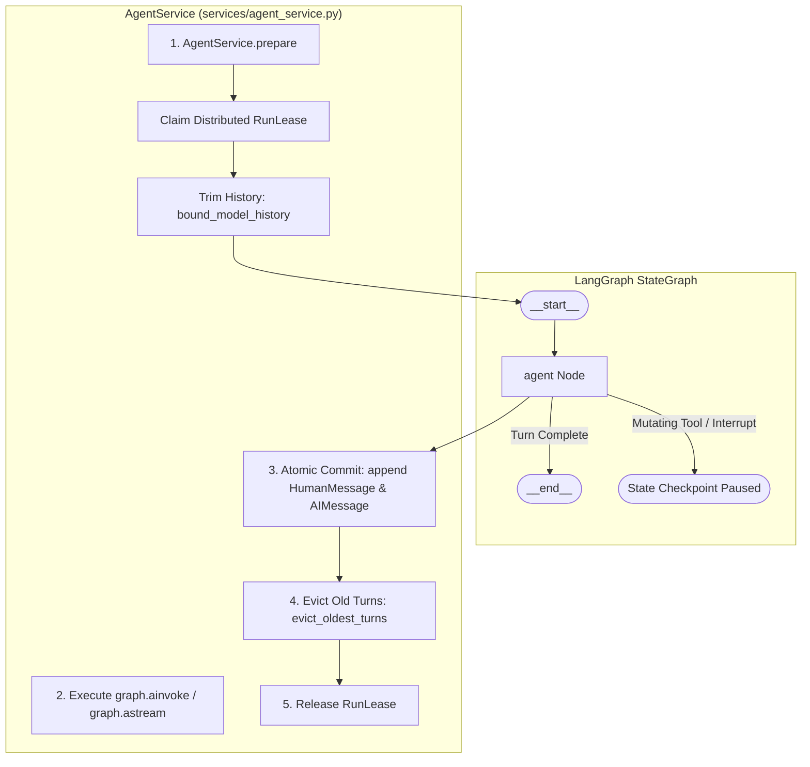

# Explanation: System Architecture and State Machine Mechanics

> **Document ID:** DOC-EXP-001  
> **Diátaxis Mode:** Explanation (Understanding-Oriented)  
> **Standard Alignment:** Structured in alignment with ISO/IEC/IEEE 26514:2022 §7.2 (Conceptual / Architectural Information) and Diátaxis (Explanation)  
> **Audience:** System Architects, Principal Engineers, Framework Maintainers  
> **Code Traceability:** `src/neuron_agent/graphs/main_graph.py`, `src/neuron_agent/services/agent_service.py`, ADR 0001, ADR 0005

---

## 1. Architectural Philosophy and Design Principles

Neuron Agent was designed to provide a production-ready, deployable baseline for agentic AI applications. In contrast to monolithic agent scripts or sprawling multi-agent frameworks, Neuron enforces three architectural principles:

1. **Separation of Concerns:** 
   - Transport concerns (HTTP parsing, SSE formatting, headers, cookies) remain isolated in `api/`.
   - Business orchestration and safety controls reside in `services/`.
   - Graph routing and state transition logic reside in `graphs/`.
   - Model provider harnesses and tool execution boundaries reside in `models/` and `tools/`.
2. **Minimal Surface Graph:** Orchestration uses a single LangGraph `StateGraph` containing exactly one agent node. Rather than constructing a complex labyrinth of hard-coded graph branches, LangChain's bounded agent harness owns the internal model-tool execution loop.
3. **Atomic Turn Commits:** In-flight LLM turns are executed against temporary run state. The persisted conversation message history (`messages`) is updated only upon successful turn completion.

---

## 2. Graph State Model and Execution Flow



### 2.1 State Definition (`MainGraphState`)
The state structure is defined in `src/neuron_agent/state/main.py`:

```python
class MainGraphState(TypedDict, total=False):
    # Persistent thread message history (only user and assistant turns)
    messages: Annotated[list[BaseMessage], add_messages]
    
    # Transient per-run fields (overwritten every turn)
    user_message: str
    answer: str
    error: str | None
    request_id: str
    run_id: str
    thread_id: str
    owner: str | None
```

---

## 3. Atomic Turn Commits and State Integrity

A frequent flaw in naive agent implementations is that a mid-turn crash, model timeout, or rate-limit failure leaves half-finished tool calls or unfulfilled questions in the thread's message history.

### The Problem
If a tool fails or the provider returns `504 Gateway Timeout` halfway through a response, replaying that partial conversation on the next turn would cause the model to see dangling tool calls without responses, corrupting its context window.

### Neuron's Solution
1. **Separation of Input:** `AgentService` delivers the new turn text via the transient `user_message` field, leaving `messages` untouched during input preparation.
2. **Execution Context:** The `agent` node constructs a temporary prompt:
   $$\text{prompt} = \text{trimmed\_history} + \text{HumanMessage}(\text{user\_message})$$
3. **Commit on Success Only:** Only after the model successfully returns a validated `AgentAnswer`, the node appends the `HumanMessage(user_message)` and the final `AIMessage(answer)` to `messages`, while clearing `user_message`.
4. **Failure Recovery:** If the run aborts (due to a timeout, provider error, or rate limit), `messages` is never touched. The user can immediately retry their query on the same thread without state corruption.

---

## 4. History Management: Trimming vs. Eviction

Neuron strictly bounds memory consumption and LLM context windows using a two-tier strategy:

```
THREAD HISTORY IN POSTGRES (up to APP_MAX_THREAD_MESSAGES, default 200)
┌────────────┬────────────┬────────────┬────────────┬────────────┬────────────┐
│ Turn 1     │ Turn 2     │ ...        │ Turn N-2   │ Turn N-1   │ Turn N     │
│ User/Asst  │ User/Asst  │            │ User/Asst  │ User/Asst  │ User/Asst  │
└────────────┴────────────┴────────────┴────────────┴────────────┴────────────┘
                                        ▲
                                        │ bound_model_history trims to
                                        │ APP_MAX_HISTORY_TOKENS (default 8,000)
                                        ▼
                           INPUT SENT TO LLM MODEL
                           ┌────────────┬────────────┬────────────┐
                           │ Turn N-1   │ Turn N     │ Current    │
                           │ User/Asst  │ User/Asst  │ Prompt     │
                           └────────────┴────────────┴────────────┘
```

### 1. In-Memory Input Trimming (`bound_model_history`)
- **Budget:** `APP_MAX_HISTORY_TOKENS` (default 8,000 tokens).
- **Mechanism:** Before invoking the model, `trim_messages` trims the conversation history to fit the token budget.
- **Integrity Rule:** Trimming always preserves a contiguous suffix of messages that begins on a `HumanMessage`. A tool call is never orphaned from its result.
- **Safety:** The current user turn is always included, even if it alone consumes the history budget (its size is bounded independently by `APP_MAX_PROMPT_CHARS`).

### 2. Durable Storage Eviction (`evict_oldest_turns`)
- **Budget:** `APP_MAX_THREAD_MESSAGES` (default 200 messages).
- **Mechanism:** After each successful turn, `evict_oldest_turns` calculates whether the thread exceeds the limit.
- **Atomicity:** It issues LangGraph `RemoveMessage` commands to prune the oldest complete user/assistant pairs from PostgreSQL, preventing unbounded storage growth.
- **No Summarization:** Neuron deliberately avoids automated model summarization (`SummarizationMiddleware`). Summaries consume extra LLM tokens, introduce hallucination risks into permanent memory, and violate zero-prompt-leak logging policies.

---

## 5. Distributed Mutual Exclusion and Run Leases

In multi-instance deployments, concurrent requests to the same conversation thread must be prevented to avoid split-brain checkpoint writes.

### Run Lease Architecture (`src/neuron_agent/persistence/run_guard.py`)
1. **Advisory Locking:** When a request arrives, `AgentService.prepare` opens a database transaction and executes `pg_advisory_xact_lock` hashed on the caller's HMAC owner key.
2. **Lease Claim:** The API attempts to insert a row into `neuron_run_leases`:
   ```sql
   INSERT INTO neuron_run_leases (thread_id, owner_key, run_id, claimed_at, expires_at)
   VALUES ($1, $2, $3, clock_timestamp(), clock_timestamp() + interval '135 seconds');
   ```
3. **Reject on Busy:** If an active lease already exists for `thread_id` and has not expired, the insert fails and Neuron immediately returns `409 thread_busy`. The in-flight run is completely unaffected.
4. **Idempotent Release:** When the run finishes (success, failure, or client disconnect), the lease row is deleted. If the process dies ungracefully, the lease automatically expires after `APP_RUN_TIMEOUT_SECONDS + 15s`.
