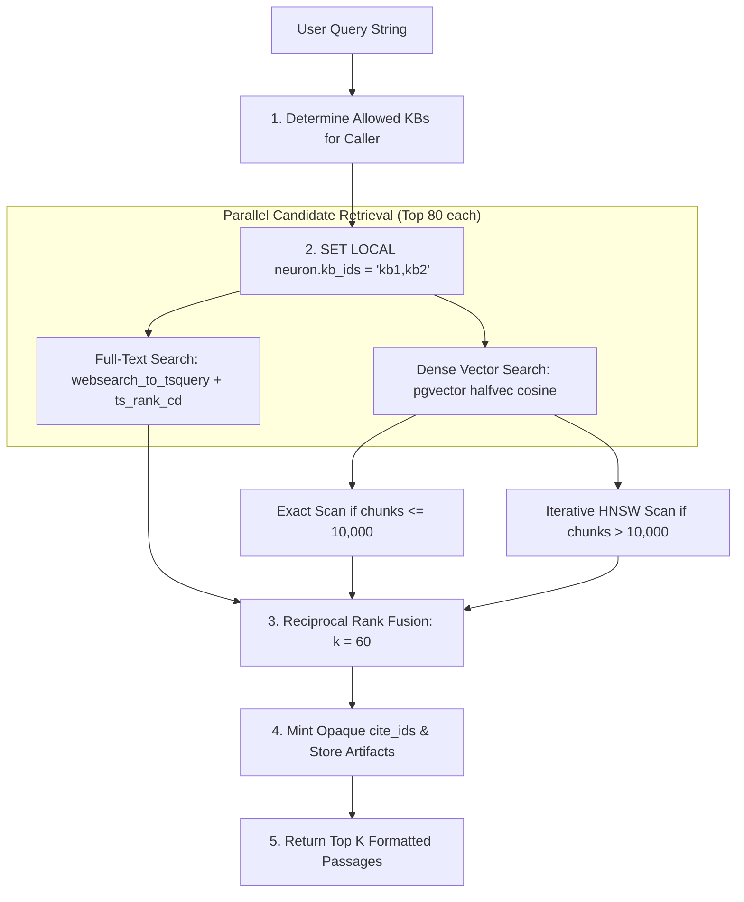

# Explanation: Knowledge Engine Architecture and Retrieval Mechanics

> **Document ID:** DOC-EXP-003  
> **Diátaxis Mode:** Explanation (Understanding-Oriented)  
> **Standard Alignment:** Structured in alignment with ISO/IEC/IEEE 26514:2022 §7.2 (Conceptual / Architectural Information) and Diátaxis (Explanation)  
> **Audience:** AI Engineers, Search Engineers, Database Architects  
> **Code Traceability:** `src/neuron_agent/knowledge/`, ADR 0014, `docs/product/RAG_IMPLEMENTATION_TRACKER.md`

---

## 1. Architectural Objectives

The Neuron Knowledge Engine (v1.1.0) was engineered to address the critical vulnerabilities and performance bottlenecks common in naive retrieval-augmented generation (RAG) architectures:
1. **Multi-Tenant Security First:** Queries enforce authorization in SQL before vector similarity ranking occurs. Chunks and embeddings are partitioned by PostgreSQL Row-Level Security.
2. **Deterministic Citations:** Answers cannot hallucinate citations; every citation is verified by server-side cryptographic matching against the run's tool execution artifacts.
3. **Hybrid Search Fusion:** Full-text lexical search (`tsvector`) and dense vector similarity (`halfvec` cosine) are fused using Reciprocal Rank Fusion (RRF), ensuring optimal recall across exact keyword searches (part numbers, acronyms) and conceptual semantic queries.
4. **Decoupled Asynchronous Processing:** File parsing, chunking, and vector embedding are offloaded to an asynchronous background worker (`neuron-worker`), ensuring API responsiveness.

---

## 2. Document Ingestion Lifecycle

```mermaid
flowchart TD
    Upload[1. HTTP Upload POST /v1/knowledge/bases/id/documents] --> ContentCheck[2. Content Sniffing: Magic bytes, encrypted check, caps]
    ContentCheck --> StoreBlob[3. Stream to Blob Store: obstore 128-bit hex key]
    StoreBlob --> DBCommit[4. Atomic DB Commit: knowledge.documents + procrastinate_jobs]
    DBCommit --> HTTP202[5. Return 202 Accepted {doc_id, queued}]
    
    subgraph BackgroundWorker ["Asynchronous Ingestion (neuron-worker)"]
        HTTP202 -.-> ClaimJob[6. Worker Claims Job]
        ClaimJob --> Parse[7. Parsing: docling-serve or PlainTextParser]
        Parse --> Chunk[8. Chunking: Hierarchical heading path & token bounds]
        Chunk --> Embed[9. Embedding: Batch call to NVIDIA / OpenAI]
        Embed --> IndexCommit[10. Atomic DB Commit: Chunks + halfvec Embeddings + ready]
    end
```

### 2.1 File Content Validation (`knowledge/parsing.py`)
Neuron rejects the dangerous practice of trusting client-supplied file extensions or MIME headers.
- **Magic Byte Inspection:** The file content is read directly to determine its real binary format:
  - `%PDF-` signature identifies PDF files.
  - PKZip signature identifies Office OpenXML files (`.docx`, `.xlsx`, `.pptx`).
  - UTF-8 validation identifies plain text and Markdown.
- **Immediate Rejection:** Encrypted PDFs (`encrypted_pdf`), macro-enabled Office files (`macro_refused`), and generic ZIP archives (`archive_refused`) are rejected before any disk write occurs.

---

### 2.2 Hierarchical Document Chunking (`knowledge/chunking.py`)
Rather than dividing text by arbitrary character windows, Neuron employs structural chunking:
1. **Heading Paths:** Each chunk tracks its full document hierarchy (e.g. `["Architecture", "Storage", "PostgreSQL Pool"]`).
2. **Token Bounding:** Text under a heading is grouped up to `APP_KNOWLEDGE_CHUNK_MAX_TOKENS` (default 400 tokens, estimated as UTF-8 bytes / 3).
3. **Splitting Fallbacks:** Large paragraphs are split cleanly along paragraph lines, then sentence spaces, and lastly character boundaries.
4. **Page Provenance:** Every chunk records its `page_start` and `page_end` for accurate citation display in user interfaces.

---

## 3. Hybrid Search and Retrieval Mechanics

Retrieval is executed in `src/neuron_agent/knowledge/retrieval.py`:



---

### 3.1 Planner-Independent Dense Scan Selection
Neuron avoids PostgreSQL query planner misestimates on vector indexes (where planners often default to costly sequential scans on large datasets):

1. **Threshold Counting:** The query checks total active embeddings in the readable bases:
   ```sql
   SELECT count(*) FROM (SELECT 1 FROM knowledge.embeddings WHERE profile_id = $1 AND kb_id = ANY($2) LIMIT 10001) s;
   ```
2. **Small Dataset ($\le 10,000$ chunks):** Uses an **exact scan** (`APP_KNOWLEDGE_EXACT_SCAN_MAX_CHUNKS`). Guarantees 100% recall without vector index overhead.
3. **Large Dataset ($> 10,000$ chunks):** Activates the **HNSW index** with iterative scanning:
   ```sql
   SET LOCAL hnsw.iterative_scan = 'relaxed_order';
   SET LOCAL hnsw.ef_search = 100;
   ```
   Bitmap scans and generic sequential scans are priced out in the transaction session, forcing index usage.

---

### 3.2 Reciprocal Rank Fusion (RRF)
To merge lexical and semantic results without arbitrary score normalization, Neuron applies Reciprocal Rank Fusion ($k=60$):

$$\text{RRF\_Score}(d) = \sum_{m \in \{\text{fts}, \text{dense}\}} \frac{1}{60 + \text{rank}_m(d)}$$

Passages that appear in both candidate sets receive significant score boosts, providing state-of-the-art retrieval accuracy across mixed technical queries.

---

## 4. Cryptographic Citation Verification

To eliminate AI hallucinations where an LLM cites documents it never consulted, Neuron implements a cryptographic citation pipeline:

1. **Artifact Concealment:** When `search_knowledge` or `get_document_excerpt` runs, it generates an ephemeral, random `cite_id` (e.g. `c1a2b3`) for each retrieved passage.
2. **State Artifact Isolation:** The mapping between `cite_id` and the actual `(doc_id, chunk_id)` is stored inside the LangChain `ToolMessage.artifact` dictionary.
3. **Model Invisibility:** The model receives only the `cite_id` in its text prompt; it never sees database UUIDs or internal table keys.
4. **Final Turn Verification (`knowledge/citations.py`):** When the model generates its structured `AgentAnswer`, the server iterates over the claimed `citations`.
   - Any `cite_id` matching an artifact minted during that specific run is preserved.
   - Any hallucinated or invented `cite_id` is stripped, incrementing the `rejected_citations` metric.
   - The verified citations are stamped permanently onto the stored answer.
