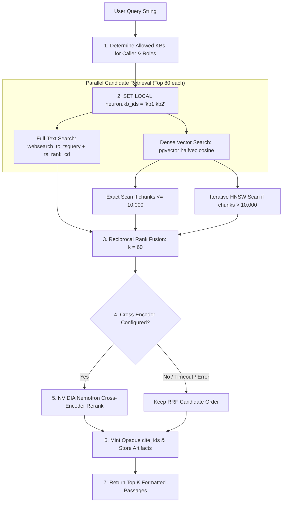
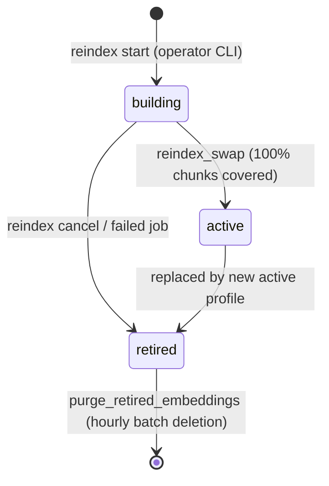

# Explanation: Knowledge Engine Architecture and Retrieval Mechanics

> **Document ID:** DOC-EXP-003  
> **Diátaxis Mode:** Explanation (Understanding-Oriented)  
> **Standard Alignment:** Structured in alignment with ISO/IEC/IEEE 26514:2022 §7.2 (Conceptual / Architectural Information) and Diátaxis (Explanation)  
> **Audience:** AI Engineers, Search Engineers, Database Architects  
> **Code Traceability:** `src/neuron_agent/knowledge/`, ADR 0014, `docs/product/RAG_IMPLEMENTATION_TRACKER.md`

---

## 1. Architectural Objectives

The Neuron Knowledge Engine (v1.2.0) was engineered to address critical security vulnerabilities and retrieval quality limits common in naive retrieval-augmented generation (RAG) architectures:
1. **Multi-Tenant Security First:** Queries enforce authorization in SQL before vector similarity ranking occurs. Chunks and embeddings are partitioned by PostgreSQL Row-Level Security.
2. **Deterministic Citations:** Answers cannot hallucinate citations; every citation is verified by server-side cryptographic matching against the run's tool execution artifacts.
3. **Hybrid Search Fusion with Reranking:** Full-text lexical search (`tsvector` with per-base dictionary stemming) and dense vector similarity (`halfvec` cosine) are fused using Reciprocal Rank Fusion (RRF), followed by optional cross-encoder candidate reranking.
4. **Zero-Downtime Reindexing:** Embedding models can be upgraded across the cluster without interrupting active queries using a dual-embedding transition pipeline and atomic profile swap.
5. **Decoupled Asynchronous Processing:** File parsing, chunking, and vector embedding are offloaded to an asynchronous background worker (`neuron-worker`), ensuring API responsiveness.

---

## 2. Document Ingestion Lifecycle

```mermaid
flowchart TD
    Upload[1. HTTP Upload POST /v1/knowledge/bases/id/documents] --> ContentCheck[2. Content Sniffing: Magic bytes, encrypted check, caps]
    ContentCheck --> StoreBlob[3. Stream to Blob Store: obstore 128-bit hex key]
    StoreBlob --> DBCommit[4. Atomic DB Commit: knowledge.documents + procrastinate_jobs]
    DBCommit --> HTTP202[5. Return 202 Accepted {doc_id, queued}]
    
    subgraph BackgroundWorker ["Asynchronous Ingestion (neuron-worker)"]
        HTTP202 -.-> ClaimJob[6. Worker Claims Job]
        ClaimJob --> Parse[7. Parsing: docling-serve or PlainTextParser]
        Parse --> Chunk[8. Chunking: Hierarchical heading path & token bounds]
        Chunk --> Embed[9. Embedding: Active Model + Building Model if Reindexing]
        Embed --> IndexCommit[10. Atomic DB Commit: Chunks + halfvec Embeddings + ready]
    end
```

### 2.1 File Content Validation (`knowledge/parsing.py`)
Neuron rejects the dangerous practice of trusting client-supplied file extensions or MIME headers.
- **Magic Byte Inspection:** The file content is read directly to determine its real binary format:
  - `%PDF-` signature identifies PDF files.
  - PKZip signature identifies Office OpenXML files (`.docx`, `.xlsx`, `.pptx`).
  - UTF-8 validation identifies plain text and Markdown.
- **Immediate Rejection:** Encrypted PDFs (`encrypted_pdf`), macro-enabled Office files (`macro_refused`), and generic ZIP archives (`archive_refused`) are rejected before any disk write occurs.

---

### 2.2 Hierarchical Document Chunking (`knowledge/chunking.py`)
Rather than dividing text by arbitrary character windows, Neuron employs structural chunking:
1. **Heading Paths:** Each chunk tracks its full document hierarchy (e.g. `["Architecture", "Storage", "PostgreSQL Pool"]`).
2. **Token Bounding:** Text under a heading is grouped up to `APP_KNOWLEDGE_CHUNK_MAX_TOKENS` (default 400 tokens, estimated as UTF-8 bytes / 3).
3. **Splitting Fallbacks:** Large paragraphs are split cleanly along paragraph lines, then sentence spaces, and lastly character boundaries.
4. **Page Provenance:** Every chunk records its `page_start` and `page_end` for accurate citation display in user interfaces.

---

## 3. Hybrid Search and Retrieval Mechanics

Retrieval is executed in `src/neuron_agent/knowledge/retrieval.py`:



---

### 3.1 Planner-Independent Dense Scan Selection
Neuron avoids PostgreSQL query planner misestimates on vector indexes (where planners often default to costly sequential scans on large datasets):

1. **Threshold Counting:** The query checks total active embeddings in the readable bases:
   ```sql
   SELECT count(*) FROM (SELECT 1 FROM knowledge.embeddings WHERE profile_id = $1 AND kb_id = ANY($2) LIMIT 10001) s;
   ```
2. **Small Dataset ($\le 10,000$ chunks):** Uses an **exact scan** (`APP_KNOWLEDGE_EXACT_SCAN_MAX_CHUNKS`). Guarantees 100% recall without vector index overhead.
3. **Large Dataset ($> 10,000$ chunks):** Activates the **HNSW index** with iterative scanning:
   ```sql
   SET LOCAL hnsw.iterative_scan = 'relaxed_order';
   SET LOCAL hnsw.ef_search = 100;
   ```
   Bitmap scans and generic sequential scans are priced out in the transaction session, forcing index usage.

---

### 3.2 Reciprocal Rank Fusion (RRF)
To merge lexical and semantic results without arbitrary score normalization, Neuron applies Reciprocal Rank Fusion ($k=60$):

$$\text{RRF\_Score}(d) = \sum_{m \in \{\text{fts}, \text{dense}\}} \frac{1}{60 + \text{rank}_m(d)}$$

Passages appearing in both candidate sets receive significant score boosts, providing robust baseline retrieval across mixed technical queries.

---

### 3.3 Cross-Encoder Candidate Reranking (RAG-09.01)
While bi-encoders generate separate embeddings for queries and passages, cross-encoders perform full cross-attention over query-passage pairs:
1. **Candidate Pool:** The top 40 fused candidates from RRF are sent to the hosted reranker (`nvidia/llama-nemotron-rerank-vl-1b-v2`).
2. **Scoring & Verification:** The API scores candidates jointly and returns logit rankings. Neuron verifies that every candidate is scored exactly once with finite values (`_checked`).
3. **Evaluation Performance:** On the benchmark corpus (`docs/releases/v1.2.0-rerank-eval.md`), cross-encoder reranking:
   - Raised Mean Reciprocal Rank (MRR) from 0.833 to 0.924.
   - Raised recall@1 from 0.734 to 0.875.
   - Maintained recall@5 at 0.984.
   - Added approximately 0.5–0.7 seconds at p95 latency.
4. **Fail-Safe Fallback:** If the reranker times out (`APP_KNOWLEDGE_RERANKER_TIMEOUT_SECONDS`, default 3.0s) or encounters provider errors, the retriever transparently falls back to RRF ordering, logging the failure and setting `reranked: false`.

---

## 4. Cryptographic Citation Verification

To eliminate AI hallucinations where an LLM cites documents it never consulted, Neuron implements a cryptographic citation pipeline:

1. **Artifact Concealment:** When `search_knowledge` or `get_document_excerpt` runs, it generates an ephemeral, random `cite_id` (e.g. `c1a2b3`) for each retrieved passage.
2. **State Artifact Isolation:** The mapping between `cite_id` and the actual `(doc_id, chunk_id)` is stored inside the LangChain `ToolMessage.artifact` dictionary.
3. **Model Invisibility:** The model receives only the `cite_id` in its text prompt; it never sees database UUIDs or internal table keys.
4. **Final Turn Verification (`knowledge/citations.py`):** When the model generates its structured `AgentAnswer`, the server iterates over the claimed `citations`.
   - Any `cite_id` matching an artifact minted during that specific run is preserved.
   - Any hallucinated or invented `cite_id` is stripped, incrementing the `rejected_citations` metric.
   - The verified citations are stamped permanently onto the stored answer.

---

## 5. Multi-Profile Zero-Downtime Reindexing (RAG-09.04)

Upgrading embedding models across production databases cannot incur downtime or compromise search availability. Neuron achieves zero-downtime re-indexing via database index profiles:



1. **Index Profile Schema (`knowledge.index_profiles`):**
   - Each embedding model configuration corresponds to a profile row.
   - Database unique partial indexes (Migrations 28 & 29) guarantee at most one `active` and at most one `building` profile at any time.
2. **Dual-Embedding Ingestion:**
   - While a profile is in the `building` state, every newly uploaded document is embedded twice: once for the `active` profile and once for the `building` profile.
   - Ingestion write transactions lock profiles (`FOR SHARE`) to prevent race conditions during swaps.
3. **Background Backfill (`reindex_kb`):**
   - The worker iterates through existing ready chunks, embedding uncovered passages with the target model, document by document.
   - Tokens spent are charged to `knowledge.documents.embedding_tokens`.
4. **Atomic Profile Swap (`reindex_swap`):**
   - Under a `FOR UPDATE` lock on the building profile and a table-level share lock on `knowledge.bases`, the worker confirms that 100% of live chunks are covered.
   - If any chunk is missing, the swap aborts and re-queues incomplete bases.
   - When 100% coverage is verified, the transaction promotes `building` to `active`, retires the previous profile, and updates all bases' `profile_id` simultaneously.
5. **Garbage Collection:**
   - Retired profile embeddings are pruned in background batches (5,000 rows hourly via `purge_retired_embeddings`).
   - The obsolete HNSW index is dropped concurrently during the next `setup` run.

---

## 6. Multilingual Full-Text Search (RAG-09.08)

To support global deployments, knowledge bases can specify a dedicated full-text search dictionary at creation:
- **Language Configurations:** Maps to PostgreSQL's 29 built-in text search dictionaries (`simple`, `english`, `german`, `french`, `spanish`, `hindi`, etc.).
- **Stemming Benefits:** The base's language determines how chunks' `tsv` columns are generated and stemmed. For example, selecting `german` stems "Häuser" into "haus", matching user queries for "Haus".
- **Evaluation Findings:** Evaluation across 30 questions in 5 languages demonstrated that language-specific configurations improved text-channel recall@5 from 0.00 (with naive case-folding `simple`) to 0.33–1.00 (`docs/releases/v1.2.0-gate/multilingual-fts.json`).

---

## 7. Role-Based Access Control in Retrieval (RAG-09.03)

Neuron enforces multi-tenant knowledge sharing through dynamic SQL authorization (`AllowedKbs`):

1. **Single-Transaction Evaluation:**
   Before any retrieval query executes, the service queries `knowledge.grants` in the active database transaction:
   ```sql
   SELECT g.kb_id, g.access, g.subject_type FROM knowledge.grants g
   JOIN knowledge.bases b USING (kb_id) WHERE b.deleted_at IS NULL AND (
     (g.subject_type = 'owner' AND g.subject = %(owner)s AND b.owner_key = %(owner)s)
     OR (g.subject_type = 'role' AND g.subject = ANY(%(roles)s::text[]))
   )
   ```
2. **Immediate Revocation:** Because `AllowedKbs` is evaluated dynamically inside the statement transaction and is never cached, revoking a role grant in `knowledge.grants` takes effect immediately on the very next HTTP request.
3. **Strict Owner Invariants:** Role grants (`read`, `write`, `admin`) can never authorize deleting the knowledge base, exporting user data, or triggering bulk account erasure. Those operations strictly require `subject_type = 'owner'`.
