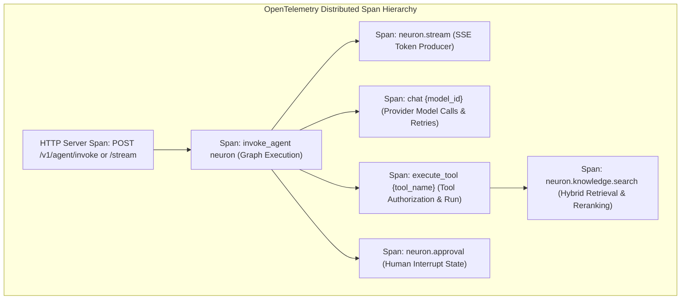

# Explanation: Observability Architecture, Telemetry, and Governance

> **Document ID:** DOC-EXP-004  
> **Diátaxis Mode:** Explanation (Understanding-Oriented)  
> **Standard Alignment:** Structured in alignment with ISO/IEC/IEEE 26514:2022 §7.2 (Conceptual / Observability Information) and Diátaxis (Explanation)  
> **Audience:** SREs, Security Engineers, Platform Architects  
> **Code Traceability:** `src/neuron_agent/observability/`, ADR 0007, ADR 0008, ADR 0014

---

## 1. Observability Principles and Privacy Guarantees

In enterprise agent deployments, observability must provide deep execution transparency without compromising user privacy or violating regulatory data protections (GDPR, HIPAA, SOC 2).

Neuron Agent enforces three foundational observability rules:
1. **Zero Prompt/Completion Leakage:** Application logs, metric labels, span attributes, and exception tracebacks strictly exclude raw user prompts, model completions, and tool input arguments.
2. **Contextual Correlation Across Tasks:** Every log entry, OpenTelemetry span, and audit event carries three correlated identifiers: `request_id` (HTTP call), `thread_id` (conversation), and `run_id` (agent invocation).
3. **Dedicated Security Audit Channel:** Security and access events are routed to a dedicated, machine-readable audit logger (`neuron_agent.audit`), isolated from application runtime logs.

---

## 2. Distributed Tracing and OpenTelemetry Hierarchy

Neuron implements OpenTelemetry tracing across all execution layers (`src/neuron_agent/observability/telemetry.py`):



### 2.1 Span Attribute Policy
Spans record execution telemetry using strictly bounded attributes defined in `src/neuron_agent/observability/semconv.py`:
- `gen_ai.system`: Provider identifier (`openai`, `nvidia`, `anthropic`).
- `gen_ai.request.model`: Configured model identifier.
- `gen_ai.usage.input_tokens`: Consumed prompt tokens.
- `gen_ai.usage.output_tokens`: Generated answer tokens.
- `neuron.knowledge.reranked`: Boolean attribute indicating whether search hits were reordered by cross-encoder reranker.
- `app.error_code`: Machine-readable error code if a failure occurred.

> [!IMPORTANT]
> `telemetry.start_span` is explicitly configured to never record raw exception messages or stack traces containing sensitive user data.

---

## 3. Structured Logging Architecture (`structlog`)

Neuron uses `structlog` to emit JSON-formatted log lines to standard output (`stdout`).

### 3.1 Automatic Contextvars Binding
When an HTTP request enters `AgentService.invoke` or `AgentService.stream`, the service generates a unique `run_id` and binds the contextvars:

```python
bind_correlation_context(request_id=req_id, thread_id=thread_id, run_id=run_id)
```

Because contextvars propagate across asynchronous coroutines, any log statement emitted during the turn (e.g. tool timeouts, model retries, database queries) automatically inherits the correlation context.

### 3.2 Sample Log Record
```json
{
  "event": "agent_request_completed",
  "service": "neuron-agent",
  "version": "1.2.0",
  "environment": "production",
  "request_id": "req-019318b2-5f6e-7b3c-8a12-abcdef123456",
  "thread_id": "019318b2-5f6e-7b3c-8a12-abcdef123456",
  "run_id": "run-a1b2c3d4-e5f6-7a8b-9c0d-1e2f3a4b5c6d",
  "model": "openai:gpt-5.4-mini",
  "duration_ms": 1420.5,
  "level": "info",
  "timestamp": "2026-11-13T10:00:00.123456Z"
}
```

---

## 4. Dedicated Security Audit Log (`neuron_agent.audit`)

Security-sensitive events bypass general application logs and are routed directly to `neuron_agent.audit`. Platform operators can stream this logger independently into a Security Information and Event Management (SIEM) system (e.g., Splunk, Elastic, AWS CloudWatch).

### 4.1 Fixed Audit Event Schema
Audit records conform to a rigid, typed JSON schema:

| Field | Type | Description |
| :--- | :--- | :--- |
| `audit` | `boolean` | Always `true` (enables easy SIEM ingestion filtering). |
| `event` | `string` | Event name (`authorization_denied`, `approval_decided`, `output_blocked`, `user_data_exported`, `user_data_erased`, `knowledge_grant_changed`, `knowledge_reindex_started`, `knowledge_reindex_swapped`, `knowledge_reindex_failed`, `auth_roles_dropped`). |
| `outcome` | `string` | Result (`allowed`, `denied`, `approved`, `rejected`, `erased`, `error`). |
| `actor` | `string` | First 12 hexadecimal characters of the caller's HMAC owner key. Raw subject is never logged. |
| `issuer_id` | `string` | Configured `APP_AUTH_ISSUER_ID` alias (e.g., `production-idp`). Full URL is omitted. |
| `action` | `string` | Scoped permission attempted (e.g., `threads:read`, `data:erase`, `knowledge:admin`, `knowledge:reindex`). |
| `resource_type` | `string` | Target resource (`thread`, `memory`, `knowledge_base`, `document`, `knowledge_index_profile`). |
| `resource_id` | `string` \| `null`| Identifier of the affected resource. |
| `role` | `string` \| `null`| Role name when modifying grants (`knowledge_grant_changed`). |
| `access` | `string` \| `null`| Access level assigned (`read`, `write`, `admin`, `none`). |
| `request_id` | `string` | Associated HTTP request ID. |
| `run_id` | `string` \| `null`| Associated agent run ID. |
| `reason` | `string` \| `null`| Machine-readable reason code (e.g., `insufficient_scope`, `cancelled`, `roles_exceeded_limit`). |
| `count` | `integer` \| `null`| Numeric metric (e.g., count of bases migrated during swap). |
| `timestamp` | `string` | UTC ISO-8601 timestamp. |

### 4.2 Example Audit Record: Knowledge Base Grant Change
```json
{
  "audit": true,
  "event": "knowledge_grant_changed",
  "outcome": "allowed",
  "actor": "4a3f8c12b90e",
  "issuer_id": "production-idp",
  "action": "knowledge:admin",
  "resource_type": "knowledge_base",
  "resource_id": "8f3b2e1a-4c5d-6e7f-8a9b-0c1d2e3f4a5b",
  "role": "engineering",
  "access": "write",
  "request_id": "req-987",
  "run_id": null,
  "reason": null,
  "count": null,
  "timestamp": "2026-11-13T10:15:00.000000Z"
}
```

### 4.3 Example Audit Record: Profile Re-Index Swap
```json
{
  "audit": true,
  "event": "knowledge_reindex_swapped",
  "outcome": "allowed",
  "actor": "system",
  "issuer_id": "system",
  "action": "knowledge:reindex",
  "resource_type": "knowledge_index_profile",
  "resource_id": "2",
  "role": null,
  "access": null,
  "request_id": "internal-reindex-swap",
  "run_id": null,
  "reason": null,
  "count": 14,
  "timestamp": "2026-11-13T11:00:00.000000Z"
}
```

---

## 5. LangSmith Privacy Governance

When `APP_ENABLE_LANGSMITH=true`, Neuron exports full agent execution traces to LangSmith for developer debugging and performance analysis.

### The Problem
Sending production prompts and user conversations to third-party SaaS platforms introduces severe privacy and compliance risks.

### Neuron's Governance Solution (`src/neuron_agent/observability/langsmith_governance.py`)
1. **Default Redaction:** In staging and production, prompt and answer texts are **completely stripped** from LangSmith spans by default. Spans record execution graph nodes, durations, tool names, and error codes only.
2. **Explicit Content Approval:** Prompts and completions are exported to LangSmith only when `APP_LANGSMITH_CONTENT_APPROVED=true`.
3. **Mandatory Audit Record:** In production, setting `APP_LANGSMITH_CONTENT_APPROVED=true` requires an accompanying `APP_LANGSMITH_CONTENT_APPROVAL_RECORD` (naming the security ticket, ADR, or legal sign-off). The server refuses to start without this traceability record.
