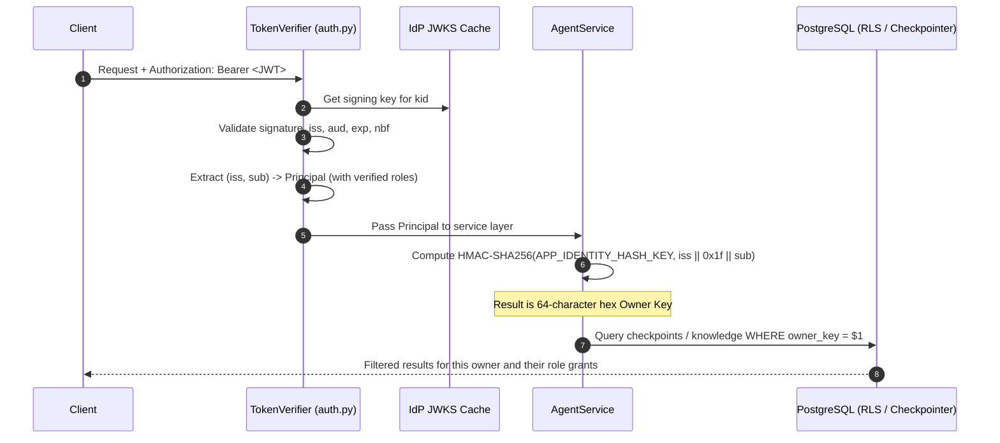

# How-To: Configure Authentication and Role-Based Authorization

> **Document ID:** DOC-HOW-001  
> **Diátaxis Mode:** How-To Guide (Task-Oriented)  
> **Standard Alignment:** Structured in alignment with ISO/IEC/IEEE 26514:2022 §7.4 (Procedural Task Information) and Diátaxis (How-To Guide)  
> **Audience:** Developers, DevOps, SREs, Security Administrators  
> **Code Traceability:** `src/neuron_agent/security/auth.py`, `src/neuron_agent/security/authorization.py`, ADR 0006

---

## 1. Overview and Security Principles

Neuron Agent uses JSON Web Tokens (JWT) for authentication in staging and production environments (`APP_AUTH_MODE=jwt`). The system enforces:
1. **Cryptographic Verification:** Every incoming token is verified against public JSON Web Key Sets (JWKS) published by the OIDC Identity Provider (e.g., Keycloak, Auth0, Okta).
2. **Pseudonymous Identity Isolation:** User identities are hashed into 64-character hexadecimal HMAC keys using `APP_IDENTITY_HASH_KEY`. Raw user IDs, emails, and names are never stored in database foreign keys or logs.
3. **Fine-Grained Scopes:** Capabilities are gated by explicit permissions declared in the JWT `scope` claim or mapped from token roles via `APP_AUTH_ROLE_PERMISSIONS`.
4. **Verified Token Roles:** Roles extracted from `APP_AUTH_ROLES_CLAIM` are kept in the verified `Principal` object, enabling multi-tenant resource sharing (such as knowledge bases) across authorized role groups.

---

## 2. Permission Scope Catalogue

The following permissions can be granted directly via the token's `scope` claim (space-delimited string) or mapped from roles:

| Scope Name | Allowed Operations & Endpoints |
| :--- | :--- |
| `agent:invoke` | `POST /v1/agent/invoke`, `POST /v1/agent/stream` |
| `agent:approve` | `GET /v1/threads/{id}/approval`, `POST /v1/threads/{id}/approvals/{approval_id}`, `POST /v1/threads/{id}/approvals/{approval_id}/stream` |
| `threads:read` | `GET /v1/threads/{id}/messages`, `GET /v1/me/threads`, `GET /v1/me/export` |
| `threads:write` | `PATCH /v1/threads/{id}` (rename conversation title) |
| `feedback:write` | `POST /v1/threads/{id}/runs/{run_id}/feedback` (rate an answer) |
| `threads:delete` | `DELETE /v1/threads/{id}` (delete single conversation thread) |
| `data:erase` | `DELETE /v1/me/threads` (GDPR bulk erase all threads, memories, knowledge), `DELETE /v1/me/knowledge` (erase all knowledge) |
| `memories:read` | `GET /v1/me/memories` (list user notes) |
| `memories:write` | `DELETE /v1/me/memories/{id}`, `DELETE /v1/me/memories` (delete user notes) |
| `tools:calculator` | Permits agent execution of the built-in `calculator` tool |
| `tools:remember` | Permits agent execution of the memory note creation tool |
| `tools:recall` | Permits agent execution of the memory note recall tool |
| `tools:forget` | Permits agent execution of the memory note deletion tool |
| `knowledge:read` | `GET /v1/knowledge/bases`, `GET /v1/knowledge/bases/{kb_id}/documents`, `GET /v1/knowledge/documents/{doc_id}`, `GET /v1/knowledge/documents/{doc_id}/chunks/{chunk_id}`, `GET /v1/knowledge/documents/{doc_id}/file`, `POST /v1/knowledge/search` |
| `knowledge:write` | `POST /v1/knowledge/bases`, `PATCH /v1/knowledge/bases/{kb_id}`, `DELETE /v1/knowledge/bases/{kb_id}`, `POST /v1/knowledge/bases/{kb_id}/documents`, `DELETE /v1/knowledge/documents/{doc_id}` |
| `knowledge:admin` | `GET` and `PUT /v1/knowledge/bases/{kb_id}/grants`: share a base with a token role, for its owner or an `admin` role (RAG-09.03) |
| `tools:list_knowledge_bases` | Permits agent execution of the `list_knowledge_bases` tool |
| `tools:search_knowledge` | Permits agent execution of the `search_knowledge` tool |
| `tools:get_document_excerpt` | Permits agent execution of the `get_document_excerpt` tool |
| `tools:mcp.<server>.<tool>` | Permits agent execution of a specific pinned MCP tool |

---

## 3. Production Configuration Recipe

Configure the following environment variables in `.env` or your secret manager:

```bash
# Enable JWT verification
APP_AUTH_MODE=jwt

# Expected token issuer (must match JWT 'iss' claim exactly)
APP_AUTH_ISSUER=https://id.example.com/realms/neuron

# Short identifier used in audit log records (never reveals full IdP URL)
APP_AUTH_ISSUER_ID=production-idp

# Expected token audience (must match JWT 'aud' claim)
APP_AUTH_AUDIENCE=neuron-agent

# HTTPS JWKS endpoint for public key retrieval
APP_AUTH_JWKS_URL=https://id.example.com/realms/neuron/protocol/openid-connect/certs

# Allowed cryptographic signature algorithms
APP_AUTH_ALGORITHMS='["RS256", "ES256"]'

# Secret HMAC key for deriving owner identifiers (at least 32 random bytes)
# Generate with: openssl rand -hex 32
APP_IDENTITY_HASH_KEY=<your-secret-32-byte-hex-key>

# Mandatory in production (APP_ENV=production enforces APP_AUTH_REQUIRE_TYP=true)
APP_AUTH_REQUIRE_TYP=true

# Claim names
APP_AUTH_SCOPE_CLAIM=scope
APP_AUTH_ROLES_CLAIM=roles

# Role to permission mapping (JSON dictionary)
APP_AUTH_ROLE_PERMISSIONS='{
  "admin": [
    "agent:invoke", "agent:approve", "threads:read", "threads:write",
    "feedback:write", "threads:delete", "data:erase", "memories:read",
    "memories:write", "tools:calculator", "knowledge:read", "knowledge:write",
    "knowledge:admin", "tools:list_knowledge_bases", "tools:search_knowledge", "tools:get_document_excerpt"
  ],
  "user": [
    "agent:invoke", "agent:approve", "threads:read", "threads:write",
    "feedback:write", "threads:delete", "memories:read", "memories:write",
    "tools:calculator", "knowledge:read", "knowledge:write", "knowledge:admin",
    "tools:list_knowledge_bases", "tools:search_knowledge", "tools:get_document_excerpt"
  ],
  "viewer": [
    "threads:read", "knowledge:read"
  ]
}'
```

---

## 4. Verified Token Roles and Resource Sharing (RAG-09.02)

Neuron allows users to share resources (such as Knowledge Bases) with colleagues belonging to specific organizational roles:

1. **Role Extraction:** When `APP_AUTH_ROLES_CLAIM` is set (default `"roles"`), the token verifier extracts the role list from the verified JWT.
2. **Safety Bounding:**
   - Maximum 100 roles per token.
   - Maximum 256 characters per role string.
   - If a token exceeds either bound, all roles are dropped for safety and an `auth_roles_dropped` audit event is emitted.
3. **No Ambient Privileges:** Roles by themselves grant **zero** API privileges. All API endpoints require verified OAuth `scopes`. Token roles are used exclusively for evaluating resource-level access grants (e.g. `knowledge.grants`).
4. **Zero-Leak Logging:** Verified roles are held in memory on the `Principal` object during request execution and are never recorded in application logs.

---

## 5. Local Development Token Workflow

When developing locally with `APP_ENV=development`, you can simulate full JWT authentication without provisioning Keycloak:

### Step 1: Generate Local Signing Key
Run `make dev-auth` to generate an RSA private key in `.dev/` and append dev JWT settings to `.env`:
```bash
make dev-auth >> .env
```

### Step 2: Serve the Local JWKS Server
In a dedicated terminal, start the lightweight JWKS server on `127.0.0.1:8765`:
```bash
make dev-jwks
```

### Step 3: Start the API in JWT Mode
In a second terminal:
```bash
make api
```

### Step 4: Mint a Development Token
In a third terminal, generate a signed 1-hour JWT token with full scopes:
```bash
TOKEN=$(make -s dev-token)
echo "Minted token: $TOKEN"
```

To mint a token for a custom user with specific scopes and roles:
```bash
TOKEN=$(uv run python scripts/dev_token.py --sub alice --scope "agent:invoke threads:read knowledge:read knowledge:admin" --role engineering)
```

### Step 5: Test Authenticated Call
```bash
curl -X POST http://127.0.0.1:8000/v1/agent/invoke \
  -H "Authorization: Bearer $TOKEN" \
  -H "Content-Type: application/json" \
  -d '{"message": "What is 10 + 20?"}'
```

---

## 6. Connecting Keycloak

When deploying with Docker Compose or standalone Keycloak:

1. **Realm:** Create a realm named `neuron`.
2. **Client Configuration:**
   - Client ID: `neuron-web` (Public client with PKCE for React UI) or `neuron-api` (Bearer-only resource server).
   - Valid Redirect URIs: `http://localhost:5173/*` (Web frontend).
   - Web Origins: `http://localhost:5173`.
3. **Audience Mapper:** Add an `Audience` protocol mapper to the client so issued tokens include `neuron-agent` in the `aud` claim.
4. **Roles / Scopes:** Configure realm roles (e.g., `user`, `admin`, `viewer`) or assign client scopes matching Neuron's scope catalogue.

---

## 7. How Identity Isolation Works

The following flowchart illustrates the cryptographic transformation from JWT token to database isolation:



---

## 8. Rotating `APP_IDENTITY_HASH_KEY`

> [!WARNING]
> Because thread ownership and knowledge permissions in PostgreSQL are keyed directly by the HMAC-SHA256 owner key, changing `APP_IDENTITY_HASH_KEY` immediately orphans existing threads, memories, and knowledge bases for all users.

To perform a key rotation:
1. Plan a migration window. Rotating the identity key replaces the stored check value in PostgreSQL (`neuron_identity_hash_check`).
2. Run database setup with the rotation flag using the migration DSN:
   ```bash
   uv run python -m neuron_agent.persistence.cli setup --rotate-identity-key
   ```
3. If thread history is not required long-term, allow threads to expire naturally via `APP_THREAD_RETENTION_DAYS` (default 30 days) before deploying the new key.
4. If durable re-keying is required, execute an offline migration script to re-compute `owner_key` on `checkpoints`, `neuron_thread_meta`, `neuron_feedback`, `knowledge.bases`, and `knowledge.documents` before restarting the API.
