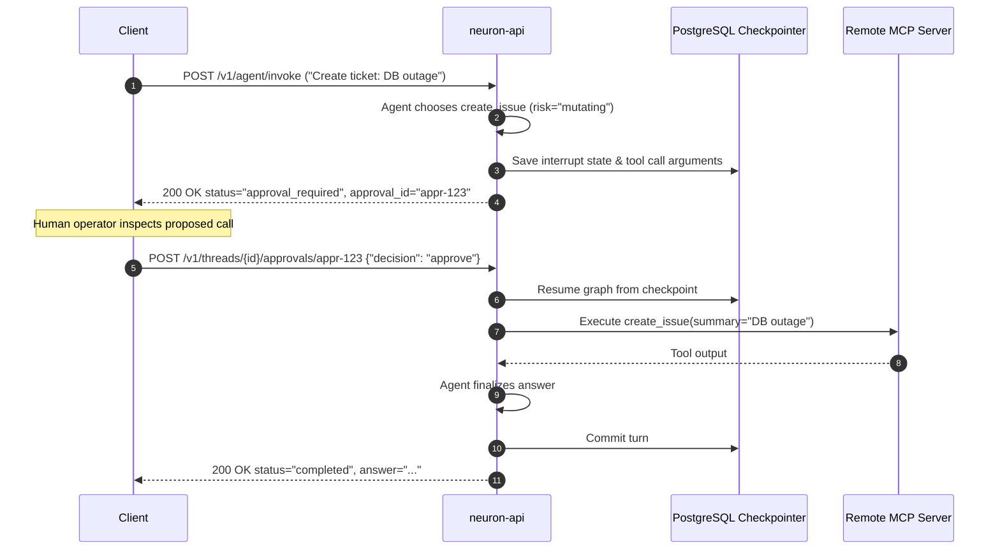

# How-To: Integrate MCP Tools and Handle Human Approvals

> **Document ID:** DOC-HOW-004  
> **Diátaxis Mode:** How-To Guide (Task-Oriented)  
> **Standard Alignment:** Structured in alignment with ISO/IEC/IEEE 26514:2022 §7.4 (Procedural Task Information) and Diátaxis (How-To Guide)  
> **Audience:** Developers, Tool Authors, Security Engineers  
> **Code Traceability:** `src/neuron_agent/tools/mcp/`, `src/neuron_agent/tools/registry.py`, ADR 0009

---

## 1. Overview and Security Model

Neuron supports external tools using the open **Model Context Protocol (MCP)** over Streamable HTTP. To protect enterprise systems against unauthorized mutations, prompt injections, and rogue tool behavior, Neuron enforces three layers of tool defense:

1. **Cryptographic Tool Pinning:** Remote tools are pinned at startup by taking a SHA-256 hash of their name, description, and JSON schema. If the remote MCP server changes a tool's schema, Neuron refuses to load it.
2. **Egress Restrictions:** Remote MCP servers must use HTTPS. Internal IPs, loopback interfaces, and cloud metadata endpoints (`169.254.169.254`) are blocked.
3. **Human-in-the-Loop Approval:** Any tool marked as `mutating` pauses the agent run at the graph checkpoint. It cannot execute until an authorized human user explicitly approves the call.
4. **Taint Tracking:** If an agent run ingests untrusted data (from knowledge bases or MCP results), subsequent outbound tool calls are automatically gated for human approval.

---

## 2. Step-by-Step MCP Integration

### Step 1: Start or Identify an MCP Server
For local testing, start Neuron's reference MCP unit-converter server on `127.0.0.1:8765`:

```bash
uv run python scripts/mcp_reference_server.py
```
*(Listening on `http://127.0.0.1:8765/mcp`)*

---

### Step 2: Pin Tools Using `neuron-mcp-pin`
Use the built-in pinning CLI to inspect the remote server, verify tool schemas, and generate cryptographic pins:

```bash
uv run neuron-mcp-pin http://127.0.0.1:8765/mcp --name converter
```

For authenticated remote servers, provide the bearer token via `--token-file` to prevent token leakage in shell process tables:
```bash
uv run neuron-mcp-pin https://mcp.internal.example.com/jira \
  --name jira \
  --token-file /run/secrets/jira_mcp_token \
  --env production
```

#### Output
```json
{
  "name": "converter",
  "url": "http://127.0.0.1:8765/mcp",
  "auth": "none",
  "tools": [
    {
      "name": "convert_units",
      "risk": "read",
      "scope": "tools:mcp.converter.convert_units",
      "pin": "a3f5b7c891024e6d78a9c0e1f2b3a4c5d6e7f8a9b0c1d2e3f4a5b6c7d8e9f012"
    }
  ]
}
```

---

### Step 3: Create the Server Configuration File
Save the pinned configuration to `var/mcp_servers.json`:

```json
{
  "servers": [
    {
      "name": "converter",
      "url": "http://127.0.0.1:8765/mcp",
      "auth": "none",
      "tools": [
        {
          "name": "convert_units",
          "risk": "read",
          "scope": "tools:mcp.converter.convert_units",
          "pin": "a3f5b7c891024e6d78a9c0e1f2b3a4c5d6e7f8a9b0c1d2e3f4a5b6c7d8e9f012"
        }
      ]
    },
    {
      "name": "jira",
      "url": "https://mcp.internal.example.com/jira",
      "auth": "bearer",
      "tools": [
        {
          "name": "create_issue",
          "risk": "mutating",
          "scope": "tools:mcp.jira.create_issue",
          "pin": "b4e6c8d012345f7a89b0d1e2f3a4b5c6d7e8f9a0b1c2d3e4f5a6b7c8d9e0f123"
        }
      ]
    }
  ]
}
```

---

### Step 4: Configure Service Environment Variables
In `.env`:

```bash
# Path to pinned MCP server configuration
APP_MCP_SERVERS=var/mcp_servers.json

# Bearer tokens for authenticated servers (JSON map)
APP_MCP_BEARER_TOKENS='{"jira": "secret-mcp-token-xyz"}'

# Maximum tool response size (default 16 KB)
APP_MCP_MAX_OUTPUT_BYTES=16384
```

Restart the API service (`make api`). The pinned tools are validated during startup.

---

## 3. Human-in-the-Loop Approvals Workflow

When an agent invokes a tool marked `"risk": "mutating"` (such as `create_issue` above), the run pauses immediately.



---

### Step 5: Handling the `approval_required` Response
When invoking the agent, a mutating tool triggers an approval pause:

```bash
curl -X POST http://127.0.0.1:8000/v1/agent/invoke \
  -H "Authorization: Bearer $TOKEN" \
  -H "Content-Type: application/json" \
  -d '{"message": "File a critical Jira ticket about the database connection pool leak."}'
```

#### Response (`200 OK`)
```json
{
  "status": "approval_required",
  "request_id": "req-1",
  "thread_id": "019318b2-5f6e-7b3c-8a12-abcdef123456",
  "approval": {
    "approval_id": "appr-7c9b1a2e",
    "actions": [
      {
        "name": "create_issue",
        "args": {
          "project": "OPS",
          "summary": "Database connection pool leak",
          "priority": "High"
        }
      }
    ],
    "allowed_decisions": ["approve", "reject"]
  }
}
```

> [!IMPORTANT]
> The run has ended and nothing has executed on the external server. While an approval is pending, sending a new message to the thread returns `409 approval_pending`.

---

### Step 6: Inspecting Pending Approvals
If a client reloads, it can re-fetch the pending approval details:

```bash
curl -s "http://127.0.0.1:8000/v1/threads/019318b2-5f6e-7b3c-8a12-abcdef123456/approval" \
  -H "Authorization: Bearer $TOKEN"
```
*(Requires `agent:approve` scope)*

---

### Step 7: Submitting an Approval Decision

#### Approving the Call
```bash
curl -X POST "http://127.0.0.1:8000/v1/threads/019318b2-5f6e-7b3c-8a12-abcdef123456/approvals/appr-7c9b1a2e" \
  -H "Authorization: Bearer $TOKEN" \
  -H "Content-Type: application/json" \
  -d '{"decision": "approve"}'
```
The agent resumes execution from the exact checkpoint state, executes the tool on the MCP server, and returns the final `AgentResponse`.

#### Rejecting the Call
```bash
curl -X POST "http://127.0.0.1:8000/v1/threads/019318b2-5f6e-7b3c-8a12-abcdef123456/approvals/appr-7c9b1a2e" \
  -H "Authorization: Bearer $TOKEN" \
  -H "Content-Type: application/json" \
  -d '{"decision": "reject"}'
```
The tool call is cancelled; a synthetic rejection message is delivered to the agent model, allowing it to formulate an alternative response without side effects.

#### Streaming Decisions
To stream the continuation over SSE, submit the decision to:
```bash
POST /v1/threads/{thread_id}/approvals/{approval_id}/stream
```
This resumes the stream with standard `run_started`, `token`, `final`, and `done` events.
