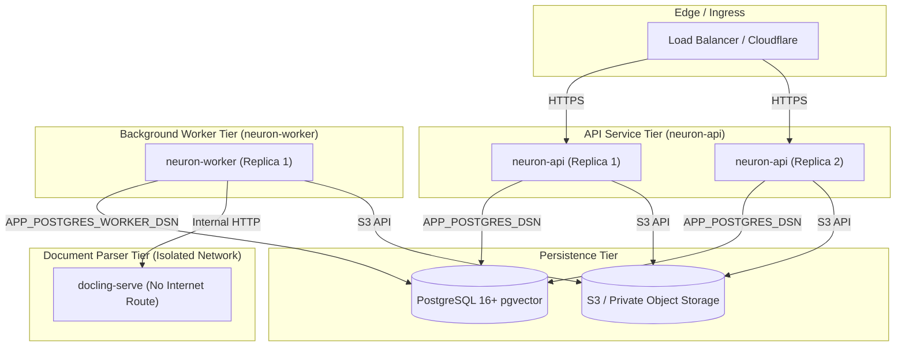

# How-To: Operate, Monitor, and Maintain Neuron in Production

> **Document ID:** DOC-HOW-007  
> **Diátaxis Mode:** How-To Guide (Task-Oriented)  
> **Standard Alignment:** Structured in alignment with ISO/IEC/IEEE 26514:2022 §7.4 (Procedural Task Information) and Diátaxis (How-To Guide)  
> **Audience:** SREs, DevOps Engineers, Platform Administrators  
> **Code Traceability:** `src/neuron_agent/observability/`, `src/neuron_agent/knowledge/worker.py`, `OPERATIONS.md`, ADR 0008, ADR 0014

---

## 1. Production Deployment Topology

In production, Neuron runs as a distributed multi-instance deployment composed of two decoupled services sharing a PostgreSQL database cluster:



### Component Roles
- **`neuron-api` (API Service):** Horizontally scalable stateless FastAPI process. Handles HTTP/SSE client connections, JWT validation, rate limiting, and graph invocation. Does not run heavy ingestion tasks.
- **`neuron-worker` (Background Worker):** Distributed task processor running Procrastinate jobs (`ingest_document`, `purge_document`, `purge_knowledge_base`, `reconcile_knowledge`, `sweep_knowledge_blobs`, `reindex_kb`, `reindex_swap`, `purge_retired_embeddings`). Connects as `neuron_worker` role.
- **`docling-serve` (Parser Container):** Runs on an internal unroutable Docker network (`parser`) without internet access. Converts complex PDF and Office files to structured text.

---

## 2. Health Checks and Readiness Probes

Neuron exposes two unauthenticated probe endpoints:

### Liveness Probe (`GET /health/live`)
- **Purpose:** Verifies that the FastAPI process is responsive and event loops are not blocked.
- **Probe Config (Kubernetes):**
  ```yaml
  livenessProbe:
    httpGet:
      path: /health/live
      port: 8000
    initialDelaySeconds: 5
    periodSeconds: 10
  ```
- **Response:** `200 {"status": "ok"}`

### Readiness Probe (`GET /health/ready`)
- **Purpose:** Verifies that external dependencies required to serve requests are fully functional:
  1. PostgreSQL connection pool is alive and responds to query probes.
  2. JWKS signing keys from the Identity Provider are cached and valid.
- **Probe Config (Kubernetes):**
  ```yaml
  readinessProbe:
    httpGet:
      path: /health/ready
      port: 8000
    initialDelaySeconds: 5
    periodSeconds: 10
    failureThreshold: 3
  ```
- **Response:** `200 {"status": "ready"}` or `503 {"status": "not_ready"}`

> [!NOTE]
> `/health/ready` deliberately ignores the state of `neuron-worker`. The API can serve chat, memory, and direct queries even if background ingestion is temporarily queued.

---

## 3. Monitoring, Telemetry, and Alerting

Neuron exports OpenTelemetry (OTel) traces and metrics over OTLP/HTTP to any standard collector (Prometheus, Grafana Tempo, Datadog).

### Enable OpenTelemetry in `.env`
```bash
APP_OTEL_ENABLED=true
APP_OTEL_SERVICE_NAME=neuron-api
APP_OTEL_EXPORTER_OTLP_ENDPOINT=http://otel-collector:4318
APP_OTEL_TRACES_SAMPLE_RATIO=1.0
```

### Core Service Level Indicators (SLIs)

| Metric Instrument | Type | Description & Alert Threshold |
| :--- | :--- | :--- |
| `neuron.requests` | Counter | Total incoming requests by status code and endpoint. Alert on sustained 5xx > 1%. |
| `neuron.agent.duration` | Histogram | End-to-end agent run duration in seconds. Target: p95 < 15s. |
| `neuron.agent.ttft` | Histogram | Time To First Token for SSE streams in milliseconds. Target: p95 < 1500ms. |
| `neuron.errors` | Counter | System failures partitioned by stable `error_code`. Alert on `persistence_error` or `provider_error`. |
| `neuron.postgres.pool.utilization` | Gauge | Active connections / pool max size. Alert when > 0.85. |
| `neuron.knowledge.queue.oldest_age`| Gauge | Age of oldest queued ingestion or purge job in seconds. Alert when > 1800s. |
| `neuron.knowledge.search.duration` | Histogram | Latency of hybrid retrieval and reranking by mode and outcome. |

---

## 4. Operational Runbooks

### Runbook 1: PostgreSQL Connection Pool Starvation
**Symptom:** `neuron.errors` records spikes of `persistence_error`; logs indicate `PoolTimeout`.  
**Remediation:**
1. Check current connection usage in PostgreSQL:
   ```sql
   SELECT count(*), state FROM pg_stat_activity WHERE datname = 'neuron_prod' GROUP BY state;
   ```
2. If total connections approach PostgreSQL `max_connections`, scale up database hardware or deploy a connection pooler (PgBouncer in transaction mode).
3. Increase pool size per replica in `.env`:
   ```bash
   APP_POSTGRES_POOL_MAX_SIZE=30
   APP_POSTGRES_POOL_TIMEOUT_SECONDS=15
   ```
4. Perform rolling restart of `neuron-api`.

---

### Runbook 2: Ingestion Queue Stalled / Worker Down
**Symptom:** Documents remain in `queued` status indefinitely; `neuron.knowledge.queue.oldest_age` > 1800s.  
**Remediation:**
1. Check `neuron-worker` container logs:
   ```bash
   docker logs neuron-worker --tail 100
   ```
2. Verify worker container health check:
   ```bash
   uv run neuron-worker health
   # Returns 0 if healthy, 1 if health file stale
   ```
3. Check Procrastinate queue table for lock contention:
   ```sql
   SELECT status, count(*) FROM knowledge.procrastinate_jobs GROUP BY status;
   ```
4. The worker's periodic `reconcile_knowledge` task (runs every 10 minutes) automatically re-queues stalled documents after `APP_WORKER_RECONCILE_AFTER_SECONDS` (default 3600s).

---

### Runbook 3: Model Provider Outage and Fallback Chain
**Symptom:** Spikes of `provider_timeout_error` or `provider_error` on OpenAI or NVIDIA.  
**Remediation:**
1. Neuron supports automated fallback chains configured via `APP_FALLBACK_MODELS`.
2. Configure ordered fallbacks in `.env`:
   ```bash
   APP_DEFAULT_MODEL=openai:gpt-5.4-mini
   APP_FALLBACK_MODELS='["nvidia:meta/llama-3.3-70b-instruct", "anthropic:claude-3-5-sonnet-latest"]'
   ```
3. When the primary model fails after its retries, Neuron logs `model_fallback_triggered` and routes the turn to the first available backup model without failing the user's turn.

---

### Runbook 4: Database Point-In-Time Restore (PITR) Drill
**Symptom:** Disaster recovery drill or database corruption restore.  
**Validation Procedure:**
1. Restore PostgreSQL database from backup snapshot.
2. Run database migration verification using the setup command:
   ```bash
   uv run python -m neuron_agent.persistence.cli setup
   ```
3. Audit blob store consistency using the worker verification tool:
   ```bash
   uv run neuron-worker check-blobs
   ```
   This outputs a JSON report identifying missing or orphaned files.
4. If orphan files exist, the worker's hourly sweep (`sweep_knowledge_blobs`) will safely clean them up.

---

### Runbook 5: Zero-Downtime Knowledge Base Re-Indexing (RAG-09.04)
**Symptom:** Upgrading to a new embedding model, provider, or vector dimension without interrupting active user searches.  
**Procedure:**
1. **Configure Target Settings:** Set `APP_KNOWLEDGE_REINDEX_EMBEDDING_*` on all API replicas, worker pods, and operator shell. Restart API and worker services:
   ```bash
   APP_KNOWLEDGE_REINDEX_EMBEDDING_PROVIDER=nvidia
   APP_KNOWLEDGE_REINDEX_EMBEDDING_MODEL="nvidia/llama-3.2-nv-embedqa-1b-v2"
   APP_KNOWLEDGE_REINDEX_EMBEDDING_DIMENSIONS=2048
   ```
2. **Initiate Re-index:** Run the start command as the migration role (`APP_POSTGRES_MIGRATION_DSN`):
   ```bash
   uv run python -m neuron_agent.persistence.cli reindex start
   ```
   This builds the new profile's partial HNSW index concurrently and queues `reindex_kb` jobs.
3. **Monitor Progress:** Check progress periodically:
   ```bash
   uv run python -m neuron_agent.persistence.cli reindex status
   ```
4. **Automated Atomic Swap:** The worker's periodic `reindex_swap` task checks every 10 minutes whether all ready chunks are covered. When 100% covered, it swaps the active profile in a single database transaction.
5. **Post-Swap Cutover:** Move the re-index values into `APP_KNOWLEDGE_EMBEDDING_*`, remove the `APP_KNOWLEDGE_REINDEX_EMBEDDING_*` variables, and restart. The worker automatically cleans up retired profile embeddings hourly in 5,000-row batches.
6. **Abort Procedure:** If re-indexing must be halted, run:
   ```bash
   uv run python -m neuron_agent.persistence.cli reindex cancel
   ```

---

### Runbook 6: Auditing Negative Answer Ratings and Low-Relevance Chunks (RAG-09.07)
**Symptom:** Investigating user dissatisfaction or diagnosing poor retrieval quality.  
**Procedure:**
1. Execute the feedback report command against the production or staging database:
   ```bash
   uv run python -m neuron_agent.persistence.cli feedback-report > negative_feedback_citations.json
   ```
2. Inspect the generated report:
   ```json
   [
     {
       "thread_id": "019318b2-5f6e-7b3c-8a12-abcdef123456",
       "run_id": "run-456",
       "rating": "negative",
       "created_at": "2026-11-13T12:00:00Z",
       "citations": [
         {
           "doc_id": "a1b2c3d4-e5f6-7a8b-9c0d-1e2f3a4b5c6d",
           "chunk_id": "e4f5a6b7-c8d9-0e1f-2a3b-4c5d6e7f8a9b"
         }
       ]
     }
   ]
   ```
3. Use the reported `doc_id` and `chunk_id` to inspect chunk text via `GET /v1/knowledge/documents/{doc_id}/chunks/{chunk_id}` and review chunk boundaries or parser output.

---

### Runbook 7: Knowledge Performance Baseline & Nightly Retrieval Gate (RAG-09.05 / RAG-09.06)
**Symptom:** Evaluating retrieval latency under load or auditing retrieval regression.  
**Procedure:**
1. **Run Knowledge Load Suite:**
   ```bash
   make load-knowledge
   ```
   Runs concurrent uploads with filtered hybrid search (`knowledge`), chat alone (`mix`), and chat beside search (`chat_search`), outputting latency metrics (p50/p95) and ingestion pages per minute.
2. **Review Nightly Retrieval Gate:**
   The GitHub Actions workflow `.github/workflows/nightly-eval.yml` runs the `knowledge-retrieval` job daily. It searches the evaluation corpus with live embeddings and reranking over committed vectors, gating on:
   - `recall@5`: Must remain within 0.02 of baseline (0.984).
   - `MRR`: Must remain within 0.02 of baseline (0.924).
   Failing either gate halts the nightly regression suite.
