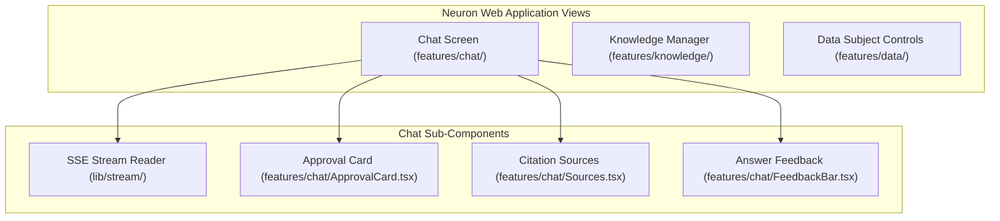

# How-To: Build and Deploy the Web Application

> **Document ID:** DOC-HOW-006  
> **Diátaxis Mode:** How-To Guide (Task-Oriented)  
> **Standard Alignment:** Structured in alignment with ISO/IEC/IEEE 26514:2022 §7.4 (Procedural Task Information) and Diátaxis (How-To Guide)  
> **Audience:** Frontend Engineers, DevOps, SREs  
> **Code Traceability:** `web/`, `scripts/web_headers.py`, ADR 0010

---

## 1. Overview and Architectural Boundary

Neuron Agent includes a dedicated, production-grade web user interface (`web/`) built with React 19, TypeScript, Vite, Tailwind CSS, and Radix UI / shadcn-ui. 

### Key Architectural Boundaries
1. **Origin Separation:** The frontend is a static Single-Page Application (SPA) designed to be hosted from its own distinct origin (e.g., Cloudflare Pages, Netlify, or an Nginx container). It is strictly separated from the FastAPI API server (`neuron-api`).
2. **Stateless In-Memory Token Storage:** Authentication is implemented using OAuth 2.0 Authorization Code Flow with PKCE against the configured OIDC Identity Provider (Keycloak, Auth0). Bearer tokens are kept in JavaScript memory only and are never written to `localStorage` or `sessionStorage`.
3. **Strict Content Security Policy (CSP):** The app enforces strict CSP headers, preventing unauthorized script execution, frame embedding, or cross-origin data exfiltration.

---

## 2. Local Development Setup

To run the web application locally with hot-reloading:

### Step 1: Install Dependencies
```bash
make web-install
# Or: cd web && npm install
```

### Step 2: Configure Web Environment
Create or edit `web/.env.local`:

```bash
# URL of the running FastAPI backend
VITE_API_URL=http://127.0.0.1:8000

# OIDC Identity Provider Issuer
VITE_AUTH_ISSUER=http://localhost:8180/realms/neuron

# OIDC Public Client ID
VITE_AUTH_CLIENT_ID=neuron-web

# Requested OAuth Scopes
VITE_AUTH_SCOPES=openid profile email agent:invoke agent:approve threads:read threads:write feedback:write threads:delete data:erase memories:read memories:write knowledge:read knowledge:write tools:calculator tools:list_knowledge_bases tools:search_knowledge tools:get_document_excerpt
```

### Step 3: Ensure Backend CORS Allows the Frontend Origin
In the root `.env` of `neuron-api`, add the web dev origin to `APP_CORS_ALLOWED_ORIGINS`:
```bash
APP_CORS_ALLOWED_ORIGINS='["http://localhost:5173"]'
```

### Step 4: Start Vite Development Server
```bash
make web-dev
# Or: cd web && npm run dev
```
Open [http://localhost:5173](http://localhost:5173) in your browser.

---

## 3. Production Build and Security Headers

For production hosting, compile the static bundle and generate origin-pinned security headers:

### Step 1: Compile Production Bundle
```bash
make web-build
# Or: cd web && npm run build
```
This produces optimized production assets in `web/dist/`.

### Step 2: Generate Origin-Pinned Security Headers
Neuron includes `scripts/web_headers.py` to synthesize exact HTTP security headers based on your production API and IdP endpoints:

```bash
uv run python scripts/web_headers.py \
  --api https://api.neuron.example.com \
  --issuer https://id.example.com/realms/neuron \
  --out web/dist/_headers
```

#### Generated Content Security Policy (CSP)
```http
Content-Security-Policy: default-src 'self'; script-src 'self'; style-src 'self' 'unsafe-inline'; img-src 'self' data: https:; connect-src 'self' https://api.neuron.example.com https://id.example.com; font-src 'self'; object-src 'none'; frame-ancestors 'none'; base-uri 'self'; form-action 'self'
X-Content-Type-Options: nosniff
X-Frame-Options: DENY
Referrer-Policy: strict-origin-when-cross-origin
Cross-Origin-Opener-Policy: same-origin
```

---

## 4. Docker Production Deployment

Neuron provides a standalone, unprivileged Nginx Dockerfile at `web/Dockerfile`.

### Step 1: Build the Container Image
```bash
docker build -t neuron-web:v1.1.0 \
  --build-arg VITE_API_URL=https://api.neuron.example.com \
  --build-arg VITE_AUTH_ISSUER=https://id.example.com/realms/neuron \
  --build-arg VITE_AUTH_CLIENT_ID=neuron-web \
  -f web/Dockerfile web/
```

### Step 2: Run the Web Container
```bash
docker run -d --name neuron-web \
  -p 8080:80 \
  --read-only \
  --cap-drop=ALL \
  neuron-web:v1.1.0
```

---

## 5. UI Features and Workflows



1. **Streaming Markdown Chat:** The chat view parses Server-Sent Events incrementally, rendering markdown securely with `rehype-sanitize` to disallow arbitrary HTML scripts.
2. **Interactive Approval Cards:** When an agent attempts a mutating tool call, the UI displays an `ApprovalCard` showing exact arguments (`summary`, `project`, etc.) with one-click **Approve** and **Reject** buttons.
3. **Knowledge Base Manager:** Users can view, create, rename, and delete knowledge bases, upload documents with progress bars, and view document ingestion status.
4. **Citation Sheets (`SourceSheet`):** Clicking a `[cite:...]` link opens a side sheet fetching the verified document chunk and its neighboring paragraphs from the API.
5. **GDPR Export & Erasure Screen:** Users can download their data export JSON file or trigger complete account data erasure with confirmation modals.
