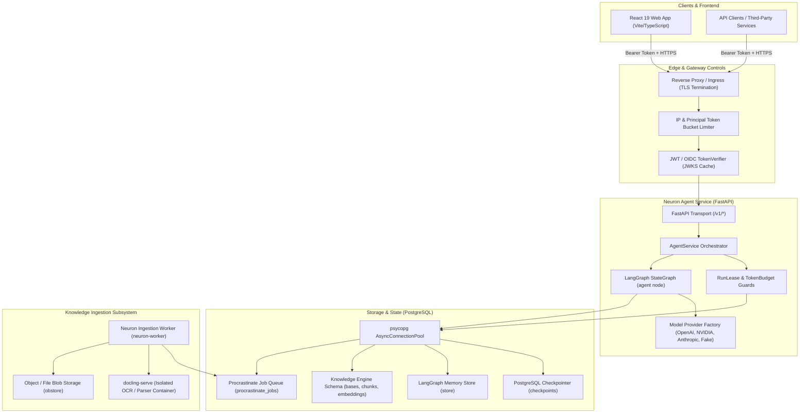
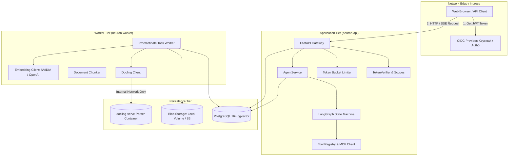

# Neuron Agent — Product Overview

> **Document ID:** DOC-OVR-001  
> **Standard Alignment:** Structured in alignment with ISO/IEC/IEEE 26514:2022 §7.2 (Product Description & Overview) and Diátaxis (Explanation / Overview)  
> **Product Version:** 1.1.0  
> **Status:** Production-Ready  
> **Code Traceability:** `src/neuron_agent/`, `docs/decisions/`

---

## 1. Executive Summary

**Neuron Agent** is a production-hardened, enterprise-grade AI agent orchestration service built on Python 3.13+, FastAPI, LangChain, and LangGraph. Designed from inception with a "defense-in-depth" security philosophy, Neuron provides a robust, observable, and multi-tenant foundation for executing LLM workflows with bounded read-only tools, stateful conversation persistence, human-in-the-loop approvals for mutating actions, Model Context Protocol (MCP) tool integration, user-controlled memory notes, and an isolated Knowledge Engine (RAG) supporting hybrid vector/full-text search over private documents.

Unlike experimental agent frameworks that permit unbounded shell execution, arbitrary prompt injections, and ambient identity impersonation, Neuron enforces strict architectural boundaries:
- **Zero Raw Identity Storage:** Authenticated token subjects are hashed using HMAC-SHA256 with an operator-controlled secret key (`APP_IDENTITY_HASH_KEY`).
- **Prompt Isolation & Zero-Leak Telemetry:** User messages, prompts, tool outputs, and LLM completions are strictly excluded from audit logs, error responses, and metric labels.
- **Fail-Closed Execution:** Any unhandled database exception, rate-limit violation, tool failure, or timeout immediately halts execution without exposing internal system details.
- **Audited Human-in-the-Loop Approvals:** Mutating tool calls are paused at the graph checkpoint until explicitly approved by an authorized human operator.

---

## 2. Core Capabilities

### 2.1 Agent Orchestration & Structured Output
- **Deterministic State Graph:** Implemented via LangGraph `StateGraph`, maintaining conversation threads across user turns with atomic checkpoint commits.
- **Guaranteed Response Schema:** Every response adheres strictly to the `AgentAnswer` schema (`answer`, `confidence`, `used_tools`, `refused`, `clarification_needed`, `citations`, `not_in_documents`).
- **Input Bounding:** Request bodies are bounded to `APP_MAX_REQUEST_BODY_BYTES` (default 64 KB); prompt characters are bounded to `APP_MAX_PROMPT_CHARS` (default 12,000 characters).
- **History Budgeting:** Conversions are pruned to `APP_MAX_HISTORY_TOKENS` (default 8,000 tokens) using `trim_messages` while ensuring message turn integrity.

### 2.2 Streaming (Server-Sent Events)
- **SSE Protocol v1:** `POST /v1/agent/stream` streams 7 standardized events: `run_started`, `token`, `tool_call`, `final`, `error`, `done`, and keepalive heartbeats (`: ping`).
- **Partial JSON Streaming Extraction:** Streaming tokens are emitted live by re-parsing the incremental growth of the `answer` field in real-time, eliminating markdown/JSON schema leakage.
- **Client Disconnect Handling:** Client connection drop triggers immediate producer cancellation, safely terminating in-flight LLM calls.

### 2.3 Authentication & Authorization
- **OAuth 2.0 / OIDC JWT Verification:** In `APP_AUTH_MODE=jwt`, every request requires an RFC 7519 JWT bearer access token issued by a trusted identity provider (e.g., Keycloak, Auth0, Okta).
- **Fine-Grained Scopes:** 15 distinct scopes govern execution permissions (e.g., `agent:invoke`, `agent:approve`, `threads:read`, `threads:write`, `data:erase`, `tools:calculator`, `knowledge:read`, `knowledge:write`).
- **HMAC Owner Key Pseudonymity:** Tenant isolation is enforced via an HMAC-SHA256 hash of the token's `(issuer, subject)` pair using `APP_IDENTITY_HASH_KEY`. Raw user IDs and emails never reach database foreign keys.

### 2.4 Tool Execution & Safety Architecture
- **Immutable Tool Registry:** Every tool is bound to a `ToolSpec` declaring its name, required permission scope, risk class (`read` vs `mutating`), source (`builtin` vs `mcp`), and data taint characteristics.
- **Built-in Tools:** 
  - `utc_now`: Deterministic current timestamp in UTC (public read-only).
  - `calculator`: AST-evaluated safe arithmetic supporting numbers, binary operators (`+`, `-`, `*`, `/`, `%`, `**`), and unary operators (`+`, `-`). Rejects expressions > 200 characters or results > $10^{12}$.
- **Human-in-the-Loop Tool Approvals:** Any tool flagged as `mutating` (or gated after reading untrusted data) pauses the graph execution, generating an `approval_required` response with a single-use `approval_id`.

### 2.5 Model Context Protocol (MCP) Integration
- **Streamable HTTP Transport:** Connects to external MCP servers over HTTP/HTTPS with per-server bearer tokens.
- **Cryptographic Tool Pinning:** The `neuron-mcp-pin` CLI inspects MCP servers and generates SHA-256 integrity pins of each tool's name, description, and JSON input schema. Unpinned or mutated tools are rejected at startup.
- **Egress Restrictions:** Internal IP ranges, loopback endpoints, and link-local cloud metadata services (`169.254.169.254`) are strictly denied for remote MCP servers.

### 2.6 User Memory Subsystem
- **User-Controlled Notes:** When `APP_MEMORY_ENABLED=true`, users can ask the agent to store personal context using the `remember` tool, retrieve notes using `recall`, and delete notes using `forget`.
- **Anti-Hallucination Guard:** The `remember` tool rejects any text that does not appear verbatim in what the user wrote during the active conversation.
- **Independent User Management:** Users can inspect (`GET /v1/me/memories`) and delete (`DELETE /v1/me/memories/{id}`) their notes directly via REST API without invoking the LLM.

### 2.7 Knowledge Engine (RAG)
- **Multi-Tenant Knowledge Bases:** Users can create isolated knowledge bases (`POST /v1/knowledge/bases`) with configurable processing locality (`hosted` vs `self_hosted`).
- **Multi-Format Document Ingestion:** Supports PDF (with OCR), DOCX, XLSX, PPTX, TXT, and Markdown files up to 50 MB.
- **Sandboxed Parsing:** Complex document types are parsed by `docling-serve` running in a container on an isolated internal network without internet egress.
- **Hybrid Search Engine:** Combines full-text search (`tsvector` with `websearch_to_tsquery`) and dense vector search (`pgvector` halfvec with HNSW indexing or exact scan) fused via Reciprocal Rank Fusion (RRF, $k=60$).
- **Cryptographic Citations:** Every search hit mints an opaque, single-run `cite_id`. The server validates that citations in the final answer correspond to actual chunks retrieved during that specific run.

### 2.8 Privacy & Data Subject Rights (GDPR / CCPA)
- **Data Export:** `GET /v1/me/export` produces a structured JSON export of conversation history, memory notes, and knowledge base metadata bounded to `APP_USER_DATA_EXPORT_MAX_BYTES` (default 5 MB).
- **Data Erasure:** `DELETE /v1/me/threads` atomically and irreversibly erases all checkpoints, conversation metadata, feedback ratings, and memory notes. `DELETE /v1/me/knowledge` tombstones knowledge bases and purges all underlying blob files, chunks, and embeddings.

---

## 3. Product Architecture & Component Topology

---

## 4. Release History and Evolution

| Release | Focus Area | Key Additions |
| :--- | :--- | :--- |
| **v0.1.0 – v0.2.0** | Core Baseline | FastAPI baseline, single-node LangGraph agent, `calculator` and `utc_now` tools, fake chat model for deterministic CI. |
| **v0.3.0** | Stateful Agents | PostgreSQL thread checkpointer, session resumption, SSE streaming (`/v1/agent/stream`), run timeout budgets. |
| **v0.4.0** | Enterprise Auth | JWT bearer token verification, JWKS caching, 15 authorization scopes, HMAC-SHA256 caller pseudonymity, GDPR export/erase. |
| **v0.5.0** | Observability | OpenTelemetry traces and metrics, SemConv v1.26.0, LangSmith governance with zero-prompt-leakage rules, structured structlog. |
| **v0.6.0** | Multi-Instance | PostgreSQL-backed distributed run leases (`neuron_run_leases`), shared token budget (`neuron_token_ledger`), shared rate buckets. |
| **v0.7.0** | Extensibility | Extensible tool registry, Model Context Protocol (MCP) streamable HTTP integration, tool pinning, human-in-the-loop approvals, memory notes. |
| **v0.8.0** | Web Application | React 19 single-page application (`web/`), Tailwind CSS, shadcn-ui, PKCE OIDC authentication, streaming client, approval dialogs. |
| **v0.9.0 – v1.0.0** | Production Candidate | Production candidate gates, automated failover drills, load-testing harness (Locust), database migration test policies. |
| **v1.1.0** *(Current)* | Knowledge Engine | Full RAG subsystem (`knowledge/`), multi-format ingestion, docling-serve container isolation, pgvector hybrid search, Procrastinate worker queue. |

---

## 5. Technology Stack Summary

| Subsystem | Technologies & Frameworks |
| :--- | :--- |
| **Runtime Environment** | Python 3.13, 3.14 (managed via `uv` 0.11+) |
| **API Framework** | FastAPI 0.125+, Uvicorn 0.38+, Starlette, Pydantic v2.12+, Pydantic-Settings |
| **Agent Orchestration** | LangGraph 1.2+, LangChain 1.4+, LangChain-OpenAI, LangChain-Anthropic |
| **Persistence & Database** | PostgreSQL 16+ with `pgvector` 0.7+, `psycopg` 3.2+ (with binary connection pool) |
| **Job Queue & Tasks** | Procrastinate 3.10.0 (PostgreSQL-backed asynchronous distributed task queue) |
| **Security & Cryptography** | `pyjwt` 2.15+ (with cryptographic extensions), `cryptography` (HKDF, SHA-256) |
| **Observability** | OpenTelemetry SDK 1.42+, OpenTelemetry OTLP Exporter, `structlog` 25.5+, LangSmith |
| **Document Processing** | `docling-serve` (DeepSearch Docling container), `obstore` 0.12+ (local/S3 blob storage) |
| **Web Frontend** | React 19, TypeScript 5.8+, Vite 7+, Tailwind CSS 4+, Radix UI / shadcn-ui |
