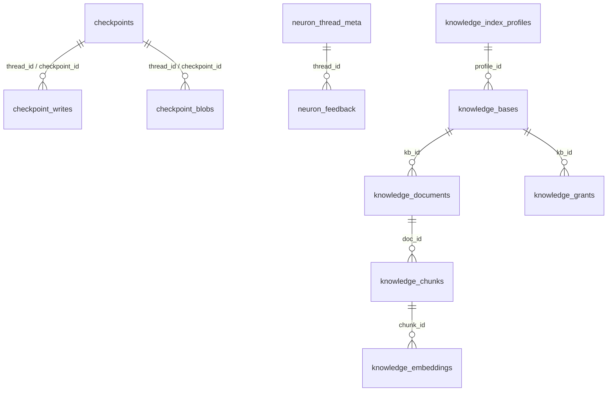

# Reference: PostgreSQL Database Schema Data Dictionary

> **Document ID:** DOC-REF-004  
> **Diátaxis Mode:** Reference (Information-Oriented)  
> **Standard Alignment:** Structured in alignment with ISO/IEC/IEEE 26514:2022 §7.3 (Reference Information) and Diátaxis (Reference)  
> **Database Version:** PostgreSQL 16+ with `pgvector` 0.7+  
> **Code Traceability:** `src/neuron_agent/persistence/migrations.py`, `src/neuron_agent/knowledge/`

---

## 1. Schema Topology and Overview

Neuron Agent organizes its relational tables into two distinct PostgreSQL schemas:
1. **`public` schema:** Contains LangGraph conversation checkpoints, thread metadata, feedback ratings, user memory notes, and multi-instance concurrency guards.
2. **`knowledge` schema:** Contains isolated tables for knowledge bases, documents, parsed chunks, vector embeddings, and the Procrastinate task queue.



---

## 2. Public Schema Tables

### 2.1 `neuron_migrations`
Maintains the forward-only migration log applied by `persistence.cli setup`.

| Column | Type | Constraints | Description |
| :--- | :--- | :--- | :--- |
| `version` | `integer` | PRIMARY KEY | Sequential migration number (1–27). |
| `name` | `text` | NOT NULL | Human-readable migration identifier. |
| `applied_at` | `timestamptz` | NOT NULL DEFAULT `now()` | Timestamp when migration was executed. |

---

### 2.2 `neuron_run_leases`
Enforces distributed mutual exclusion per conversation thread across API replicas.

| Column | Type | Constraints | Description |
| :--- | :--- | :--- | :--- |
| `thread_id` | `text` | PRIMARY KEY | UUID of the active conversation thread. |
| `owner_key` | `text` | NOT NULL | HMAC-SHA256 owner key of the caller. |
| `run_id` | `text` | NOT NULL | Unique run identifier holding the lease. |
| `claimed_at` | `timestamptz` | NOT NULL | Database timestamp when lease was claimed. |
| `expires_at` | `timestamptz` | NOT NULL | Expiration deadline (`claimed_at + run_timeout + 15s`). |

- **Indexes:**
  - `neuron_run_leases_owner_idx` ON `neuron_run_leases (owner_key)`
  - `neuron_run_leases_expires_idx` ON `neuron_run_leases (expires_at)`

---

### 2.3 `neuron_rate_buckets` (`UNLOGGED`)
Distributed token-bucket rate limiter. Declared as `UNLOGGED` for maximum IOPS performance.

| Column | Type | Constraints | Description |
| :--- | :--- | :--- | :--- |
| `key` | `text` | PRIMARY KEY | Rate limit key (`owner:<hash>` or `ip:<hmac>`). |
| `tokens` | `float8` | NOT NULL | Current token count remaining in bucket. |
| `refilled_at` | `timestamptz` | NOT NULL | Database timestamp of last token refill. |
| `allowed` | `boolean` | NOT NULL | Whether the most recent request was permitted. |

- **Indexes:**
  - `neuron_rate_buckets_refilled_idx` ON `neuron_rate_buckets (refilled_at)`

---

### 2.4 `neuron_token_ledger`
Sliding-window token usage accounting.

| Column | Type | Constraints | Description |
| :--- | :--- | :--- | :--- |
| `owner_key` | `text` | NOT NULL | HMAC-SHA256 owner key. |
| `minute` | `timestamptz` | NOT NULL | Truncated UTC minute (`date_trunc('minute', clock_timestamp())`). |
| `tokens` | `integer` | NOT NULL | Total LLM tokens consumed during that minute. |

- **Primary Key:** `(owner_key, minute)`
- **Indexes:**
  - `neuron_token_ledger_minute_idx` ON `neuron_token_ledger (minute)`

---

### 2.5 `neuron_thread_meta`
Durable conversation titles for the web interface and thread discovery.

| Column | Type | Constraints | Description |
| :--- | :--- | :--- | :--- |
| `owner_key` | `text` | NOT NULL | HMAC-SHA256 owner key. |
| `thread_id` | `text` | PRIMARY KEY | Thread UUID. |
| `title` | `text` | NOT NULL | Sanitized title (1–80 characters). |
| `updated_at` | `timestamptz` | NOT NULL DEFAULT `now()` | Timestamp of last title update. |

- **Indexes:**
  - `neuron_thread_meta_owner_idx` ON `neuron_thread_meta (owner_key, updated_at DESC)`

---

### 2.6 `neuron_feedback`
Answer ratings submitted by users via `POST /v1/threads/{id}/runs/{run_id}/feedback`.

| Column | Type | Constraints | Description |
| :--- | :--- | :--- | :--- |
| `owner_key` | `text` | NOT NULL | HMAC-SHA256 owner key. |
| `thread_id` | `text` | NOT NULL | Associated thread UUID. |
| `run_id` | `text` | NOT NULL | Evaluated run UUID. |
| `rating` | `text` | NOT NULL | Rating value (`positive` or `negative`). |
| `created_at` | `timestamptz` | NOT NULL DEFAULT `now()` | Submission timestamp. |

- **Primary Key:** `(owner_key, run_id)`

---

### 2.7 LangGraph Core Tables (`public`)
Managed by LangGraph's `AsyncPostgresSaver.setup()`:
- `checkpoints`: Thread checkpoint state metadata (thread_id, checkpoint_id, parent_id, checkpoint, metadata).
- `checkpoint_blobs`: Serialized state payloads.
- `checkpoint_writes`: Turn-by-turn node write operations.
- `store`: LangGraph long-term memory key-value document store (`APP_MEMORY_ENABLED=true`).

---

## 3. Knowledge Schema Tables (`knowledge.*`)

Created by migrations 17–27 when `APP_KNOWLEDGE_ENABLED=true`.

### 3.1 `knowledge.index_profiles`
Active embedding model configuration profiles.

| Column | Type | Constraints | Description |
| :--- | :--- | :--- | :--- |
| `profile_id` | `integer` | PRIMARY KEY | Unique profile number (Profile 1 is default). |
| `provider` | `text` | NOT NULL | Provider name (`nvidia`, `openai_compatible`). |
| `model` | `text` | NOT NULL | Embedding model identifier string. |
| `dimensions` | `integer` | NOT NULL | Vector dimensions (e.g. 1024). |
| `chunker` | `text` | NOT NULL | Chunking strategy identifier. |
| `status` | `text` | NOT NULL | Status (`building`, `active`, `retired`). |

---

### 3.2 `knowledge.bases`
User-owned knowledge base containers.

| Column | Type | Constraints | Description |
| :--- | :--- | :--- | :--- |
| `kb_id` | `uuid` | PRIMARY KEY DEFAULT `gen_random_uuid()` | Unique knowledge base UUID. |
| `owner_key` | `text` | NOT NULL | 64-hex HMAC owner key of creator. |
| `name` | `text` | NOT NULL | User-provided name (1–80 characters). |
| `processing` | `text` | NOT NULL DEFAULT `'hosted'` | Locality rule (`hosted` or `self_hosted`). |
| `ts_config` | `regconfig` | NOT NULL DEFAULT `'simple'::regconfig` | PostgreSQL full-text search dictionary configuration. |
| `profile_id` | `integer` | REFERENCES `knowledge.index_profiles` | Active embedding profile. |
| `created_at` | `timestamptz` | NOT NULL DEFAULT `now()` | Creation timestamp. |
| `deleted_at` | `timestamptz` | NULL | Tombstone timestamp when deleted. |

---

### 3.3 `knowledge.documents`
Metadata and status of uploaded files.

| Column | Type | Constraints | Description |
| :--- | :--- | :--- | :--- |
| `doc_id` | `uuid` | PRIMARY KEY DEFAULT `gen_random_uuid()` | Document UUID. |
| `kb_id` | `uuid` | REFERENCES `knowledge.bases` ON DELETE CASCADE | Parent knowledge base. |
| `uploaded_by` | `text` | NOT NULL | HMAC owner key of uploader. |
| `title` | `text` | NOT NULL | User title or sanitized file name. |
| `mime_type` | `text` | NOT NULL | Validated MIME type (PDF, docx, etc.). |
| `size_bytes` | `bigint` | NOT NULL | Raw file byte size. |
| `sha256` | `bytea` | NOT NULL | SHA-256 digest of original file. |
| `blob_key` | `text` | NOT NULL | 32-character hex key in blob storage. |
| `page_count` | `integer` | NULL | Total parsed page count. |
| `status` | `text` | NOT NULL DEFAULT `'queued'` | Lifecycle stage (`queued`, `parsing`, `embedding`, `ready`, `failed`, `deleting`). |
| `error_code` | `text` | NULL | Stable failure code when `failed`. |
| `idempotency_key` | `text` | NULL | Optional idempotency key from header. |
| `embedding_tokens` | `bigint` | NOT NULL DEFAULT 0 | Cumulative embedding tokens spent. |
| `created_at` | `timestamptz` | NOT NULL DEFAULT `now()` | Upload timestamp. |
| `updated_at` | `timestamptz` | NOT NULL DEFAULT `now()` | Last status transition timestamp. |
| `deleted_at` | `timestamptz` | NULL | Tombstone timestamp. |

- **Unique Constraints & Indexes:**
  - `documents_live_sha_idx` UNIQUE ON `knowledge.documents (kb_id, sha256) WHERE deleted_at IS NULL`
  - `documents_idempotency_idx` UNIQUE ON `knowledge.documents (uploaded_by, idempotency_key) WHERE idempotency_key IS NOT NULL`
  - `documents_uploader_idx` ON `knowledge.documents (uploaded_by)`

---

### 3.4 `knowledge.chunks`
Extracted text passages generated by the chunker.

| Column | Type | Constraints | Description |
| :--- | :--- | :--- | :--- |
| `chunk_id` | `uuid` | PRIMARY KEY DEFAULT `gen_random_uuid()` | Unique chunk UUID. |
| `doc_id` | `uuid` | NOT NULL | Parent document UUID. |
| `kb_id` | `uuid` | NOT NULL | Parent knowledge base UUID. |
| `ordinal` | `integer` | NOT NULL | Sequential chunk order in document (0-indexed). |
| `text` | `text` | NOT NULL | Extracted plain text content. |
| `headings` | `text[]` | NOT NULL | Array of hierarchical section heading paths. |
| `page_start` | `integer` | NULL | First page number containing passage. |
| `page_end` | `integer` | NULL | Last page number containing passage. |
| `token_count` | `integer` | NOT NULL | Approximate token length (UTF-8 bytes / 3). |
| `tsv` | `tsvector` | GENERATED ALWAYS AS tsvector | Generated full-text search vector. |

- **Foreign Key:** `(doc_id, kb_id) REFERENCES knowledge.documents (doc_id, kb_id) ON DELETE CASCADE`
- **Indexes:**
  - `chunks_tsv_idx` GIN ON `knowledge.chunks (tsv)`
  - `chunks_kb_idx` ON `knowledge.chunks (kb_id)`
  - `chunks_doc_idx` ON `knowledge.chunks (doc_id)`

---

### 3.5 `knowledge.embeddings`
Vector representations of chunk texts.

| Column | Type | Constraints | Description |
| :--- | :--- | :--- | :--- |
| `chunk_id` | `uuid` | NOT NULL | Associated chunk UUID. |
| `kb_id` | `uuid` | NOT NULL | Parent knowledge base UUID. |
| `profile_id` | `integer` | REFERENCES `knowledge.index_profiles` | Embedding profile ID. |
| `embedding` | `halfvec` | NOT NULL | Half-precision floating-point vector. |

- **Primary Key:** `(chunk_id, profile_id)`
- **Foreign Key:** `(chunk_id, kb_id) REFERENCES knowledge.chunks (chunk_id, kb_id) ON DELETE CASCADE`
- **Indexes:**
  - `embeddings_profile_kb_idx` ON `knowledge.embeddings (profile_id, kb_id)`
  - Partial HNSW Index: `embeddings_p1_hnsw` ON `knowledge.embeddings USING hnsw ((embedding::halfvec(1024)) halfvec_cosine_ops) WHERE profile_id = 1`

---

## 4. Row-Level Security (RLS) Architecture

To guarantee that no tenant can read chunks or vector embeddings belonging to another organization, Neuron enables PostgreSQL Row-Level Security on `knowledge.chunks` and `knowledge.embeddings`:

```sql
ALTER TABLE knowledge.chunks ENABLE ROW LEVEL SECURITY;
ALTER TABLE knowledge.embeddings ENABLE ROW LEVEL SECURITY;

CREATE POLICY kb_scope ON knowledge.chunks
    USING (kb_id = ANY (string_to_array(current_setting('neuron.kb_ids', true), ',')::uuid[]))
    WITH CHECK (kb_id = ANY (string_to_array(current_setting('neuron.kb_ids', true), ',')::uuid[]));

CREATE POLICY kb_scope ON knowledge.embeddings
    USING (kb_id = ANY (string_to_array(current_setting('neuron.kb_ids', true), ',')::uuid[]))
    WITH CHECK (kb_id = ANY (string_to_array(current_setting('neuron.kb_ids', true), ',')::uuid[]));
```

### Transaction Execution Contract
Before querying or modifying `chunks` or `embeddings`, the application executes:
```sql
SELECT set_config('neuron.kb_ids', 'uuid1,uuid2', true);
```
If `neuron.kb_ids` is not explicitly set in the active transaction, the RLS policy evaluates to an empty array, returning zero rows.
