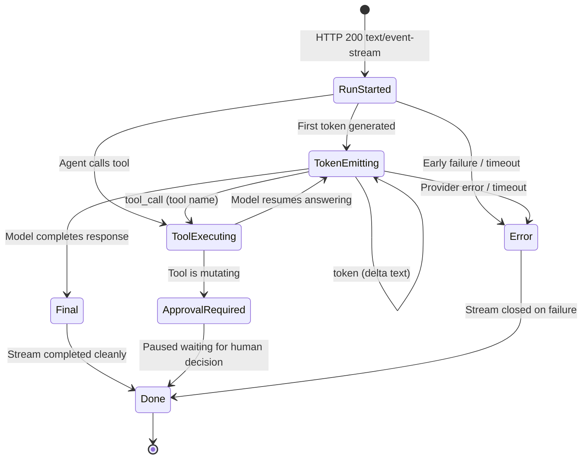

# Reference: Server-Sent Events (SSE) Protocol Specification (v1)

> **Document ID:** DOC-REF-002  
> **Diátaxis Mode:** Reference (Information-Oriented)  
> **Standard Alignment:** Structured in alignment with ISO/IEC/IEEE 26514:2022 §7.3 (Reference Information) and Diátaxis (Reference)  
> **Protocol Version:** 1.0  
> **Transport:** HTTP/1.1 or HTTP/2 over TLS (`text/event-stream`)  
> **Code Traceability:** `src/neuron_agent/services/streaming.py`, `src/neuron_agent/api/main.py`, ADR 0005

---

## 1. Protocol Overview and Stream Lifecycle

The Neuron streaming protocol delivers real-time token deltas, tool execution events, and final structured responses from `POST /v1/agent/stream` and approval continuations. 

### Key Characteristics
1. **Unbuffered Streaming:** Responses set `Cache-Control: no-store` and `X-Accel-Buffering: no` to prevent intermediate proxies (Nginx, Cloudflare) from buffering chunks.
2. **Partial JSON Parsing:** Tokens are extracted live from the model's incremental growth of the `AgentAnswer.answer` field. Structural JSON markup is never sent as tokens.
3. **Guaranteed Terminal Event:** Every stream terminates with either `final` + `done` or `error` + `done`.



---

## 2. Event Specification

Each SSE block consists of an `event:` line, a `data:` line with a JSON payload, and a double newline (`\n\n`).

### 2.1 `run_started`
- **When:** Always emitted as the first event immediately after run admission and lease acquisition.
- **Payload Schema:**
  ```json
  {
    "request_id": "req-019318b2-5f6e-7b3c-8a12-abcdef123456",
    "thread_id": "019318b2-5f6e-7b3c-8a12-abcdef123456",
    "run_id": "run-a1b2c3d4-e5f6-7a8b-9c0d-1e2f3a4b5c6d"
  }
  ```

---

### 2.2 `token`
- **When:** Emitted as new answer text is generated by the LLM. May be emitted zero or more times.
- **Payload Schema:**
  ```json
  {
    "text": " incremental string delta "
  }
  ```
- **Note:** `token` events represent a live preview only. The authoritative, validated answer arrives in the `final` event.

---

### 2.3 `tool_call`
- **When:** Emitted when the agent begins executing an approved tool.
- **Payload Schema:**
  ```json
  {
    "name": "calculator"
  }
  ```
- **Security Rule:** To prevent prompt injection and data leaks, `tool_call` events carry **only the tool name**. Tool arguments and tool outputs are never transmitted over this event.

---

### 2.4 `approval_required`
- **When:** Emitted if the agent attempts to execute a `mutating` tool, pausing the run.
- **Payload Schema:**
  ```json
  {
    "request_id": "req-1",
    "thread_id": "019318b2-5f6e-7b3c-8a12-abcdef123456",
    "approval": {
      "approval_id": "appr-7c9b1a2e",
      "actions": [
        {
          "name": "create_issue",
          "args": {"project": "OPS", "summary": "DB leak"}
        }
      ],
      "allowed_decisions": ["approve", "reject"]
    }
  }
  ```

---

### 2.5 `final`
- **When:** Emitted upon successful completion of the agent run.
- **Payload Schema (`AgentResponse`):**
  ```json
  {
    "status": "completed",
    "request_id": "req-1",
    "thread_id": "019318b2-5f6e-7b3c-8a12-abcdef123456",
    "run_id": "run-a1b2c3d4-e5f6-7a8b-9c0d-1e2f3a4b5c6d",
    "answer": "Complete text of the agent answer.",
    "used_tools": ["calculator"],
    "confidence": 1.0,
    "refused": false,
    "clarification_needed": false,
    "citations": [
      {
        "cite_id": "c1a2",
        "doc_id": "8f3b2e1a-4c5d-6e7f-8a9b-0c1d2e3f4a5b",
        "chunk_id": "a1b2c3d4-e5f6-7a8b-9c0d-1e2f3a4b5c6d",
        "title": "Architecture Spec",
        "headings": ["Security"],
        "page_start": 4,
        "page_end": 4
      }
    ],
    "citation_schema_version": 1,
    "grounded": true
  }
  ```

---

### 2.6 `error`
- **When:** Emitted if an unhandled failure or timeout occurs after the stream has started. Replaces `final`.
- **Payload Schema:**
  ```json
  {
    "code": "run_timeout",
    "retryable": true
  }
  ```

---

### 2.7 `done`
- **When:** Always emitted as the terminal event of the stream.
- **Payload Schema:**
  ```json
  {}
  ```

---

### 2.8 Heartbeat Comments
Every `APP_STREAM_HEARTBEAT_SECONDS` (default 15s), the server transmits an SSE comment line to prevent idle TCP disconnects by intermediate firewalls:
```http
: ping
```
Clients must ignore lines starting with a colon (`:`).

---

## 3. Client Reader Implementation Examples

### 3.1 JavaScript / TypeScript (`fetch` Reader)

```typescript
async function streamAgent(message: string, token: string) {
  const response = await fetch("http://127.0.0.1:8000/v1/agent/stream", {
    method: "POST",
    headers: {
      "Authorization": `Bearer ${token}`,
      "Content-Type": "application/json"
    },
    body: JSON.stringify({ message })
  });

  if (!response.ok) {
    const errorBody = await response.json();
    throw new Error(`HTTP ${response.status}: ${errorBody.detail}`);
  }

  const reader = response.body!.pipeThrough(new TextDecoderStream()).getReader();
  let buffer = "";

  while (true) {
    const { value, done } = await reader.read();
    if (done) break;

    buffer += value.replaceAll("\r\n", "\n");
    let boundary: number;

    while ((boundary = buffer.indexOf("\n\n")) !== -1) {
      const block = buffer.slice(0, boundary);
      buffer = buffer.slice(boundary + 2);

      if (block.startsWith(":")) continue; // Skip heartbeat

      const eventMatch = block.match(/^event: (.*)$/m);
      const dataMatch = block.match(/^data: (.*)$/m);
      if (!eventMatch || !dataMatch) continue;

      const event = eventMatch[1];
      const data = JSON.parse(dataMatch[1]);

      switch (event) {
        case "token":
          process.stdout.write(data.text);
          break;
        case "tool_call":
          console.log(`\n[Executing tool: ${data.name}]`);
          break;
        case "final":
          console.log(`\n\n[Final answer received: ${data.answer}]`);
          break;
        case "approval_required":
          console.log(`\n[Action paused: Approval needed for ${data.approval.actions[0].name}]`);
          break;
        case "error":
          console.error(`\n[Stream Error: ${data.code}, retryable: ${data.retryable}]`);
          break;
        case "done":
          return;
      }
    }
  }
}
```

### 3.2 Python Client (`httpx` Reader)

```python
import json
import httpx

def stream_agent(message: str, token: str):
    headers = {"Authorization": f"Bearer {token}", "Content-Type": "application/json"}
    payload = {"message": message}

    with httpx.Client(timeout=120.0) as client:
        with client.stream("POST", "http://127.0.0.1:8000/v1/agent/stream", headers=headers, json=payload) as response:
            response.raise_for_status()
            current_event = None
            for line in response.iter_lines():
                if not line or line.startswith(":"):
                    continue
                if line.startswith("event: "):
                    current_event = line.removeprefix("event: ")
                elif line.startswith("data: ") and current_event:
                    data = json.loads(line.removeprefix("data: "))
                    if current_event == "token":
                        print(data["text"], end="", flush=True)
                    elif current_event == "final":
                        print(f"\nFinal: {data['answer']}")
                    elif current_event == "done":
                        break
```
