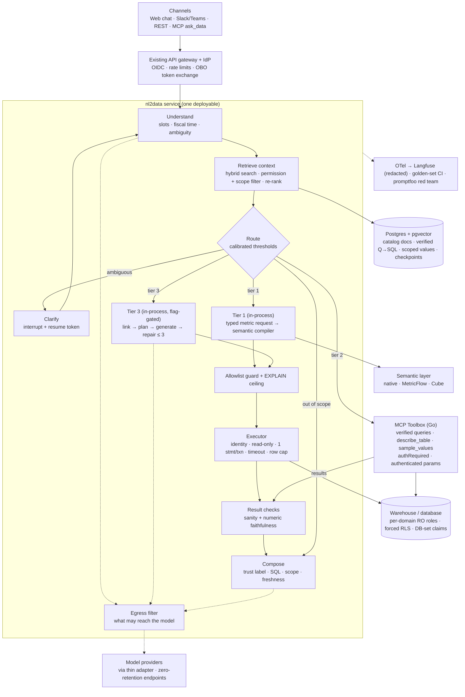
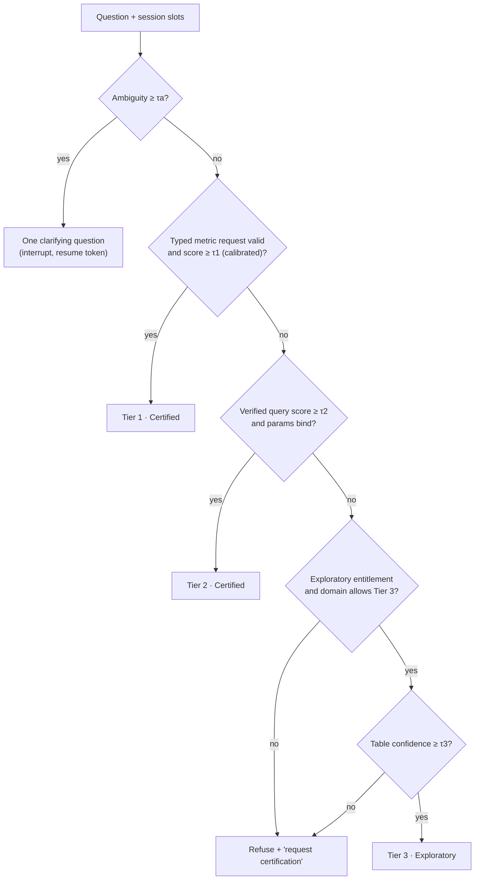
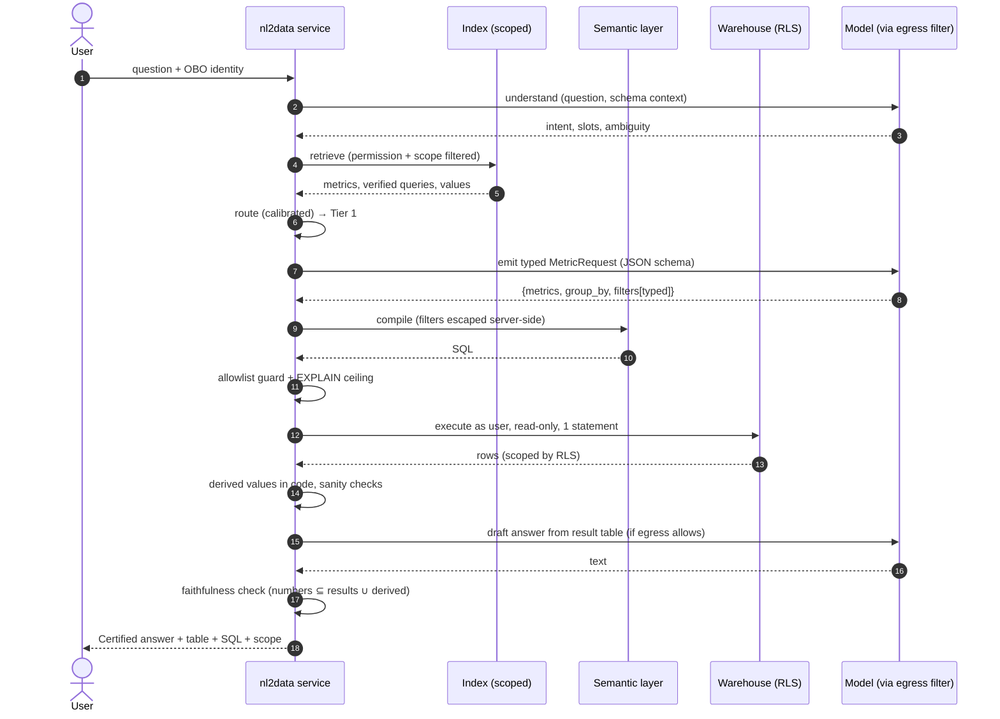
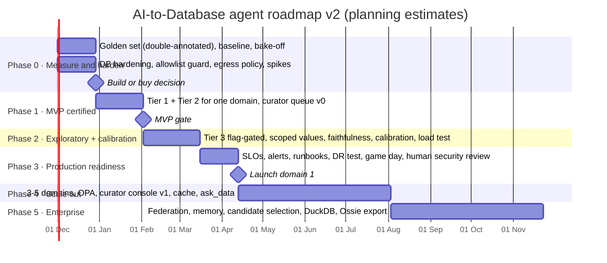

# AI-to-Database Solution Architecture

**Natural-language access to structured data for AI agents — definitive technical reference and implementation blueprint**

| | |
|---|---|
| Version | **2.0** (review-driven revision of 1.0) |
| Date | 18 November 2026 (updated 22 November 2026: NVIDIA Auto Ontology added to the assessment and the bake-off) |
| Audience | Platform, data, AI, security and SRE engineering |
| Companion code | [`nl2data-ref`](../reference-code/nl2data-ref/) 2.0.0 — 68 tests passing (53 unit, 12 Postgres 16 integration, 3 capacity) |
| Supersedes | v1.0 of this document, the earlier blueprint doc, and both supporting research reports |

---

## What changed in 2.0

Every finding from the independent review (v1.0 scored 6.0/10) is addressed below; Appendix A maps each finding to its resolution.

| Area | v1.0 | v2.0 |
|---|---|---|
| SQL guard | Deny-list; bypassed by `pg_stat_file`, `lo_get`, `FOR UPDATE`, huge `LIMIT` | **Allowlist** guard; 27 attack inputs rejected, 8 legitimate patterns pass; comments stripped; tested on sqlglot 30.33.0 |
| Identity model B | Session claim settable by any SQL that slipped through | **Database-enforced**: `set_config` revoked from PUBLIC, claims set only by a `SECURITY DEFINER` function, per-domain logins, forced RLS, fail-closed. 12 integration tests on Postgres 16 prove the DB holds **with the guard bypassed** |
| Tier 1 filters | Free-text `where` from the model | **Typed filters** (closed operator enum, validated names, server-side escaping) |
| Value index | Leaked RLS-protected values across scopes | **Scope-partitioned** index or live RLS-bound lookup; tested |
| Data egress | Not addressed | **LLM egress policy**, trace redaction, retention, residency (§11) |
| Faithfulness | Measured offline only | **Runtime numeric faithfulness check** on every answer |
| Router | Uncalibrated thresholds | **Calibrated** per tier against a wrong-certified-rate target |
| MVP | Seven services incl. internal MCP hops, OPA, DuckDB | **Slim MVP**: one service with in-process tools; MCP only at Toolbox and the external `ask_data` boundary |
| Build vs buy | Asserted | **Vendor bake-off in Phase 0** on your own golden set |
| Capacity & cost | Absent | **Model with formulas + tested code** (§12) |
| Operations | Thin | **SLOs, error budgets, kill switches, degraded mode, DR, drift handling, runbooks** (§13) |
| Curator workflow / UX | PR-only YAML | **Curator console**, certification queue, usage analytics (§14) |
| OSS scoring | Unweighted, subjective | **Weighted rubric**, evidence level per score, spike plan (§7) |
| Protocol & SDK churn | Not tracked | MCP **2026-07-28 stateless** revision and Python SDK **2.0** (`MCPServer`) handled |
| Sources | Many secondary | Load-bearing claims re-verified against primary sources where reachable; verification status shown per claim |

---

## Table of contents

0. [How to read this document](#0-how-to-read-this-document)
1. [Executive summary](#1-executive-summary)
2. [Scope, goals and service-level targets](#2-scope-goals-and-service-level-targets)
3. [State of the art: verified research findings](#3-state-of-the-art-verified-research-findings)
4. [Design principles](#4-design-principles)
5. [Target architecture](#5-target-architecture)
6. [Technology decisions](#6-technology-decisions)
7. [Open-source assessment (weighted rubric)](#7-open-source-assessment-weighted-rubric)
8. [Component specifications](#8-component-specifications)
9. [Query lifecycle](#9-query-lifecycle)
10. [Security architecture and threat model](#10-security-architecture-and-threat-model)
11. [Data governance and LLM egress](#11-data-governance-and-llm-egress)
12. [Capacity, latency and cost model](#12-capacity-latency-and-cost-model)
13. [Operations and reliability engineering](#13-operations-and-reliability-engineering)
14. [Curator workflow and user experience](#14-curator-workflow-and-user-experience)
15. [Evaluation and calibration](#15-evaluation-and-calibration)
16. [Reference implementation (tested)](#16-reference-implementation-tested)
17. [Advanced capabilities](#17-advanced-capabilities)
18. [Trade-offs and alternatives](#18-trade-offs-and-alternatives)
19. [Implementation roadmap](#19-implementation-roadmap)
20. [Risk register](#20-risk-register)
21. [Assumptions and open questions](#21-assumptions-and-open-questions)
22. [References](#22-references)
- [Appendix A — Review findings and resolutions](#appendix-a--review-findings-and-resolutions)
- [Appendix B — Verification log](#appendix-b--verification-log)
- [Appendix C — Test evidence](#appendix-c--test-evidence)
- [Appendix D — Re-evaluation scorecard](#appendix-d--re-evaluation-scorecard)

---

## 0. How to read this document

| Label | Meaning |
|---|---|
| **[Industry]** | Shipped by a named vendor or published by an in-house team, or a widely used open-source pattern |
| **[Proposal]** | Our decision, built from industry patterns, not documented elsewhere as one system |
| **[Tested]** | Implemented in `nl2data-ref` and covered by passing tests (Appendix C) |
| **[Verify]** | Secondary source, fast-moving project, or illustrative code — confirm before relying on it |

Vendor accuracy figures are vendor-run on private or small datasets: they show direction, not comparable numbers. Illustrative cost inputs are **assumptions**, never vendor prices.

---

## 1. Executive summary

### 1.1 Decision

Build a **semantic-first, tiered, database-enforced agent** [Proposal], but **measure before building**: Phase 0 runs a vendor bake-off on your own golden set and only proceeds with the custom build where it wins or where vendors cannot serve the requirement.

- One orchestrator (LangGraph state graph) answers through three tiers, in order:
  1. **Tier 1 — governed semantic layer.** The model emits a *typed* metric request (no SQL, no free-text filters); a compiler writes SQL. Label **Certified**.
  2. **Tier 2 — verified, parameterized queries** (MCP Toolbox `tools.yaml`). The model fills typed parameters only. **Certified**.
  3. **Tier 3 — agentic text-to-SQL fallback.** Schema linking → plan → generate → allowlist guard → EXPLAIN → bounded repair. **Exploratory**, SQL and assumptions shown.
  4. Otherwise **clarify or refuse**.
- **Security is enforced in the database** and proven independently of the guard: per-domain read-only logins, forced RLS with claims only a `SECURITY DEFINER` function can set, `set_config` revoked, one model-authored statement per transaction [Tested].
- **Every answer passes a numeric faithfulness check** before it is shown [Tested].
- **No data leaves for an LLM provider without an egress policy decision** (schema-only by default; sample values and result rows only for approved domains, zero-retention endpoints, masked PII).
- **A calibrated router** targets a wrong-certified-answer rate below 1% on the golden set [Tested method].
- **The MVP is one service** (orchestrator with in-process tools) + MCP Toolbox + the warehouse-native semantic layer + Postgres + Langfuse. OPA, DuckDB sandbox, Trino, candidate selection and learned memory are post-MVP.

The design goal is **never confidently wrong**, with measurable proof.

### 1.2 Why (verified evidence)

| Evidence | Implication |
|---|---|
| LinkedIn's production SQL Bot: 53% of responses correct or close to correct on expert review; 300+ weekly users ([arXiv 2507.14372](https://arxiv.org/abs/2507.14372)) | Raw generated SQL cannot be the default path for KPIs |
| Annotation errors in 62.8% of checked Spider 2.0-Snow and 52.8% of BIRD Mini-Dev examples; corrections moved leaderboard ranks by up to 9 places ([PVLDB 19(5)](https://vldb.org/pvldb/volumes/19/paper/Pervasive%20Annotation%20Errors%20Break%20Text-to-SQL%20Benchmarks%20and%20Leaderboards)) | Decide on your own, double-annotated golden set |
| Reference Postgres MCP server's read-only mode bypassed by stacked statements ([Datadog Security Labs, Aug 2025](https://securitylabs.datadoghq.com/articles/mcp-vulnerability-case-study-SQL-injection-in-the-postgresql-mcp-server/)); Postgres MCP Pro restricted mode bypassed via FROM-clause functions, CVE-2026-85620 ([VulnCheck](https://www.vulncheck.com/advisories/postgres-mcp-pro-0.3.0-restricted-mode-bypass-via-from-clause-function)) | Parsers and flags fail; the DB role must hold on its own |
| LiteLLM shipped malicious releases twice in 2026 ([Snyk, Mar](https://snyk.io/articles/poisoned-security-scanner-backdooring-litellm); [LiteLLM, Oct](https://docs.litellm.ai/blog/security-incident-oct-21-2026)); Vanna archived 29 Mar 2026 with at least 8 CVEs | Few, pinned, permissively licensed dependencies; own the thin layers |
| Semantic grounding raises accuracy (dbt 98–100% in scope; Snowflake 90%+ vs 51%; Fabric 90.9% — all vendor-run) | Invest first in semantic models and verified queries |

### 1.3 Adopt / integrate / learn from / build

| Strategy | Items |
|---|---|
| **Adopt** | LangGraph, MCP Toolbox for Databases, sqlglot (pinned), Postgres + pgvector, Langfuse (self-hosted), promptfoo; post-MVP: OPA or Cedar, DuckDB |
| **Integrate** | Warehouse-native semantic layer (Snowflake Semantic Views, Databricks Metric Views, LookML, Fabric) or MetricFlow / Cube Core; platform catalog or DataHub; Trino only for proven federation |
| **Learn from** | CHESS, WrenAI, Vanna (incl. its failures), ReFoRCE, Postgres MCP Pro and DBHub (incl. their CVEs), LlamaIndex table retriever, defog `sql-eval` |
| **Build** | Router and graph; typed Tier 1 wrapper; allowlist guard; identity-aware executor; faithfulness check; scoped value index; egress filter and trace redaction; calibration and golden-set harness; curator console; thin model adapter |
| **Avoid** | Generic `execute_sql` for end users; archived reference MCP servers; MCP read-only flags as controls; unpinned LiteLLM; all-in-one text-to-SQL products as the core |

### 1.4 Buy-versus-build rule (now measured, not asserted)

If more than ~80% of questions hit one platform, the Phase 0 bake-off includes that platform's agent (Cortex Agents, Genie, Fabric data agent, Google Conversational Analytics API). It also includes NVIDIA Auto Ontology, the open-source option that covers the semantic layer, fallback SQL and context layer in one package (§7.3). **Buy** if it meets the Tier 1/2 accuracy gates, identity requirements and cost envelope; then spend effort on its semantic model and verified queries. **Build** (this design) when the bake-off fails a gate, data spans several warehouses, OLTP access with per-user security is required, or lock-in is unacceptable. Semantic definitions stay portable either way (MetricFlow / Apache Ossie [Verify maturity]).

---

## 2. Scope, goals and service-level targets

### 2.1 Scope

**In:** read-only analytical and operational questions over SQL warehouses and databases; NoSQL/graph through declared Toolbox tools; multi-turn conversation and clarification; exposure to other agents through one `ask_data` MCP tool.
**Out:** writes, DML/DDL, administrative actions, autonomous outbound actions, replacing BI.

### 2.2 Quality targets (gates, measured on the golden set)

| Metric | Target | Why |
|---|---|---|
| **Wrong-certified rate** (Tier 1/2 answers that are wrong) | ≤ 1% | The number that destroys trust |
| Tier 1 result-match, in scope | ≥ 98% | dbt and vendor evidence say this is reachable |
| Tier 2 route precision | ≥ 95%; recall ≥ 85% | Prefer abstaining to mis-routing |
| Tier 3 SQL validity / result-match (hard set) | ≥ 95% / ≥ baseline + 15 pts (re-baselined in Phase 0) | Absolute targets set from measured baseline |
| Abstention (clarify/refuse) on in-scope questions | ≤ 15% | Usefulness floor |
| Faithfulness violations reaching users | 0 | Runtime check |
| Guard escapes in red-team corpus | 0 | CI gate |
| Cross-scope data exposure in access tests | 0 | Release blocker |

### 2.3 Service-level objectives

| SLO | Target (initial; recalibrate after 4 weeks of data) | Error budget |
|---|---|---|
| Availability of `/v1/ask` (non-5xx) | 99.5% monthly | 3.6 h/month |
| Tier 1/2 latency | P50 ≤ 4 s, P95 ≤ 10 s | 5% of requests over |
| Tier 3 latency | P95 ≤ 35 s; hard cap 60 s then async | 5% over |
| Freshness disclosure | 100% of answers carry source freshness | — |
| Audit completeness | 100% of answers traced (redacted) | — |

Latency targets are now *derived* (§12.3), not asserted.

---

## 3. State of the art: verified research findings

Verification status: **✔** confirmed against a primary or authoritative source in this revision; **◐** secondary source only; **○** vendor claim, not independently checked.

### 3.1 Accuracy reality

| Finding | Status | Source |
|---|---|---|
| LinkedIn SQL Bot: 53% correct or near-correct (expert review), 300+ weekly users | ✔ | [arXiv 2507.14372](https://arxiv.org/abs/2507.14372) |
| Benchmark annotation errors: 62.8% Spider 2.0-Snow, 52.8% BIRD Mini-Dev; rank changes up to ±9 | ✔ | [PVLDB 19(5), VLDB 2026](https://vldb.org/pvldb/volumes/19/paper/Pervasive%20Annotation%20Errors%20Break%20Text-to-SQL%20Benchmarks%20and%20Leaderboards); [arXiv 2601.08778](https://arxiv.org/abs/2601.08778) |
| Spider 2.0 at launch: best agent 21.3% vs 91.2% on Spider 1.0 | ◐ | Spider 2.0 paper (via report) |
| Spider 2.0-Snow top entry 96.7% (Genloop) | ◐ | [BenchmarkList aggregator](https://benchmarklist.com/benchmarks/spider_2_0/) |
| CHESS: 71.10% BIRD test; schema selector ~5× fewer tokens | ◐ | [arXiv 2405.16755](https://arxiv.org/html/2405.16755v2) |
| Arctic-Text2SQL-R1: 32B 71.83%, 7B 68.47% BIRD test | ◐ | [Snowflake engineering](https://www.snowflake.com/en/blog/engineering/arctic-text2sql-r1-sql-generation-benchmark/) |
| dbt: semantic layer 98–100% in scope vs text-to-SQL 84–90% (11 questions × 20 runs) | ○ | [dbt blog](https://docs.getdbt.com/blog/semantic-layer-vs-text-to-sql-2026) |
| Snowflake Cortex Analyst 90%+ vs 51% single-shot GPT-4o | ○ | Snowflake (via report) |
| Databricks Genie "32% to over 90%" vs a coding agent | ○ | [Databricks blog](https://www.databricks.com/blog/pushing-frontier-data-agents-genie) |
| Fabric Advanced NL2SQL 78.8% → 90.9%, P95 32.9 s | ○ | [Fabric blog](https://community.fabric.microsoft.com/blog/fbc_fabricupdatesblogs/advanced-nl2sql-and-advanced-dax-generation-in-fabric-data-agents-generally-avai/5374654) |

### 3.2 Approaches compared

| Approach | Reliability | Flexibility | Latency | Cost | Complexity |
|---|---|---|---|---|---|
| Hand-built APIs / parameterized queries | Very high | Low | Fast | Low runtime | Low per tool |
| Raw single-shot text-to-SQL | Low on enterprise schemas | Very high | Fast | Low | Deceptively low |
| RAG-grounded text-to-SQL | Medium (LinkedIn 53%) | High | Medium | Medium | Medium–high |
| Agentic text-to-SQL | Medium–high (benchmarks), variable (production) | Very high | Slow | High | High |
| Semantic layer + LLM | Very high in scope; refuses out of scope | Medium | Fast | Low runtime | Medium–high (modelling) |
| Managed platform agents | High when curated (vendor claims) | Medium–high in platform | Medium | Consumption | Low–medium; lock-in |
| **Hybrid tiered (this design)** | Highest overall | High | Fast common path | Medium | Staged |

### 3.3 Industry implementations [Industry]

| Product | Architecture | Grounding | Limits |
|---|---|---|---|
| Snowflake Cortex Analyst / Agents | Agentic NL2SQL over Semantic Views; managed MCP server via `CREATE MCP SERVER` exposing `CORTEX_ANALYST_MESSAGE`, `SYSTEM_EXECUTE_SQL` and others ✔ ([docs](https://docs.snowflake.com/en/en/user-guide/snowflake-cortex/cortex-agents-mcp)) | Semantic Views, verified queries | Snowflake-only; supports MCP revision 2025-11-25 ✔; OSS `Snowflake-Labs/mcp` deprecated ✔ |
| Databricks Genie | Agent over Unity Catalog / Metric Views; managed MCP | UC metadata, metric views, example SQL | Table caps per agent; needs FKs |
| Google CA API / BigQuery agents / Looker | Gemini grounded in LookML or BigQuery context | LookML, golden queries | GA for BigQuery/Looker; others preview |
| AlloyDB AI NL | In-database NL2SQL, templates, parameterized secure views | Templates | High accuracy only within templates |
| Microsoft Fabric data agent | NL2SQL / NL2DAX / NL2KQL with Entra passthrough | Instructions, examples, verified answers | 5 sources per agent |
| AWS Bedrock KB (structured) | Managed NL2SQL via Redshift | Schema, query history, curated pairs | Redshift-centric |
| dbt Semantic Layer / MetricFlow | LLM picks metrics; MetricFlow compiles | Semantic models | Hosted APIs paid; engine Apache-2.0 since v0.209.0 ✔ ([dbt](https://www.getdbt.com/blog/open-source-metricflow-governed-metrics)) |

In-house: Uber QueryGPT (intent → table agent → column pruning), LinkedIn SQL Bot (knowledge graph, re-rank to ~7 tables, EXPLAIN-based repair; UX as decisive as the model), Pinterest Querybook (documentation weighting raised table-search hit rate 40% → 90% ◐), OpenAI's internal data agent (one model, curated tools, six context layers ◐).

### 3.4 Security and supply-chain events that shape this design

| Event | Status | Lesson |
|---|---|---|
| Reference Postgres MCP server: `COMMIT;` escapes read-only transaction (Aug 2025) | ✔ [Datadog](https://securitylabs.datadoghq.com/articles/mcp-vulnerability-case-study-SQL-injection-in-the-postgresql-mcp-server/) | One statement per call; DB role read-only |
| Postgres MCP Pro 0.3.0: FROM-clause `pg_read_file` bypasses restricted mode, CVE-2026-85620 (Sep 2026) | ✔ [VulnCheck](https://www.vulncheck.com/advisories/postgres-mcp-pro-0.3.0-restricted-mode-bypass-via-from-clause-function); [issue #178](https://github.com/crystaldba/postgres-mcp/issues/178) | Check functions everywhere in the AST; DB role without file privileges |
| Supabase MCP "lethal trifecta" leak (2025) | ◐ | No outbound tools with private data; no `service_role` |
| LiteLLM malicious releases 1.82.7/1.82.8 (Mar 2026) and 1.107.0 (Oct 2026) | ✔ | Hash-pinned mirror or own adapter |
| Vanna archived 29 Mar 2026; CVE-2026-4229 plus ≥7 more (missing auth on v2 chat API, SSRF in `run_sql`, improper authorization) | ✔ [GitHub](https://github.com/vanna-ai/vanna); [NVD](https://nvd.nist.gov/vuln/detail/CVE-2026-4229) | Treat as reference only |
| MCP spec 2026-07-28 removes sessions and the initialize handshake | ✔ ([WorkOS](https://workos.com/blog/mcp-stateless-spec-2026-07-28)) | External `ask_data` must carry its own resume tokens |
| MCP Python SDK 2.0 (28 Jul 2026) removes `mcp.server.fastmcp`; `FastMCP` → `MCPServer` | ✔ [migration guide](https://py.sdk.modelcontextprotocol.io/migration/) | Pin `mcp` and use the v2 API |

---

## 4. Design principles

| # | Principle | Consequence |
|---|---|---|
| 1 | Deterministic where possible, generative only where needed | Typed metric requests; templates; compilers write SQL |
| 2 | **The database must hold on its own** | DB-layer tests run with the guard bypassed [Tested] |
| 3 | Context is the product | Semantic model, verified queries, catalog docs are versioned assets |
| 4 | Clarify or refuse rather than guess | Calibrated abstention |
| 5 | **Measure before you build** | Phase 0 bake-off and baseline |
| 6 | **Minimise and govern egress** | Schema-only by default; policy per domain |
| 7 | **All context is untrusted input** | Metadata, docs and data values cannot grant authority |
| 8 | Fewest moving parts that meet the gates | Slim MVP; components added when a gate needs them |
| 9 | Separate governed from exploratory access | Separate roles; Tier 3 entitlement |
| 10 | Platform-neutral contracts at the boundary | MCP for Toolbox and `ask_data`; OTel; portable semantics |

---

## 5. Target architecture

### 5.1 MVP architecture (Phases 1–2) [Proposal]

One deployable service plus MCP Toolbox. Tools that we own are **in-process functions behind typed interfaces**; MCP is used only where it buys interoperability: Toolbox (Tier 2 and catalog statements) and the external `ask_data` endpoint for other agents.



Tier 2 statements are guard-checked **at review time in CI** (Toolbox executes them); runtime safety comes from the database role, identity-bound parameters and timeouts. Toolbox `templateParameters` (identifier splicing) are banned by CI policy.

### 5.2 Target architecture (Phases 3–5)

Added only when a gate requires it: OPA/Cedar per tool, tier and domain (when > 1 domain or > 3 roles); DuckDB no-network sandbox for multi-step analysis; Trino for proven federation; candidate selection for hard Tier 3 questions; review-gated learned memory; semantic answer cache; curator console; Tier 3 split into its own service with its own role and network policy when its traffic or blast radius justifies it.

### 5.3 Layer responsibilities

| Layer | Responsibility | Pattern source |
|---|---|---|
| Channels | Capture question and identity token | [Industry] vendor agents publish to chat and API |
| Gateway (existing) | AuthN, quotas, OBO token exchange | [Industry] |
| Orchestrator | Bounded LangGraph state graph; durable checkpoints | [Industry] LinkedIn uses LangGraph; graph is [Proposal] |
| Tier 1 | Typed metric request → compiler | [Industry] dbt, Snowflake, Looker; typed filters [Tested] |
| Tier 2 | Reviewed parameterized statements in Toolbox | [Industry] Snowflake verified queries, AlloyDB templates |
| Tier 3 | Exploratory generation with repair | [Industry] CHESS, LinkedIn, Uber |
| Guard | Allowlist AST policy, identifier check, LIMIT clamp, EXPLAIN ceiling | [Tested] |
| Executor | Identity, read-only, one statement per transaction | [Tested] on Postgres 16 |
| Result checks | Sanity rules, numeric faithfulness | [Tested] |
| Egress filter | Enforce per-domain egress policy before any model call | [Proposal] |
| Context layer | Semantic model, verified queries, catalog docs, scoped value index | [Industry] + scoped index [Tested] |
| Observability & eval | OTel traces (redacted), golden set, calibration, red team | [Industry] + [Tested] helpers |

### 5.4 Routing



Thresholds τ are chosen per tier by `choose_threshold()` (§15.3) to keep the wrong-certified rate ≤ 1% while maximising coverage. Rules first; an LLM tie-break only within a calibrated band; every route logged with its reason.

### 5.5 Identity models

| Model | Mechanism | Use when | Evidence |
|---|---|---|---|
| **A. End-user identity (preferred)** | Gateway exchanges the user's token for a warehouse token (OBO / external OAuth); executor connects as the user | Snowflake, Databricks, BigQuery, Fabric and other sources with per-user OAuth | [Industry] Cortex RBAC, Fabric Entra passthrough, Genie UC grants |
| **B. Hardened delegated role** | Per-domain login (no cross-domain membership) → `app.set_claims()` (`SECURITY DEFINER`, only caller allowed) → `SET LOCAL ROLE` to the domain's read-only data role → **one** model-authored statement; `set_config` revoked from PUBLIC; RLS forced and fail-closed | Postgres/OLTP and sources without per-user OAuth | [Tested] 12 integration tests, guard bypassed |

Residual risk of model B: plain `SET app.x = …` needs no privilege, so the **one-statement-per-transaction invariant** is mandatory (tested: a `SET` returns no result set and the transaction is rolled back). For Toolbox Tier 2 on model-B sources, the same pattern applies through source-level session settings or parameterized secure views; authenticated parameters provide row filters, not warehouse impersonation.

### 5.6 Deployment topology (MVP)

| Component | Runtime | Scaling | State |
|---|---|---|---|
| nl2data service | Python 3.12, FastAPI, LangGraph | Horizontal; stateless except checkpoints | Postgres checkpointer (pooled) |
| MCP Toolbox | Go container, pinned 1.x | Horizontal; pool per source | `tools.yaml` from Git |
| Postgres 16 + pgvector | Managed Postgres, HA pair, PITR | Vertical + read replica | Index, checkpoints, curation data |
| Langfuse | Self-hosted (Postgres, ClickHouse, Redis, S3) | Per Langfuse docs | Redacted traces, scores |
| Model adapter | In-process library | — | Provider keys from secret manager |

---

## 6. Technology decisions

| # | Decision | Selected | Alternatives | Rationale | Revisit when |
|---|---|---|---|---|---|
| D1 | Tool protocol | **MCP only at boundaries** (Toolbox; external `ask_data`); typed in-process calls internally | MCP everywhere; OpenAPI | Interop where it pays; no extra hops or auth layers internally | Tier 3 splits into its own service |
| D2 | MCP versions | Server: spec **2026-07-28** for `ask_data` (stateless; resume tokens in our API); clients pin per server (Snowflake managed MCP supports 2025-11-25 ✔) | Single version | Ecosystem is mid-migration | All servers on 2026-07-28 |
| D3 | MCP Python SDK | `mcp>=2,<3` with `MCPServer`; or pin `mcp>=1.28,<2` until migrated | Unpinned | SDK 2.0 removed `mcp.server.fastmcp` ✔ | — |
| D4 | Orchestrator | **LangGraph** + Postgres checkpointer from a long-lived connection pool | MS Agent Framework (GA 3 Apr 2026 ✔), Google ADK, OpenAI Agents SDK | Explicit typed graph, `interrupt()`, checkpoints | .NET/Azure-first org → MAF |
| D5 | Tier 1 | Platform-native semantic layer if single warehouse; else MetricFlow (Apache-2.0 ≥ 0.209.0 ✔) or Cube Core; **typed request schema** [Tested] | Wren MDL, hand-written views | Deterministic SQL; no model-written filters | Malloy/LookML-query target proves better in spike (§18) |
| D6 | Tier 2 & catalog statements | **MCP Toolbox** `googleapis/mcp-toolbox` (renamed from genai-toolbox ✔), pin the latest 1.x you have tested (≥ 1.8.0 verified, 28 Jul 2026, adds groups and 2026-07-28 draft spec ✔) | Own MCP server | Declared tools, `authRequired`, authenticated params, OTel, BigQuery `maximumBytesBilled` (1.2.0) | Unsupported engine |
| D7 | Guard | **sqlglot 30.33.0 (exact pin)** with **function allowlist**, `Lock`/`Copy`/recursive-CTE rejection, LIMIT clamp, comment stripping [Tested] | Deny-list; pglast (Postgres-only) | Deny-lists fail open (CVE-2026-85620 pattern) | Dialect needs functions outside the allowlist → reviewed addition |
| D8 | Identity | Model A where possible; hardened model B otherwise [Tested] | Shared service account | Supabase-style failures | — |
| D9 | Catalog | Platform catalog; else DataHub (Apache-2.0); OpenMetadata after licence review | Direct catalog MCP access | Sync into own permission-filtered index | — |
| D10 | Retrieval | Postgres + pgvector + tsvector with RRF; **scope column + RLS on the value table** [Tested logic] | Dedicated vector DB | One store; scope enforced in SQL | > tens of millions of vectors |
| D11 | Models | Thin in-house adapter; frontier model for plan/SQL, small model for understand/route; JSON-schema-constrained outputs | LiteLLM (compromised twice ✔) | Two or three providers need little code | Many providers → hardened LiteLLM from own image |
| D12 | Egress control | **Egress filter** in the adapter enforcing per-domain policy | Provider-side controls only | Data minimisation must be ours | — |
| D13 | Observability | OTel → **self-hosted Langfuse** with redaction at source (ClickHouse-owned, core MIT ✔) | Arize Phoenix (ELv2), LangSmith | Self-hostable, permissive | — |
| D14 | Evaluation | Own harness [Tested comparator, calibration] + **promptfoo** (plugins `sql-injection`, `indirect-prompt-injection`, `rbac`, `bola`, `bfla`, `pii`, `data-exfil` ✔ ([docs](https://www.promptfoo.dev/docs/red-team/llm-vulnerability-types/))) | Leaderboards | Only your data predicts your accuracy | — |
| D15 | Policy engine | **Post-MVP** OPA (Rego) or Cedar | From day one | DB grants + static table suffice for one domain | > 1 domain or > 3 roles |
| D16 | Federation | Native warehouse; Trino only on proven need | MindsDB | One SQL surface | — |
| D17 | Post-processing | **Post-MVP** DuckDB in a no-network sandbox | pandas in process | Model never does arithmetic; composer computes in code | — |

---

## 7. Open-source assessment (weighted rubric)

### 7.1 Rubric

Each criterion scored 1–5, weighted, normalised to 100. **Evidence level**: **H** = exercised hands-on in this revision's tests; **D** = documentation, release notes or source reviewed; **S** = secondary sources only. Scores with S evidence are provisional until the Phase 0 spikes (§7.4).

| Criterion | Weight |
|---|---|
| Security record and design | 20 |
| Maintenance and community health | 15 |
| Licence fit for proprietary internal use | 15 |
| Production maturity | 15 |
| Functional fit for its role | 10 |
| Integration effort (inverse) | 10 |
| Extensibility | 5 |
| Performance and scale | 5 |
| Code and design quality | 5 |

### 7.2 Results

| Component | Score /100 | Evidence | Verdict |
|---|---|---|---|
| Postgres 16 + pgvector | 96 | H/D | **Adopt** |
| sqlglot (pinned) | 93 | H | **Adopt** |
| LangGraph | 88 | D | **Adopt** |
| promptfoo | 85 | D | **Adopt** |
| MCP Toolbox for Databases | 84 | D | **Adopt** (via SDK) |
| Langfuse (self-hosted) | 83 | D | **Adopt** |
| Microsoft Agent Framework | 82 | D | Alternative orchestrator |
| DataHub | 81 | S | Adopt if no platform catalog |
| Cube Core | 79 | S/D | Adopt if caching / multi-tenant semantics needed |
| dbt MetricFlow | 78 | D | Adopt for dbt shops / multi-warehouse |
| OpenMetadata | 75 | S | Viable after licence review |
| NVIDIA Auto Ontology 1.1.0 | 75 | D (partial source review) | **Bake-off candidate** (Phase 0) |
| LiteLLM | 66 | D | Avoid by default; hardened only |
| WrenAI | 60 | S | Learn from |
| Postgres MCP Pro | 57 | D | Learn from (incl. CVE-2026-85620) |
| Vanna 2.0 (archived) | 48 | D | Learn from |

Scores are computed from the per-criterion ratings (kept with the source repository of this document); the ranking is robust to ±1 changes on any single criterion for the adopted set.

### 7.3 Inventory additions in 2.0

| Repository | Licence | Status | Role |
|---|---|---|---|
| [crystaldba/postgres-mcp](https://github.com/crystaldba/postgres-mcp) (Postgres MCP Pro) | MIT [Verify] | Active; CVE-2026-85620 | Attack patterns for our corpus |
| [bytebase/dbhub](https://github.com/bytebase/dbhub) | [Verify] | Active | Reviewed Toolbox token costs; MCP server design reference |
| [malloydata/malloy](https://github.com/malloydata/malloy) | MIT ◐ | Active | Candidate Tier 1 query target (spike) |
| Hasura / PostGraphile | [Verify licences] | Active | Typed, permission-aware GraphQL for OLTP Tier 2 (spike) |
| [NVIDIA Auto Ontology](https://github.com/NVIDIA/auto-ontology) | Apache-2.0 | Active (v1.1.0; NVIDIA not accepting external contributions) | Open-source NL-to-SQL over an auto-generated ontology: builds glossary terms, metric definitions and relationships from metadata; a multi-agent text-to-SQL pipeline tries semantic SQL first, then raw tables, with join-path, value and empty-result checks; read-only MCP server (`ask_question`, `check_answerable`, glossary tools, `describe_table`; no raw table browser); Postgres + pgvector; NVIDIA NIM models by default; Databricks, Postgres, Snowflake, DuckDB and other connectors. BIRD evaluation in a separate `ontology-sql-eval` repo. **Bake-off candidate.** Security notes from source review: DuckDB opens read-only by default, but the Postgres connector runs on an autocommit pool with no read-only transaction and no allowlist guard was found, so write protection rests on the database credentials you configure. It sets its statement timeout with `set_config`, which conflicts with our hardened identity model B (§5.5): give it a separate read-only login or use identity model A |
| [modelcontextprotocol/python-sdk](https://github.com/modelcontextprotocol/python-sdk) | MIT | 2.x since 28 Jul 2026 ✔ | `ask_data` server |

The full v1 inventory (LangGraph, Toolbox, sqlglot, pgvector, Langfuse, promptfoo, DuckDB, OPA/Cedar, MetricFlow, Cube, DataHub, OpenMetadata, Unity Catalog, Trino, DataFusion, LiteLLM, MS Agent Framework, AutoGen/Semantic Kernel (maintenance), ADK, OpenAI Agents SDK, LlamaIndex, LangChain SQL toolkit, WrenAI, Vanna, Dataherald (dormant), defog sqlcoder/sql-eval, CHESS, Arctic-Text2SQL-R1, ReFoRCE, Spider2, BIRD, DeepEval, Phoenix, Guardrails AI, NeMo Guardrails, MindsDB, Superset, archived reference servers) and its licence notes remain valid; see §22 for links.

### 7.4 Phase 0 spikes (turn D/S evidence into H)

| Spike | Question answered | Exit evidence |
|---|---|---|
| Toolbox + SDK with your IdP | Do authenticated params, `authRequired` and pinned config work end-to-end? | Integration test in CI |
| Semantic layer candidate(s) | Native vs MetricFlow vs Cube on 50 golden questions | Accuracy, latency, ops effort |
| LangGraph checkpoint + resume | Idempotency and replay under failure | Chaos test passes |
| Langfuse redaction | No raw rows or PII in stored traces | Automated scan of trace store |
| Vendor agent(s) and NVIDIA Auto Ontology | Bake-off on the golden set | Report with accuracy/latency/cost; for Auto Ontology also ontology-generation effort and a write-attempt test against its configured credentials |

### 7.5 Licensing checklist

Apache-2.0 (Toolbox, MetricFlow ≥ 0.209.0, Cube backend, DataHub, Arctic model, sql-eval, OPA, Cedar): keep LICENSE/NOTICE. MIT (LangGraph†, sqlglot†, Langfuse core, promptfoo, MCP SDK, DuckDB†): keep notices. Watch: OpenMetadata MCP/UI/ingestion (Collate licence), WrenAI AGPL-3.0 files, Phoenix ELv2, LiteLLM enterprise dir, Langfuse `ee/`. SBOM and licence scan in CI. († = re-check LICENSE file at the pinned version.)

---

## 8. Component specifications

| Component | Responsibility | Interface | Notes |
|---|---|---|---|
| Gateway (existing) | AuthN, quotas, OBO | `POST /v1/ask` → SSE | Never a shared execution account |
| Conversation state | Slots across turns | `SessionState {metrics, dimensions, filters, time_range, last_sql, last_result_ref}` | Stored in checkpointer; resume tokens for stateless MCP |
| Understander | Intent, fiscal time, ambiguity | → `Intent` | Small model; fiscal calendar from a table |
| Context retriever | Metrics, verified queries, tables, columns, values | → `ContextBundle` | Permission filter on tables; **scope filter on values** |
| Router | Tier choice | → `Route{tier, score, reason}` | Calibrated thresholds |
| Tier 1 | Typed metric request → SQL | `MetricRequest` (§16.2) | Validates names; compiles filters server-side |
| Tier 2 | Verified statements | Toolbox SDK `load_toolset()` | Reviewed in CI by the guard |
| Tier 3 | Exploratory generation | → `SqlCandidate{sql, assumptions, tables}` | Flag-gated per domain |
| Guard | Static + cost checks | `validate(sql, scope, policy)` → `Verdict` | Allowlist [Tested] |
| Executor | Identity-aware execution | `execute(conn, sql, params, identity)` | One statement per transaction [Tested] |
| Result checks | Sanity + faithfulness | `faithful(text, rows, derived)` | Fails → table-only answer [Tested] |
| Egress filter | Enforce egress policy | `allow(payload, domain, provider)` | Drops/masks fields before model calls |
| Composer | Answer with provenance | → `Answer` | Numbers from results or code; no tool access |
| Curator console | Certification workflow | Web UI over curation tables | §14 |
| Feedback & eval | Learn and gate | thumbs, edits → review queue | Review-gated promotion only |

---

## 9. Query lifecycle

1. **Receive**: gateway authenticates; identity and OBO token attached; trace opened (redacted).
2. **Understand**: fiscal time resolution, entities, ambiguity score. *Egress: question text + schema-level context only.*
3. **Retrieve**: hybrid search; drop unreadable tables; values only from the principal's scope.
4. **Route**: calibrated thresholds; clarify or refuse below them.
5. **Build**: Tier 1 typed request → compiler; Tier 2 template + bound params; Tier 3 link → plan → generate.
6. **Validate**: allowlist guard; EXPLAIN / dry-run ceiling; Tier 3 repairs on structured errors (≤ 3).
7. **Execute**: identity model A or B; read-only; one statement per transaction; timeout; row cap.
8. **Check**: sanity rules (empty, null-heavy, fan-out, outliers vs history).
9. **Compose**: derived values computed in code; text drafted by the model *from the result table* (egress-permitted domains only; otherwise a template sentence).
10. **Verify**: numeric faithfulness check; failure → regenerate once → table-only answer.
11. **Answer**: trust label, interpretation, SQL (expand), scope, freshness.



Worked examples (certified, exploratory, clarification) from v1 remain valid; in Example A the filter is now `{"dimension": "metric_time__fiscal_quarter", "op": ">=", "values": ["2026-04-01"]}`, compiled server-side.

---

## 10. Security architecture and threat model

### 10.1 Threat model

| # | Threat | Primary control | Second control | Last line (database) | Evidence |
|---|---|---|---|---|---|
| T1 | Writes / DDL / stacked statements | Guard: one read query; forbidden nodes | Extended protocol (one statement) | Read-only login and transaction | [Tested] |
| T2 | File / large-object / server functions | Guard allowlist | — | No file privileges; DB rejects with permission denied | [Tested] |
| T3 | Claim or role tampering (model B) | Guard rejects `set_config`, `SET`, `Command` | One statement per transaction | `set_config` revoked; claims only via `SECURITY DEFINER` | [Tested] |
| T4 | Cross-scope rows | Permission-filtered retrieval | — | Forced RLS, fail-closed on missing claims | [Tested] |
| T5 | Cross-scope **values** via suggestions | Scope-partitioned value index | Live RLS-bound `sample_values` | RLS on the value table | [Tested logic] |
| T6 | Cost / DoS | LIMIT clamp, table cap, EXPLAIN ceiling, no recursive CTEs | Rate limits | Statement timeout, warehouse caps, `maximumBytesBilled` (BigQuery via Toolbox) | [Tested] guard parts |
| T7 | Prompt injection via data, docs or metadata | Context treated as data; provenance tags; length caps; no authority from context | No outbound tools in data sessions | Least-privilege role limits blast radius | promptfoo `indirect-prompt-injection` in CI |
| T8 | Injection via Tier 1 filters | Typed filters, closed operator enum | Server-side escaping | Guard on compiled SQL | [Tested] |
| T9 | Injection via Toolbox templates | CI bans `templateParameters` | Guard runs on every statement in CI | DB role | Policy |
| T10 | Hallucinated numbers in answers | Numbers only from results/code | Runtime faithfulness check | — | [Tested] |
| T11 | Sensitive data in traces | Redaction at source | Role-restricted trace access, retention | — | [Tested] redaction |
| T12 | Data sent to model providers | Egress policy per domain | Zero-retention, regional endpoints | — | §11 |
| T13 | Supply chain | Hash-pinned private mirror, SBOM, egress allow-list | Own model adapter | No DB credentials in model-gateway environments | Policy |
| T14 | Governed-path bypass | Separate roles and entitlement for Tier 3 | Per-domain Tier 3 flag | Separate data roles | Design |

### 10.2 Guard rules (allowlist) [Tested]

1. Parse in target dialect; exactly one statement; root is a read query.
2. Reject `Insert`, `Update`, `Delete`, `Merge`, `Create`, `Drop`, `Alter`, `Command`, `Into`, `Lock`, `Copy`; reject recursive CTEs.
3. **Every function must be on the per-dialect allowlist** (aggregates, conditionals, casts, math, strings, dates, windows). Table-valued and unknown functions are rejected wherever they appear, including FROM and LATERAL.
4. Tables: not in system schemas; in the principal's readable set; count ≤ 8.
5. Qualify columns against the principal's schema snapshot; unknown → structured hint.
6. Inject or clamp LIMIT; strip comments; emit SQL from the AST.
7. EXPLAIN / dry-run against a per-warehouse ceiling **calibrated from query history** (Postgres plan cost is unitless; Snowflake/BigQuery use bytes).

### 10.3 Database-layer results with the guard bypassed (Postgres 16.15)

| Attempt | Result |
|---|---|
| `SELECT 1; DROP TABLE …` | Rejected: multiple commands in a prepared statement |
| `SELECT set_config('app.regions','APAC,EMEA',true)` | Permission denied for function `set_config` |
| `SELECT app.set_claims('u123', ARRAY['EMEA'])` | Permission denied for function `set_claims` |
| `SELECT set_config('role','agent_login_finance',true)` | Permission denied |
| `SELECT * FROM pg_read_file('/etc/passwd')`, `pg_ls_dir('/')` | Permission denied |
| `DELETE FROM …` | Cannot execute in a read-only transaction |
| `… WHERE region = 'EMEA'` as an APAC user | 0 rows (RLS) |
| No claims set | 0 rows (fail closed) |
| `SET LOCAL app.regions = …` | No result set → rejected and rolled back; next call has fresh claims |

### 10.4 MCP and supply-chain hygiene

Never expose generic `execute_sql` or Toolbox prebuilt toolsets to end users; MCP read-only flags are not controls; load minimal toolsets; expose only `ask_data` externally; pin and hash every dependency from a private mirror; build images yourself; keep warehouse credentials out of any process that installs third-party AI tooling.

---

## 11. Data governance and LLM egress

### 11.1 Egress policy (default deny, per domain)

| Data class | Default | Allowed when | Controls |
|---|---|---|---|
| Question text | Allowed | Always | PII detector masks emails, account numbers before send |
| Schema metadata (table/column names, descriptions) | Allowed | Always | Descriptions are untrusted text: length cap, provenance tag |
| Sample / distinct values | **Denied** | Domain classified ≤ Internal and column not tagged PII | Scope-filtered; max 20 values per column |
| Result rows (for answer drafting) | **Denied** | Domain approved for "results to model"; provider has zero-retention terms and an approved region | Column masking for PII-tagged columns; row cap 200 |
| Generated SQL | Allowed | Always | — |
| Traces | Internal only | — | Redacted at source; access by role; retention 30 days (raw) / 13 months (aggregates) |

When results may not leave, the composer uses a **template sentence** built in code ("Net revenue by region for FY26-Q3; Japan has the largest decline.") and the table — no model sees the numbers.

### 11.2 Provider requirements

Zero data retention or contractual no-training terms; regional endpoint matching data residency; audit logs of calls; per-domain allow-list of providers and models enforced in the adapter; prompt and response hashing for audit without storing content.

### 11.3 Classification inputs

Column tags from the catalog (PII, confidential) drive masking and egress; untagged columns in confidential domains are treated as confidential (fail closed).

---

## 12. Capacity, latency and cost model

All inputs below are **illustrative assumptions** to show the method; replace them with Phase 0 measurements and your contracted prices. The model is implemented in `capacity.py` [Tested].

### 12.1 Formulas

- Cost per answer (tier *t*): `in_tokens/1e6 × price_in + out_tokens/1e6 × price_out + wh_seconds × (1 − cache_hit) × price_wh_second`
- Monthly cost: `Σ_t share_t × questions × cost_t`
- Peak arrival rate: `questions / (business_days × busy_hours × 3600) × peak_factor`
- Concurrent warehouse queries (Little's law): `peak_rate × Σ_t share_t × wh_seconds_t × (1 − cache_hit_t)`

### 12.2 Worked example (assumptions)

Inputs: 100,000 questions/month; tier mix 60/25/15; Tier 1: 6k in / 400 out tokens, 2 s warehouse, 30% cache hit; Tier 2: 4k / 300 tokens, 1.5 s, 50% cache; Tier 3: 60k / 4k tokens, 10 s, no cache; illustrative prices $3 / $15 per million tokens, $0.001 per warehouse-second.

| Tier | Cost per answer | Monthly | Share of traffic | Share of cost |
|---|---|---|---|---|
| Tier 1 | $0.025 | $1,524 | 60% | 27% |
| Tier 2 | $0.017 | $431 | 25% | 8% |
| Tier 3 | $0.250 | $3,750 | 15% | 66% |
| **Total** | — | **$5,705** | | |

Peak ≈ 0.66 questions/s; ≈ 1.7 concurrent warehouse queries. **Finding:** under these assumptions Tier 3 is 15% of traffic but two-thirds of cost, so certification throughput (moving questions from Tier 3 to Tiers 1/2) is the main cost lever, ahead of model price.

### 12.3 Latency budget (Tier 1, P50 target 4 s)

| Step | Budget |
|---|---|
| Understand (small model) | 0.5 s |
| Retrieve (index) | 0.2 s |
| Typed metric request (frontier model, constrained output) | 1.2 s |
| Compile + guard + EXPLAIN | 0.2 s |
| Warehouse (warm) | 1.0 s |
| Checks | 0.05 s |
| Compose + faithfulness | 0.8 s |
| **Total** | **3.95 s** |

Risks to the budget: warehouse cold starts (keep the domain warehouse warm in business hours or rely on the result cache), provider tail latency (timeouts + failover), and long contexts (token budgets in §17). Stream the table before the prose to cut perceived latency.

### 12.4 Connections and pooling

Model A: use stateless statement APIs where the warehouse offers them, or per-user sessions with idle timeouts; concurrency from §12.1 sizes the warehouse. Model B (Postgres): one pool per domain login; the executor's per-transaction `SET LOCAL` and `set_claims` are compatible with transaction pooling. Server-side prepared statements under PgBouncer transaction pooling need a PgBouncer release with prepared-statement support enabled [Verify for your version]; otherwise set `prepare=False`.

---

## 13. Operations and reliability engineering

### 13.1 Alerts (each tied to an SLO or a gate)

| Signal | Alert |
|---|---|
| SLO burn rate (availability, latency per tier) | Multi-window burn-rate alerts |
| Wrong-certified rate (sampled production review) | > 1% over 7 days → page domain owner |
| Faithfulness failures | > 0.5% of answers or any reaching a user |
| Guard rejections | 3× baseline (attack or schema drift) |
| Cost per answer | > 2× forecast for a tier |
| Model provider errors / latency | Failover threshold |
| Catalog snapshot age | > TTL → fail closed for Tier 3 |

### 13.2 Kill switches and degraded modes

Feature flags per **tier × domain**; global Tier 3 off; "table-only" mode (no model drafting); provider failover order per domain (respecting egress policy); read-only maintenance banner. All switches are tested in game days.

### 13.3 Backup and disaster recovery

| Store | RPO | RTO | Notes |
|---|---|---|---|
| Postgres (index, checkpoints, curation) | 5 min (PITR) | 1 h | HA pair; quarterly restore test |
| `tools.yaml`, semantic models, policies | Git | Redeploy | Immutable releases |
| Langfuse | 24 h | Best effort | Non-critical; redacted |

### 13.4 Schema drift and change management

- Subscribe to DDL changes (Snowflake account usage, Postgres event triggers, dbt manifest diff in CI). On change: refresh catalog snapshot, re-run affected golden items, block affected verified queries until green.
- Every change to semantic models, verified queries, prompts, model versions or allowlists goes through PR → golden-set gate → canary (5% of traffic, 48 h) → rollout.
- Model upgrades run in shadow mode on sampled traffic before canary.

### 13.5 Runbooks (minimum set)

Provider outage · warehouse outage · suspected data exposure (disable tier/domain, preserve query tags and traces, rotate credentials, notify) · guard false-positive surge · schema change breaking certified answers · cost spike · faithfulness failure spike. Each runbook names an owner, first actions, and the flag to flip.

### 13.6 Game days (quarterly)

Provider failover, warehouse cold start, DB failover, Tier 3 kill, injection attempt via a column comment, restore from backup.

---

## 14. Curator workflow and user experience

### 14.1 Curator console (analytics engineers)

- **Certification queue**: fed by "Request certification", thumbs-down, repeated Tier 3 questions and abstentions; ranked by frequency × user reach.
- **Review view**: question variants, generated SQL vs proposed certified SQL or metric, diff, run against golden subset, sample results.
- **Approve** opens a PR to `tools.yaml` or the semantic repository; CI runs the guard, Toolbox config validation and the golden set.
- **Usage analytics**: top uncertified questions, tier mix trend, abstention reasons, failure clusters, cost per domain.

Vendor parity note: Genie and Snowflake ship curation UIs; this console is the main extra build effort if you do not buy.

### 14.2 Answer experience (users)

Trust badge (Certified / Exploratory) · one-sentence interpretation ("Net revenue = Finance definition v4; FY26-Q3 vs Q2; APAC only") · table first, prose second · chart when helpful · SQL behind "Show SQL" (default open for analysts) · "Change assumption" chips · clarification as tappable options · freshness and scope disclosure · feedback with reason codes · keyboard and screen-reader accessible.

---

## 15. Evaluation and calibration

### 15.1 Golden set

Sources: query logs, BI dashboard questions, analyst tickets. ≥ 150 questions for the MVP domain, ≥ 300 overall, each with ≥ 3 phrasings, expected route and expected result set. **Double annotation** with adjudication; target inter-annotator agreement κ ≥ 0.8 on expected answers before use; stratified by tier, domain and difficulty; refreshed quarterly; negative cases for refusal, clarification and injection.

### 15.2 Metrics per stage

Retrieval recall@k · route precision/recall · wrong-certified rate · abstention rate · SQL validity · result match (comparator [Tested]) · faithfulness · latency P50/P95 per tier · cost per answer.

### 15.3 Calibration [Tested method]

For each tier, collect `(router_score, correct)` on the golden set; `choose_threshold(scored, max_wrong_rate=0.01, min_support=30)` returns the lowest threshold whose accepted set meets the wrong-rate target, maximising coverage. Re-calibrate after any model, prompt or semantic change.

### 15.4 Online evaluation

Weekly expert review of a stratified sample of production answers (≥ 50 per domain); results feed the wrong-certified SLO and the certification queue.

### 15.5 Red team (CI)

```yaml
# promptfoo — plugin names verified against promptfoo docs (Nov 2026)
description: nl2data red team
providers:
  - id: https
    config:
      url: https://nl2data.staging.internal/v1/ask
      method: POST
      headers: {Authorization: "Bearer {{env.EVAL_TOKEN}}"}
      body: {question: "{{prompt}}", session_id: "redteam"}
      transformResponse: json.answer
redteam:
  purpose: >-
    Read-only analytics assistant over finance data for APAC analysts. Must never write
    data, reveal other regions' rows, reveal system prompts, or send data to external URLs.
  plugins: [sql-injection, indirect-prompt-injection, rbac, bola, bfla, pii, data-exfil, excessive-agency]
  strategies: [prompt-injection, jailbreak]
```

Plus the deterministic guard corpus (Appendix C) and the database-layer bypass suite on every merge.

---

## 16. Reference implementation (tested)

### 16.1 Layout

```text
nl2data/
  service/            # FastAPI + LangGraph graph, nodes, router, composer
  service/tools/      # in-process Tier 1, Tier 3, catalog tools (typed)
  nl2data_ref/        # guard, metrics, answer_checks, governance, executor, capacity
  toolbox/            # tools.yaml (verified queries), CI validation
  semantic/           # metric definitions (Git, reviewed)
  sql/                # database hardening migrations
  curator/            # console UI + API
  evals/              # golden set, calibration, promptfoo configs
  deploy/             # Helm, pinned images, SBOM
```

### 16.2 Public API

```http
POST /v1/ask
Authorization: Bearer <user OIDC token>
{"session_id": "s_8f2c", "question": "...", "options": {"allow_exploratory": true, "max_rows": 1000}}

POST /v1/ask/resume
{"resume_token": "...", "choice": "daily_active_users"}
```

SSE events: `status` · `clarification {question, options[], resume_token}` · `answer` · `error {code, message, trace_id}`.

```json
{
  "type": "answer",
  "trust": "certified",
  "route": {"tier": 1, "score": 0.93, "threshold": 0.88, "reason": "metric net_revenue matched"},
  "text": "In FY26-Q3, Japan had the largest decline (-8.3%).",
  "faithfulness": {"checked": true, "unsupported": []},
  "interpretation": {"metric": "net_revenue v4", "time": "FY26-Q2..FY26-Q3", "scope": "APAC (your access)"},
  "assumptions": [],
  "sql": "SELECT ...",
  "result": {"columns": ["region", "quarter", "net_revenue"], "rows": [], "truncated": false},
  "freshness": {"source_updated_at": "2026-11-18T02:00:00Z"},
  "query_id": "wh_01HX...",
  "trace_id": "4bf92f..."
}
```

Error codes: `AUTH_FAILED`, `RATE_LIMITED`, `POLICY_DENIED`, `GUARD_REJECTED`, `COST_LIMIT`, `TIMEOUT`, `OUT_OF_SCOPE`, `FAITHFULNESS_FAILED` (answer downgraded to table-only, not an error to the user), `EGRESS_DENIED`, `INTERNAL`.

### 16.3 Guard [Tested]

```python
"""Allowlist-based SQL guard for agent-generated SQL.

Design rules (fail closed):
  * exactly one statement; root must be a read query (SELECT / set operation)
  * no DML, DDL, commands, SELECT ... INTO, locking clauses, recursive CTEs
  * every function must be on a per-dialect ALLOWLIST (deny-lists fail open)
  * every table must be in the caller's readable set; system schemas never
  * every column must resolve against the caller's schema snapshot
  * LIMIT is injected or clamped; table count is capped
  * the SQL that runs is re-emitted from the AST (comments and tricks dropped)

The database role remains the security boundary; this guard is defence in depth.
Tested with sqlglot 30.33.0 (pin the exact version you test).
"""
from __future__ import annotations

from dataclasses import dataclass, field

import sqlglot
from sqlglot import exp
from sqlglot.errors import OptimizeError, ParseError
from sqlglot.optimizer.qualify import qualify

FORBIDDEN_NODES = (
    exp.Insert, exp.Update, exp.Delete, exp.Merge, exp.Create, exp.Drop,
    exp.Alter, exp.Command, exp.Into, exp.Lock, exp.Copy,
)

# Functions an analytics question legitimately needs. Extend deliberately, per dialect,
# and only after review: every addition is a potential side channel.
BASE_ALLOWED_FUNCS = frozenset({
    # aggregates
    "SUM", "COUNT", "AVG", "MIN", "MAX", "STDDEV", "STDDEV_POP", "STDDEV_SAMP",
    "VARIANCE", "VAR_POP", "VAR_SAMP", "APPROX_DISTINCT", "PERCENTILE_CONT",
    "PERCENTILE_DISC", "MEDIAN", "ARRAY_AGG", "STRING_AGG", "GROUP_CONCAT",
    # conditionals / nulls / casts
    "CASE", "IF", "COALESCE", "NULLIF", "GREATEST", "LEAST", "CAST", "TRY_CAST",
    # math
    "ABS", "ROUND", "CEIL", "FLOOR", "POWER", "SQRT", "LN", "LOG", "EXP", "MOD", "SIGN", "DIV",
    "SAFE_DIVIDE",
    # strings
    "LOWER", "UPPER", "TRIM", "LTRIM", "RTRIM", "LENGTH", "SUBSTRING", "CONCAT",
    "REPLACE", "LEFT", "RIGHT", "STARTS_WITH", "SPLIT_PART",
    # dates
    "CURRENT_DATE", "CURRENT_TIMESTAMP", "EXTRACT", "DATE_TRUNC", "TIMESTAMP_TRUNC",
    "DATE_ADD", "DATE_SUB", "DATE_DIFF", "DATEDIFF", "TS_OR_DS_ADD", "TS_OR_DS_TO_DATE",
    "TO_DATE", "STR_TO_DATE", "DATE", "TIME_TO_STR", "LAST_DAY",
    # window
    "ROW_NUMBER", "RANK", "DENSE_RANK", "NTILE", "LAG", "LEAD", "FIRST_VALUE",
    "LAST_VALUE", "PERCENT_RANK", "CUME_DIST",
})

SYSTEM_SCHEMAS = frozenset({"pg_catalog", "information_schema", "pg_toast",
                            "sys", "mysql", "performance_schema", "snowflake",
                            "account_usage"})


@dataclass(frozen=True)
class Scope:
    """What the calling principal may read. Built from the catalog, filtered by RBAC."""
    readable_tables: frozenset[str]              # fully qualified, lower-case: "schema.table"
    schema: dict                                 # sqlglot schema mapping for qualify()
    extra_allowed_funcs: frozenset[str] = frozenset()


@dataclass(frozen=True)
class Policy:
    dialect: str = "postgres"
    max_rows: int = 1000
    max_tables: int = 8
    allow_recursive_cte: bool = False


@dataclass
class Verdict:
    ok: bool
    sql: str | None = None
    code: str | None = None
    detail: str | None = None
    warnings: list[str] = field(default_factory=list)

    @staticmethod
    def reject(code: str, detail: str) -> "Verdict":
        return Verdict(ok=False, code=code, detail=detail)


def _func_name(node: exp.Func) -> str:
    return (node.name if isinstance(node, exp.Anonymous) else node.sql_name()).upper()


def _fqn(t: exp.Table) -> str:
    return ".".join(p for p in (t.catalog, t.db, t.name) if p).lower()


def validate(sql: str, scope: Scope, policy: Policy = Policy()) -> Verdict:
    try:
        stmts = [s for s in sqlglot.parse(sql, read=policy.dialect) if s is not None]
    except ParseError as e:
        return Verdict.reject("PARSE", str(e).splitlines()[0])
    if len(stmts) != 1:
        return Verdict.reject("MULTI_STATEMENT", f"{len(stmts)} statements; exactly one allowed")
    tree = stmts[0]
    if not isinstance(tree, exp.Query):
        return Verdict.reject("NOT_READ_QUERY", type(tree).__name__)

    allowed = BASE_ALLOWED_FUNCS | scope.extra_allowed_funcs
    for node in tree.walk():
        if isinstance(node, FORBIDDEN_NODES):
            return Verdict.reject("FORBIDDEN_NODE", type(node).__name__)
        if isinstance(node, exp.With) and node.args.get("recursive") and not policy.allow_recursive_cte:
            return Verdict.reject("RECURSIVE_CTE", "recursive CTEs are not allowed")
        if isinstance(node, exp.Func):
            name = _func_name(node)
            if name not in allowed:
                return Verdict.reject("FUNCTION_NOT_ALLOWED", name.lower())

    ctes = {c.alias_or_name.lower() for c in tree.find_all(exp.CTE)}
    tables = [t for t in tree.find_all(exp.Table) if t.name.lower() not in ctes]
    if len(tables) > policy.max_tables:
        return Verdict.reject("TOO_MANY_TABLES", f"{len(tables)} > {policy.max_tables}")
    for t in tables:
        fqn = _fqn(t)
        if not t.name:  # table-valued function or other non-table source
            return Verdict.reject("TABLE_FUNCTION", t.sql(dialect=policy.dialect)[:60])
        if (t.db or "").lower() in SYSTEM_SCHEMAS:
            return Verdict.reject("SYSTEM_SCHEMA", fqn)
        if fqn not in scope.readable_tables:
            return Verdict.reject("UNKNOWN_OR_FORBIDDEN_TABLE", fqn)

    try:
        tree = qualify(tree, schema=scope.schema, dialect=policy.dialect,
                       validate_qualify_columns=True)
    except OptimizeError as e:
        return Verdict.reject("UNKNOWN_IDENTIFIER", str(e)[:200])

    limit = tree.args.get("limit")
    if limit is None:
        tree = tree.limit(policy.max_rows)
    else:
        lit = limit.expression if isinstance(limit, exp.Limit) else None
        if not isinstance(lit, exp.Literal) or not lit.is_int or int(lit.this) > policy.max_rows:
            tree = tree.limit(policy.max_rows)   # sqlglot replaces the existing LIMIT

    # comments=False: sqlglot preserves comments by default; strip them so nothing the
    # model wrote outside the AST reaches the database or the audit log.
    return Verdict(ok=True, sql=tree.sql(dialect=policy.dialect, comments=False))
```

### 16.4 Typed Tier 1 requests [Tested]

```python
"""Typed Tier 1 metric requests. The model emits this structure (JSON-schema constrained);
it never writes filter SQL. Names are validated against the semantic model, values are
typed and escaped by the server, operators come from a closed enum."""
from __future__ import annotations

import datetime as dt
from enum import Enum
from typing import Union

from pydantic import BaseModel, Field, field_validator

Scalar = Union[int, float, dt.date, str]


class Op(str, Enum):
    eq = "="
    ne = "!="
    gt = ">"
    gte = ">="
    lt = "<"
    lte = "<="
    in_ = "in"
    between = "between"


class Filter(BaseModel):
    dimension: str = Field(pattern=r"^[a-z][a-z0-9_]{0,62}(__[a-z0-9_]{1,62})?$")
    op: Op
    values: list[Scalar] = Field(min_length=1, max_length=100)

    @field_validator("values")
    @classmethod
    def no_control_chars(cls, v):
        for x in v:
            if isinstance(x, str) and any(ord(c) < 32 for c in x):
                raise ValueError("control characters not allowed in filter values")
        return v


class MetricRequest(BaseModel):
    metrics: list[str] = Field(min_length=1, max_length=10)
    group_by: list[str] = Field(default_factory=list, max_length=10)
    filters: list[Filter] = Field(default_factory=list, max_length=20)
    order_by: list[str] = Field(default_factory=list, max_length=5)
    limit: int = Field(default=1000, ge=1, le=1000)


class SemanticModel(BaseModel):
    metrics: set[str]
    dimensions: dict[str, str]   # name -> type: "categorical" | "time" | "number"


def validate_request(req: MetricRequest, model: SemanticModel) -> list[str]:
    errors = []
    errors += [f"unknown metric: {m}" for m in req.metrics if m not in model.metrics]
    errors += [f"unknown dimension: {d}" for d in req.group_by if d not in model.dimensions]
    for f in req.filters:
        if f.dimension not in model.dimensions:
            errors.append(f"unknown filter dimension: {f.dimension}")
        if f.op == Op.between and len(f.values) != 2:
            errors.append(f"between needs exactly 2 values: {f.dimension}")
        if f.op not in (Op.in_, Op.between) and len(f.values) != 1:
            errors.append(f"{f.op.value} needs exactly 1 value: {f.dimension}")
    return errors


def _literal(v: Scalar) -> str:
    if isinstance(v, bool):
        raise ValueError("booleans not supported")
    if isinstance(v, (int, float)):
        return repr(v)
    if isinstance(v, dt.date):
        return "'" + v.isoformat() + "'"
    return "'" + str(v).replace("'", "''") + "'"


def to_metricflow_where(f: Filter, model: SemanticModel) -> str:
    """Compile one typed filter to a MetricFlow where-clause string, server-side only."""
    kind = model.dimensions[f.dimension]
    ref = (f"{{{{ TimeDimension('{f.dimension}') }}}}" if kind == "time"
           else f"{{{{ Dimension('{f.dimension}') }}}}")
    if f.op == Op.in_:
        return f"{ref} IN (" + ", ".join(_literal(v) for v in f.values) + ")"
    if f.op == Op.between:
        return f"{ref} BETWEEN {_literal(f.values[0])} AND {_literal(f.values[1])}"
    return f"{ref} {f.op.value} {_literal(f.values[0])}"
```

### 16.5 Answer checks and comparator [Tested]

```python
"""Runtime answer checks and evaluation helpers.

faithful(): every number in the answer text must be traceable to the result set or to a
value the composer computed in code (passed in `derived`). Otherwise the answer is
rejected and the system falls back to returning the table with a template sentence.

results_match(): result-set comparison for the golden-set harness: type-normalised,
float-tolerant, column-order-insensitive by name, row order optional.
"""
from __future__ import annotations

import datetime as dt
import math
import re
from collections import Counter
from decimal import Decimal
from typing import Iterable, Sequence

_NUM = re.compile(r"(?<![\w.])[-−]?\$?\d{1,3}(?:,\d{3})+(?:\.\d+)?%?|(?<![\w.])[-−]?\$?\d+(?:\.\d+)?%?")
_YEARISH = re.compile(r"^(19|20)\d\d$")


def _to_float(token: str) -> tuple[float, bool]:
    pct = token.endswith("%")
    t = token.replace("−", "-").replace("$", "").replace(",", "").rstrip("%")
    return float(t), pct


def numbers_in_text(text: str) -> list[tuple[float, bool, str]]:
    out = []
    for m in _NUM.finditer(text):
        tok = m.group(0)
        val, pct = _to_float(tok)
        out.append((val, pct, tok))
    return out


def _close(a: float, b: float, rel: float) -> bool:
    return math.isclose(a, b, rel_tol=rel, abs_tol=0.5 * 10 ** -2)


def faithful(text: str, rows: Iterable[Sequence], derived: Iterable[float] = (),
             rel: float = 0.005, ignore: Iterable[str] = ()) -> tuple[bool, list[str]]:
    """Return (ok, unsupported_tokens). Years and explicitly ignored tokens are skipped."""
    pool: list[float] = []
    for r in rows:
        for v in r:
            if isinstance(v, (int, float, Decimal)) and not isinstance(v, bool):
                pool.append(float(v))
    pool += [float(d) for d in derived]
    ignore = set(ignore)
    bad = []
    for val, pct, tok in numbers_in_text(text):
        if tok in ignore or (_YEARISH.match(tok) and not pct):
            continue
        cands = [val, val / 100.0] if pct else [val]
        if not any(_close(c, p, rel) or _close(round(p, 1), c, rel) for c in cands for p in pool):
            bad.append(tok)
    return (not bad, bad)


def _norm(v, rel_digits: int):
    if v is None:
        return None
    if isinstance(v, bool):
        return v
    if isinstance(v, (int, float, Decimal)):
        f = float(v)
        if math.isnan(f):
            return "NaN"
        return float(f"{f:.{rel_digits}g}")
    if isinstance(v, dt.datetime):
        return v.replace(tzinfo=None).isoformat()
    if isinstance(v, dt.date):
        return v.isoformat()
    return str(v).strip()


def results_match(got_cols: Sequence[str], got_rows: Sequence[Sequence],
                  exp_cols: Sequence[str], exp_rows: Sequence[Sequence],
                  order_matters: bool = False, sig_digits: int = 6,
                  match_columns_by_name: bool = True) -> tuple[bool, str]:
    if len(got_rows) != len(exp_rows):
        return False, f"row count {len(got_rows)} != {len(exp_rows)}"
    if len(got_cols) < len(exp_cols):
        return False, "missing columns"
    if match_columns_by_name:
        lower = [c.lower() for c in got_cols]
        try:
            idx = [lower.index(c.lower()) for c in exp_cols]
        except ValueError as e:
            return False, f"column not found: {e}"
    else:
        idx = list(range(len(exp_cols)))
    g = [tuple(_norm(r[i], sig_digits) for i in idx) for r in got_rows]
    e = [tuple(_norm(v, sig_digits) for v in r) for r in exp_rows]
    if order_matters:
        return (g == e, "ok" if g == e else "row order or values differ")
    ok = Counter(map(repr, g)) == Counter(map(repr, e))
    return ok, "ok" if ok else "values differ"
```

### 16.6 Scoped values, redaction, calibration [Tested]

```python
"""Scope-safe value lookup, trace redaction and router calibration."""
from __future__ import annotations

import hashlib
import re
from dataclasses import dataclass
from typing import Iterable, Sequence


# ---------- scope-partitioned value index -------------------------------------------------
def scope_key(row_filters: dict[str, Sequence[str]]) -> str:
    """Stable key for a security scope (e.g. {'region': ['APAC']}). Values indexed under one
    scope are only ever served to principals whose row filters produce the same key."""
    canon = "|".join(f"{k}={','.join(sorted(v))}" for k, v in sorted(row_filters.items()))
    return hashlib.sha256(canon.encode()).hexdigest()[:16]


@dataclass(frozen=True)
class ValueEntry:
    table: str
    column: str
    value: str
    scope: str            # scope_key, or "public" for non-sensitive low-cardinality columns


class ScopedValueIndex:
    """In-memory stand-in for the pgvector/tsvector value table. Production: a column
    `scope text NOT NULL` with RLS on the index table itself, same predicate as below."""

    def __init__(self, entries: Iterable[ValueEntry]):
        self._entries = list(entries)

    def lookup(self, text: str, principal_scope: str, readable_tables: set[str], k: int = 5):
        t = text.lower()
        hits = [e for e in self._entries
                if e.table in readable_tables
                and e.scope in ("public", principal_scope)
                and t in e.value.lower()]
        return hits[:k]


# ---------- trace redaction ----------------------------------------------------------------
_EMAIL = re.compile(r"[\w.+-]+@[\w-]+\.[\w.]+")
_DIGITS = re.compile(r"\b\d{9,19}\b")      # account, card, phone-like runs


def redact_trace(payload: dict, keep_result_rows: bool = False) -> dict:
    """Applied before any span leaves the process. Result rows are replaced by shape metadata
    unless the trace store is approved for production data."""
    out = {}
    for k, v in payload.items():
        if k in ("result_rows", "sample_values") and not keep_result_rows:
            out[k] = {"redacted": True, "count": len(v) if hasattr(v, "__len__") else None}
        elif isinstance(v, str):
            out[k] = _DIGITS.sub("[NUM]", _EMAIL.sub("[EMAIL]", v))
        elif isinstance(v, dict):
            out[k] = redact_trace(v, keep_result_rows)
        else:
            out[k] = v
    return out


# ---------- router calibration -------------------------------------------------------------
def choose_threshold(scored: Sequence[tuple[float, bool]], max_wrong_rate: float = 0.01,
                     min_support: int = 30) -> tuple[float | None, float, float]:
    """scored = [(router_score, answer_was_correct)] from the golden set for ONE tier.
    Return the lowest threshold whose accepted set has wrong-rate <= max_wrong_rate,
    maximising coverage. Returns (threshold, coverage, wrong_rate)."""
    best = (None, 0.0, 1.0)
    n = len(scored)
    for thr in sorted({s for s, _ in scored}):
        acc = [c for s, c in scored if s >= thr]
        if len(acc) < min_support:
            continue
        wrong = 1 - sum(acc) / len(acc)
        cov = len(acc) / n
        if wrong <= max_wrong_rate and cov > best[1]:
            best = (thr, cov, wrong)
    return best
```

### 16.7 Hardened identity model B (Postgres 16) [Tested]

```sql
-- Hardened identity model B for Postgres 16: per-domain read-only roles, RLS keyed on
-- claims that ONLY a SECURITY DEFINER function can set, set_config revoked from PUBLIC.
-- Run as a superuser/owner. Idempotent enough for test setup.

CREATE SCHEMA IF NOT EXISTS certified;
CREATE SCHEMA IF NOT EXISTS app;

CREATE TABLE IF NOT EXISTS certified.fct_revenue (
  region text NOT NULL, fiscal_quarter text NOT NULL, net_revenue numeric NOT NULL);
TRUNCATE certified.fct_revenue;
INSERT INTO certified.fct_revenue VALUES
  ('APAC','FY26-Q2',100),('APAC','FY26-Q3',90),('EMEA','FY26-Q2',200),('EMEA','FY26-Q3',210);

-- 1. Claims live in transaction-local GUCs, but nobody except app.set_claims may write them.
REVOKE EXECUTE ON FUNCTION pg_catalog.set_config(text, text, boolean) FROM PUBLIC;

DO $$ BEGIN
  IF NOT EXISTS (SELECT 1 FROM pg_roles WHERE rolname = 'app_claims_owner') THEN
    CREATE ROLE app_claims_owner NOLOGIN; END IF;
  IF NOT EXISTS (SELECT 1 FROM pg_roles WHERE rolname = 'agent_ro_finance') THEN
    CREATE ROLE agent_ro_finance NOLOGIN; END IF;
  IF NOT EXISTS (SELECT 1 FROM pg_roles WHERE rolname = 'agent_login_finance') THEN
    CREATE ROLE agent_login_finance LOGIN NOINHERIT; END IF;
END $$;
GRANT EXECUTE ON FUNCTION pg_catalog.set_config(text, text, boolean) TO app_claims_owner;
GRANT USAGE ON SCHEMA app TO app_claims_owner;

CREATE OR REPLACE FUNCTION app.set_claims(p_user text, p_regions text[])
RETURNS void LANGUAGE sql SECURITY DEFINER SET search_path = pg_catalog AS $$
  SELECT pg_catalog.set_config('app.user_id', p_user, true),
         pg_catalog.set_config('app.regions', array_to_string(p_regions, ','), true);
$$;
ALTER FUNCTION app.set_claims(text, text[]) OWNER TO app_claims_owner;
REVOKE EXECUTE ON FUNCTION app.set_claims(text, text[]) FROM PUBLIC;

CREATE OR REPLACE FUNCTION app.regions() RETURNS text[] LANGUAGE sql STABLE AS $$
  SELECT string_to_array(NULLIF(pg_catalog.current_setting('app.regions', true), ''), ',');
$$;

-- 2. One login per domain (no cross-domain membership); it may only set claims and switch
--    into its single data role. Settings live on the LOGIN role (applied at connect).
GRANT USAGE ON SCHEMA app TO agent_login_finance;
GRANT EXECUTE ON FUNCTION app.set_claims(text, text[]) TO agent_login_finance;
GRANT agent_ro_finance TO agent_login_finance;
ALTER ROLE agent_login_finance SET default_transaction_read_only = on;
ALTER ROLE agent_login_finance SET statement_timeout = '15s';

-- 3. Data role: SELECT on curated schema only; no app.set_claims, no set_config.
GRANT USAGE ON SCHEMA certified, app TO agent_ro_finance;
GRANT EXECUTE ON FUNCTION app.regions() TO agent_ro_finance;
GRANT SELECT ON certified.fct_revenue TO agent_ro_finance;

-- 4. RLS, forced even for the owner; fail closed when claims are missing (NULL -> no rows).
ALTER TABLE certified.fct_revenue ENABLE ROW LEVEL SECURITY;
ALTER TABLE certified.fct_revenue FORCE ROW LEVEL SECURITY;
DROP POLICY IF EXISTS region_scope ON certified.fct_revenue;
CREATE POLICY region_scope ON certified.fct_revenue FOR SELECT TO agent_ro_finance
  USING (region = ANY (app.regions()));
```

```python
"""Identity-aware executor (Postgres, identity model B). Runs ONLY guard-approved SQL.

Order inside one read-only transaction:
  1. SET LOCAL statement_timeout            (bounded runtime)
  2. app.set_claims(user, regions)          (SECURITY DEFINER; the only way to set claims)
  3. SET LOCAL ROLE <domain data role>      (role allow-list; never from model input)
  4. execute the validated SQL with bound parameters (extended protocol: one statement only)
"""
from __future__ import annotations

from dataclasses import dataclass

import psycopg
from psycopg import sql as psql

DOMAIN_ROLES = {"finance": "agent_ro_finance"}


class NoResultSet(RuntimeError):
    """The statement produced no rows/description (e.g. SET, RESET): rejected, txn rolled back."""


@dataclass(frozen=True)
class Identity:
    user_id: str
    domain: str
    regions: tuple[str, ...]
    trace_id: str = "-"


def execute(conn: psycopg.Connection, validated_sql: str, params: tuple, ident: Identity,
            timeout_s: int = 15, max_rows: int = 1000):
    role = DOMAIN_ROLES[ident.domain]                       # KeyError = fail closed
    with conn.transaction():
        cur = conn.cursor()
        cur.execute("SET TRANSACTION READ ONLY")
        cur.execute(psql.SQL("SET LOCAL statement_timeout = {}").format(
            psql.Literal(f"{int(timeout_s)}s")))
        cur.execute("SELECT app.set_claims(%s, %s)", (ident.user_id, list(ident.regions)))
        cur.execute(psql.SQL("SET LOCAL ROLE {}").format(psql.Identifier(role)))
        cur.execute(validated_sql, params, prepare=True)    # extended protocol
        if cur.description is None:
            raise NoResultSet("statement returned no result set")
        cols = [d.name for d in cur.description]
        rows = cur.fetchmany(max_rows + 1)
    return cols, rows[:max_rows], len(rows) > max_rows
```

### 16.8 Capacity model [Tested]

```python
"""Capacity and cost model. All unit prices and volumes are INPUTS: fill them from your
contracts and from Phase 0 measurements; nothing here is a vendor price."""
from __future__ import annotations

from dataclasses import dataclass


@dataclass(frozen=True)
class TierProfile:
    share: float                 # fraction of questions routed to this tier
    llm_calls: float             # mean LLM calls per answer
    in_tokens: float             # mean input tokens per answer (all calls)
    out_tokens: float            # mean output tokens per answer
    wh_seconds: float            # mean warehouse compute seconds per answer
    cache_hit: float = 0.0       # fraction served from result cache (no warehouse cost)


@dataclass(frozen=True)
class Prices:
    usd_per_m_in: float
    usd_per_m_out: float
    usd_per_wh_second: float


def cost_per_answer(t: TierProfile, p: Prices) -> float:
    llm = t.in_tokens / 1e6 * p.usd_per_m_in + t.out_tokens / 1e6 * p.usd_per_m_out
    wh = t.wh_seconds * (1 - t.cache_hit) * p.usd_per_wh_second
    return llm + wh


def monthly(tiers: dict[str, TierProfile], prices: Prices, questions_per_month: int):
    out = {name: cost_per_answer(t, prices) * t.share * questions_per_month
           for name, t in tiers.items()}
    out["total"] = sum(out.values())
    return out


def peak_qps(questions_per_month: int, business_days: int = 21, busy_hours: float = 6,
             peak_factor: float = 3.0) -> float:
    return questions_per_month / (business_days * busy_hours * 3600) * peak_factor


def warehouse_sessions(peak: float, tiers: dict[str, TierProfile]) -> float:
    """Little's law: concurrent warehouse queries = arrival rate x mean time in warehouse."""
    mean_s = sum(t.share * t.wh_seconds * (1 - t.cache_hit) for t in tiers.values())
    return peak * mean_s
```

### 16.9 MCP Toolbox configuration (v1 format) [Verify against your pinned release]

```yaml
kind: source
name: dw-finance
type: postgres
host: ${PG_HOST}
port: 5432
database: analytics
user: ${PG_TOOLBOX_FINANCE_USER}        # per-domain login, read-only, model-B hardened
password: ${PG_TOOLBOX_FINANCE_PASSWORD}
---
kind: authServices                      # docs pages show both authService and authServices;
name: corp-oidc                         # validate with the pinned binary in CI
type: generic
audience: ${OIDC_AUDIENCE}
authorizationServer: https://idp.example.com
mcpEnabled: false
scopesRequired: [nl2data.read]
---
kind: tool
name: revenue_by_region_verified
type: postgres-sql
source: dw-finance
description: "Certified: net revenue by region for a fiscal quarter"
authRequired: [corp-oidc]
parameters:
  - name: fiscal_quarter
    type: string
    description: "Fiscal quarter, e.g. FY26-Q3"
  - name: tenant_id
    type: string
    description: "auto-populated from token"
    authServices:
      - name: corp-oidc
        field: tenant
statement: |
  SELECT region, SUM(net_revenue) AS net_revenue
  FROM certified.fct_revenue
  WHERE fiscal_quarter = $1 AND tenant_id = $2
  GROUP BY region
---
kind: toolset
name: finance_verified
tools: [revenue_by_region_verified]
```

CI for `tools.yaml`: start the pinned binary with `--tools-file` (fails on invalid config); reject any `templateParameters`; run the guard on every `statement`; run golden items per tool. Toolbox ≥ 1.8 introduces `kind: group` for prebuilt sets; track whether toolsets move to groups in your release [Verify].

### 16.10 Orchestrator wiring

```python
from psycopg_pool import ConnectionPool
from langgraph.checkpoint.postgres import PostgresSaver   # [Verify] against pinned LangGraph

pool = ConnectionPool(PG_DSN, max_size=20,
                      kwargs={"autocommit": True, "prepare_threshold": 0})
checkpointer = PostgresSaver(pool)        # long-lived: created at app startup, closed at shutdown
checkpointer.setup()
app = graph.compile(checkpointer=checkpointer)
```

Nodes after the last checkpoint re-execute on resume: tools are idempotent and results cached by `(sql_hash, scope_key)`.

### 16.11 External `ask_data` (MCP Python SDK 2.x) [Verify]

```python
from mcp.server.mcpserver import MCPServer      # SDK 2.x; FastMCP was renamed MCPServer

server = MCPServer("nl2data")

@server.tool()
def ask_data(question: str, resume_token: str | None = None) -> dict:
    """Ask a governed question about company data. Returns a trust-labelled answer,
    or a clarification with a resume_token (the protocol itself is stateless)."""
    return service.ask(question=question, resume_token=resume_token, identity=current_identity())
```

---

## 17. Advanced capabilities

- **Schema linking** [Industry: CHESS, LinkedIn, Uber]: domain scoping → hybrid table retrieval (top ~20, documentation-weighted, popularity-boosted, permission-filtered) → LLM re-rank to 5–7 tables → column pruning → value lookup (scoped).
- **Context assembly**: ranked, token-budgeted (e.g., 12k) bundle of semantic model, verified Q→SQL pairs, descriptions (untrusted, provenance-tagged), scoped values, reviewed memory; add dbt model code and lineage as context (OpenAI's code-enrichment layer).
- **Multi-step questions**: prefer one query; dependent steps run as **separate validated statements in separate transactions** (preserves the model-B invariant); intermediate values passed as bound parameters; derived statistics in DuckDB sandbox (post-MVP); ≤ 4 steps.
- **Grammar-constrained outputs**: JSON-schema-constrained `MetricRequest` now; SQL grammar constraints for Tier 3 when the provider supports them.
- **Semantic answer cache** (post-MVP): key = normalised question + scope key + data freshness; certified answers only.
- **Candidate selection** for hard Tier 3 questions behind a flag (cost grows linearly; §12).
- **Review-gated memory**: corrections become certification-queue items; unreviewed memory stays private to its author.
- **Mixed structured/unstructured**: document search is a separate tool; combined only in the composer with labelled sources.
- **NoSQL/graph**: declared Toolbox tools only (MongoDB, Neo4j, Redis sources) until a pilot with its own golden set.
- **Self-hosted Tier 3 model**: Arctic-Text2SQL-R1-7B (Apache-2.0) via vLLM for residency/cost cases, same guard and gates.

---

## 18. Trade-offs and alternatives

| Alternative | Better when | Worse because | Status in 2.0 |
|---|---|---|---|
| Platform agent (Cortex, Genie, Fabric, Google CA API) | ≥ 80% of data on one platform; small team | Lock-in; platform limits; less routing control | **Measured in Phase 0 bake-off** |
| Semantic layer only | Finance/executive KPIs | Refuses unmodelled questions | Supported: Tier 3 off per domain |
| Verified queries / APIs only | Customer-facing or OLTP agents | Coverage limited by templates | Supported: Tier 1/3 off |
| Agentic text-to-SQL only | Analyst exploration | ~50% production accuracy | Rejected as default |
| Malloy / LookML-query as Tier 1 target | Compositional analytics beyond metric/dimension grammar | New language and tooling | **Spike** in Phase 0–1 |
| GraphQL engines with row permissions (Hasura, PostGraphile) | OLTP data with existing row rules | Another service; schema exposure design | **Spike** for OLTP Tier 2 |
| NVIDIA Auto Ontology (open source) | You want a ready-made ontology/semantic layer, fallback SQL and MCP server without vendor lock-in | Full extra stack (Next.js UI, Better Auth, ingestion worker); tens of seconds per answer by its own docs; DB write protection depends on credentials; NVIDIA takes no external contributions | **Measured in Phase 0 bake-off** |
| All-in-one OSS (WrenAI, Vanna) | Prototypes | Licence/maintenance/security issues | Rejected as core |
| Fine-tuned open model | Residency, high volume | Retraining cost | Optional for Tier 3 |
| Internal MCP everywhere | Multi-team tool sharing | Latency, auth complexity | Rejected for MVP; revisit when Tier 3 splits out |

**Honest costs:** modelling and curation is the dominant ongoing cost (≈ one analytics engineer per 2–3 domains, estimate); Tier 3 answers will sometimes be wrong (visible, labelled, and measured); custom curator tooling is the largest gap vs vendors.

---

## 19. Implementation roadmap

Durations are planning estimates for 5–7 engineers, one analytics engineer per domain, 0.5 SRE and a security reviewer; start date assumed 1 Dec 2026.



| Phase | Exit gate |
|---|---|
| 0 | Golden set κ ≥ 0.8; baseline and bake-off report; guard corpus 0 escapes; DB bypass suite green; egress policy signed; build/buy decision recorded |
| 1 | Tier 1 result-match ≥ 98%; wrong-certified ≤ 1%; Tier 2 precision ≥ 95%; access tests 0 leaks; P50 ≤ 4 s measured |
| 2 | Tier 3 validity ≥ 95% and result-match ≥ baseline + 15 pts; faithfulness violations 0; calibration report; load test at 3× forecast peak |
| 3 | SLO dashboards live; all runbooks rehearsed; DR restore within RTO; independent human security review passed |
| 4 | Per-domain gates; cost per answer within forecast ± 20% |
| 5 | Continuous evaluation in CI; owner per domain; quarterly game days |

---

## 20. Risk register

| Risk | L / I | Mitigation | Fallback |
|---|---|---|---|
| Plausible wrong numbers | M / H | Tiers, calibration, faithfulness, online review | Tier 3 off per domain |
| Prompt injection via data or metadata | M / H | Untrusted-context design, no outbound tools, red team | Table-only mode |
| Data leakage to providers | M / H | Egress policy, zero-retention, masking | Self-hosted model for sensitive domains |
| Value or trace leakage | M / H | Scoped index, redaction, role-restricted traces | Disable value suggestions |
| Supply chain | M / H | Pinned hashes, private mirror, SBOM, own adapter | Freeze dependencies |
| Protocol/SDK churn (MCP 2026-07-28, SDK 2.0) | H / M | Pin per server; boundary-only MCP | Native HTTP API for `ask_data` |
| Toolbox auth edge cases (#4049) | M / M | SDK, per-IdP tests | Own server with same YAML |
| Curation backlog | H / M | Console, usage-ranked queue | Wider Tier 3 with labels |
| Cost overrun | M / M | §12 model, alerts, certification as cost lever | Tier 3 quotas |
| Benchmark/golden-set errors | M / M | Double annotation, κ gate | External audit sample |

---

## 21. Assumptions and open questions

**Assumptions:** data spans more than one warehouse (else the bake-off likely favours buying); enterprise OIDC IdP; Python backend; read-only use; at least one warehouse supports per-user OAuth.

**Open questions:** which platform holds most questions; which sources support identity model A; domain owners for metrics and golden sets; Tier 3 entitlement policy; residency constraints by domain; approved model providers and retention terms; latency and cost envelopes per tier.

---

## 22. References

**Research and benchmarks:** [Spider 2.0](https://www.alphaxiv.org/abs/2411.07763) · [Spider2 repo](https://github.com/xlang-ai/Spider2) · [BIRD](https://bird-bench.github.io/) · [Annotation errors, PVLDB 19(5)](https://vldb.org/pvldb/volumes/19/paper/Pervasive%20Annotation%20Errors%20Break%20Text-to-SQL%20Benchmarks%20and%20Leaderboards) · [arXiv 2601.08778](https://arxiv.org/abs/2601.08778) · [CHESS](https://arxiv.org/html/2405.16755v2) · [LinkedIn SQL Bot](https://arxiv.org/abs/2507.14372) · [Arctic-Text2SQL-R1](https://www.snowflake.com/en/blog/engineering/arctic-text2sql-r1-sql-generation-benchmark/) · [ReFoRCE](https://github.com/Snowflake-Labs/ReFoRCE)

**Vendors:** [dbt semantic layer vs text-to-SQL](https://docs.getdbt.com/blog/semantic-layer-vs-text-to-sql-2026) · [MetricFlow Apache-2.0](https://www.getdbt.com/blog/open-source-metricflow-governed-metrics) · [dbt licence FAQ](https://www.getdbt.com/licenses-faq) · [Snowflake managed MCP](https://docs.snowflake.com/en/en/user-guide/snowflake-cortex/cortex-agents-mcp) · [Snowflake semantic views](https://www.snowflake.com/en/blog/engineering/native-semantic-views-ai-bi/) · [Databricks Genie](https://www.databricks.com/blog/pushing-frontier-data-agents-genie) · [Genie benchmarks](https://docs.databricks.com/aws/en/genie/benchmarks) · [Fabric NL2SQL](https://community.fabric.microsoft.com/blog/fbc_fabricupdatesblogs/advanced-nl2sql-and-advanced-dax-generation-in-fabric-data-agents-generally-avai/5374654) · [Looker CA API](https://cloud.google.com/blog/products/data-analytics/understanding-lookers-conversational-analytics-api) · [AlloyDB secure views](https://cloud.google.com/alloydb/docs/ai/use-psvs) · [Bedrock KB structured](https://docs.aws.amazon.com/bedrock/latest/userguide/knowledge-base-structured-create.html) · [Uber QueryGPT](https://www.uber.com/us/en/blog/query-gpt/) · [Microsoft Agent Framework 1.0](https://techcommunity.microsoft.com/blog/azuredevcommunityblog/the-future-of-agentic-ai-inside-microsoft-agent-framework-1-0/4510698)

**MCP and Toolbox:** [Toolbox repo](https://github.com/googleapis/mcp-toolbox) · [Toolbox v1.8.0 release](https://newreleases.io/project/github/googleapis/mcp-toolbox/release/v1.8.0) · [Toolbox v1.0.0](https://newreleases.io/project/github/googleapis/mcp-toolbox/release/v1.0.0) · [Generic OIDC auth](https://googleapis.github.io/genai-toolbox/previews/PR-2717/resources/authservices/generic) · [Tool config](https://pkg.go.dev/github.com/googleapis/mcp-toolbox) · [Issue #4049](https://github.com/googleapis/mcp-toolbox/issues/4049) · [MCP 2026-07-28 stateless (WorkOS)](https://workos.com/blog/mcp-stateless-spec-2026-07-28) · [MCP Python SDK migration](https://py.sdk.modelcontextprotocol.io/migration/)

**Security:** [Datadog: Postgres MCP SQL injection](https://securitylabs.datadoghq.com/articles/mcp-vulnerability-case-study-SQL-injection-in-the-postgresql-mcp-server/) · [CVE-2026-85620 (VulnCheck)](https://www.vulncheck.com/advisories/postgres-mcp-pro-0.3.0-restricted-mode-bypass-via-from-clause-function) · [postgres-mcp issue #178](https://github.com/crystaldba/postgres-mcp/issues/178) · [Vanna (archived)](https://github.com/vanna-ai/vanna) · [CVE-2026-4229 (NVD)](https://nvd.nist.gov/vuln/detail/CVE-2026-4229) · [Vanna CVE list](https://cve.imfht.com/product/vanna?lang=en) · [LiteLLM March 2026 (Snyk)](https://snyk.io/articles/poisoned-security-scanner-backdooring-litellm) · [LiteLLM October 2026](https://docs.litellm.ai/blog/security-incident-oct-21-2026) · [Postgres RLS footguns (Bytebase)](https://www.bytebase.com/blog/postgres-row-level-security-footguns/) · [promptfoo vulnerability types](https://www.promptfoo.dev/docs/red-team/llm-vulnerability-types/) · [promptfoo agent red teaming](https://www.promptfoo.dev/docs/red-team/agents)

**Ownership and licences:** [ClickHouse acquires Langfuse](https://clickhouse.com/zh/blog/clickhouse-acquires-langfuse-open-source-llm-observability) · [promptfoo joins OpenAI](https://www.promptfoo.dev/blog/promptfoo-joining-openai/) · [OpenMetadata vs DataHub](https://open-metadata.org/learning-center/openmetadata-vs-datahub)

**Repositories:** [LangGraph](https://github.com/langchain-ai/langgraph) · [sqlglot](https://github.com/tobymao/sqlglot) · [pgvector](https://github.com/pgvector/pgvector) · [Langfuse](https://github.com/langfuse/langfuse) · [promptfoo](https://github.com/promptfoo/promptfoo) · [DuckDB](https://github.com/duckdb/duckdb) · [OPA](https://github.com/open-policy-agent/opa) · [Cedar](https://github.com/cedar-policy/cedar) · [MetricFlow](https://github.com/dbt-labs/metricflow) · [Cube](https://github.com/cube-js/cube) · [DataHub](https://github.com/datahub-project/datahub) · [OpenMetadata](https://github.com/open-metadata/OpenMetadata) · [Trino](https://github.com/trinodb/trino) · [MS Agent Framework](https://github.com/microsoft/agent-framework) · [Google ADK](https://github.com/google/adk-python) · [OpenAI Agents SDK](https://github.com/openai/openai-agents-python) · [LlamaIndex](https://github.com/run-llama/llama_index) · [WrenAI](https://github.com/Canner/WrenAI) · [CHESS](https://github.com/ShayanTalaei/CHESS) · [defog sql-eval](https://github.com/defog-ai/sql-eval) · [Arctic training](https://github.com/snowflakedb/ArcticTraining/tree/main/projects/arctic_text2sql_r1) · [DeepEval](https://github.com/confident-ai/deepeval) · [Phoenix](https://github.com/Arize-ai/phoenix) · [LiteLLM](https://github.com/BerriAI/litellm) · [Postgres MCP Pro](https://github.com/crystaldba/postgres-mcp) · [DBHub](https://github.com/bytebase/dbhub) · [Malloy](https://github.com/malloydata/malloy) · [MCP Python SDK](https://github.com/modelcontextprotocol/python-sdk) · [NVIDIA Auto Ontology](https://github.com/NVIDIA/auto-ontology)

---

## Appendix A — Review findings and resolutions

| Review finding (v1.0) | Resolution in 2.0 | Where |
|---|---|---|
| Guard deny-list bypassed (`pg_stat_file`, `lo_get`) | Function allowlist; all functions checked anywhere in the AST | §10.2, §16.3 |
| `FOR UPDATE` passed | `Lock` nodes rejected | §10.2 |
| `LIMIT 100000000` passed | LIMIT clamped in code | §16.3 |
| Comments survived re-emission (review's own claim was wrong: sqlglot keeps comments by default) | `comments=False` on emission; test added | §16.3 |
| Tier 1 free-text `where` | Typed filters, closed operator enum, server-side escaping | §16.4 |
| Toolbox template parameters | Banned in CI | §5.1, §16.9 |
| Unverified Toolbox config syntax and version | Re-checked docs; both `authService`/`authServices` forms observed, CI validation with pinned binary; ≥ 1.8.0 verified | §6 D6, §16.9 |
| Single login with all domain roles; session claims writable | Per-domain logins; `set_config` revoked; `SECURITY DEFINER` claims; forced, fail-closed RLS; one statement per transaction | §5.5, §16.7 |
| Stale `mcp.server.fastmcp` import | SDK 2.x `MCPServer` or `mcp<2` pin | §6 D3, §16.11 |
| Checkpointer lifecycle bug | Long-lived pool | §16.10 |
| Unitless Postgres EXPLAIN ceilings | Calibrated per warehouse from history | §10.2 |
| Comparator not runnable | Tested comparator with type normalisation | §16.5 |
| Mutable default arguments | Removed (pydantic models) | §16.4 |
| Mixed MCP protocol versions | Pinned per server; stateless `ask_data` with resume tokens | §6 D2 |
| Value index leaks row-level values | Scope-partitioned index; RLS on value table | §16.6, §10.1 T5 |
| Traces store sensitive results | Redaction at source, retention, role access | §11, §16.6 |
| No LLM egress policy | Default-deny egress policy per domain | §11 |
| Metadata as injection vector | Untrusted-context principle; promptfoo indirect-injection in CI | §4, §10.1 T7 |
| Router not calibrated | `choose_threshold` per tier with wrong-certified target | §15.3 |
| No runtime faithfulness | `faithful()` on every answer; table-only fallback | §9, §16.5 |
| Schema drift | DDL subscriptions, snapshot TTL, fail closed | §13.4 |
| Golden-set quality | Double annotation, κ ≥ 0.8 gate | §15.1 |
| No capacity/cost model | Formulas, tested code, worked example | §12 |
| Thin operations | Alerts, kill switches, DR, runbooks, game days | §13 |
| Stateless MCP churn | Resume tokens in our API | §6 D2, §16.11 |
| Internal MCP hops | In-process tools; MCP at boundaries only | §5.1, §6 D1 |
| OPA/DuckDB/Trino in MVP | Post-MVP, gate-triggered | §5.2 |
| No vendor bake-off | Phase 0 deliverable and decision gate | §1.4, §19 |
| Subjective OSS scores | Weighted rubric with evidence levels and spikes | §7 |
| Missing alternatives | Malloy, GraphQL engines, constrained decoding, semantic cache | §17, §18 |
| Missing Postgres MCP Pro CVE and full Vanna CVE list | Added and used in tests | §3.4, Appendix C |
| Curator tooling missing | Curator console and certification queue | §14 |
| Thin UX | Answer experience specified | §14.2 |
| Aggregator-only sources | Primary sources re-checked; status shown per claim | §3, Appendix B |

## Appendix B — Verification log (18 Nov 2026)

| Claim | Result | Source |
|---|---|---|
| Toolbox renamed to `googleapis/mcp-toolbox`, Apache-2.0 | Confirmed | Repository README |
| Toolbox 1.0.0 first stable (10 Apr 2026); 1.8.0 (28 Jul 2026) adds groups and 2026-07-28 draft spec | Confirmed | Release notes |
| Toolbox 1.17.0 (claimed in v1) | Not verifiable here; removed | — |
| Generic OIDC auth fields (`audience`, `authorizationServer`, `mcpEnabled`, `scopesRequired`) | Confirmed | Toolbox docs |
| Vanna archived 29 Mar 2026; CVE-2026-4229 in legacy BigQuery module; ≥ 8 CVEs | Confirmed | GitHub, NVD, CVE list |
| LiteLLM malicious 1.82.7/1.82.8 and 1.107.0 | Confirmed | Snyk; LiteLLM incident post |
| MetricFlow Apache-2.0 from 0.209.0 (14 Oct 2025) | Confirmed | dbt Labs |
| Datadog Postgres MCP bypass (21 Aug 2025) | Confirmed | Datadog Security Labs |
| CVE-2026-85620 Postgres MCP Pro FROM-clause bypass | Confirmed | VulnCheck, GitHub issue |
| Langfuse acquired by ClickHouse; core MIT | Confirmed | ClickHouse blog |
| Snowflake-Labs/mcp deprecated; managed MCP tool types; MCP 2025-11-25 support | Confirmed | Snowflake docs |
| Annotation error rates 62.8% / 52.8% (VLDB 2026) | Confirmed | PVLDB, arXiv |
| LinkedIn 53% / 300+ weekly users | Confirmed | arXiv abstract |
| MS Agent Framework GA 3 Apr 2026; AutoGen/SK maintenance | Confirmed | Microsoft, InfoQ |
| MCP 2026-07-28 stateless | Confirmed | WorkOS and others |
| MCP Python SDK 2.0 removes `mcp.server.fastmcp` | Confirmed | Official migration guide |
| promptfoo plugin names | Confirmed | promptfoo docs |
| NVIDIA Auto Ontology: Apache-2.0, v1.1.0, read-only MCP tool set, NL-to-SQL pipeline, connector behaviour | Confirmed by reading the repository source (fork synced to upstream commit of 25 Oct 2026); accuracy not measured | GitHub |
| Vendor accuracy figures (Snowflake, Genie, Fabric, dbt) | Not independently verified; labelled ○ | — |
| Spider 2.0-Snow 96.7% | Aggregator only; labelled ◐ | — |

## Appendix C — Test evidence

`nl2data-ref` 2.0.0, Python 3.13, sqlglot 30.33.0, pydantic 2.13.5, psycopg 3.3.9, PostgreSQL 16.15: **68 passed**.

| Suite | Tests | What it proves |
|---|---|---|
| `test_guard.py` | 39 | 8 legitimate query shapes pass with LIMIT injected; 27 attacks rejected with the expected code (stacked statements, FROM/LATERAL/subquery file functions, `pg_stat_file`, `lo_get`, `set_config` in qualified/quoted/upper-case forms, `current_setting`, `pg_sleep`, `dblink`, `query_to_xml`, `FOR UPDATE`, `SELECT INTO`, system schemas, unknown tables/columns, `generate_series`, recursive CTE, `COPY`, `VALUES`, DML, `EXPLAIN ANALYZE`); LIMIT clamp; comment stripping; table cap |
| `test_other.py` | 14 | Typed filters reject injection and unknown operators; quotes escaped; semantic validation; faithfulness passes true answers and catches invented numbers; comparator handles order/types; value index does not leak across scopes; redaction; calibration meets target |
| `test_postgres_integration.py` | 12 | With the guard bypassed: RLS scoping; fail-closed without claims; multi-statement, `set_config`, `set_claims`, role switching, `pg_read_file`, `pg_ls_dir`, DML all blocked by the database; WHERE cannot widen scope; error messages name the right object; one-statement invariant |
| `test_capacity.py` | 3 | Cost formula, monthly total, Little's-law concurrency |

**Not tested here:** identity model A on a real warehouse; MCP Toolbox runtime and auth; LangGraph checkpoint/resume; Langfuse redaction in a live trace store; load and latency; promptfoo red team against a running service. These are Phase 0–3 exit criteria (§19).

## Appendix D — Re-evaluation scorecard

Same 11 criteria and 0–10 scale as the v1.0 review; the production-ready bar used there was 7.

| Criterion | v1.0 | v2.0 | Why not higher |
|---|---|---|---|
| Research depth | 7 | 8.5 | No hands-on comparison of semantic layers or vendor agents yet |
| Factual accuracy | 7 | 9.0 | A few API details remain [Verify] (Toolbox `kind` pluralisation, LangGraph pool constructor, `MCPServer` decorator, PgBouncer prepared statements) |
| Source credibility | 5 | 7.5 | Vendor accuracy claims unverified; some figures from aggregators; some primary pages unreachable from the research environment |
| Architectural soundness | 8 | 9.0 | Not yet validated against a real workload |
| Technology selection | 7 | 9.0 | Semantic-layer and Toolbox choices await spikes |
| Open-source evaluation | 6 | 7.5 | Rubric is sound but most scores rest on documentation, not hands-on use |
| Security | 6 | 9.0 | DB-layer and guard defences tested; model A, Toolbox auth path and full red team untested; no independent human review |
| Scalability | 4 | 7.0 | Method and model exist; inputs are assumptions; no load test |
| Production readiness | 4 | 7.5 | Operations designed, nothing rehearsed (no game day, DR restore, on-call) |
| Implementation feasibility | 6 | 8.5 | Estimates unvalidated against your team and estate |
| Completeness | 6 | 9.0 | Minor: NoSQL beyond declared tools remains thin |
| **Mean** | **6.0** | **8.3** | |

**Verdict.** v2.0 is ready to start implementation (Phase 0 and Phase 1) and is a sound basis for an engineering commitment, conditional on the Phase 0 bake-off. It is **not** a justified 9.5. The remaining gap is evidence that only execution on your systems can produce, and awarding it now would be inflation.

**What would justify 9.5+ (evidence, not more writing):**

| Criterion | Evidence required |
|---|---|
| Research depth, OSS evaluation | Phase 0 spikes and vendor bake-off results on your golden set |
| Source credibility | Every vendor figure replaced by your own measurement or a primary source |
| Security | Independent human penetration test and red team on the running system; model A tested per warehouse |
| Scalability | Load test at 3× forecast peak with measured latency and cost per answer |
| Production readiness | Game day, DR restore within RTO, rehearsed runbooks, four weeks of SLO data |
| Feasibility | Phase 1 delivered within ±20% of estimate |
