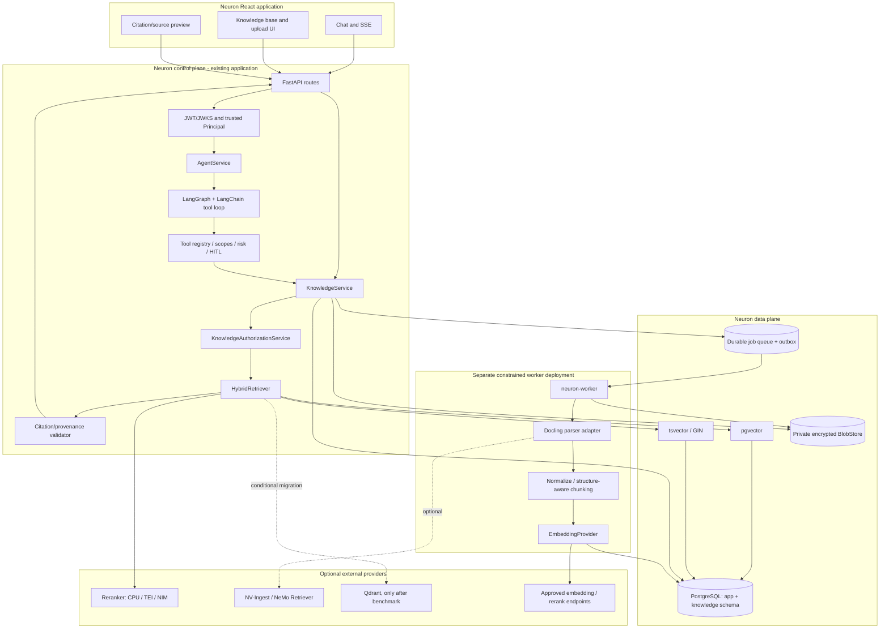
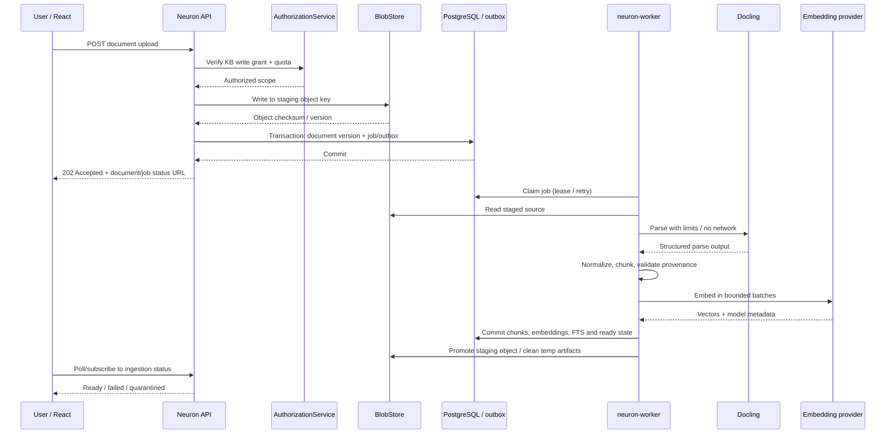
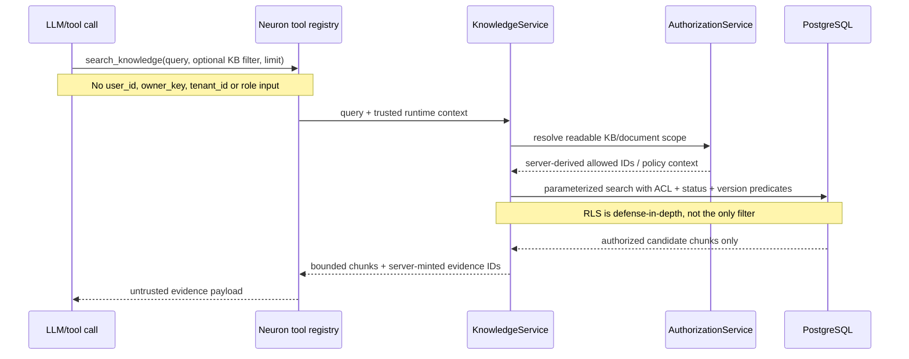

# Neuron Knowledge Engine
## Consolidated RAG architecture and research decision report

**Prepared:** 2 November 2026  
**Scope:** Critical synthesis of the Claude, ChatGPT and Gemini Neuron RAG research reports, the earlier Neuron architecture assessment, and current upstream documentation for material technical decisions.  
**Status:** Architecture recommendation; no changes to the Neuron repository have been made.

---

# 1. Executive decision

**Build a Neuron-native Knowledge Engine as a bounded subsystem inside the existing Neuron application. Keep identity, authorization, retrieval policy, citations, audit, agent orchestration and user experience under Neuron's control. Run ingestion in a separate constrained worker process. Use PostgreSQL with pgvector and PostgreSQL full-text search as the first retrieval store; Docling as the default parser; a durable PostgreSQL-backed job mechanism; and replaceable embedding and reranking providers. Do not deploy the complete NVIDIA RAG Blueprint or introduce a second agent framework.**

The three research reports agree on the broad direction, but they differ on implementation details and contain several claims that are too strong to accept without benchmarks. This report resolves those disagreements rather than averaging them.

### Final architecture at a glance

| Concern | Decision | Why |
|---|---|---|
| Application/control plane | Existing Neuron FastAPI + `AgentService` | Preserve current API, identity, lifecycle, thread/run control and compatibility. |
| Agent runtime | Existing LangGraph + LangChain tool loop | No second orchestration framework; start with tools, add subgraphs only when measured. |
| Knowledge domain | New `neuron_agent.knowledge` module | One domain boundary for API routes and native agent tools. |
| Authorization | Neuron-owned `AuthorizationContext` + `KnowledgeAuthorizationService` | Model arguments and external services are never authority. |
| Initial retrieval store | Existing PostgreSQL + pgvector + built-in FTS (`tsvector`/GIN) | Avoid an extra database while keeping metadata, ACLs and vectors in one transaction domain. |
| Parsing | Docling behind a `DocumentParser` port, executed out of process | Good layout-aware starting point; keeps heavy parser dependencies away from API. |
| Ingestion | Separate `neuron-worker`; durable Postgres-backed jobs + outbox/idempotency | Long-running parse/embed work must survive API restarts and be retry-safe. |
| Binary documents | Private encrypted object storage behind `BlobStore` | PostgreSQL stores metadata, not large files or page-image payloads. |
| Embeddings/reranking | `EmbeddingProvider` and `Reranker` ports | Choose hosted, TEI or NIM providers independently of Neuron's generation model. |
| NVIDIA RAG | Reference patterns; optional NV-Ingest/NIM adapters | Use its strengths without adopting its second app, data plane or control plane. |
| Citations | Neuron-owned, server-minted and validated evidence references | Citation provenance must survive tool-message non-persistence and be permission-checked on open. |
| Evaluation | Extend Neuron's existing test/eval and OTel/LangSmith stack | Add retrieval, citation, security and cost tests; avoid duplicate observability products. |

### The first release should do one thing exceptionally well

Deliver a **personal document assistant**: upload a PDF or Office document, ingest it asynchronously, ask questions about it, receive answers with page/section citations, and prove that another user cannot retrieve or preview it. Make this reliable before adding shared workspaces, GitHub, web crawling, GraphRAG or multi-agent workflows.

**Do not publish percentage claims such as “95% of NVIDIA RAG capability”, “80–90% cheaper”, or “38–46 engineering weeks saved”.** None of the three reports supplied benchmark or bottom-up evidence sufficient to support those figures. The consolidated plan provides explicit scoped effort estimates and validation gates instead.

---

# 2. How the three reports were cross-examined

The source set is not equally deep or equally current. Claude's report describes a local source checkout and gives the most detailed Neuron implementation findings; ChatGPT's report supplies the clearest data model, API, security and release-quality structure but explicitly notes that its checkout/tests were not complete; Gemini's report is strongest on a broad capability catalogue and alternative components, but contains some unsupported performance claims and at least one material mismatch with Neuron's persistence implementation.

The shared evidence labels used here are:

- **Verified in upstream source/configuration:** confirmed against the source/manifest/documentation cited in this report.
- **Documented:** stated by the upstream project; not necessarily independently executed.
- **Inferred:** follows from inspected code or system behaviour but has not been benchmarked in Neuron.
- **Proposed:** this report's target design.
- **Needs validation:** must be proven with a Neuron checkout, integration test, license review or benchmark before production adoption.

## 2.1 Agreement matrix

| Topic | Claude | ChatGPT | Gemini | Consolidated finding |
|---|---|---|---|---|
| Keep Neuron's FastAPI/LangGraph/Postgres core | Yes | Yes | Yes | Adopt. This is the strongest consensus and avoids duplicate control planes. |
| Do not deploy NVIDIA Blueprint wholesale | Yes | Yes | Yes | Adopt. NVIDIA remains a reference and optional technology provider. |
| PostgreSQL + pgvector first | Yes | Yes | Yes | Adopt, but qualify ANN/filtering behaviour and benchmark tenant-filtered recall. |
| Docling as initial parser | Yes | Yes | Yes | Adopt behind a parser interface; isolate execution and preserve source locators. |
| Keep LangGraph/LangChain | Yes | Yes | Yes | Adopt; agents are not a product milestone by themselves. |
| Neuron owns authorization | Yes | Yes | Yes | Non-negotiable. Authorization must be applied in the retrieval query before data leaves the database. |
| Add durable background ingestion | Yes | Yes | Yes | Adopt. Choice of queue library remains a gated implementation decision. |
| First-class citations | Yes | Yes | Yes | Adopt; server-minted evidence references, validated and persisted with final answers. |
| NVIDIA model/provider adapters | Yes | Yes | Yes | Adopt optional adapter ports, not hard-coded NVIDIA dependency. |

## 2.2 Material contradictions and their resolution

| Disagreement / claim | Critical assessment | Final decision |
|---|---|---|
| **SQLAlchemy vs psycopg + hand-written SQL** | Gemini's proposed SQLAlchemy `AsyncSession`/ORM examples do not match the inspected Neuron implementation described by Claude and ChatGPT. Current Neuron `pyproject.toml` declares `psycopg[binary,pool]` and no SQLAlchemy dependency. | Use the existing psycopg pools, versioned SQL migrations and database-role separation. Do not introduce SQLAlchemy just to use a vector ORM helper. `pgvector-python` has psycopg integration; test that exact integration. |
| **Procrastinate vs PGQueuer vs custom DB queue** | The reports recommend different Postgres-backed queues. None has been proven against Neuron's connection pools, deployment entrypoints, permissions, migration conventions and desired retry semantics. | Define a small queue adapter and run a short bake-off. PGQueuer is the first candidate to test for async worker fit; Procrastinate is the comparison candidate. Select only after proving transactional enqueue/outbox behaviour, retries, stale-worker recovery, graceful shutdown, idempotency and least-privilege DB grants. Avoid hand-building a bespoke queue unless both fail. |
| **RLS/filtering guarantees** | Gemini overstates pgvector iterative scans as preventing filtered top-k underfill. pgvector explicitly says approximate-index filtering happens after index scan and may return fewer rows; iterative scans stop at configured limits. | Apply Neuron ACL predicates in SQL before results are returned, use RLS as defense in depth, and separately benchmark candidate recall. Consider per-KB/tenant partitioning or a dedicated vector store when shared ANN interference is material. |
| **pgvector scale thresholds** | Claims such as “5–10M chunks at 15–40ms” or “switch at 20M chunks” are not portable facts without corpus, hardware, selectivity, concurrency and p95 measurements. | No fixed chunk-count threshold. Define a benchmark and move only when latency, recall, write contention, isolation or operational objectives fail. |
| **LiteLLM in Neuron** | Gemini favours LiteLLM as a provider abstraction. ChatGPT cautions against adding it by default. Current LiteLLM SDK docs state that the SDK is not thread-safe because important settings are process-global. | Build narrow provider ports first and use direct, concurrency-safe clients/adapters already compatible with Neuron's stack. Consider LiteLLM Gateway as a separately operated service only if central routing, spend budgets and virtual keys become real requirements. |
| **NVIDIA RAG dependency compatibility** | A blanket claim that the whole Blueprint can never be imported is too strong. The current base manifest and optional extras need to be distinguished. The declared `rag` extra includes `openai<2` and `langchain-openai<1.1.9`, conflicting with Neuron's `openai>=3.6` and `langchain-openai>=1.7.3`; Python ranges overlap only on 3.13. | Do not merge the full Blueprint or its `rag`/`ingest` extras into Neuron's environment. If a direct component is considered, test a minimal pinned dependency set in an isolated worker. For a full capability, prefer a private service adapter. |
| **Prompt-injection scanning/sanitization** | Gemini's proposed LLM Guard/XML spotlighting layer is useful only as heuristic defense-in-depth; it cannot reliably sanitize all adversarial content or enforce authorization. | Treat retrieved content as tainted data. Security comes from external policy enforcement, constrained tools, no capability expansion, approval and egress control. Scanners may be evaluated as supplemental signals, never as the security boundary. |
| **Shared workspace/tenant model** | Gemini assumes `user_id`, `tenant_id` and `org_roles`; Claude says Neuron has no tenant/organization model and maps JWT roles into scopes, discarding the original roles. | MVP: private owner-scoped KBs using Neuron's existing HMAC owner key. Later: explicit workspace/membership/grant entities populated from trusted IdP or application-managed membership. A role string alone is not a tenant identity. |
| **“Do retrieval in one SQL transaction”** | This is sound for the initial Postgres design, but it does not by itself solve external blob-store atomicity, ANN candidate recall, stale auth caches or citation revocation. | Keep metadata/ACL/chunk retrieval in Postgres; use staged object writes, outbox/reconciliation, live ACL checks on preview and measured ANN isolation. |
| **Fixed embedding vector dimensions** | Claude's example `vector(2048)` and Gemini's sample dimensions are examples, not universally compatible with all selected models. Mixed dimensions/spaces cannot be compared safely. | One explicit embedding profile per physical index initially. Record model/revision/dimension/metric and chunker/parser versions. Reindex into a new version/profile for model changes; do not mix vectors from incompatible spaces. |
| **Queue-backed docling-serve async jobs** | Docling Serve has its own async job capability, and its distributed RQ engine brings Redis. A second queue adds duplicate state/retry semantics. | Neuron's queue owns end-to-end ingestion status/retries. Call Docling library or a bounded synchronous/remote parser operation from the Neuron worker. Only use Docling's own distributed queue if there is a specific scale reason and clear ownership boundary. |

## 2.3 Additional gaps found by cross-analysis

The three reports are strong on the core retrieval pipeline, but several production concerns deserve first-class treatment:

1. **Malware and content quarantine are not the same as parser sandboxing.** An isolated parser limits blast radius; it does not decide whether a file should be accepted, quarantined or made searchable. Add a pluggable upload scanning stage (signature scanning and archive/decompression controls; optional content-disarm/reconstruction for higher-risk deployments) before parsing. Scan results, policy version and quarantine reason belong in the document lifecycle.
2. **Connector ACL synchronization is a separate problem from KB membership.** A user may be allowed to connect a source while not being allowed to read every item inside it. GitHub, Drive, SharePoint, Slack and Confluence sync must preserve source-level ACLs and identities, or explicitly require a user-selected export/copy into a shared KB. Do not flatten a private source into a broadly readable KB. Revocations and source deletes need synchronization and fail-closed semantics.
3. **Citation ID validation is necessary but does not prove entailment.** A valid `evidence_id` can still be attached to a claim that the chunk does not support. The answer-quality gates must measure claim-to-source support and citation precision; UI should expose the cited passage, not imply that a valid pointer proves correctness.
4. **Availability and abstention need explicit design.** If embeddings, parser, reranker or a vector index is unavailable, return a typed degraded result. Text-only fallback is permissible only when the lexical path and authorization policy remain intact. If no adequate evidence is found, ask a clarification or abstain rather than fabricate a grounded answer.
5. **Operational isolation matters even with one database.** PostgreSQL should have separate connection budgets and roles for API/agent requests, ingestion workers, and migrations. Job queue traffic, HNSW builds, embeddings and LangGraph checkpoints can compete for connections, I/O and CPU. A single Postgres cluster reduces system count; it does not make resource contention disappear.
6. **Restore correctness spans two storage systems.** Backups must capture Postgres metadata and object-store blobs with a documented consistency point. Test restoration, orphan detection, missing blob detection, and index rebuild from source documents. Never treat the vector index as the only surviving copy of knowledge.
7. **Source freshness is a lifecycle feature.** For connectors and web sources, store source revision/ETag/commit SHA, last-seen time, sync cursor, deletion marker and ACL snapshot/version. Define how stale or revoked sources are hidden before adding scheduled connectors.

## 2.4 Claims deliberately removed or downgraded

The following figures and categorical statements in the submitted reports are not accepted as facts: “95% of NVIDIA functionality”, “80–90% lower infrastructure cost”, “38–46 engineer-weeks saved”, “15–28% reranker improvement”, “40ms FlashRank”, “5–10M chunks at a fixed p95”, “90% of queries fit one tool”, “80% of data questions need no Python”, and “sub-10ms API responsiveness from worker separation”. Some may become true in a particular deployment; none is demonstrated by the supplied research. They should be reintroduced only with a benchmark, vendor quote, or explicit estimation model.

---

# 3. Verified platform baseline and design invariants

## 3.1 Neuron today

Current upstream `pyproject.toml` identifies Neuron `0.9.0`, Python `>=3.13,<3.15`, FastAPI, LangChain, LangGraph, `langgraph-checkpoint-postgres`, `psycopg[binary,pool]`, Pydantic, MCP SDK, OpenTelemetry and LangSmith. It declares `openai>=3.6.0` and `langchain-openai>=1.7.3`. The report set further documents a one-node LangGraph graph invoking LangChain's agent loop, FastAPI SSE endpoints, JWT/JWKS/scope verification, HMAC owner keys, tool registry and risk classification, optional user memory, pinned MCP integrations, batched approvals, structured logs/OTel/LangSmith and React 19. See the current [Neuron dependency manifest](https://raw.githubusercontent.com/Md-Nisar/neuron/main/pyproject.toml) and [Neuron repository](https://github.com/Md-Nisar/neuron).

Important gaps for RAG remain: no first-party file upload, no document/knowledge schema, no embedding/indexing layer, no durable ingestion worker and no general organization/workspace model. Claude additionally notes that tool messages are not persisted as thread history, which makes final-answer citation stamping essential. Treat those source findings as the baseline to re-check against the exact commit before implementation.

## 3.2 Invariants that must survive the change

1. Caller identity comes only from the verified token and server-side principal mapping.
2. The model cannot provide or override `owner_key`, `tenant_id`, role grants, scopes, DB predicates, object-store keys or provider credentials.
3. Neuron authorizes every KB/document operation, including upload, search, source preview, download, share, revoke and delete.
4. Authorization filtering is applied as part of retrieval, before chunks are returned to the agent; post-filtering retrieved top-k is not acceptable.
5. Knowledge search is a native Neuron service/tool, not an MCP round-trip to a service Neuron already owns.
6. Retrieved documents, web pages, repository content and MCP results are untrusted/tainted data. They cannot expand tool capabilities.
7. Mutating operations and sensitive external egress preserve Neuron's existing risk and human-approval model.
8. Ingestion is asynchronous, bounded, durable, observable and idempotent.
9. Raw file bytes and parser artefacts do not enter LangGraph checkpoints or ordinary logs.
10. Document, version, chunk, embedding, blob and citation-preview deletion/retention behaviour is defined and testable.
11. Existing REST/SSE contracts remain backward compatible; citation fields are additive.
12. New code follows Neuron's existing psycopg and SQL migration patterns unless an explicit ADR proves otherwise.

---

# 4. NVIDIA RAG Blueprint: what to reuse and what not to adopt

## 4.1 Blueprint capability assessment

Current NVIDIA documentation describes the Blueprint as a modular reference solution with dense+sparse hybrid search, reranking, a pluggable vector database, multimodal document extraction (including tables/charts/images and audio/video pathways), query decomposition, an optional LangGraph plan-and-execute path, summarization, optional reflection/guardrails, RAGAS evaluation, OpenTelemetry, OpenAI-compatible APIs, Python library mode and MCP integration. The Blueprint has useful features beyond the simplistic “vector search demo” framing. Sources: [NVIDIA RAG repository](https://github.com/NVIDIA-AI-Blueprints/rag), [current Blueprint README](https://github.com/NVIDIA-AI-Blueprints/rag/blob/main/README.md), [agentic RAG guide](https://github.com/NVIDIA-AI-Blueprints/rag/blob/main/docs/agentic-rag.md), [2.6 docs](https://docs.nvidia.com/rag/2.6.0/).

The current manifest identifies package `nvidia_rag` at `2.6.0.rc1`, Python `>=3.11,<3.14`, core dependencies including LangChain/LangGraph, NVIDIA endpoints, Milvus integration, MinIO and Redis. Its optional `rag` extra pins `openai>=1,<2` and `langchain-openai<1.1.9`, which conflict with Neuron's currently declared OpenAI packages. This is sufficient to reject a casual merge of the complete optional RAG runtime into Neuron, but not to claim that every isolated NVIDIA client/module is impossible to use. A dependency solver/lockfile check is mandatory for any proposed direct import. See [NVIDIA's current pyproject.toml](https://raw.githubusercontent.com/NVIDIA-AI-Blueprints/rag/main/pyproject.toml).

**Version-specific deployment correction:** some reports describe Milvus/MinIO as the Blueprint defaults. That matches earlier Blueprint configurations, but NVIDIA's 2.6.0 release notes and migration guide say the default vector database changed to Elasticsearch and the default object store changed from MinIO to SeaweedFS; Milvus remains an optional backend. The current repository manifest can still contain Milvus and MinIO integration dependencies. Architecture decisions must follow the selected Blueprint release's deployment profile, not an older diagram or dependency list. Sources: [2.6.0 release notes](https://docs.nvidia.com/rag/2.6.0/release-notes.html), [migration guide](https://docs.nvidia.com/rag/latest/migration_guide.html), [vector DB configuration](https://docs.nvidia.com/rag/2.6.0/change-vectordb.html).

## 4.2 Component adoption decisions

| Blueprint capability | Decision | Neuron integration | Rationale |
|---|---|---|---|
| Hybrid dense + sparse retrieval | Reuse pattern | Implement with pgvector + PostgreSQL FTS + RRF | Keeps authorization and retrieval inside Neuron's DB boundary. |
| Reranking | Reuse model capability | `Reranker` adapter; compare NIM, TEI and CPU options | Valuable second stage; require corpus eval before enabling by default. |
| Embeddings | Reuse model options, not provider lock-in | `EmbeddingProvider` adapter, model/dimension recorded per index | Avoid NVIDIA-only configuration in domain layer. |
| Query decomposition / multi-query | Defer and adapt | Bounded LangGraph retrieval subgraph | Avoid extra LLM round trips for simple questions; add only when evals show recall gain. |
| Agentic plan/execute | Reference, not adopt as second application | LangGraph subgraph within Neuron | Neuron already owns graph, state, approvals and streaming. |
| Multimodal ingestion / NV-Ingest | Optional advanced parser | Separate parser service adapter for complex chart/image/scanned corpora | GPU/runtime cost justified only by target corpus requirements. |
| Citation schema/response shaping | Learn from | Neuron-owned citation DTO and validation | Neuron must own provenance, persistence and preview authorization. |
| RAGAS evaluation | Reuse methodology | Extend Neuron eval harness | Avoid another evaluation UI/pipeline by default. |
| NVIDIA RAG API and frontend | Do not adopt wholesale | None for MVP | Duplicates Neuron API, chat UX, streaming and governance. |
| Milvus/Elasticsearch + associated infrastructure | Defer | Qdrant/Milvus only after a measured need | No evidence yet that current PostgreSQL is insufficient. |
| NIM model services | Optional provider | Private endpoint adapters, hosted only under approved data policy | Isolates provider choice and GPU operations. |

**Important licence distinction:** NVIDIA's repository code is Apache-2.0, but model weights and extraction components can carry separate model-specific terms. Review each exact model and deployment licence before production. Do not treat the repository's code licence as a blanket licence for every model.

## 4.3 Final NVIDIA reuse position

Neuron should not target an arbitrary percentage of “NVIDIA RAG adoption.” The useful objective is feature-level interoperability. Initially reuse the patterns for hybrid retrieval, reranking, model adapters, multimodal parsing options and evaluation. NVIDIA NIM and NV-Ingest remain optional. The first release should still work without a local GPU and without the NVIDIA Blueprint being deployed.

---

# 5. Target architecture

## 5.1 Logical architecture



## 5.2 Ownership boundaries

| Layer | Owns | Must not own |
|---|---|---|
| FastAPI/Auth | Authentication, scopes, request limits, trusted principal | Vector provider specifics or LLM-generated ACL decisions |
| AgentService | Thread/run lifecycle, runtime context, allowed KB selection | Raw file parsing or blob storage internals |
| LangGraph/LangChain | Agent execution and calls to governed tools | Authority over users, tenant membership or DB filters |
| KnowledgeService | KB/document lifecycle, policy orchestration, retrieval API and citations | Authentication verification itself |
| KnowledgeAuthorizationService | Resolve user/workspace grants and build access predicates | Rely on prompt-inferred identities or cache without revocation semantics |
| Retriever | Dense/lexical candidate generation, fusion, optional rerank | Granting access or changing ACLs |
| Worker | Parsing, normalization, chunking, embedding and job state transitions | Directly deciding user-visible permissions |
| PostgreSQL | Metadata, ACL data, chunks, embeddings, FTS, job state/audit | Raw file blob payloads |
| BlobStore | Original files and optional derived renditions | Authoritative ACL decisions; no public permanent URL |
| Model services | Embedding/reranking/generation inference | Neuron user identity or application policy |

## 5.3 Process boundaries

Use a modular monolith with one independently scaled worker process, not a fleet of premature microservices.

- **Neuron API:** current FastAPI deployment, extended with knowledge routes and services.
- **Neuron worker:** separate deployment/entrypoint using same repository and shared domain code, but a worker-specific image/dependency extra is preferred so Docling's heavier dependencies and attack surface do not enter the API image.
- **Parser:** call Docling in the isolated worker by default. Use a standalone `docling-serve` HTTP service only if independent scaling, API isolation or language interoperability requires it. The Neuron worker remains authoritative for job lifecycle. Docling Serve supports synchronous and asynchronous HTTP conversion and can use a Redis-backed distributed engine; do not turn on its queue in MVP or there will be two queue authorities. See [Docling API server guide](https://docling-project.github.io/docling/usage/api_server/).
- **Model serving:** hosted approved endpoint initially or an internal TEI/NIM/vLLM service later. Keep provider network paths private and authenticated.
- **Object store:** local filesystem only for single-node development; production uses encrypted private S3-compatible storage with lifecycle and backup controls.

---

# 6. Knowledge ingestion architecture

## 6.1 End-to-end ingestion flow



### 6.2 Required document states

Use explicit, monotonic state transitions such as:

`accepted -> queued -> parsing -> normalizing -> chunking -> embedding -> indexing -> ready`

Failure paths should distinguish retryable failures, terminal failures and security quarantine:

`retry_wait`, `failed`, `quarantined`, `deleting`, `deleted`.

A document is searchable only when the full target index version is committed and the active-index pointer is switched. Partial chunks must never become visible as a ready document. A parser/provider failure must not leave stale vectors searchable.

### 6.3 Upload controls

At upload time, Neuron should:

- Authorize write access to the target KB before creating any object.
- Enforce per-file and per-owner byte, file-count, page-count, image-dimension, concurrent-job and embedding-cost quotas.
- Check MIME using file signatures/magic bytes, not only browser-supplied content type or extension.
- Reject or quarantine malformed, encrypted, unsupported or suspicious archives; defend against zip bombs and pathological decompression.
- Generate a random object key; do not use user-controlled filenames as storage paths.
- Compute SHA-256 and preserve content length; use idempotency to prevent duplicate ingestion.
- Quarantine pending a malware/signature scan where deployment risk and file types justify it; parser sandboxing is still required. Treat archive extraction, embedded files and external relationships as untrusted.
- Return `202 Accepted` and a status URL; scanning and parsing never hold the API request open.

### 6.4 Parser and chunking choices

Docling is the default parser because it provides a structured document representation and a path to layout-aware PDF/Office extraction, tables and page-level provenance. Its code licence is MIT; individual model licences must still be checked. See [Docling repository](https://github.com/docling-project/docling) and [Docling core](https://github.com/docling-project/docling-core).

Do not persist Docling internal objects as Neuron's permanent domain schema. Normalize them to a Neuron representation with:

- source document version and content hash;
- parser name/version/configuration;
- page range, bounding boxes and element locator;
- heading/section path;
- table identifier and row/column context when present;
- image/figure references for later visual processing;
- chunker algorithm/version and token count;
- text content hash and optional redacted display text.

Use structure-aware chunking before semantic/fixed-size fallback. Keep headings with their content, avoid splitting tables arbitrarily, preserve page/section anchors, and record parent/child chunk relationships if hierarchical retrieval is used. Chunk sizes, overlap and parent-child retrieval should be selected by representative eval corpus, not generic magic constants.

**Advanced parser:** evaluate NVIDIA NV-Ingest / NeMo Retriever extraction only for corpus classes where Docling misses chart, image, OCR or multimodal fidelity requirements. Compare extraction quality and total cost on the same documents. The NVIDIA path must be a parser adapter, never a new authorization authority.

### 6.5 Atomicity and worker reliability

Database and object storage cannot share one ACID transaction. Use a staging protocol:

1. Upload to a temporary/private staging key.
2. Write document-version metadata and an outbox/job record in a database transaction.
3. Commit the DB transaction.
4. Worker claims the job and reads the staged blob.
5. On successful indexing, mark the version ready and promote/retain the object key.
6. A periodic reconciler deletes orphan staging objects and repairs documents whose jobs disappeared.

The queue is **at-least-once**. Every handler must be idempotent using `(document_version_id, index_profile_id, stage)` keys. Use bounded retries with exponential backoff and jitter; cap attempts; move poison jobs to a reviewable dead-letter/failed state. Store only IDs and small safe metadata in job payloads, never file bytes or credentials.

---

# 7. Retrieval and answer-generation architecture

## 7.1 MVP retrieval path

1. Resolve authenticated principal and selected/authorized KB IDs server-side.
2. Normalize the user query; use conversation context only where it is relevant and bounded.
3. Create a query embedding using the KB's active embedding profile.
4. Execute a dense pgvector candidate query with server-derived ACL/document/version predicates.
5. Execute a lexical PostgreSQL FTS query with the same ACL/document/version predicates.
6. Fuse candidate ranks with Reciprocal Rank Fusion (RRF); do not compare raw dense and lexical scores as though they share a scale.
7. Optionally rerank the fused candidate list with a cross-encoder if enabled for that KB/model profile.
8. Deduplicate overlapping chunks, apply context/token budgets, and preserve enough parent/section context to answer faithfully.
9. Mint per-run evidence IDs and return bounded evidence records to the agent.
10. Generate an answer grounded only in retrieved evidence; validate citations before final response.

RRF is a good initial fusion algorithm because it combines rankings rather than requiring score calibration. Its constants, candidate depth and rerank cut-off are tunable parameters. Do not freeze top-k, top-n or RRF constant without retrieval evaluation.

## 7.2 Advanced retrieval, only when evaluation supports it

| Capability | When to introduce | Guardrails |
|---|---|---|
| Query rewriting | Poor retrieval for conversational references or vocabulary mismatch | Preserve original query; evaluate rewritten vs original recall. |
| Multi-query retrieval | Query has clear facets or synonyms | Bound number of variants and total token/cost budget. |
| Query decomposition | Multi-part or multi-document question | LangGraph subgraph with maximum tasks/iterations/deadline. |
| Context compression | Retrieved context regularly exceeds model budget | Compression must retain provenance and citations back to source chunks. |
| Corrective RAG/retrieval feedback | Eval shows measurable improvement over baseline | Grade relevance with explicit thresholds; avoid unbounded loops. |
| GraphRAG/entity graph | Questions require global relationship or entity-level synthesis | Separate evaluation against vector/lexical baseline; graph extraction, updates and deletion must be correct. |
| Multimodal RAG | Target users ask questions about diagrams/charts/visuals | Store image/table artifacts with ACL/provenance; evaluate visual model quality and privacy. |

Start with one native `search_knowledge` tool. Most questions should not trigger a multi-step autonomous retrieval workflow by default. When the user asks a multi-hop question, use a bounded LangGraph subgraph that can plan, retrieve parallel subqueries, synthesize, check evidence gaps and perform one or two targeted follow-ups. NVIDIA's current Blueprint plan-and-execute documentation is a useful reference, not a reason to create a second runtime: [Agentic RAG guide](https://github.com/NVIDIA-AI-Blueprints/rag/blob/main/docs/agentic-rag.md).

## 7.3 Embeddings and reranking provider contracts

Define minimal internal interfaces, independent of a chosen vendor:

```python
class EmbeddingProvider(Protocol):
    model_id: str
    dimensions: int
    async def embed_documents(self, texts: Sequence[str]) -> list[list[float]]: ...
    async def embed_query(self, text: str) -> list[float]: ...

class Reranker(Protocol):
    model_id: str
    async def rerank(
        self, query: str, candidates: Sequence[RetrievedChunk], limit: int
    ) -> list[RankedChunk]: ...
```

Provider adapters should validate dimensions, response count, finite numeric values, supported task/input mode and maximum payload size. Retry only transient errors; a provider returning the wrong dimensionality is a hard ingestion/index failure. Record model/provider revision and parameters with each index profile.

Potential implementations:

- approved hosted embeddings/reranking API;
- Hugging Face TEI as an isolated embedding/reranking service;
- NVIDIA NIM as an optional private/hosted provider;
- CPU cross-encoder/FlashRank-like adapter for lower-cost deployments where quality passes the eval gate.

Do not make NVIDIA the default merely because this research started with NVIDIA RAG. Do not introduce LiteLLM into the API process as a convenience wrapper without reviewing its process-global/thread-safety behaviour. LiteLLM's current Python SDK documentation explicitly calls the SDK not thread-safe; a separately managed gateway remains an option if routing/budgets become platform requirements.

## 7.4 Postgres first, with measured exit criteria

The initial database is PostgreSQL with:

- `vector` extension / pgvector HNSW or IVFFlat as justified by measurement;
- `tsvector` + GIN for lexical retrieval;
- RRF fusion in parameterized SQL or a carefully bounded repository method;
- dedicated knowledge schema and restricted roles;
- separate connection pool budgets for app, retrieval and workers if contention demands it.

**Do not assume an approximate vector index with filters always returns enough rows.** The pgvector documentation explains that approximate index scans apply filters after scanning and may under-return. Iterative scans continue until enough candidates are found or configured limits are reached; they are not a mathematical guarantee. The same docs warn that shared approximate indexes can let vectors from one tenant affect another tenant's recall and speed. For high isolation/selectivity, consider per-tenant/KB partitioning or separate physical indexes. See [pgvector filtering and iterative scans](https://github.com/pgvector/pgvector#iterative-index-scans) and [pgvector multitenancy guidance](https://github.com/pgvector/pgvector#filtering).

Benchmark exact scan as a recall baseline, HNSW with/without iterative scans, realistic filters, concurrent ingest and top-k underfill. Use partial indexes for few stable filter values and partitioning where many distinct tenants/KB scopes justify it. Do not state a static “10M chunks” switch point.

Use built-in PostgreSQL FTS first. It is not identical to BM25; test stemming/configuration and language behavior. Evaluate a BM25 extension (such as `pg_textsearch` or another Postgres-compatible option) only after the lexical evaluation indicates built-in FTS is insufficient. Extension licensing, packaging, upgrades and backup/restore must be reviewed before use.

### Trigger to evaluate Qdrant or another dedicated vector store

Move only when one or more measured service objectives fail after query tuning, partitioning and workload isolation:

- p95/p99 latency or throughput at target concurrency;
- filtered recall/coverage for highly selective ACLs;
- index build/update contention with transactional workloads;
- inability to scale retrieval independently;
- need for sparse/multi-vector/filter operators that pgvector does not meet efficiently;
- operational isolation or region/data-residency requirements.

If external vector storage is introduced, Postgres remains authoritative for identities, ACLs, document state and citations. The adapter must build external payload filters from Neuron's `KnowledgeAuthorizationService`; recheck access in Neuron before returning chunks. External filter metadata is defense in depth and can be stale; it is not a grant authority.

---

# 8. Authorization, tenant isolation and prompt-injection security

## 8.1 MVP ownership model

Neuron's current source reports indicate no formal organization/tenant model and no retained raw roles field in its principal. Therefore, do not invent a tenant abstraction in Phase 1.

**Phase 1:** private user KBs owned by the same stable HMAC owner key already used for Neuron's per-user isolation. Use an immutable server-side `owner_key`, not raw email or user-supplied IDs.

**Phase 2:** introduce explicit `workspaces`/`knowledge_base_members` or equivalent only after the product's organization identity source is agreed. Map a trusted OIDC issuer/subject or app-managed workspace membership to a stable principal key. Preserve issuer scoping; role names alone may collide across organizations. Record who granted and revoked access, when, and at what level.

## 8.2 Authorization sequence



The user may choose a KB from the UI or the model may propose a KB ID, but Neuron intersects that request with the caller's actual readable set. An unreadable or foreign KB should not reveal whether it exists; use consistent not-found semantics where appropriate.

## 8.3 Database controls

- Keep migrations under the existing versioned SQL mechanism; separate schema and roles for knowledge.
- Use an API role with only the SELECT/CRUD privileges it needs; a worker role with narrowly scoped write privileges; a migrator role for DDL. Never run the request path as table owner or superuser.
- Use RLS on the tables that benefit from defense in depth, but also add explicit parameterized authorization predicates to every query path.
- PostgreSQL documents that table owners typically bypass RLS unless forced; superusers and `BYPASSRLS` roles also bypass. If using RLS, use `FORCE ROW LEVEL SECURITY` where appropriate and test using the real non-owner runtime role. See [PostgreSQL Row Security Policies](https://www.postgresql.org/docs/17/ddl-rowsecurity.html).
- If passing transaction context via a setting, use transaction-local state (`SET LOCAL`) and test connection-pool reuse to ensure no principal context leaks between requests. Clear/reset session state robustly.
- Apply authorization to knowledge bases, membership/grants, documents, document versions, chunks, embeddings, audit events and source-preview/download endpoints—not only the chunk query.
- Do not cache user-to-KB grants beyond a short, explicit policy unless revocation invalidation is reliable. Prefer resolving policy at request time in MVP.

### Source-system permissions for future connectors

A connector's OAuth permission is not proof that every source item may be copied into every Neuron KB. Before Drive/SharePoint/Slack/Confluence/GitHub ingestion, define the source ACL mapping model: principal identity mapping, inherited permissions, groups, link-sharing, deny rules, item-level ACLs, sync cursors, revocation latency and deletion semantics. If Neuron cannot faithfully map a source's permissions, require explicit user copy into a target KB with an appropriate warning and ownership policy; do not silently broaden access.

For a connector-backed KB, every document version must carry an ACL snapshot or a reference to a versioned authorization mapping. Authorization is enforced before candidate retrieval, and the connector synchronizer must make revocation/deletion visible immediately (tombstone first, asynchronous physical purge later). Search caches must be disabled initially or keyed by principal plus an invalidation/policy epoch.

## 8.4 Indirect prompt injection

Retrieved content, web pages, code comments, OCR text, table cells and MCP results are all untrusted. Delimiters and “treat this as data” instructions help model behavior but do not establish security.

Use defense in depth:

1. Mark knowledge retrieval tools as tainting the run, reusing Neuron's existing taint/risk mechanism.
2. Ensure tainted content cannot alter tool registry, scopes, credentials, tenant identity, destination allowlists or approval requirements.
3. Keep all tool authorization and risk decisions in deterministic Neuron code outside the model.
4. Preserve HITL for mutating actions and sensitive egress after untrusted content is read, according to Neuron policy.
5. Do not expose arbitrary shell, filesystem, Python `exec`, network fetch or credential-bearing tools just because a retrieved document requests them.
6. Treat model-generated query filters as untrusted hints only; the server intersects them with hard ACL predicates.
7. Use content framing/escaping and optional classifiers/scanners only as secondary controls; they are not complete prompt-injection sanitizers.
8. Red-team poisoned PDFs, hidden white text, OCR prompt injections, table/alt-text attacks, malicious code comments and MCP payloads.
9. Log counts, IDs, stage timings and safe hashes—not raw document contents, secrets or full retrieved passages.

---

# 9. Citations, evidence provenance and response contract

Citations are a platform feature, not merely formatting added by the LLM.

## 9.1 Citation lifecycle

1. A retrieval result carries immutable provenance: `document_id`, `document_version_id`, `chunk_id`, page/section/table/image locator, content hash and retrieval/index profile.
2. Neuron mints opaque per-run `evidence_id` values for the evidence actually returned to the model.
3. The answer model may return a list of evidence IDs it used; it must not authoritatively generate document IDs, page numbers, URLs or raw blob keys.
4. Neuron validates every returned evidence ID against the current run's retrieved-evidence set; unknown IDs are dropped and counted.
5. Validated citations are serialized into the final answer message metadata and the API/SSE `final` payload. This is necessary because tool messages may not be persisted in the current Neuron thread history.
6. The UI renders citation chips/cards; clicking uses an authorized Neuron source endpoint that rechecks access and returns a bounded excerpt, page preview or signed short-lived media URL as appropriate.
7. Revoked grants or deleted documents cause old citations to fail closed at preview time. A stored answer may retain citation metadata while source content access is denied.

## 9.2 Suggested citation DTO

```json
{
  "evidence_id": "ev_opaque_per_run_id",
  "document_id": "uuid",
  "document_version_id": "uuid",
  "chunk_id": "uuid",
  "title": "Policy Handbook.pdf",
  "page_start": 12,
  "page_end": 13,
  "section_path": ["Leave", "Annual leave"],
  "locator": {"type": "page_bbox", "page": 12, "bbox": [0.1, 0.2, 0.8, 0.4]},
  "content_hash": "sha256:..."
}
```

Avoid persisting full source excerpts in every message. Store concise display metadata and a content hash; source text is resolved through the authorized preview endpoint. For answer auditability, persist which immutable document version/chunk and index profile supported the answer.

## 9.3 API and SSE contract

Additive contracts preserve current clients:

- `AgentResponse.citations: list[Citation] = []`
- SSE `final` event includes optional `citations` array and optional evidence summary metadata.
- Older clients ignore unknown optional fields.
- Thread history serialization includes final answer citations, even if intermediate tool outputs are not persisted.
- Citation preview is a separate permission-checked REST call; citation metadata is never itself a bearer URL.

---

# 10. Data model and migration strategy

Use psycopg and the existing migration conventions. This is a conceptual schema; final SQL depends on the chosen database version, vector dimension, role setup, RLS design and index deployment method.

## 10.1 Recommended entities

| Entity | Core fields | Notes |
|---|---|---|
| `knowledge_bases` | id, owner_kind, owner_key, name, visibility, status, created_at | Phase 1 owner_kind=user only; workspace ownership later. |
| `knowledge_base_members` | kb_id, principal_key, access_level, granted_by, created_at, revoked_at | Add when sharing/workspaces are implemented. |
| `documents` | id, kb_id, title, media_type, size_bytes, sha256, status, active_version_id, created_by | Logical document identity and lifecycle. |
| `document_versions` | id, document_id, blob_key, source_hash, parser_profile, status, created_at | Immutable source revision; reupload creates new version. |
| `ingestion_jobs` | id, document_version_id, stage, state, attempts, idempotency_key, lease_owner, lease_until, heartbeat_at, error_code | User-visible domain status and reconciliation metadata; queue engine owns dispatch. |
| `document_chunks` | id, version_id, ordinal, text, section_path, page range, locator JSON, content_hash, index_profile_id | Canonical Neuron chunk schema, parser-independent. |
| `knowledge_index_profiles` | id, embedding_provider, model_id, revision, dimensions, metric, parser_version, chunker_version, status | Defines reproducible index profile. |
| `document_embeddings` | chunk_id, profile_id, embedding vector(d), created_at | Use one dimension/profile per physical vector index; do not mix spaces. |
| `knowledge_audit_events` | actor_key, action, resource_type, resource_id, outcome, trace_id, timestamp | No raw text or secrets. |

A separate `citations` table is not required for ordinary chat initially. Citation DTOs can be stamped on final messages. Add durable research/citation records only when the product needs saved reports, review workflows or cross-session evidence dossiers.

## 10.2 Index versioning and model changes

- Each KB or index partition has a single active index profile.
- Persist model name/revision, provider, dimensions, distance metric, tokenizer assumptions, chunker and parser versions.
- A model or chunking change builds a new index version side-by-side.
- Validate count, dimensions, sample retrieval quality and citations before switching the active pointer.
- Keep previous version during a rollback window, then purge under retention policy.
- Do not write a model migration by simply mixing different-dimensional embeddings into the same vector index.

## 10.3 Database and object-store deletion

Deletion is a workflow, not a single row delete:

1. Tombstone the document/KB immediately so new retrieval and preview fail closed.
2. Cancel or invalidate queued/running ingestion work via document-version state and job generation token.
3. Remove chunks, embedding rows, lexical entries and any derived page/image artefacts.
4. Delete source blobs and staged uploads.
5. Invalidate caches and derived indexes, including any external vector provider if one exists.
6. Record deletion outcome and completeness; retry failed external purges.
7. Respect active run leases and the platform's retention contract; avoid deleting content still referenced by an active job without a safe cancellation boundary.
8. Document backup-retention semantics: logical deletion does not instantly rewrite every backup snapshot.

---

# 11. API, tools and frontend surface

## 11.1 Proposed API endpoints

| Method | Path | Purpose / authorization |
|---|---|---|
| GET | `/v1/knowledge/bases` | List bases readable by current principal. |
| POST | `/v1/knowledge/bases` | Create private base; requires knowledge write scope. |
| PATCH | `/v1/knowledge/bases/{kb_id}` | Rename or change allowed settings; owner/admin. |
| DELETE | `/v1/knowledge/bases/{kb_id}` | Tombstone and enqueue asynchronous deletion. |
| POST | `/v1/knowledge/bases/{kb_id}/documents` | Upload source; check write grant/quota; return 202. |
| GET | `/v1/knowledge/bases/{kb_id}/documents` | Paginated documents and statuses. |
| GET | `/v1/knowledge/documents/{doc_id}` | Metadata and ingestion status. |
| DELETE | `/v1/knowledge/documents/{doc_id}` | Tombstone then asynchronous purge. |
| POST | `/v1/knowledge/search` | User-visible test/search endpoint; server ACL enforced. |
| GET | `/v1/knowledge/documents/{doc_id}/chunks/{chunk_id}` | Permission-checked citation/source preview. |
| GET | `/v1/knowledge/documents/{doc_id}/file` | Authorized file download; no public permanent URL. |
| PUT/DELETE | `/v1/knowledge/bases/{kb_id}/members/{principal_key}` | Phase 2 only; audited grant/revoke. |

Bodies should follow current Pydantic conventions (`extra="forbid"` where established), bounded pagination, stable error codes, consistent 404 treatment for unreadable resources, and no model-controlled principal fields.

## 11.2 Agent tool set

| Tool | Inputs exposed to model | Policy |
|---|---|---|
| `list_knowledge_bases` | optional name/query filter | Read-only; server filters to readable bases. |
| `search_knowledge` | query, optional requested KB IDs, bounded limit | Read-only; requires knowledge read scope; server intersects IDs with authorized set; taints run. |
| `retrieve_document_section` | evidence ID or document ID/section request | Read-only; permission re-check; only resolve evidence available to this run or explicitly authorized document. |
| `get_document_metadata` | document ID | Read-only; permission check. |
| `request_document_ingestion` | document/version ID only if a user workflow requires reprocessing | Write/risk class; normally user/API initiated, not a generic model tool. |
| `delete_document` / `share_knowledge_base` | narrowly typed resource and grant inputs | Mutating; explicit approval and admin scope. Prefer API UI action over agent invocation initially. |

Do not expose `tenant_id`, `owner_key`, role names, object keys, direct SQL, arbitrary metadata expressions or an unbounded vector filter schema to the LLM.

## 11.3 Frontend additions

- Knowledge base list/create/rename/delete.
- Upload with limits and ingestion progress; retry/remove actions.
- Per-document states and safe error messages.
- KB selector in chat; selection only narrows what the caller can access.
- Citation chips and side panel with title, page, section and bounded excerpt.
- Source preview/PDF navigation; page image or bounding-box highlight where extraction provides it.
- Search playground for administrators/developers with permission-aware results.
- Later: workspace memberships, role grants and audit history.

Keep the existing React component structure and SSE contract. Do not reuse NVIDIA's demo UI.

---

# 12. Evaluation, observability and quality gates

The reports correctly identify a missing capability: RAG needs its own evaluation suite. The correct response is to extend Neuron's current evaluation harness and trace pipeline, not to deploy another full monitoring product.

## 12.1 Offline evaluation corpus

Build a representative, permission-labelled corpus covering:

- born-digital PDFs with headings and page references;
- scanned PDFs and OCR;
- DOCX/PPTX/XLSX with tables;
- long policies/contracts with cross-page clauses;
- diagrams/charts/figures;
- duplicate/revised documents;
- multilingual documents if in scope;
- near-duplicate and irrelevant distractors;
- malicious prompt-injection examples embedded in body text, white text, tables, alt text and OCR.

Each case should include trusted expected answer facts, relevant document/version/page/chunk ids, allowed principal/KB, denied principal/KB, and expected citation set or acceptable source ranges.

## 12.2 Release metrics

| Dimension | Metric/test | Release gate |
|---|---|---|
| Parsing | Page/section/table extraction coverage on golden documents | Agree corpus-specific threshold before release; manually review failures. |
| Retrieval | Recall@k, MRR/nDCG, precision@k, filtered recall@k | Compare lexical-only, dense-only, RRF, rerank and exact-vector baseline. |
| Citation | Citation precision/recall, page accuracy, unsupported cite rejection, claim-evidence support | No foreign or fabricated evidence ID survives; measure entailment separately from pointer validity. |
| Grounding | Faithfulness/answer support, answer relevance | LLM judge is supplemental; include human-reviewed cases and deterministic assertions. |
| Security | Cross-user/KB denial, RLS role bypass, revoked grant, stale cache, poisoned document, prompt injection | Zero unauthorized rows/previews/egress; any leak blocks release. |
| Reliability | Worker crash/restart, duplicate job, timeout, provider failure, poison job | No partial document marked ready; retries idempotent and bounded. |
| Performance | p50/p95/p99 upload, parse, embed, retrieval, rerank, full answer latency | Set SLO after baseline and load profile; no invented SLA. |
| Cost | embedding tokens, rerank calls, parser CPU/GPU seconds, storage and per-query cost | Per-owner quotas and telemetry before public launch. |
| Operations | job age/lag, retry count, dead letters, queue depth, Postgres pool saturation | Dashboards/alerts and drain/restore runbooks exist. |

## 12.3 Required tracing

Add OTel spans for `knowledge.authorize`, `knowledge.embed_query`, `knowledge.retrieve_dense`, `knowledge.retrieve_lexical`, `knowledge.rrf`, `knowledge.rerank`, `knowledge.citation_validate`, `ingestion.parse`, `ingestion.chunk`, `ingestion.embed`, `ingestion.index`, `ingestion.delete`.

Record duration, counts, provider/model IDs, index profile, retry count, allowed scope count, candidate count and result count. Do not record raw query/document text by default. Redact user identifiers or use stable privacy-preserving keys according to Neuron's existing telemetry policy.

---

# 13. Open-source selection and build-vs-buy conclusions

## 13.1 Ecosystem screening catalogue and disposition

The three submissions screen several dozen projects. The following consolidated catalogue keeps the useful alternatives visible without implying that every project is approved for adoption. Repository licences are project-level signals only; verify the exact release, optional extras, model weights, hosted terms and transitive dependencies before use.

| Domain | Projects considered | Consolidated disposition |
|---|---|---|
| RAG applications / frameworks | [NVIDIA RAG](https://github.com/NVIDIA-AI-Blueprints/rag), [LlamaIndex](https://github.com/run-llama/llama_index), [Haystack](https://github.com/deepset-ai/haystack), [RAGFlow](https://github.com/infiniflow/ragflow), [Kotaemon](https://github.com/Cinnamon/kotaemon), [AnythingLLM](https://github.com/Mintplex-Labs/anything-llm), [Dify](https://github.com/langgenius/dify), [Open WebUI](https://github.com/open-webui/open-webui), [Verba](https://github.com/weaviate/Verba), [txtai](https://github.com/neuml/txtai), [Quivr](https://github.com/QuivrHQ/quivr) | Use NVIDIA, RAGFlow and Kotaemon as reference implementations/UX inspiration. Do not add another full application or orchestration framework to Neuron. Select isolated loaders/chunkers only if a benchmark shows value. |
| Parsing / OCR / extraction | [Docling](https://github.com/docling-project/docling), [Unstructured](https://github.com/Unstructured-IO/unstructured), [Apache Tika](https://github.com/apache/tika), [Tesseract](https://github.com/tesseract-ocr/tesseract), [MarkItDown](https://github.com/microsoft/markitdown), [MinerU](https://github.com/opendatalab/MinerU), [Marker](https://github.com/datalab-to/marker), [NVIDIA NV-Ingest](https://github.com/NVIDIA/nv-ingest) | Docling first behind a parser port. Tika/Unstructured as selective format fallbacks. Tesseract as OCR fallback. NV-Ingest for measured multimodal GPU need. Marker/MinerU require exact licence/weight review; do not assume permissive commercial terms. |
| Search / vector stores | [pgvector](https://github.com/pgvector/pgvector), [Qdrant](https://github.com/qdrant/qdrant), [Milvus](https://github.com/milvus-io/milvus), [Weaviate](https://github.com/weaviate/weaviate), [OpenSearch](https://github.com/opensearch-project/OpenSearch), [Vespa](https://github.com/vespa-engine/vespa), [LanceDB](https://github.com/lancedb/lancedb), [FAISS](https://github.com/facebookresearch/faiss), [Elasticsearch](https://github.com/elastic/elasticsearch) | pgvector + native PostgreSQL FTS first. Qdrant is first external vector-store challenger. Elasticsearch/OpenSearch/Vespa only if already strategic search infrastructure or advanced ranking is required. Milvus is not justified for MVP; LanceDB/FAISS suit embedded/offline use cases. |
| Jobs / workflows | [PGQueuer](https://github.com/janbjorge/pgqueuer), [Procrastinate](https://github.com/procrastinate-org/procrastinate), [Temporal](https://github.com/temporalio/temporal), [Prefect](https://github.com/PrefectHQ/prefect) | Evaluate PGQueuer and Procrastinate through a queue port. Temporal only for durable multi-system workflows with signals/cancellation/compensation. Prefect is a pipeline alternative, not an additional workflow layer. |
| Embedding / reranking / inference | [Hugging Face TEI](https://github.com/huggingface/text-embeddings-inference), [vLLM](https://github.com/vllm-project/vllm), [SGLang](https://github.com/sgl-project/sglang), [LiteLLM](https://github.com/BerriAI/litellm), [AnswerDotAI rerankers](https://github.com/AnswerDotAI/rerankers), NVIDIA NIM / NeMo Retriever | Narrow provider adapters first. TEI or NIM for self-hosted embeddings/reranking; vLLM/SGLang for generation when justified. LiteLLM SDK not the default embedded API client due documented global/thread-safety caveat; Gateway may be evaluated separately. |
| Evaluation / safety / observability | [Ragas](https://github.com/explodinggradients/ragas), [DeepEval](https://github.com/confident-ai/deepeval), [Promptfoo](https://github.com/promptfoo/promptfoo), [LLM Guard](https://github.com/protectai/llm-guard), [Arize Phoenix](https://github.com/Arize-ai/phoenix), [Langfuse](https://github.com/langfuse/langfuse), LangSmith, OpenTelemetry | Reuse Neuron's OTel/LangSmith. Add deterministic retrieval/citation/security evals and optionally selected Ragas metrics. Promptfoo is useful as CI red-team harness. LLM Guard scanners are supplemental only. Do not add a second observability backend by default; verify Phoenix/other licence terms. |
| Agents / MCP / memory | [LangGraph](https://github.com/langchain-ai/langgraph), [PydanticAI](https://github.com/pydantic/pydantic-ai), [CrewAI](https://github.com/crewAIInc/crewAI), [AutoGen](https://github.com/microsoft/autogen), [Google ADK](https://github.com/google/adk-python), [FastMCP](https://github.com/jlowin/fastmcp), [MCP Python SDK](https://github.com/modelcontextprotocol/python-sdk), [LangMem](https://github.com/langchain-ai/langmem), [Mem0](https://github.com/mem0ai/mem0), [Graphiti](https://github.com/getzep/graphiti), [LightRAG](https://github.com/HKUDS/LightRAG), [Microsoft GraphRAG](https://github.com/microsoft/graphrag) | Keep LangGraph and the existing MCP client. FastMCP is optional connector-authoring help. Retain current user-controlled memory; consider LangMem/Graphiti only after a product requirement and deletion/consent model. LightRAG/GraphRAG are experiments after a baseline proves graph queries matter. |
| Code / web / data tools | [tree-sitter](https://github.com/tree-sitter/tree-sitter), [Crawl4AI](https://github.com/unclecode/crawl4ai), [DuckDB](https://github.com/duckdb/duckdb), [sqlglot](https://github.com/tobymao/sqlglot), [E2B](https://github.com/e2b-dev/E2B), [Microsandbox](https://github.com/microsandbox/microsandbox) | Later specialised capability set. Tree-sitter + exact symbol search for code; DuckDB + sqlglot for bounded read-only data queries; isolated microVM only for code execution; crawler blocked until SSRF/outbound controls are verified. |

## 13.2 Minimum adoption set

| Project | Role | Recommendation |
|---|---|---|
| [pgvector](https://github.com/pgvector/pgvector) + [pgvector-python](https://github.com/pgvector/pgvector-python) | Vector indexing/search in Postgres | Adopt first. Test psycopg adapter; no SQLAlchemy assumption. |
| [Docling](https://github.com/docling-project/docling) + optional [docling-serve](https://github.com/docling-project/docling-serve) | Layout-aware document parsing | Adopt behind parser port, isolated worker. |
| PostgreSQL built-in FTS | Lexical retrieval | Adopt first; no BM25 extension until evidence. |
| PGQueuer or Procrastinate | Durable ingestion dispatch | Evaluate both behind a queue adapter; select after compatibility/reliability spike. |
| Provider-specific SDK/HTTP adapters | Embedding and reranking | Keep small, explicit provider implementations. |
| [Ragas](https://github.com/explodinggradients/ragas) or selected metric implementations | RAG evaluation | Reuse metrics/methods inside Neuron eval harness. |
| Existing LangGraph / MCP SDK / OTel | Orchestration, integration and tracing | Already part of Neuron; extend, don't replace. |

## 13.3 Later/conditional projects

- **Qdrant:** first external vector-store candidate if Postgres fails measured service objectives.
- **NVIDIA NV-Ingest / NeMo Retriever:** advanced multimodal document extraction where the corpus justifies GPU/runtime overhead.
- **Hugging Face TEI:** isolated self-hosted embedding/reranker endpoint for data residency or economics.
- **vLLM/SGLang:** self-hosted generation or compatible inference where GPU utilization/cost is justified.
- **tree-sitter:** syntax-aware code indexing for repository intelligence; combine with exact symbol/text search.
- **DuckDB + sqlglot:** read-only structured-data analysis over uploaded datasets, with strict file and SQL boundaries.
- **Crawl4AI/other crawler:** only after SSRF, DNS rebinding, redirect, private IP, robots/terms and outbound network controls are closed.
- **Temporal:** reconsider if long-running connector/research workflows need signals, cancellation, compensation and cross-system durability beyond queue jobs.
- **Graphiti/GraphRAG:** only when temporal entity relationships/global corpus questions are a validated product need.

## 13.4 Deliberately avoid in the MVP

- Complete NVIDIA RAG deployment or its frontend.
- Milvus/Elasticsearch/Qdrant in addition to Postgres without a benchmark.
- LlamaIndex or Haystack as a second full RAG abstraction layer.
- CrewAI, AutoGen, PydanticAI, Google ADK or another agent runtime.
- Mem0/Zep/Graphiti as a second memory store.
- Phoenix/Langfuse alongside current OTel/LangSmith unless a concrete gap is established.
- Redis solely to run ingestion if a Postgres job implementation satisfies the need.
- Unrestricted Python/shell execution for data analysis.
- LLM-generated ACL filters, post-retrieval tenant filtering or scanner-only prompt-injection controls.

## 13.5 Engineering effort and reuse economics

These are planning estimates, not measured savings. They assume one experienced backend engineer plus part-time platform/frontend/test support, working within the existing Neuron conventions and an agreed first-release scope.

| Work package | Rough engineering effort | Main uncertainty |
|---|---:|---|
| Architecture spike, dependency lock, DB extension/role proof, queue bake-off | 3–5 engineer-days | Existing deployment and test fixtures. |
| Personal KB/document lifecycle, upload, object store, migrations | 1–2 engineer-weeks | Security, storage interface and deletion requirements. |
| Docling worker, normalized parser schema, durable ingest/retry | 1.5–2.5 engineer-weeks | Corpus complexity and parser runtime. |
| Embedding adapter, pgvector/FTS/RRF, search tool | 1.5–2.5 engineer-weeks | Provider limits, index tuning, eval set. |
| Citation validation, SSE/history and UI/source preview | 1–2 engineer-weeks | Existing response/message schema constraints. |
| Security, reliability, retrieval eval, deployment hardening | 1.5–2.5 engineer-weeks | Cross-tenant test coverage and operational review. |
| **Total first production-grade personal KB slice** | **7–12 engineer-weeks** | Excludes organization sharing and advanced multimodal GPU path. |

The reports' shorter estimates (4–6 engineer-weeks) may describe a narrower first slice or assume existing platform pieces can be reused with little integration. The 7–12 range above explicitly includes security, operational failure handling, citations, evaluation and frontend work. Calendar duration depends on team allocation and parallelism. Reuse avoids building a parser, vector index, queue engine, embedding model, cross-encoder or orchestration framework from scratch; it does not eliminate integration, security, data lifecycle or evaluation work.

---

# 14. Implementation roadmap and engineering backlog

## Phase 0 — Architecture and implementation readiness (3–5 days)

**Outputs:** ADRs approved; clean dependency resolution; Postgres extension enabled in test/reference deployment; parser and queue spikes; golden corpus and security threat model.

Tasks:
- Confirm exact Neuron commit/release baseline and current freeze policy before modifying `main`.
- Add an ADR for Knowledge Engine, Postgres index, worker, parser, provider ports, citations and taint behaviour.
- Build dependency lock tests for Docling worker extras separate from API extras.
- Validate pgvector extension installation, psycopg vector adaptation, migration and restore.
- Bake off PGQueuer vs Procrastinate with real Neuron pools/roles and fault injection.
- Define the initial embedding profile and evaluate data-processing terms for hosted APIs.
- Create a 30–100 document representative corpus (size to be agreed) and query/ACL ground truth.

**Exit criteria:** selected job queue passes crash/retry/idempotency tests; API image remains free of heavy parser deps; retrieval can run with exact search and correct ACL predicates in an integration DB.

## Phase 1 — Personal Knowledge Assistant (target: 2–4 calendar weeks after Phase 0, depending on staffing)

Deliver:
- Private personal KB CRUD.
- Upload and private blob storage.
- Durable asynchronous Docling ingestion.
- Normalized chunk/provenance representation.
- One embedding profile and pgvector dense retrieval.
- Built-in FTS + RRF (can be enabled after baseline search is stable).
- Native `search_knowledge` tool.
- Server-minted citation IDs, final response persistence, SSE citations and source preview.
- User deletion/export/retention semantics.

**Acceptance:** upload/query/cite works end-to-end; restart/retry works; foreign-user retrieval and previews return no data; citations only point to chunks retrieved in the run; no content is logged; old clients still parse SSE.

## Phase 2 — Retrieval quality and resilience (2–4 weeks)

Deliver:
- Hybrid dense/FTS retrieval and candidate fusion.
- Reranker adapter with at least two implementations or one hosted + one local fallback tested.
- Retrieval/citation evaluation suite and dashboards.
- Index versioning and reindex jobs.
- Query rewriting only where evaluations justify it.
- Search latency/recall tuning and Postgres contention tests.

**Acceptance:** baseline and improved pipelines compared with statistically meaningful held-out queries; changes improve the agreed metrics without weakening ACL or latency limits.

## Phase 3 — Shared knowledge spaces and external sources (3–6 weeks)

Deliver:
- Workspace/membership and role/group mapping from trusted identity source.
- Explicit grants and audit trail.
- GitHub connector or source sync with repository permissions and commit pinning.
- Web ingestion only after SSRF/DNS/redirect/HTTPS controls are verified.
- ACL synchronization, deletion propagation and source refresh strategy.

**Acceptance:** membership revoke immediately blocks new retrieval and preview; connector token scope is read-only/minimal; SSRF tests reject private/loopback/link-local and redirect/DNS rebinding cases.

## Phase 4 — Specialized knowledge and data tools (4–8 weeks)

Deliver only where user demand justifies them:
- Repository intelligence with tree-sitter + exact symbol search.
- Read-only DuckDB analysis for CSV/XLSX/Parquet with SQL allowlisting (sqlglot) and quotas.
- Bounded DeepResearch or Corrective-RAG LangGraph subgraph for multi-hop work.
- Optional chart/table/figure extraction service for difficult corpora.

**Acceptance:** specialized tools have isolated resource limits, source permissions, content provenance and dedicated evaluations; no arbitrary shell/Python execution in the agent process.

## Phase 5 — Enterprise scale / advanced knowledge (quarter 2 onward)

Conditional investments:
- Qdrant or partitioned vector deployment if pgvector benchmark gates fail.
- NVIDIA NV-Ingest/NIM for multimodal/GPU-heavy extraction and reranking.
- Temporal for genuinely complex multi-system workflows.
- GraphRAG/Graphiti for temporal relationship discovery.
- Enterprise audit, retention, residency and policy administration.

**Acceptance:** every new service has a measured performance/quality/compliance justification, clear owner, failure contract, backup/restore and deletion semantics.

## 14.1 Initial issue-ready backlog

| ID | Task | Priority | Depends on | Main acceptance criteria |
|---|---|---|---|---|
| KN-001 | Approve Knowledge Engine ADR and release branch policy | P0 | — | ADR records owners, boundaries, rollback and release freeze constraints. |
| KN-002 | Verify pgvector extension and psycopg integration | P0 | KN-001 | Migrate, insert, query, backup and restore in CI/reference DB. |
| KN-003 | Queue bake-off and adapter contract | P0 | KN-001 | Crash, retry, duplicate, graceful shutdown, outbox and role tests pass. |
| KN-004 | BlobStore port and encrypted private storage | P0 | KN-001 | Staging key, checksum, cleanup and no public URL. |
| KN-005 | Knowledge DB schema/roles/migrations | P0 | KN-002 | API/worker/migrator least-privilege tests; RLS plus explicit query filters. |
| KN-006 | KnowledgeAuthorizationService (private owner scope) | P0 | KN-005 | Cross-user denial for list/search/preview/download/delete. |
| KN-007 | Document version and lifecycle model | P0 | KN-005 | Immutable versions and tombstone state transitions. |
| KN-008 | Parser worker and Docling adapter | P0 | KN-003, KN-004 | CPU/memory/time limits, normalized locators and repeatable output. |
| KN-009 | Chunk normalization + index profile | P0 | KN-008 | Provenance fields; parser/chunker/model version stored. |
| KN-010 | Embedding provider interface + first adapter | P0 | KN-009 | Dimension/count/finite-value checks; retry/error classification. |
| KN-011 | Dense retrieval baseline with exact-search tests | P0 | KN-002, KN-006, KN-010 | ACL predicates in SQL; recall benchmark against exact search. |
| KN-012 | Native `search_knowledge` tool + taint flag | P0 | KN-006, KN-011 | No identity fields in tool schema; scope check and taint test. |
| KN-013 | Citation DTO, mint/validate/persist pipeline | P0 | KN-012 | Forged/unseen IDs are rejected; history retains validated citations. |
| KN-014 | SSE contract and React citation UI | P1 | KN-013 | Backwards compatibility and authorized source preview. |
| KN-015 | Hybrid FTS + RRF | P1 | KN-011 | Evaluate dense vs FTS vs fusion on held-out set. |
| KN-016 | Reranker adapter and evaluation | P1 | KN-015 | Reranker gains measured; disabled when quality/cost/latency gate fails. |
| KN-017 | Reindex/blue-green index versions | P1 | KN-009, KN-010 | Model change does not mix vector spaces; atomic active pointer. |
| KN-018 | Ingestion reconciliation/deletion sweeper | P1 | KN-004, KN-007 | Orphan staging blobs/jobs and partial deletes are detected/retried. |
| KN-019 | RAG eval corpus and security red-team suite | P0 | KN-006, KN-012 | Zero unauthorized retrieval/preview/egress in adversarial tests. |
| KN-020 | OTel metrics, alerts and runbooks | P1 | KN-003, KN-008, KN-011 | Queue age, stage errors, pool saturation and retrieval metrics visible. |

---

# 15. Risk and decision register

## 15.1 Key risks

| Risk | Impact | Mitigation / release gate |
|---|---|---|
| Cross-user or cross-workspace data exposure | Critical | Neuron auth context, explicit SQL filters, RLS defence-in-depth, non-owner runtime role, negative integration tests. |
| ANN filtered recall underfill or tenant interference | High | Exact baseline, iterative scans with limits measured, partial indexes/partitioning, external store only if benchmark justifies. |
| Prompt injection in retrieved content | High | Taint model, deterministic tool gates, approval for sensitive egress/mutations, poisoned-corpus tests. |
| Queue duplicate or lost job | High | At-least-once semantics, outbox/idempotency, leases, bounded retry, reconciliation. |
| Blob/DB state divergence | High | Staging + transaction/outbox + reconciler; tombstone-first deletion. |
| Parser exploit/resource exhaustion | High | Isolated worker, no network access, memory/CPU/time limits, file/page/image caps. |
| Provider data leakage or residency violation | High | Data-processing review, private endpoints/self-host option, approved provider policy per KB. |
| Embedding/model upgrade invalidates index | Medium/High | Model and dimensions recorded; blue/green reindex and rollback. |
| PostgreSQL contention with checkpoints/OLTP | Medium/High | Separate pools/roles, query budget, load test, partition/read scaling only with consistency safeguards. |
| Dependency conflicts / supply chain | Medium/High | Separate worker extras/image, lockfiles, SBOM/license scan, dependency pinning. |
| Incomplete deletion/retention | High | End-to-end erase job across blobs, versions, chunks, vectors, caches, external indexes and backups policy. |
| External web ingestion SSRF | Critical | Block until URL/redirect/DNS/private-IP/HTTPS controls are verified and red-teamed. |
| Unreviewed model or parser licences | Medium/High | Review code, package, model weights and service terms separately. |

## 15.2 Architecture Decision Records

**ADR-RAG-001 — Neuron owns control plane and authorization.**  
Decision: Keep FastAPI, AgentService, LangGraph, ToolRegistry, approval policy and OTel as system of record. NVIDIA/other RAG services are providers, not policy authorities.

**ADR-RAG-002 — Knowledge Engine as a Neuron domain module.**  
Decision: API routes and native agent tools call the same `KnowledgeService`; authorization happens within that service boundary. Do not expose first-party retrieval only through MCP.

**ADR-RAG-003 — PostgreSQL + pgvector + built-in FTS first.**  
Decision: Use existing Postgres with separate schema/roles and versioned SQL migrations. Evaluate Qdrant only after measured limits. RLS supplements explicit SQL filters and cannot be treated as a guarantee of ANN recall isolation.

**ADR-RAG-004 — Docling behind a parser port, in a separate worker.**  
Decision: Default parser is Docling. Normalize output to Neuron document/chunk/provenance schema. NV-Ingest remains optional for validated multimodal use cases.

**ADR-RAG-005 — Durable PostgreSQL-backed worker queue.**  
Decision: Abstract job dispatch; run PGQueuer/Procrastinate bake-off; choose one after transactional and failure testing. Queue semantics are at-least-once, so jobs must be idempotent. No Temporal in MVP.

**ADR-RAG-006 — One embedding profile per physical index.**  
Decision: Record provider/model/revision/dimension/distance metric/parser/chunker. Model changes create a new index version and controlled cutover.

**ADR-RAG-007 — Neuron owns citations and evidence provenance.**  
Decision: Mint per-run evidence IDs from retrieved chunks; validate returned IDs; persist final citations; resolve source content through reauthorized preview APIs.

**ADR-RAG-008 — Retrieved content taints the agent run.**  
Decision: Reuse Neuron taint/risk/approval controls. Prompt delimiters/scanners are supplemental, not security boundaries.

**ADR-RAG-009 — Existing memory, model generation and observability remain.**  
Decision: No Mem0/Graphiti/Phoenix/Langfuse or second LLM runtime in MVP. Add RAG-specific dimensions to current evaluation and tracing.

**ADR-RAG-010 — Workspace sharing deferred until trusted membership model exists.**  
Decision: Start owner-only. Add explicit grant/membership model later; no implicit tenant inferred from JWT role labels.

---

# 16. Current Neuron issues and readiness gates

The Claude report identifies Neuron issues that should be checked against the live repository before work begins. This consolidated assessment treats them as gating items until verified closed:

- **SSRF/outbound URL validation (#364) and HTTPS/redirect controls (#366):** block web ingestion and research crawling until URL parsing, DNS resolution, redirects, private/link-local/loopback destinations and rebinding are protected.
- **Shared rate limiter (#365):** required before scaling ingestion/connectors across multiple API/worker instances or opening expensive upload/embedding endpoints broadly.
- **Thread retention/lease correctness (#372):** use the same lease-aware approach for document/job deletion and retention; do not purge data while a live job/run still requires a safe cleanup boundary.
- **MCP transport stability (#370):** close before building MCP-backed enterprise connectors; it does not block native first-party knowledge retrieval.

These issue IDs and statuses are a report-derived readiness checklist, not a substitute for checking the current issue state at implementation start.

---

# 17. CTO recommendation and strategic answers

1. **What should Neuron build next?** A secure personal Knowledge Engine with upload, asynchronous parsing, hybrid retrieval, citations and a retrieval evaluation suite.
2. **What should Neuron take from NVIDIA RAG?** The architecture patterns for dense+sparse hybrid retrieval, reranking, multimodal extraction options, agentic query decomposition, evaluation, and optional NIM/NV-Ingest adapters. Do not import the full product.
3. **What should come from the rest of the ecosystem?** Docling, pgvector, PostgreSQL FTS, a tested Postgres queue, optional TEI, and RAG evaluation methods. Add tree-sitter, DuckDB and Qdrant only when the relevant roadmap phase and benchmark justify them.
4. **What should remain native to Neuron?** Identity, scopes, knowledge ACLs, tool authorization, approvals, taint handling, thread/run lifecycle, citation validation, audit, streaming and frontend UX.
5. **What should be an optional service?** Parser service for scale, model serving (TEI/NIM/vLLM), NV-Ingest for complex multimodal extraction, and Qdrant only if the data plane demands it.
6. **Should Neuron become knowledge-centric?** Yes—but knowledge should be a governed capability inside a broader agent platform, not a reason to turn the codebase into unrelated microservices.
7. **What can be delivered first?** Personal PDF/Office knowledge with permission-safe citations. A two-to-four-calendar-week target is plausible only with focused staffing and a narrow feature contract; the fully hardened scope is estimated at 7–12 engineer-weeks.
8. **What can be delivered in 2–3 months?** Personal and shared KBs, hybrid/reranked search, evidence quality gates, a first connector, and controlled data-analysis/repository tools if staffed.
9. **What architecture scales for 2–3 years?** A Neuron-owned control plane and knowledge domain with clean ports for storage, parsing, embeddings, reranking and background workflow; start Postgres-first and split only measured bottlenecks.
10. **Smallest adoption set for the largest gain?** Docling, pgvector, PostgreSQL FTS, one proven PostgreSQL-backed job queue, and provider adapters—plus Neuron's existing LangGraph, MCP, OTel and authorization core.

**Final recommendation:** implement the architecture in this report, in phases, with authorization and evaluation as release gates rather than later hardening. Do not chase a numerical percentage of NVIDIA RAG. Build the distinctive Neuron layer—identity-aware retrieval, trusted citations, controlled tool composition and excellent user experience—while using NVIDIA and the open-source ecosystem as replaceable engines underneath.

---

# Appendix A. Source register

## Submitted research reports

- Claude: `claude_neuron_rag_research_v1.md` (Nov 2026; source audit, Neuron baseline, NVIDIA RAG, Procrastinate, data model/backlog).
- ChatGPT: `chatgpt_neuron_rag_research_v1.md` (Nov 2026; architecture, security/data model/API/eval and release caveats).
- Gemini: `gemini_neuron_rag_research_v1.md` (v1.0; ecosystem catalogue, component-level suggestions, PGQueuer, provider/sandbox integrations).
- Earlier Neuron architecture research report: `Neuron_Architecture_Research.docx` / `neuron_architecture_research.md` (prior synthesis, used as background rather than independent evidence).

## Upstream technical sources

1. Neuron project manifest: https://raw.githubusercontent.com/Md-Nisar/neuron/main/pyproject.toml
2. Neuron repository: https://github.com/Md-Nisar/neuron
3. NVIDIA RAG repository: https://github.com/NVIDIA-AI-Blueprints/rag
4. NVIDIA RAG manifest: https://raw.githubusercontent.com/NVIDIA-AI-Blueprints/rag/main/pyproject.toml
5. NVIDIA RAG agentic flow: https://github.com/NVIDIA-AI-Blueprints/rag/blob/main/docs/agentic-rag.md
6. NVIDIA RAG 2.6 documentation: https://docs.nvidia.com/rag/2.6.0/
7. pgvector README and filtering/iterative scan guidance: https://github.com/pgvector/pgvector
8. PostgreSQL 17 row security: https://www.postgresql.org/docs/17/ddl-rowsecurity.html
9. Docling repository and licence: https://github.com/docling-project/docling
10. Docling core: https://github.com/docling-project/docling-core
11. Docling API server: https://docling-project.github.io/docling/usage/api_server/
12. Docling Serve asynchronous API: https://github.com/docling-project/docling-serve/blob/main/docs/usage.md
13. LiteLLM SDK concurrency/provider documentation: https://docs.litellm.ai/docs/python_sdk
14. PGQueuer: https://github.com/janbjorge/pgqueuer
15. Procrastinate: https://github.com/procrastinate-org/procrastinate
16. Ragas: https://github.com/explodinggradients/ragas
17. Qdrant: https://github.com/qdrant/qdrant
18. Hugging Face Text Embeddings Inference: https://github.com/huggingface/text-embeddings-inference

## Evidence limitations

- No benchmark was executed against Neuron's real documents, hardware, user load or target deployment.
- No dependency lock/solver run was performed for the exact proposed worker extras; current manifests establish declared constraints only.
- No complete live test suite or production deployment was run. Repository findings must be re-verified against the exact commit/branch before implementation.
- Licences must be checked at the exact package, optional-extra, model-weight and service level; upstream repository code licences do not automatically cover model weights or hosted API terms.
- The queue recommendation remains subject to a comparative spike because the three reports do not provide a common tested basis to select PGQueuer or Procrastinate conclusively.
