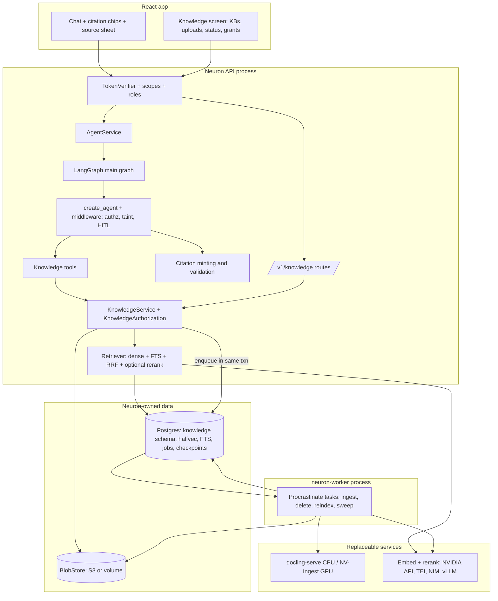

# Neuron Knowledge Engine: Consolidated RAG Architecture and Research (v2)

Nov 2, 2026 · @Md Nisar Ahmed

## 1. Final verdict

**All three reports reach the same core decision, and the evidence supports it: build a Neuron-owned Knowledge Engine on Neuron's existing PostgreSQL (pgvector + full-text, fused with RRF), parse documents out of process with Docling, run ingestion as durable Postgres-backed jobs in a separate worker, and keep the NVIDIA RAG Blueprint as a reference and an optional GPU parser, never as Neuron's runtime.** Cross-examination changed several details, and two of them would have broken the build:

1. **Vector type corrected.** NVIDIA's default embedding is 2,048-dimensional (`APP_EMBEDDINGS_DIMENSIONS=2048` in the Blueprint's compose files), and pgvector HNSW indexes only `vector` up to 2,000 dimensions ([dbi-services, 2026](https://www.dbi-services.com/blog/pgvector-a-guide-for-dba-part-2-indexes-update-march-2026/)). Claude's v1 DDL (`vector(2048)` + HNSW) would fail. Final design: `halfvec`, which indexes up to 4,000 dimensions and halves storage.
2. **Identity transport kept as Neuron already does it.** Gemini proposed passing a `UserSecurityContext` through `RunnableConfig.configurable` with `InjectedToolArg`. Neuron passes `AuthorizationContext` as runtime `context`, which no HTTP client can send; on the Agent Server path, `configurable` is client-influenced. Knowledge tools read identity from `ToolRuntime.context`, exactly like `memory/tools.py`.
3. **In-process NVIDIA import ruled out on dependency grounds too.** ChatGPT found, and this review confirmed in `pyproject.toml`, that the Blueprint pins `openai>=1.0,<2.0` and `langchain-openai<1.1.9`, while Neuron requires `openai>=3.6.0`. They cannot share an environment.
4. **Deletion is tombstone-first** (ChatGPT): retrieval joins live documents only, so a deleted document disappears from search before its chunks are purged.
5. **Three gaps none of the reports closed** are now designed in: document text sent to a hosted embedding API leaves Neuron's boundary; per-user knowledge bases make HNSW filters extremely selective; embedding spend is outside Neuron's token budgets.

The final stack is deliberately small:

| Layer | Choice | Why this and not the alternatives |
| --- | --- | --- |
| Storage, vectors, text search | PostgreSQL + pgvector `halfvec` + built-in FTS | One transaction for ACL and ranking; no sync between stores |
| Parsing | Docling via docling-serve (CPU); NV-Ingest optional for GPU | Permissive licence, layout and tables; keeps torch out of Neuron's image and the parser network-isolated |
| Jobs | Procrastinate on Postgres | psycopg 3 native, retries and locks without Redis; PGQueuer as the named fallback |
| Embeddings and rerank | LangChain `Embeddings` with NVIDIA (dev) and TEI or OpenAI-compatible (self-host); rerank optional | Matches Neuron's model factory; no LiteLLM layer |
| Retrieval, ACL, citations, tools, UI | Neuron code | This is the security boundary and the product |
| Evaluation | Neuron's code-graded harness: recall@k, MRR, citation precision; Ragas optional | Deterministic gates; LLM judges as secondary signal |

First deliverable: private knowledge bases with upload, durable ingestion, hybrid retrieval and server-validated citations, about 7–10 engineer-weeks after the v1.0.0 release freeze lifts, with the ADR and blocking security fixes done during the freeze.

## 2. Method and evidence quality

**Every disputed claim was re-checked against the cloned source of both repositories, PyPI metadata, or a primary web page; agreement between reports was not treated as evidence.** Sources used for arbitration: Neuron at `0f6f24c`, NVIDIA RAG at `29905d8` (both cloned 2026-11-02), PyPI JSON for package versions and licences, and the pages listed in section 13.

| Report | Access it had | Strengths | Weaknesses | Trust level |
| --- | --- | --- | --- | --- |
| Claude v1 | Full clones of both repos; GitHub API for Neuron issues | Grounded in Neuron's actual code (registry, taint, `_final_answer`, migrations, release freeze); most precise NVIDIA source map | Missed the `openai` version conflict; invalid `vector(2048)` HNSW DDL; did not filter tombstoned documents in retrieval | High; corrections in section 5 |
| ChatGPT v1 | No clone (GitHub DNS failed); selected raw files and docs | Strongest security and lifecycle thinking: tombstone-first delete, `Idempotency-Key`, index profiles, RLS-with-pooling caveat, a 12-case security test table; found the dependency conflict | Some wrong file paths; did not see the taint model, the release freeze or the migration style | Medium-high |
| Gemini v1 | No clone; reports paths from "established upstream trees" | Useful ideas: `halfvec`, iterative HNSW scans, DuckDB-first data analysis, bounding-box citations, Kotaemon UX reference | Many claims labelled VERIFIED are outdated or invented (paths, models, licences); unsupported percentages; assumes SQLAlchemy, Alembic and a tenant model Neuron lacks; recommends stale libraries | Low for facts, medium for ideas |

The received Gemini file ends mid-sentence at line 362 (section 5.3.1), so its later sections, if any, were not available to compare.

## 3. Consensus: settled decisions

**Twelve decisions appear independently in all three reports and survive source checks; treat them as fixed inputs to ADR 0014.**

| # | Decision | Evidence that holds it up |
| --- | --- | --- |
| 1 | Do not deploy or import the NVIDIA RAG Blueprint as Neuron's RAG runtime | Its servers have no user identity: the bearer header is forwarded as `vdb_auth_token` (`rag_server/server.py`); dependency pins conflict with Neuron |
| 2 | Keep LangGraph + LangChain as the only agent runtime; no CrewAI, AutoGen, ADK, PydanticAI, Agent Framework | Neuron's checkpointing, approvals and streaming are built on LangGraph (`graphs/main_graph.py`) |
| 3 | PostgreSQL + pgvector + full-text search first; dedicated vector DB only after a benchmark | Neuron already runs Postgres with role separation and backups; ACL and ranking in one statement |
| 4 | Docling is the default parser, behind a parser interface | MIT, active (2.145.0, 2026-10-29), layout and tables; `HybridChunker` present in docling-core |
| 5 | Parsing and embedding run in a background process, never in the API request | Conversion is CPU and memory heavy; SSE streams share the API event loop |
| 6 | Authorisation is derived server-side and applied inside the retrieval query, before ranking | Brief's constraints 2–4; Neuron's owner-key pattern |
| 7 | `search_knowledge` is an in-process tool, not MCP | MCP would add a hop and a second auth boundary for data Neuron owns |
| 8 | Citations are minted by the server and the model cannot create a valid source | Model output is untrusted; Neuron already recomputes `used_tools` from real tool messages |
| 9 | Retrieved content is untrusted data and must not expand capabilities | OWASP agentic guidance; Neuron's taint amendment R2 |
| 10 | Extend the existing React app; reject the Blueprint frontend, Dify, Open WebUI | Duplicate UI; Dify and Open WebUI have restrictive licence clauses |
| 11 | Keep OTel + LangSmith; no Phoenix or Langfuse deployment in the MVP | Phoenix is Elastic-2.0; Langfuse duplicates LangSmith |
| 12 | GraphRAG, Graphiti, Qdrant, Temporal, code sandboxes are later and evidence-gated | No current requirement; each adds a stateful system |

## 4. Contradictions resolved

**Fourteen points of disagreement; the resolution in each row is the one the source evidence or Neuron's existing architecture supports, not a vote.**

| Topic | Claude v1 | ChatGPT v1 | Gemini v1 | Evidence | Resolution |
| --- | --- | --- | --- | --- | --- |
| Job queue | Procrastinate | Own job table with leases and `SKIP LOCKED` | PGQueuer | All three are Postgres-only. Procrastinate 3.10.0 (2026-09-23, MIT) and PGQueuer 1.6.0 (2026-10-11, MIT) are both active. Neuron uses psycopg 3, already owns lease code, but no retry/backoff/scheduling | **Procrastinate**, validated in the Phase 0 spike against PGQueuer; an own table only if both fail the spike. A job-status row in Neuron's own table stays the API's source of truth either way |
| Parser placement | docling-serve container | Docling library in a worker | Docling library in a worker of the same image | Docling pulls ML models (\~GBs); Neuron tests its image layout; a separate container can run with no network egress | **docling-serve container** in the lean profile; the worker sends bytes, never URLs. In-worker library only if a separate worker image is accepted |
| NVIDIA RAG as a service adapter | No | Optional adapter (KNO-028) | Optional NIM adapters only | `NvidiaRAG(vdb_op=…)` accepts an injected store (VERIFIED, `rag_server/main.py:130`), but the HTTP service has no identity and takes `vdb_endpoint` per request | **No search-service adapter** on the roadmap. NV-Ingest is the only NVIDIA service behind `DocumentParser`; reconsider only if a customer already runs the Blueprint |
| Embedding abstraction | LangChain `Embeddings` | Own interface | LiteLLM | Neuron's model factory is LangChain-based; ADR 0009 rejected heavy wrappers (`langchain.mcp`, `fastmcp`) | **LangChain `Embeddings` behind Neuron's `EmbeddingProvider`**; LiteLLM rejected as a duplicate routing layer |
| Default reranker | NVIDIA hosted or TEI; optional | Optional, Phase 2 | FlashRank via `rerankers`, default on | FlashRank last release 2025-01-06, `rerankers` 2025-05-22 (both stale); fastembed 0.9.1 active | **Reranking off until evals show a gain**; providers: NVIDIA, TEI, fastembed cross-encoder (CPU) |
| Long-term memory | Keep notes; semantic recall later via `AsyncPostgresStore` index | Keep current memory | Adopt LangMem | LangMem last release 2025-10-27; it extracts memories from model text, which ADR 0009 decision 7 forbids | **Reject LangMem**; keep notes, add semantic recall over the same store later under a new ADR |
| Injection scanning | Capability control first | Detection as signal only | LLM-Guard as a security boundary | LLM-Guard last release 2025-05-19; classifiers are bypassable | **Capability control (taint + approval) is the boundary**; a scanner may be added later as a logged signal |
| Tenant model | Owner keys now, role grants later | `owner_kind` user or org | Assumes `tenant_id`, `org_roles` exist | Neuron's `Principal` has issuer, subject, scopes only; roles are mapped to scopes and dropped (`security/auth.py`) | **Phase 1 owner-only; Phase 2 role grants** after `Principal` keeps roles; an org entity only when the IdP supplies an org claim |
| ORM and migrations | psycopg + Neuron's migration module | SQL sketch | SQLAlchemy 2 + Alembic | Neuron has no SQLAlchemy; versioned SQL in `persistence/migrations.py` | **Follow Neuron's migration style** |
| Embedding storage | One `vector(2048)` column on chunks | Separate embeddings table + index profiles | `halfvec` column | HNSW indexes `vector` ≤2,000 dims, `halfvec` ≤4,000 | **Separate `knowledge_embeddings(chunk_id, profile_id, embedding halfvec)`** with a partial HNSW index per profile; makes re-indexing to a new model safe |
| Web extraction | Trafilatura | Crawl4AI or vetted crawler | Crawl4AI primary | Crawl4AI runs a headless browser (large attack surface); Trafilatura 2.3.1 is pure-Python | **Trafilatura default**; Crawl4AI only in an isolated, egress-controlled worker for JS pages |
| Evaluation gate | Own code-graded metrics; Ragas optional | Ragas in the minimal set | Ragas + Phoenix | Ragas last release 2026-01-13; Neuron's harness is deterministic | **Deterministic metrics gate releases**; Ragas faithfulness as a nightly, non-blocking signal |
| Observability add-ons | None | None | OpenInference instrumentation | Neuron defines its own GenAI attributes in `observability/semconv.py` | **No OpenInference** (competing attribute set) |
| FastMCP | Only for serving Neuron tools later | Optional authoring | Adopt, incl. `from_openapi` | ADR 0009 rejected FastMCP as a client (28 extra packages) | **Out-of-process only**: an OpenAPI-to-MCP server may run separately and be consumed through Neuron's pinned client |

## 5. Factual errors found

**Each report contains errors; none of them changes the core decision, but several would have caused build failures or bad dependency choices.**

### Claude v1

| Claim | Problem | Correction |
| --- | --- | --- |
| `embedding vector(2048)` with an HNSW index | pgvector HNSW supports `vector` up to 2,000 dimensions; the migration would fail | `halfvec(2048)` (or reduce dimensions); see section 8 |
| Retrieval filters on `kb_id` only | Chunks of documents being deleted or failed remain searchable | Join live documents: `status = 'ready' AND deleted_at IS NULL` |
| NVIDIA reuse blocked by auth and job durability | Incomplete: the `openai<2.0` / `langchain-openai<1.1.9` pins also make an in-process import impossible | Added as a third reason |
| Procrastinate stalled-job recovery "DOCUMENTED" | Docs were not opened | Downgraded to UNVERIFIED; checked in the Phase 0 spike |
| No data-egress discussion for hosted embeddings | Every chunk is sent to the embedding provider | Section 6 |

### ChatGPT v1

| Claim | Problem | Correction |
| --- | --- | --- |
| `src/nvidia_rag/rag_server/utils/embedding.py`, `…/reranker.py`, `…/vdb/vdb_base.py` | No `rag_server/utils/` directory | Files are in `src/nvidia_rag/utils/` |
| "Ragas integration" in the smallest adoption set | Ragas has slowed (0.4.3, 2026-01-13) and is an LLM judge | Optional, non-blocking |
| FastMCP at `jlowin/fastmcp`, Ragas at `explodinggradients/ragas` | Both moved (PyPI lists `PrefectHQ/fastmcp`, `vibrantlabsai/ragas`) | Links updated |
| Own job/lease table | Reasonable, but rebuilds retries, backoff and scheduling that Procrastinate or PGQueuer provide | Library first |

ChatGPT's verified finding (`NvidiaRAG` accepts an injected `vdb_op`) is correct (`rag_server/main.py:130`).

### Gemini v1

| Claim (labelled VERIFIED) | Actual state in the repository | Impact |
| --- | --- | --- |
| `src/rag_server/chains.py`, `retriever.py`, `src/ingestor_server/chunker.py`, `evaluations/` | None exist; code is under `src/nvidia_rag/`; eval is `scripts/eval/` | Integration table unusable as a source map |
| Default vector store Milvus with cuVS | Elasticsearch is the default since 2.6.0 (2026-05-30) | Wrong default |
| Models `llama-3.2-nv-embedqa-1b-v2`, `llama-3.1-70b-instruct` | Current defaults: `llama-nemotron-embed-1b-v2`/`-vl-1b-v2`, `nemotron-3-super-120b-a12b` | Outdated |
| `/v1/chat/completions` is the main endpoint | It exists only as an alias of `/generate` | Minor |
| MinerU is AGPL-3.0 | PyPI now declares a custom "MinerU Open Source License" | Still needs legal review |
| Marker is GPL-3.0 | PyPI declares Apache-2.0 for `marker-pdf` 2.1.0; weight terms separate (UNVERIFIED) | Outdated |
| PGQueuer at `snakesgun/PGQueuer` | Project is `janbjorge/pgqueuer` | Wrong link |
| LangMem, LLM-Guard, rerankers/FlashRank as "primary adoption" | Last releases 2025-10, 2025-05, 2025-05, 2025-01 | Stale dependencies |
| SQLAlchemy, Alembic, `tenant_id`, `UserSecurityContext` in Neuron | None exist | Design would not fit the codebase |
| "95% of capabilities", "80–90% cost cut", "15–28% precision gain", "38–46 weeks saved", "<10 ms p99" | No source or measurement given | Removed |

## 6. Gaps none of the reports closed

**Ten components were missing or only mentioned in passing in all three reports; each is now part of the design, with the section that carries it.**

| # | Gap | Why it matters | Design response |
| --- | --- | --- | --- |
| 1 | **Data egress to hosted model APIs** | The lean profile sends every chunk to the embedding API and every query to the reranker. For personal or company documents this is a data-processing decision, not a default | Per-KB `processing` setting: `hosted` or `self_hosted`; operators can forbid `hosted`; the UI states where content is processed; staging/production validation refuses a hosted provider when policy says local only (§8, §10) |
| 2 | **Very selective ANN filters** | A user's private KB is a tiny fraction of all chunks; filtered HNSW can return too few rows, and `hnsw.max_scan_tuples` (default 20,000) caps the iterative scan | Two-path query: exact scan via the `(profile_id, kb_id)` index when the allowed set is small (threshold set by the spike, initially 20,000 chunks); otherwise HNSW with `hnsw.iterative_scan = relaxed_order` (§8) |
| 3 | **Embedding spend outside budgets** | Neuron enforces per-user token budgets for chat only; a 2,000-page upload is unbounded spend | Ingestion quotas (bytes, pages, documents, concurrent jobs) checked at enqueue; embedding tokens recorded in the existing token ledger under a separate kind |
| 4 | **Agent Server deployment path** | Neuron also exports the graph via `langgraph.json`, where memory and gated tools are deliberately not offered | Knowledge tools are FastAPI-path only, like memory; documented and tested |
| 5 | **Release freeze** | `main` takes only fixes until v1.0.0 | Phase 0 work (ADR, security fixes, spike on a branch) fits the freeze; code lands after the tag |
| 6 | **Abstention when evidence is missing** | Without a rule the model answers from general knowledge and looks grounded | Tool returns an explicit `no_relevant_results` marker below a score floor; the system prompt requires saying so; eval cases for unanswerable questions; answers with no valid citation are flagged `grounded: false` |
| 7 | **Multilingual text search** | Postgres `english` stemming fails on Indian and other languages; `simple` loses stemming | `simple` config by default plus a per-KB language setting; dense retrieval covers semantics; pg\_textsearch BM25 evaluated in Phase 2 |
| 8 | **Stored XSS through previews** | Uploaded HTML/SVG served inline can run script in Neuron's origin | Originals served only as `Content-Disposition: attachment` with `X-Content-Type-Options: nosniff`; previews render extracted text, never the original markup |
| 9 | **Backup consistency between Postgres and blobs** | A restore can reference blobs that no longer exist, or leave orphans | Write-once random blob keys; a periodic orphan sweep job; Neuron's existing restore drill extended to blobs |
| 10 | **Production quality signal** | Offline evals miss real queries | The existing per-run feedback (`neuron_feedback`) is joined to the run's citation set, so a thumbs-down marks the retrieved chunks for review, with no text in telemetry |

## 7. Final architecture

**A modular monolith plus one worker: the API process owns knowledge authorisation, retrieval and citations; a worker process (same codebase) owns ingestion; parsing and model inference sit behind interfaces as replaceable external services.** No new database, no new Neuron microservice.



### Placement

| Component | Runs in | Persistence | GPU | Network |
| --- | --- | --- | --- | --- |
| Knowledge routes, `KnowledgeService`, authorisation, retrieval, citations | API process | `knowledge` schema in Neuron Postgres | No | DB, model API |
| Knowledge tools | `ToolRegistry` (FastAPI path only) | — | No | — |
| Ingestion, delete, re-index, orphan sweep | `neuron-worker` (same image, new entrypoint) | Procrastinate tables + `knowledge` schema | No | DB, blob, parser, model API |
| Parser | docling-serve container; NV-Ingest in GPU profile | None | Optional | **No egress**; reachable only from the worker |
| Embedding and rerank | Hosted API or TEI/NIM/vLLM container | None | Optional | Internal, authenticated |
| Original files | S3-compatible bucket or local volume | Blob | No | — |
| Connectors (Phase 3) | Worker sync jobs; MCP via Neuron's pinned client | Chunks in Postgres | No | Allow-listed egress |
| Agentic retrieval (Phase 4) | LangGraph subgraph | Checkpointer | No | — |

### Flow A: authorised retrieval

1. `TokenVerifier` builds `Principal`; `AgentService` creates `AuthorizationContext(owner_key, permissions, roles)` and passes it as the run's `context` (existing mechanism).
2. `ToolAuthorizationMiddleware` checks `tools:search_knowledge` before the call (existing).
3. The tool reads identity only from `runtime.context`; model arguments are `query`, optional `kb_ids`, `limit`.
4. `KnowledgeAuthorization.allowed_kbs(ctx)` resolves owner and role grants and intersects any requested ids; a foreign id behaves as not found.
5. One SQL transaction: `SET LOCAL neuron.kb_ids = …` (row-level security), then dense and text candidates filtered by allowed KBs **and live documents**, fused with RRF (section 8).
6. Optional rerank of the top 40 to the top 8, only when enabled for the KB profile.
7. Results return as a framed JSON block with server-minted `cite_id`s; the tool is `taints_run=True`.

### Flow B: citations to the UI

1. `AgentAnswer` gains `citations: list[str]` (the `cite_id`s used).
2. `_final_answer` keeps only `cite_id`s returned by a knowledge tool in this run, the same way it already recomputes `used_tools`; rejected ids are counted.
3. Validated citations (document id, chunk id, title, page range, optional bounding box) are stamped in the final `AIMessage.additional_kwargs`, next to `run_id`, so history keeps them although tool messages are not persisted.
4. `AgentResponse`, the SSE `final` event and `ThreadMessage` carry an optional `citations` array with `citation_schema_version: 1`; old clients ignore it.
5. Clicking a chip calls the chunk endpoint, which re-checks access every time.

### Flow C: ingestion that survives restarts

1. Upload: auth, quota, MIME sniffing, size and page caps; stream to BlobStore under a random key; insert the document (`queued`) and defer `ingest_document(doc_id)` in the same transaction; honour `Idempotency-Key`; return `202`.
2. Worker: fetch blob, send bytes to the parser with a timeout, validate output against a schema, chunk with `HybridChunker`, embed in batches, write chunks and embeddings for the active profile, set `ready`.
3. Every step is idempotent by `(doc_id, profile_id)`; a killed worker's job is retried; terminal failures store a sanitised `error_code`.
4. Delete: tombstone (`deleted_at`, status `deleting`) so search excludes it immediately, then a job purges chunks, embeddings and the blob.

### Deployment profiles

| Profile | Adds to today's reference stack | GPUs |
| --- | --- | --- |
| Lean | `pgvector/pgvector:pg16` image, `neuron-worker`, docling-serve (CPU), hosted NVIDIA embedding, volume or S3 | 0 |
| Private CPU | + TEI (CPU) with an open embedding model; `processing=self_hosted` enforced | 0 |
| GPU | + TEI or NIM embed/rerank on GPU, docling-serve GPU or NV-Ingest for scans, vLLM for chat | 1–3 |

## 8. Data model and retrieval query

**Six tables in a dedicated `knowledge` schema, keyed by Neuron's HMAC owner key; embeddings live in their own table per index profile so a model change is a re-index, never a schema change.** This merges Claude's grants and RLS, ChatGPT's index profiles and tombstones, and Gemini's `halfvec`. Written as Neuron-style versioned SQL migrations (no ORM); every statement below is a design sketch to be confirmed with `EXPLAIN` in the Phase 0 spike.

```sql
CREATE EXTENSION IF NOT EXISTS vector;
CREATE SCHEMA IF NOT EXISTS knowledge;

CREATE TABLE knowledge.index_profiles (
  profile_id     smallint PRIMARY KEY,
  provider       text NOT NULL,                -- nvidia | tei | openai_compatible
  model          text NOT NULL,                -- e.g. nvidia/llama-nemotron-embed-1b-v2
  dimensions     int  NOT NULL CHECK (dimensions <= 4000),  -- halfvec HNSW limit
  chunker        text NOT NULL,                -- e.g. docling HybridChunker, max_tokens=512
  status         text NOT NULL CHECK (status IN ('building','active','retired'))
);

CREATE TABLE knowledge.bases (
  kb_id          uuid PRIMARY KEY,
  owner_key      text NOT NULL,                -- HMAC owner key, never a raw subject
  name           text NOT NULL CHECK (char_length(name) BETWEEN 1 AND 80),
  processing     text NOT NULL DEFAULT 'hosted' CHECK (processing IN ('hosted','self_hosted')),
  ts_config      regconfig NOT NULL DEFAULT 'simple',
  profile_id     smallint NOT NULL REFERENCES knowledge.index_profiles,
  created_at     timestamptz NOT NULL DEFAULT now(),
  deleted_at     timestamptz
);

CREATE TABLE knowledge.grants (               -- Phase 2; owner row written at creation
  kb_id          uuid REFERENCES knowledge.bases ON DELETE CASCADE,
  subject_type   text NOT NULL CHECK (subject_type IN ('owner','role')),
  subject        text NOT NULL,                -- owner key, or role from the configured claim
  access         text NOT NULL CHECK (access IN ('read','write','admin')),
  granted_by     text NOT NULL,
  created_at     timestamptz NOT NULL DEFAULT now(),
  PRIMARY KEY (kb_id, subject_type, subject)
);

CREATE TABLE knowledge.documents (
  doc_id         uuid PRIMARY KEY,
  kb_id          uuid NOT NULL REFERENCES knowledge.bases ON DELETE CASCADE,
  uploaded_by    text NOT NULL,
  title          text NOT NULL,
  mime_type      text NOT NULL,
  size_bytes     bigint NOT NULL,
  page_count     int,
  sha256         char(64) NOT NULL,
  blob_key       text NOT NULL,
  source_type    text NOT NULL DEFAULT 'upload',  -- upload | github | web
  source_ref     text,
  idempotency_key text,
  status         text NOT NULL CHECK (status IN ('queued','parsing','embedding','ready','failed','deleting')),
  error_code     text,
  parser_version text,
  created_at     timestamptz NOT NULL DEFAULT now(),
  updated_at     timestamptz NOT NULL DEFAULT now(),
  deleted_at     timestamptz
);
CREATE UNIQUE INDEX ON knowledge.documents (kb_id, sha256) WHERE deleted_at IS NULL;
CREATE UNIQUE INDEX ON knowledge.documents (uploaded_by, idempotency_key) WHERE idempotency_key IS NOT NULL;

CREATE TABLE knowledge.chunks (
  chunk_id       uuid PRIMARY KEY,
  doc_id         uuid NOT NULL REFERENCES knowledge.documents ON DELETE CASCADE,
  kb_id          uuid NOT NULL,                -- denormalised for filters and RLS
  ordinal        int  NOT NULL,
  text           text NOT NULL,
  headings       text[] NOT NULL DEFAULT '{}',
  page_start     int, page_end int,
  bbox           jsonb,                        -- Docling provenance, optional
  token_count    int NOT NULL,
  ts_config      regconfig NOT NULL,
  tsv            tsvector GENERATED ALWAYS AS (to_tsvector(ts_config, text)) STORED
);
CREATE INDEX CONCURRENTLY ON knowledge.chunks USING gin (tsv);
CREATE INDEX CONCURRENTLY ON knowledge.chunks (kb_id);

CREATE TABLE knowledge.embeddings (
  chunk_id       uuid REFERENCES knowledge.chunks ON DELETE CASCADE,
  profile_id     smallint REFERENCES knowledge.index_profiles,
  kb_id          uuid NOT NULL,
  embedding      halfvec NOT NULL,             -- no typmod: dimension fixed per profile index
  PRIMARY KEY (chunk_id, profile_id)
);
CREATE INDEX CONCURRENTLY ON knowledge.embeddings (profile_id, kb_id);
-- one partial expression index per profile (profile 1 = 2048 dims)
CREATE INDEX CONCURRENTLY knowledge_emb_p1_hnsw ON knowledge.embeddings
  USING hnsw ((embedding::halfvec(2048)) halfvec_cosine_ops) WHERE profile_id = 1;

ALTER TABLE knowledge.chunks     ENABLE ROW LEVEL SECURITY;
ALTER TABLE knowledge.embeddings ENABLE ROW LEVEL SECURITY;
CREATE POLICY kb_scope ON knowledge.chunks
  USING (kb_id = ANY (string_to_array(current_setting('neuron.kb_ids', true), ',')::uuid[]));
CREATE POLICY kb_scope ON knowledge.embeddings
  USING (kb_id = ANY (string_to_array(current_setting('neuron.kb_ids', true), ',')::uuid[]));
```

RLS applies because the app role does not own these tables (the migrator does, per Neuron's role split). `SET LOCAL` is transaction-scoped, so a pooled connection cannot carry one user's KB list into another request (ChatGPT's pooling caveat). The worker writes with its own role that bypasses the `kb_scope` policy only for inserts and deletes it performs by `doc_id`.

### Hybrid query (sketch)

```sql
BEGIN;
SET LOCAL neuron.kb_ids = '…allowed ids…';
SET LOCAL hnsw.iterative_scan = relaxed_order;   -- large allowed sets only
WITH dense AS (
  SELECT chunk_id,
         row_number() OVER (ORDER BY embedding::halfvec(2048) <=> %(q)s::halfvec(2048)) AS r
  FROM (SELECT chunk_id, embedding FROM knowledge.embeddings
        WHERE profile_id = 1 AND kb_id = ANY(%(kb_ids)s)
        ORDER BY embedding::halfvec(2048) <=> %(q)s::halfvec(2048)
        LIMIT 80) d),
text_hits AS (
  SELECT chunk_id,
         row_number() OVER (ORDER BY ts_rank_cd(tsv, q) DESC) AS r
  FROM knowledge.chunks, websearch_to_tsquery(%(ts_config)s, %(query)s) q
  WHERE kb_id = ANY(%(kb_ids)s) AND tsv @@ q
  ORDER BY ts_rank_cd(tsv, q) DESC LIMIT 80),
fused AS (
  SELECT chunk_id, sum(1.0 / (60 + r)) AS score
  FROM (SELECT * FROM dense UNION ALL SELECT * FROM text_hits) u
  GROUP BY chunk_id)
SELECT c.chunk_id, c.doc_id, d.title, c.headings, c.page_start, c.page_end, c.text, f.score
FROM fused f
JOIN knowledge.chunks c    USING (chunk_id)
JOIN knowledge.documents d ON d.doc_id = c.doc_id
WHERE d.status = 'ready' AND d.deleted_at IS NULL         -- tombstone filter
ORDER BY f.score DESC LIMIT %(limit)s;
COMMIT;
```

Sizing (arithmetic, not measured): `halfvec(2048)` is 4,096 bytes per chunk, so 1 million chunks hold about 4 GB of vectors before index overhead. If the chosen model supports reduced output dimensions (the Blueprint exposes an `APP_EMBEDDINGS_DIMENSIONS` setting), 1,024 dimensions halve that; the spike decides using recall@5.

## 9. API, tools and citation contract

**The document's status is the job's status: there is no separate public job resource, which removes one ACL surface (ChatGPT proposed `/v1/ingestion-jobs/{id}`).** All routes follow Neuron conventions: `/v1`, `extra="forbid"` bodies, stable error codes, and a single `404` for missing, foreign or unreadable resources.

| Method and path | Scope | Notes |
| --- | --- | --- |
| `GET /v1/knowledge/bases` | `knowledge:read` | Only readable KBs; inaccessible names never listed |
| `POST /v1/knowledge/bases` | `knowledge:write` | Private KB; `processing` limited by operator policy |
| `PATCH /v1/knowledge/bases/{kb_id}` | KB admin | Rename, language, visibility |
| `DELETE /v1/knowledge/bases/{kb_id}` | KB admin | Tombstone, `202`, async purge |
| `PUT /v1/knowledge/bases/{kb_id}/grants` | `knowledge:admin` + KB admin (Phase 2) | Role grants; audited |
| `POST /v1/knowledge/bases/{kb_id}/documents` | KB write | Multipart; `Idempotency-Key`; `202` with `doc_id` and `status_url` |
| `GET /v1/knowledge/bases/{kb_id}/documents` | KB read | Paginated, with status |
| `GET /v1/knowledge/documents/{doc_id}` | KB read | Metadata, status, `error_code`, stage |
| `DELETE /v1/knowledge/documents/{doc_id}` | KB write | Tombstone first; `202` |
| `GET /v1/knowledge/documents/{doc_id}/chunks/{chunk_id}` | KB read | Citation inspection; access re-checked each call |
| `GET /v1/knowledge/documents/{doc_id}/file` | KB read | `attachment` + `nosniff`, never inline |
| `POST /v1/knowledge/search` | `knowledge:read` | UI and eval use; same authorisation path as the tool |
| `DELETE /v1/me/knowledge` | `threads:delete` | Part of the existing erase-everything flow; export lists KBs and documents |

`AgentRequest` gains optional `knowledge_base_ids` (at most 10), which narrows and never widens the caller's allowed set.

### Agent tools

| Tool | Model-visible input | Output | Scope | Risk | Taints | Limits |
| --- | --- | --- | --- | --- | --- | --- |
| `list_knowledge_bases` | — | `[{kb_id, name, documents}]` | `tools:search_knowledge` | read | no | 50 items |
| `search_knowledge` | `query` (≤500 chars), `kb_ids?` (≤10), `limit?` (≤10) | framed JSON `[{cite_id, title, headings, page, text}]` or `no_relevant_results` | `tools:search_knowledge` | read | **yes** | 6,000 chars total; 5 calls per run |
| `get_document_excerpt` | `cite_id`, `window?` (≤2) | neighbouring chunks of a result already returned in this run | `tools:search_knowledge` | read | yes | only `cite_id`s from this run |
| `query_table` (Phase 4) | `doc_id`, `sql` | ≤200 rows | `tools:query_table` | read | yes | one `SELECT` (sqlglot-checked), DuckDB with external access off, 5 s, 256 MB |
| `research_web` (Phase 4) | `question`, `max_pages` ≤5 | framed extracts + URLs | `tools:research_web` | read, outbound | yes | after taint, approval required (existing rule); SSRF-safe, HTTPS |
| `save_to_knowledge` (Phase 4) | `kb_id`, `url` or user-approved text | `doc_id` | `tools:save_to_knowledge` | **mutating** | no | always approved; quota |
| `delete_document` (Phase 4) | `doc_id` | status | `tools:delete_document` | **mutating** | no | always approved |

Upload is never a model tool: it is a user action in the UI (ChatGPT). Identity is never a tool argument; tool errors are fixed strings, as in `memory/tools.py`.

### Citation object

```json
{
  "citation_schema_version": 1,
  "citations": [{
    "n": 1,
    "doc_id": "6db1…",
    "chunk_id": "c456…",
    "title": "architecture.pdf",
    "page_start": 12, "page_end": 13,
    "headings": ["System Design", "Security"],
    "bbox": null
  }],
  "grounded": true
}
```

No excerpt text is stored on the answer; the UI fetches it through the chunk endpoint, so revoking access also hides old citations. `grounded` is false when the answer cites nothing valid after the search tool ran.

## 10. Security model

**The boundary is capability control, enforced outside the model: retrieved text may change what the model says, but it cannot read another user's data, invent a source, or trigger an outbound or mutating action without a human.** Detection classifiers (Gemini's LLM-Guard) are at most a logged signal; all three reports agree that delimiters alone are not a defence.

### Layers, strongest first

1. **Authorisation inside the query.** Allowed KBs come from `AuthorizationContext` and grants; the SQL filters on them and on live documents; RLS repeats the filter. Neither the model nor the request body can name an owner.
2. **Taint and approval (existing Neuron code).** `search_knowledge` and `get_document_excerpt` set `taints_run=True`; after they run, any MCP or outbound tool needs approval (security review amendment R2). Mutating tools always need approval.
3. **Citation validation.** Only `cite_id`s minted in this run survive; fabricated sources are dropped and counted.
4. **Framing.** Results are a JSON array inside a delimited block with `<` escaped, reusing `render_notes()`'s pattern and its "data, not instructions" preamble.
5. **Ingestion hardening.** MIME sniffing; size, page and decompression limits; no archives or macros in Phase 1; encrypted PDFs rejected; parser has no network egress and a timeout; parser output schema-validated; text per page capped.
6. **Egress.** Web and connector fetches only after #364 and #366, via `validate_safe_url`, HTTPS-only, redirect and DNS checks.
7. **Data processing locality.** KB `processing=self_hosted` keeps chunks and queries on operator-run models; policy can forbid `hosted` (section 6, gap 1).
8. **Telemetry hygiene.** Spans and logs carry ids, counts, stages and timings; never queries, chunk text, filenames or vectors. The existing leak scan covers the new paths.

### Required security tests (merged from ChatGPT's table and Claude's evals)

| Test | Expected result |
| --- | --- |
| User A searches with User B's `kb_id` or `doc_id` | Not found; no chunk, title or count leaks |
| Same text in two users' KBs | Each sees only their own chunk |
| Role grant revoked while a citation sheet is open | Next fetch returns 404 |
| Document deleted during async purge | Excluded from search immediately |
| PDF with hidden instructions (white text, alt text, table cell) asking for a tool call | No gated tool runs without approval; answer cites only real sources |
| Chunk containing a fake `cite_id` | Dropped by validation |
| Retrieved text asks to send data to an MCP tool | Approval required (taint) |
| Worker killed during embedding | Job completes once; no duplicate chunks |
| Upload of HTML/SVG, then download | Served as attachment; no script runs in Neuron's origin |
| Zip bomb or 5,000-page PDF | Rejected at upload or parser limit; quota unchanged |
| Erase-everything request | Blobs, chunks, embeddings, grants and jobs removed; `complete` flag accurate |
| Hosted provider configured while policy is self-hosted only | Startup validation fails in staging and production |

## 11. Final technology stack

**Four adoptions carry Phases 1–2; everything else is optional, later, or rejected with a stated reason.** Versions and dates are the latest PyPI release as of 2026-11-02.

### Adopt (Phases 1–2)

| Project | Role | Licence | Latest | Form |
| --- | --- | --- | --- | --- |
| [pgvector](https://github.com/pgvector/pgvector) + [pgvector-python](https://github.com/pgvector/pgvector-python) | `halfvec`, HNSW, psycopg types | PostgreSQL / MIT | 0.5.1 (2026-10-09) | Extension + library |
| [Docling](https://github.com/docling-project/docling) via [docling-serve](https://github.com/docling-project/docling-serve); `docling-core` in the worker for `HybridChunker` | Parsing, OCR, layout, tables, chunking | MIT (model weights: check per model) | 2.145.0 / 1.38.2 / core 2.105.0 | Container + light library |
| [Procrastinate](https://github.com/procrastinate-org/procrastinate) | Durable jobs on Postgres | MIT | 3.10.0 (2026-09-23) | Library in worker |
| [langchain-nvidia-ai-endpoints](https://github.com/langchain-ai/langchain-nvidia) and `langchain-openai` (for TEI/vLLM/OpenAI) | Embedding and rerank clients | MIT (nvidia package licence UNVERIFIED) | — | Library behind `EmbeddingProvider` / `Reranker` |

### Optional or later

| Project | When | Condition |
| --- | --- | --- |
| [pg\_textsearch](https://www.postgresql.org/about/news/pg_textsearch-v10-3264) (PostgreSQL licence, v1.0 2026-04-03) | Phase 2 | Built-in FTS underperforms on the eval set; needs a custom Postgres image |
| Hugging Face TEI | Private-CPU and GPU profiles | `processing=self_hosted` or cost |
| fastembed 0.9.1 (Apache-2.0) | Phase 2 | CPU cross-encoder rerank when no rerank service |
| [PGQueuer](https://github.com/janbjorge/pgqueuer) 1.6.0 (MIT) | Phase 0 | Fallback if Procrastinate fails the spike |
| NV-Ingest + extraction NIMs | GPU profile | Scanned or chart-heavy corpora fail Docling quality bar; NIM licence reviewed |
| DuckDB 2.0.0 + sqlglot 30.27.0 (MIT) | Phase 4 | Tabular analysis without code execution |
| Trafilatura 2.3.1 (Apache-2.0) | Phase 3 | Web ingestion after SSRF fixes |
| Crawl4AI 0.9.5 (Apache-2.0) | Phase 4 | JS-rendered pages, isolated worker only |
| tree-sitter-language-pack 1.22.1 (MIT) | Phase 3–4 | Code-aware chunking with commit SHA provenance |
| GitHub MCP server | Phase 3 | Via pinned MCP client; service token; per-user OAuth needs a token-vault ADR |
| Unstructured 0.27.36 (Apache-2.0), MarkItDown 0.1.9 (MIT) | As needed | Formats Docling misses (email, legacy) |
| Qdrant | Phase 5 | Benchmark shows Postgres misses p95 or recall targets at real scale |
| LightRAG / Graphiti | Phase 5 | Eval shows multi-hop questions fail with hybrid retrieval |
| E2B or gVisor sandbox | Phase 5 | A use case needs code execution, behind approval |
| Ragas 0.4.3 / DeepEval 4.3.2 | Any | Nightly LLM-judge signal, not a gate |
| Promptfoo / Inspect AI | Phase 1+ | CI red-team for injection |
| vLLM / SGLang | GPU profile | Self-hosted chat model |

### Rejected

| Project | Reason |
| --- | --- |
| NVIDIA RAG servers, frontend, Redis task handler | No identity model; in-memory jobs; duplicate UI; dependency conflict |
| Milvus, Weaviate, Elasticsearch, OpenSearch, Vespa | A second datastore and ACL model without a measured need |
| LiteLLM | Duplicates Neuron's model factory and fallback |
| LangMem, Mem0, Letta, Cognee | Model-extracted memories conflict with ADR 0009; LangMem stale |
| LLM-Guard, FlashRank, `rerankers` | Last releases in 2025 |
| Phoenix, OpenInference, Langfuse | Licence (Phoenix) or duplicate telemetry |
| PyMuPDF, ParadeDB `pg_search`, Firecrawl server | AGPL |
| MinerU, Marker | Licence terms and weight terms need review; Docling covers the need |
| Dify, Open WebUI, RAGFlow, AnythingLLM, Kotaemon | Whole products; licence clauses (Dify, Open WebUI); Kotaemon kept as a UX reference for bounding-box highlights |
| CrewAI, AutoGen, Agent Framework, Semantic Kernel, PydanticAI, ADK, OpenAI Agents SDK | Second orchestrator |
| Temporal, Prefect, Airflow, Celery | New infrastructure; revisit only for multi-system connector workflows |

## 12. Roadmap, backlog and effort

**Phases 0–2 take about 13–18 engineer-weeks and deliver private and role-shared knowledge with hybrid retrieval and validated citations; everything after Phase 2 is gated on eval evidence.** Effort is estimated, not measured.

### Phases

| Phase | Delivers | Gate to exit | Effort |
| --- | --- | --- | --- |
| 0. Decide (during freeze) | ADR 0014; #364, #366, #370 fixed; spike on a branch: Docling quality on 50 real documents, `halfvec` dimension choice, exact-vs-HNSW threshold, Procrastinate vs PGQueuer, labelled eval set (≥50 questions with expected pages, plus unanswerable and ACL cases) | ADR accepted; spike numbers recorded | 2–3 ew |
| 1. Personal knowledge | Private KBs, upload, durable ingestion, dense + FTS retrieval, `search_knowledge`, validated citations, tombstone delete, erase/export, Knowledge screen, processing locality setting | Zero cross-user results in the security suite; ≥90% of answerable eval questions cite a correct page; killed-worker job completes; existing tests green | 7–10 ew |
| 2. Quality and sharing | RRF tuning, optional rerank, re-index to a new profile, role grants (`Principal` keeps roles), grants UI, retrieval regression gate in nightly evals, load test | Recall@5 and MRR at or above Phase 1 on the same set; revoked role loses access on next query; p95 search latency recorded | 4–5 ew |
| 3. Sources | GitHub repo sync (tree-sitter chunks, commit SHA provenance), web page ingestion (Trafilatura), MCP connectors, `openai_compatible` model provider | Every chunk maps to a source version; private-range URLs refused | 4–6 ew |
| 4. Capabilities | `query_table` (DuckDB), `research_web` + `save_to_knowledge`, `search_repository`, optional plan/verify retrieval subgraph | Each ships with eval cases; subgraph kept only if it beats the tool loop | 6–8 ew |
| 5. Platform | Semantic recall over memory notes (new ADR), sandboxed code execution, GraphRAG trial, Qdrant only on benchmark, organisation spaces | Measured gain per item | 8–12 ew |

### Backlog for Phases 0–2

| ID | Task | Pri | Depends | Est. | Acceptance |
| --- | --- | --- | --- | --- | --- |
| KE-001 | ADR 0014 Knowledge Engine (this report's decisions) | P0 | — | 0.5 w | Accepted by owner |
| KE-002 | Fix SSRF and HTTPS-only fetch (#364, #366) | P0 | — | 1 w | Security suite passes new cases |
| KE-003 | Handle MCP transport exceptions (#370) | P0 | — | 0.5 w | Dropped connection is a tool error |
| KE-004 | Spike: Docling quality, dimension choice, ANN threshold, queue choice | P0 | KE-001 | 1–1.5 w | Numbers recorded in the ADR |
| KE-005 | Labelled eval set and knowledge security dataset | P0 | KE-001 | 1 w | ≥50 answerable, ≥10 unanswerable, ACL and injection cases |
| KE-010 | pgvector image, extension, `knowledge` schema, startup check | P0 | KE-004 | 0.5 w | Readiness fails clearly without the extension |
| KE-011 | Tables, grants to roles, RLS, partial HNSW index | P0 | KE-010 | 1 w | RLS denies rows outside `neuron.kb_ids`; grant tests extended |
| KE-012 | `BlobStore` (local, S3) with write-once keys | P0 | KE-001 | 0.5 w | No path traversal; idempotent delete |
| KE-013 | Worker entrypoint, Procrastinate schema, drain and health | P0 | KE-011 | 1 w | Job survives a worker kill |
| KE-014 | `DocumentParser`: docling-serve adapter + plain text/Markdown | P0 | KE-013 | 1 w | Timeouts, caps, schema-validated output; parser has no egress |
| KE-015 | `EmbeddingProvider` (nvidia, openai-compatible, fake) + locality policy | P0 | KE-001 | 0.5 w | Hosted provider refused when policy is self-hosted |
| KE-016 | Ingest task, idempotent per `(doc_id, profile_id)` | P0 | KE-013–015 | 1 w | Re-run leaves one chunk set |
| KE-017 | Knowledge routes, quotas, idempotency, tombstone delete | P0 | KE-011, KE-012, KE-016 | 1 w | Foreign ids 404; audit with counts only |
| KE-018 | Retriever: dense + FTS + RRF, tombstone join, exact/HNSW switch | P0 | KE-011, KE-015 | 1 w | Isolation test passes; small-KB queries return full k |
| KE-019 | Knowledge tools, registry wiring, taint, abstention marker | P0 | KE-018 | 1 w | MCP gated after search; unanswerable cases say so |
| KE-020 | Citations: minting, validation in `_final_answer`, stamp, API/SSE/history fields | P0 | KE-019 | 1 w | Fake ids dropped; history returns citations |
| KE-021 | Knowledge screen, upload, status, citation chips, source sheet | P0 | KE-017, KE-020 | 1.5 w | Playwright upload → ask → open citation; axe passes |
| KE-022 | Erase and export include knowledge; orphan sweep | P0 | KE-017 | 0.5 w | `complete` flag accurate |
| KE-023 | Embedding tokens in the ledger; ingestion quotas | P0 | KE-016 | 0.5 w | Over-quota upload refused before work starts |
| KE-030 | Optional rerank providers (NVIDIA, TEI, fastembed) | P1 | KE-018 | 0.5 w | Enabled only if eval gain; outage falls back to fused order |
| KE-031 | Roles kept in `Principal` and `AuthorizationContext` | P1 | — | 0.5 w | Roles only from configured claim and issuer |
| KE-032 | Grants API and UI | P1 | KE-031 | 1 w | Revocation effective on next query; audited |
| KE-033 | Re-index job to a new profile; swap and retire | P1 | KE-016 | 0.5 w | No mixed profiles in one search |
| KE-034 | Nightly retrieval regression gate | P1 | KE-005 | 0.5 w | Fails on recall@5 or citation-precision drop |
| KE-035 | Load test ingestion and search | P1 | KE-018 | 0.5 w | p95 latency and throughput recorded |

### Effort reconciliation

| Source | Claim | Assessment |
| --- | --- | --- |
| ChatGPT | MVP 9–16 ew with reuse vs 24–36 from scratch | Consistent with the backlog above once UI and evals are counted |
| Claude v1 | Phase 1 5–7 ew; Phases 0–2 11–15 ew | Slightly low: omitted tombstones, idempotency, quotas, locality and the eval set |
| Gemini | "38–46 weeks saved" | No derivation; not used |
| **Consolidated** | Phases 0–2: 13–18 ew; saving vs building parsing, queueing and vector search in-house: about 15–25 ew | Estimate |

## 13. Decisions, risks, open questions and sources

**Eight decision records go into ADR 0014; five questions stay open until the Phase 0 spike answers them.**

### Decision records

| ID | Decision | Rejected alternatives |
| --- | --- | --- |
| K1 | Knowledge Engine inside Neuron on Neuron's Postgres (`knowledge` schema, RLS) | NVIDIA RAG as a service; Qdrant first |
| K2 | Parsing out of process behind `DocumentParser`; docling-serve default, NV-Ingest optional, no parser egress | Docling in the API process; Unstructured; MinerU/Marker |
| K3 | Embeddings in a per-profile table as `halfvec` with partial HNSW indexes; one active profile per KB; change by re-index | `vector(2048)` column (exceeds HNSW limit); mixed profiles in one search |
| K4 | Procrastinate for jobs, confirmed by spike; document row is the public status | Own lease table; Celery/Redis; Temporal |
| K5 | Identity only from runtime `AuthorizationContext`; tools never take identity | `RunnableConfig.configurable` + `InjectedToolArg` |
| K6 | Server-minted, run-validated citations stamped on the answer message | Model-written sources; citation table |
| K7 | Retrieved content taints the run; capability control over detection | Classifier-based scanning as the boundary |
| K8 | KB-level processing locality (`hosted` / `self_hosted`) enforced by settings validation | Implicit hosted processing |

### Top risks

| Risk | L / I | Mitigation |
| --- | --- | --- |
| Cross-user retrieval | Low / Critical | Filter in SQL + RLS + isolation tests + mutation testing over `knowledge/` |
| Injected instructions trigger an action | Medium / High | Taint + approval; poisoned-document evals |
| Document content sent to a third party without consent | Medium / High | Locality setting and UI disclosure |
| Selective filters starve HNSW | Medium / Medium | Exact-scan path; iterative scan; spike threshold |
| Shared Postgres contention | Medium / Medium | Separate pools for worker; read replica for search; Qdrant only on benchmark |
| Parser exploit or resource exhaustion | Medium / High | Isolated container, no egress, limits |
| Stale or abandoned dependency | Medium / Medium | Adopt only libraries released in the last six months; pin images |
| Freeze delays delivery | Certain / Medium | Use the freeze for Phase 0 |

### Open questions for the Phase 0 spike

- [ ] Does Docling's CPU pipeline reach acceptable table and scanned-page quality on the target corpus, or is a GPU parser needed?
- [ ] 2,048 or 1,024 dimensions: does `llama-nemotron-embed-1b-v2` keep recall@5 at reduced output size?
- [ ] At what allowed-chunk count does HNSW with iterative scan beat an exact scan?
- [ ] Does Procrastinate recover jobs from a killed worker as documented, under Neuron's pool settings?
- [ ] Is the NVIDIA API catalog acceptable for production document processing (terms, data handling, pricing), or is TEI the production default?

### Sources

- Claude v1, ChatGPT v1 and Gemini v1 research reports (attached `*_neuron_rag_research_v1.md`)
- [Md-Nisar/neuron](https://github.com/Md-Nisar/neuron) at `0f6f24c`: `security/auth.py`, `security/authorization.py`, `tools/registry.py`, `memory/tools.py`, `graphs/main_graph.py`, `persistence/migrations.py`, ADR 0009
- [NVIDIA-AI-Blueprints/rag](https://github.com/NVIDIA-AI-Blueprints/rag) at `29905d8`: `pyproject.toml`, `src/nvidia_rag/rag_server/main.py`, `rag_server/server.py`, `utils/embedding.py`, `utils/vdb/`, `deploy/compose/*`, `docs/release-notes.md`, `docs/support-matrix.md`
- PyPI JSON metadata for all versions, dates and licences ([pypi.org](https://pypi.org))
- [pgvector index limits and iterative scans (dbi-services, 2026)](https://www.dbi-services.com/blog/pgvector-a-guide-for-dba-part-2-indexes-update-march-2026/)
- [pg\_textsearch v1.0 announcement](https://www.postgresql.org/about/news/pg_textsearch-v10-3264)
- [Dify licence](https://docs.dify.ai/policies/open-source) · [Open WebUI licence](https://docs.openwebui.com/license/) · [Zep CE deprecation](https://help.getzep.com/ce-deprecation-notice)
