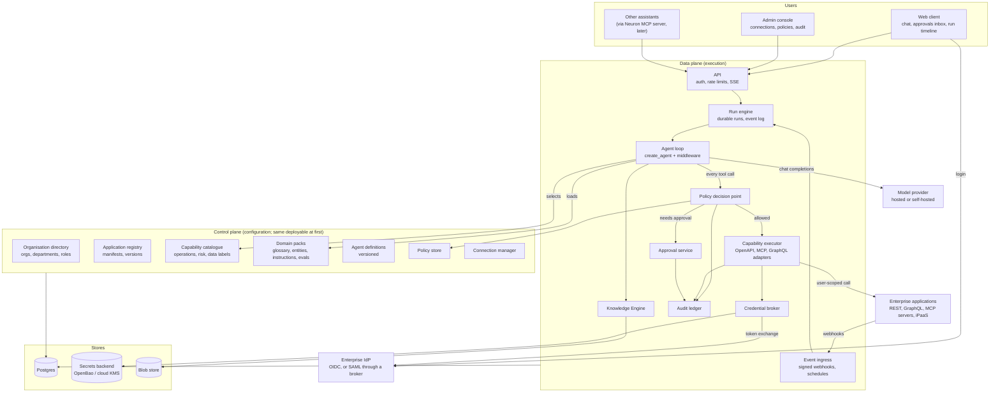
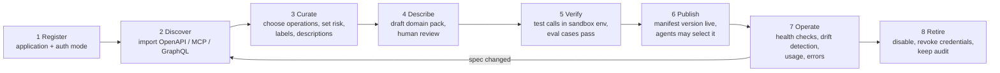
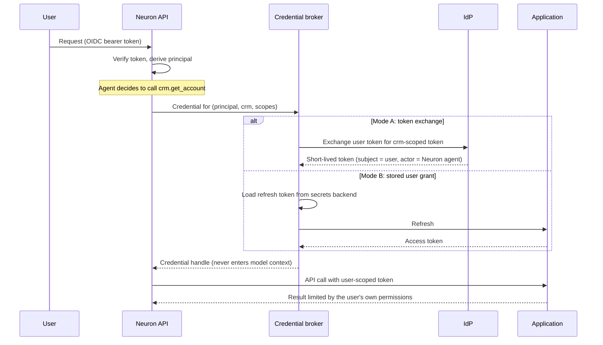
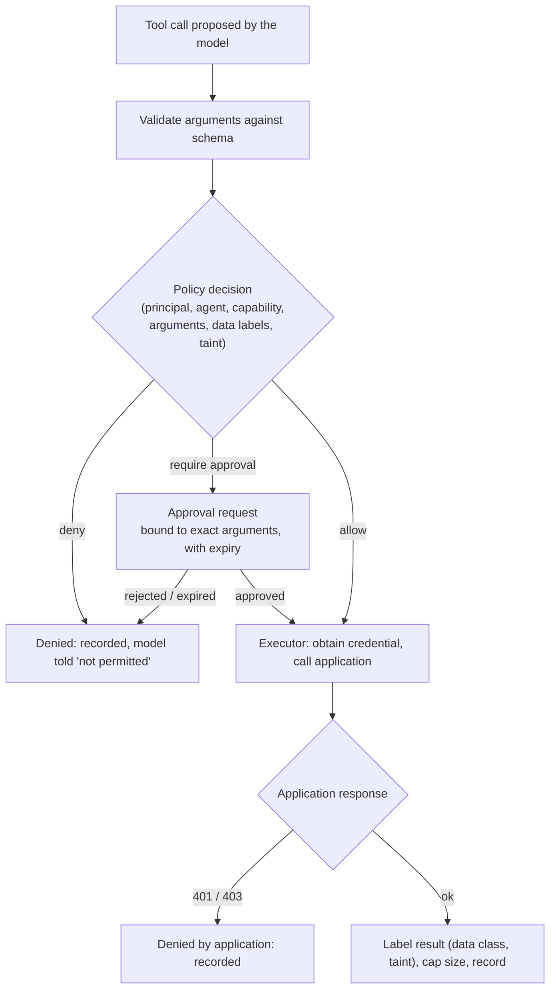
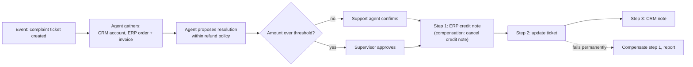
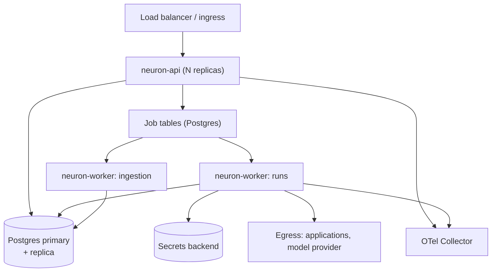

# Domain-Agnostic Integration Architecture

| | |
| --- | --- |
| Date | 2026-11-10 |
| Package | Document 5 of 14 |
| Status | Reference architecture for discussion. Each new subsystem needs an ADR before code (the repository's own rule). |
| Evidence | Neuron facts from `NEURON_CURRENT_ARCHITECTURE_ASSESSMENT.md`. External references from document 2. Design choices are mine [I]. |

## 1. Design goals

1. A new application is onboarded with configuration and review. **No change to core code.** This is the main acceptance criterion (section 14).
2. The agent's access to an application never exceeds the requesting user's.
3. Every call to an application passes one policy decision point and produces one audit record.
4. The architecture starts as the current modular monolith plus a worker, and splits only when measurements require it.
5. Existing strengths are kept: `ToolSpec` policy, taint tracking, approvals, egress control, the token ledger.

## 2. Integration mechanisms and their roles

No single mechanism covers enterprise integration. Each has a place.

| Mechanism | Role in Neuron | When | Notes |
| --- | --- | --- | --- |
| **REST with OpenAPI** | Primary way to reach custom and line-of-business applications | First | Most such applications have REST; many have a specification or can produce one. |
| **MCP (client)** | Primary way to reach applications and platforms that ship a server, and connector catalogues | First (exists; needs per-user auth) | A transport and discovery protocol. It does not supply business meaning, risk classes or user delegation by itself. |
| **OAuth 2 / OIDC** | How users sign in and how Neuron obtains delegated credentials | First | Authorization code with PKCE per user; token exchange (RFC 8693) where supported. |
| **SAML** | Sign-in for enterprises whose IdP offers only SAML | First, through the identity broker | Neuron never parses SAML. Keycloak or another broker converts it to OIDC. |
| **Service accounts** | Fallback where an application has no per-user access | First, restricted | Flagged as an elevated connection; read-only by default. |
| **Webhooks** | How applications start work in Neuron | Second | One signed inbound endpoint; events become runs. |
| **GraphQL** | Applications that offer only GraphQL | Second | Introspection gives a schema; operations are curated like OpenAPI ones. |
| **Event streams and message queues** | High-volume event sources | Later, through a bridge | Neuron should not embed Kafka or AMQP clients early. An integration platform or a small bridge posts events to the webhook endpoint. |
| **Database integration** | Read-only access to legacy data with no API | Later | Parameterised, pre-approved queries against a read replica or view. Never free-form SQL from the model. |
| **MCP (server)** | How other assistants call Neuron's governed capabilities | Later | Neuron becomes a tool provider to Copilot, Claude and others. |
| **A2A** | Agent-to-agent delegation across vendors | Later, on demand | Useful when a customer's other agents must hand tasks to Neuron. Not needed to integrate applications. |
| **Legacy adapters, RPA, browser automation** | Applications with no programmatic interface | Not built in Neuron | Call an RPA vendor's robot as a tool. Browser automation inside Neuron stays excluded (`NEURON_GLOBAL_AGENT_ARCHITECTURE_RESEARCH.md`, section 6). |
| **Traditional middleware (iPaaS, ESB, API gateway)** | Stays the customer's integration backbone | Integrate | Neuron calls what the middleware exposes. |

**The role of MCP, stated plainly.** MCP standardises how a client lists and calls tools. It solves transport and discovery. It leaves four things to the platform: which user the call is for, whether this user may make this call with these arguments, what the tool means in the business, and what happens when the call half-succeeds. Those four are Neuron's work.

## 3. Reference architecture



"Control plane" and "data plane" are logical. In the first deployments both live in the existing API process and worker, in one Postgres database.

## 4. Component responsibilities

| Component | Responsibility | Exists today |
| --- | --- | --- |
| **Organisation directory** | Organisations, departments, role assignments synced from IdP groups. Every row in every table carries an organisation id. | No. Neuron has users (owner keys) only. |
| **Application registry** | One record per connected application: base URL, interface type, authentication mode, environment, owner, version, status. Holds the application manifest (section 5). | No. MCP servers are a file. |
| **Capability catalogue** | The curated list of operations an agent may use, each with schema, risk class, data labels, idempotency behaviour and the application entity it touches. Generalises `ToolSpec`. | Partly: `ToolSpec` and `ToolRegistry`, fixed at start-up. |
| **Domain packs** | Per-application and per-organisation business context (document 6). | No. |
| **Agent definitions** | Versioned records: instructions, allowed capabilities, model, limits, owner. | No. One agent compiled at start-up. |
| **Policy store and decision point** | Rules as data. One function answers allow, deny or require-approval for every capability call, given principal, agent, capability, arguments, data labels and run state. | Partly: scope checks and taint logic in Python. |
| **Connection manager** | Per-application authentication set-up; per-user consent flows; connection health. | No. One operator bearer token per MCP server. |
| **Credential broker** | Obtains, stores, refreshes and injects credentials at call time. The model and the run state never see them. | No. |
| **Run engine** | Runs as durable records with an append-only event log, executed by workers, resumable after a crash. | No. A run is an asyncio task in one process. |
| **Agent loop** | The existing `create_agent` loop and middleware. | Yes. |
| **Capability executor** | Adapters per interface type. Shared behaviour: argument validation, pagination, retries, rate limiting, error normalisation, idempotency keys, response size caps, egress checks. | Partly: the MCP client and egress backend. |
| **Approval service** | Durable approval requests bound to exact arguments, routed by tier, answerable later by another person. | Partly: approvals bound to a paused run, same user. |
| **Event ingress** | Signed webhook endpoint and scheduler. Converts events into runs under a defined principal. | No. |
| **Knowledge Engine** | Document retrieval with citations; extended to shared bases with grants. | Yes, private bases only. |
| **Audit ledger** | One action record per decision and call (document 7). | Partly: audit events in logs. |

## 5. The application manifest

The manifest is what makes onboarding configuration instead of code. It is a versioned document stored in the registry. A sketch of its contents (a specification, not a schema to implement as written):

| Section | Content | Source |
| --- | --- | --- |
| Identity | Name, namespace (`crm`, `hrms`), environment, owner, data residency | Entered |
| Interface | Type (OpenAPI, MCP, GraphQL), location, version, pinned hash | Imported |
| Authentication | Mode (section 7), OAuth endpoints, scopes, token audience | Entered |
| Capabilities | Selected operations: name, description for the model, input schema, risk class, data labels, idempotency support, entity touched, pagination style | Imported, then curated |
| Limits | Rate limits, timeouts, maximum response size, concurrency | Entered, with defaults |
| Events | Webhook types accepted, signature method, mapping from event to run | Entered |
| Errors | Mapping of status codes and error bodies to Neuron's error taxonomy | Defaults, then adjusted |
| Review | Who reviewed which capability, when | Recorded |

Two rules:

1. **Nothing is callable until a person has reviewed it.** Imported operations start disabled.
2. **Risk class is never inferred as lower than the HTTP method suggests.** `GET` defaults to read; everything else defaults to mutating. A reviewer may raise a class freely and lower it only with a recorded reason.

## 6. Integration lifecycle



| Step | Deterministic or assisted | Key control |
| --- | --- | --- |
| Discover | Deterministic parsing. Optional model-drafted descriptions. | Imported definitions are pinned by hash. |
| Curate | A person decides. The model may propose groupings and risk classes. | Disabled by default. |
| Describe | Model drafts from the schema and supplied documents; a person edits. | Drafts are never active. |
| Verify | Test calls against a non-production instance; evaluation cases. | Publish is blocked until they pass. |
| Operate | Drift detection compares the live specification with the pinned one. | A changed operation is suspended until re-reviewed, as MCP pins are today. |

## 7. Authentication flow

Two separate questions: how the user proves who they are to Neuron, and how Neuron proves to the application that it acts for that user.

### 7.1 User to Neuron

Unchanged in principle: OIDC bearer tokens verified by `TokenVerifier`. Enterprise SSO is added by federating the customer's IdP (OIDC or SAML) through the broker Neuron already ships with (Keycloak), or by pointing Neuron directly at an OIDC IdP. Group claims map to Neuron roles and departments.

### 7.2 Neuron to application: delegation modes

Ranked from most to least preferred. The mode is declared in the manifest and shown in the admin console.

| Mode | How it works | Application enforces user's permissions | Use when |
| --- | --- | --- | --- |
| **A. Token exchange** | Neuron exchanges the user's token at the IdP for one scoped to the application (RFC 8693, or the ID-JAG grant for MCP servers). No consent screen. | Yes | The application trusts the same IdP. Best case. |
| **B. Per-user OAuth** | The user authorises Neuron once per application (authorization code with PKCE). The broker stores and refreshes the tokens. | Yes | The application has its own OAuth server. Most SaaS and modern custom applications. |
| **C. Impersonation by trusted service** | Neuron authenticates as a service and names the user in a signed assertion or header the application honours. | Yes, if the application implements it | Custom applications the customer can modify. |
| **D. Restricted service account** | One credential for all users. Neuron enforces what it can: read-only by default, mandatory binding of a user identifier into query parameters, a narrow capability list. | No | Legacy applications. Flagged as elevated. |
| **E. None** | | | The application is not onboarded for that capability. |



## 8. Authorization flow

A capability call is allowed only if all three layers agree.

| Layer | Question | Enforced by |
| --- | --- | --- |
| 1. Application | May this user do this in the application? | The application, because the call carries the user's credential (modes A to C) |
| 2. Neuron policy | May this principal, through this agent, use this capability with these arguments, given the data already in the run? | Policy decision point |
| 3. Run state | Has an approval been given where one is required? Has the run read untrusted content? | Approval service and taint tracking |



The default answer of the decision point is deny. A capability with no matching rule is not callable.

## 9. Data flow

1. **Into the model:** results from applications and documents are untrusted. They enter the context framed as data, capped in size, and carry labels (source application, data class). This extends the existing framing and taint stamps.
2. **Between applications:** when the agent passes data read from application X into a call to application Y, the policy decision sees the labels of what the run has read. A rule can forbid, for example, anything labelled `hrms:restricted` from flowing into any capability outside `hrms`. This is the current taint mechanism made finer-grained.
3. **Out to the user:** the answer passes the existing output guard. Citations to documents stay server-validated; references to application records are validated the same way (the record id must have been returned by a call in this run).
4. **At rest:** Neuron stores conversation turns, run events and audit records. It does not copy application records into its own store, except where the Knowledge Engine indexes documents. Run events that contain application data follow the organisation's retention setting.
5. **To the model provider:** whatever enters the context goes to the provider. Organisations that cannot allow this use a self-hosted model. Per-capability rules may mark a data class as "never send to hosted models".

## 10. Agent execution flow

```mermaid
sequenceDiagram
    participant C as Client
    participant API as API
    participant R as Run engine
    participant W as Worker
    participant L as Agent loop
    participant P as Policy / approvals
    participant E as Executor
    C->>API: Start run (idempotency key)
    API->>R: Create run record, enqueue
    API-->>C: Run id; stream attaches to event log
    R->>W: Claim run (lease with heartbeat)
    W->>L: Load agent definition version, thread history
    L->>L: Select capabilities for this run (catalogue search), load domain pack sections
    loop until answer or limit
        L->>P: Tool call?
        P-->>L: allow / deny / approval required
        alt approval required
            L->>R: Persist state, run status = waiting
            Note over R: Worker released. Run resumes when the approval is decided.
        else allowed
            L->>E: Execute
            E-->>L: Labelled result
        end
        L->>R: Append events (tool call, result summary, tokens)
    end
    L->>R: Commit turn + final answer atomically
    R-->>C: Events to completion (resumable by offset)
```

Changes from today, each with its own roadmap item:

- The run is a record and a queued job, not a request-bound task.
- The capability list is chosen per run from the catalogue, not compiled at start-up.
- Waiting for approval releases the worker.
- The stream is a read of the event log.

## 11. Cross-application workflow

Two kinds of multi-application work, handled differently.

**Agent-led, short.** The agent reads from several applications and performs one or two writes in a single run. No workflow engine is needed: the run engine's event log plus idempotent capability calls are enough.

**Process-led, long.** Several writes across applications with approvals in between, possibly over days. This needs explicit structure:

| Concern | Design |
| --- | --- |
| Definition | A workflow definition is data: ordered steps, each naming a capability, its inputs, its approval tier and its compensation capability if any. The agent fills in inputs and handles exceptions; it does not invent the step order for a defined process. |
| Transaction boundaries | There is no distributed transaction. Each step is one call to one application, committed there. |
| Idempotency | Every mutating call carries a key derived from run id and step id. The executor refuses to send the same key twice with different arguments. Applications that support idempotency keys receive it; for others the executor checks for the effect before retrying. |
| Compensation | A step may declare an undo capability (cancel the credit note). On later failure the engine runs compensations in reverse order, each through the same policy and audit path. Steps with no undo are marked, and require approval before execution. |
| Human approvals | A step waits on the approval service. The workflow state is durable. |
| Versioning | A running instance stays on the definition version it started with. |
| Recovery | After a crash, the engine reads the event log and continues from the last completed step. A step whose outcome is unknown is checked, not blindly repeated. |
| Audit | Every step is an action record linked to the workflow instance. |



Customers who already own a workflow engine (ServiceNow, Power Automate, Camunda, an iPaaS) should keep long processes there and call Neuron for the reasoning steps. Neuron's own workflow support is deliberately small.

## 12. Failure handling

| Failure | Behaviour |
| --- | --- |
| Application returns an error | Normalised to the existing error taxonomy (retryable or not, user-visible or not). Retries only for idempotent calls or with an idempotency key. |
| Application is slow or down | Per-application circuit breaker and concurrency limit, so one application cannot consume all workers. The agent is told the capability is unavailable. |
| Rate limit | Honour `Retry-After`; per-application token bucket in the executor. |
| Credential expired or revoked | The run pauses with "reconnect required" for that user. No fallback to a service account. |
| Specification drift | Affected capabilities are suspended until re-reviewed. |
| Worker crash mid-run | Lease expires (heartbeat), another worker resumes from the event log. Mutating steps with unknown outcome are verified first. |
| Policy store unavailable | Fail closed: no capability calls. |
| Model provider failure | Existing retry and fallback middleware. |
| Poisoned tool output | Treated as data; taint raises the approval requirement for subsequent outbound calls (existing behaviour). |
| Partial workflow | Compensation, then a report to the initiating user and an audit record. |

## 13. Deployment architecture

Detail is in `ENTERPRISE_SCALABILITY_AND_DEPLOYMENT_STRATEGY.md`. In outline:



One image, three roles (API, run worker, ingestion worker), one Postgres. This is the current topology with one more worker role.

## 14. Why this stays domain-independent

| Where domain knowledge could leak into code | How the design prevents it |
| --- | --- |
| Tool implementations per application | There are none. The executor has one adapter per *interface type*; applications are manifests. |
| Entity names in prompts or code | Entities live in domain packs, namespaced by application. The core handles only "entity", "capability", "label". |
| Approval rules per business process | Policy data, per organisation. |
| Industry workflows | Workflow definitions are data, shipped separately from the core. |
| Risk heuristics tied to a domain | Risk class and data labels are fields on a capability, set at curation. |
| Agent behaviour per department | Agent definitions: instructions plus a capability selection. |

**Architectural acceptance criterion.** A person who did not write Neuron onboards an application the project has never seen, from its OpenAPI document and its user guide, and gets a working, policy-governed agent:

- with zero changes under `src/`,
- with no new database migration,
- within a fixed time budget, measured and recorded (the target is set after the first three use cases give a baseline),
- with the per-application evaluation cases passing.

If this fails, the cause is a defect in the core, and it is fixed there.

## 15. Fit with the current code

| Current element | Becomes |
| --- | --- |
| `ToolSpec`, `ToolRegistry` | The in-memory form of catalogue entries for one run |
| `_ToolAuthorizationMiddleware` | The call site of the policy decision point |
| `HumanInTheLoopMiddleware` + approvals route | A client of the approval service |
| `tools/mcp/` (pins, egress, schema validation) | One executor adapter; the pin mechanism is reused for OpenAPI imports |
| `security/egress.py` | Used by every adapter |
| Taint stamps | Data labels with taint as one label |
| `AgentService` | Split into run, thread and data-rights services (prior research), then the run service moves behind the run engine |
| Procrastinate worker | Hosts run jobs as well as ingestion, subject to the ADR and the build-versus-integrate decision on durable execution |
| `APP_MCP_SERVERS` file | Imported into the application registry |

The existing ADRs forbid queues, subgraphs, custom persistence and multi-agent orchestration without a new ADR. This architecture needs ADRs for at least: product direction, organisation model, run engine, application registry and executor, credential broker, policy engine, approval service, event ingress. `OPUS_IMPLEMENTATION_HANDOFF.md` lists them.
