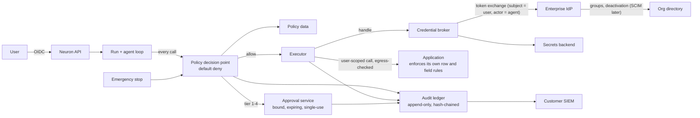

# Enterprise Security and Governance Architecture

| | |
| --- | --- |
| Date | 2026-11-10 |
| Package | Document 7 of 14 |
| Evidence | Neuron's current controls are from `NEURON_CURRENT_ARCHITECTURE_ASSESSMENT.md`. External references are in document 2. Regulatory notes are general orientation from background knowledge [K], not legal advice, and were not re-checked. |

## 1. Starting point

Neuron's security model is its strongest asset and is kept whole:

- Identity only from a verified token; the model never supplies it.
- One policy record per tool; the same record filters what the model sees and what may execute.
- Taint tracking: a run that has read private or untrusted content needs approval before data can leave.
- Egress control with DNS pinning; MCP tool definitions pinned by hash.
- Fail-closed limits; least-privilege database roles; row-level security.

What an enterprise integration platform adds, and Neuron lacks:

| Gap | Section |
| --- | --- |
| Organisations, departments, roles | 2 |
| Delegated access to external applications | 3 |
| Policy as data, argument-level and data-flow rules | 4 |
| Agent identity and lifecycle governance | 5 |
| Approval tiers beyond "the same user confirms" | 7 |
| A structured, complete audit ledger | 8 |
| Evidence: penetration test, hosted operation | 10 |

## 2. Identity and access management

### 2.1 Human identity

| Topic | Design |
| --- | --- |
| **Single sign-on** | OIDC to Neuron. Customer IdPs that speak SAML or OIDC are federated through an identity broker. Neuron's reference stack already uses Keycloak, which brokers both [K]. Neuron's code keeps verifying OIDC tokens only. |
| **Provisioning** | Just-in-time from token claims first. SCIM (the standard provisioning protocol) later, so that deactivating a user in the IdP removes access and revokes stored grants without waiting for a login. |
| **Organisation model** | Organisation, department, user. Every stored row carries an organisation id. The owner key (HMAC of issuer and subject) stays the user identifier. |
| **Roles (RBAC)** | A small fixed set in Neuron: member, approver, application owner, policy administrator, auditor, organisation administrator. Mapped from IdP groups. |
| **Attributes (ABAC)** | Department, role and custom claims are available to policy rules. |
| **Fine-grained sharing** | Knowledge base grants by user or group (the table exists). A relationship-based engine such as OpenFGA is unnecessary until sharing covers many resource types. |

### 2.2 Agent identity

Each agent definition is a principal of its own kind, distinct from users and from service accounts:

- It has an id, an owner, a version and a status.
- Every token Neuron obtains through exchange names the user as subject and the agent as actor, where the IdP supports the actor claim. WSO2 documents this model, and Microsoft assigns directory identities to agents [V].
- Where a customer runs an agent registry (Entra Agent ID, Workday's Agent System of Record), Neuron registers its agents there. Neuron does not build a registry for other vendors' agents.

### 2.3 Service identities

Used only for: the worker's database role (exists), event-triggered runs with no user, and delegation mode D. Each service identity has an owner, a purpose and a narrow capability list.

### 2.4 Identity propagation

The five delegation modes are defined in `DOMAIN_AGNOSTIC_INTEGRATION_ARCHITECTURE.md`, section 7. The security position:

- **Modes A to C** keep the application as the enforcer of its own rules. This is the only way to honour row-level and field-level security that lives inside the application.
- **Mode D** (shared service account) cannot honour them. It is allowed only with: read-only default, a reviewer-approved capability list, identity parameters bound from the principal, an "elevated" flag visible in the console and in every audit record, and a periodic review.
- **Event-triggered runs** have no user. They run as a named service identity with their own capability list, and any consequential step waits for a human approver, who becomes the accountable person.

## 3. Credential handling

| Rule | Mechanism |
| --- | --- |
| Credentials never enter model context, run state, logs or traces | The executor asks the broker for a credential handle at call time and attaches the secret at the HTTP layer. |
| Stored encrypted, outside the main database where possible | Refresh tokens in a secrets backend behind an interface: OpenBao, a cloud secrets manager, or envelope-encrypted columns for small installations. |
| Short-lived by default | Access tokens are not stored. Refresh tokens are rotated where the application supports rotation. |
| Scoped | One grant per user, application and scope set. Tokens are requested with a resource indicator so they are valid for one application only [K: RFC 8707]. |
| Revocable | A user can disconnect an application. Deactivation in the IdP or an administrator action revokes all of a user's grants. |
| Bound to the broker | Only the executor process can redeem a handle. The API process that serves the browser cannot. |

A credential store is a high-value target. It is the main new risk this architecture introduces, and the reason the broker is a separate, small component with its own tests and review tier.

## 4. Authorization

### 4.1 The decision

For every capability call the decision point receives:

| Input | Examples |
| --- | --- |
| Principal | User, organisation, department, roles |
| Agent | Definition id and version |
| Capability | Application, name, risk class, entity |
| Arguments | Validated values (amount, record id, recipient) |
| Data context | Labels of data the run has read; taint |
| Environment | Trigger (interactive, event, schedule); delegation mode |

and returns allow, deny, or require-approval with a tier. Default deny.

### 4.2 Rule examples (illustrative, in words)

- Members of department Sales may use capabilities of application `crm` with risk class read.
- Any capability with risk class mutating requires at least user confirmation.
- `erp.create_credit_note` requires supervisor approval when `amount` exceeds the organisation's threshold.
- Data labelled `hrms:restricted` may not appear in the run context of any call to a capability outside `hrms`.
- Capabilities on a mode D connection are denied for event-triggered runs.
- An agent definition may narrow these rules and may never widen them.

### 4.3 Levels of control

| Level | Who enforces |
| --- | --- |
| Which application and capability | Neuron policy |
| Which arguments (amounts, recipients, scopes) | Neuron policy |
| Which records (row-level) | The application, through the user's credential. In mode D, Neuron binds identity parameters; this is weaker. |
| Which fields (field-level) | The application. In addition, Neuron can redact fields by data label before results reach the model. |
| Cross-organisation isolation | Neuron: organisation id on every row, row-level security in Postgres, per-organisation credentials and policies |

### 4.4 Policy format

A typed rule table in Postgres is enough for the first year. A policy language becomes worthwhile when customers need to author rules themselves. Of the options, Cedar fits the shape of the problem best (principal, action, resource, conditions; permit and forbid; used by AgentCore for the same purpose [V]); OPA is the general alternative. The choice is a build-versus-integrate decision recorded in document 10. Whatever the format: default deny, a test for every rule, and a dry-run mode that shows what a rule change would have decided on recent traffic.

## 5. Agent governance

| Topic | Design |
| --- | --- |
| **Registration** | Every agent is a definition in the registry. No unregistered agent can run. |
| **Ownership** | A named owner and a backup. Ownerless agents are suspended. |
| **Lifecycle** | Draft, published, deprecated, retired. Publishing requires passing the agent's evaluation cases. |
| **Permissions** | The capability set and limits in the definition, bounded by organisation policy. |
| **Approval policies** | Inherited from policy; a definition may tighten them. |
| **Tool governance** | Capabilities are reviewed at curation, pinned by hash, suspended on drift. |
| **Versioning** | Immutable versions. A run records the version. Rollback is publishing the previous version. |
| **Monitoring** | Per agent: runs, denials, approvals requested and refused, errors, cost, evaluation results over time. |
| **Retirement** | Disable, revoke any service grants, keep the audit trail. |
| **Emergency stop** | One switch per agent, per application and per organisation that denies all capability calls at the decision point. Vendors market this as a "kill switch" [V: Boomi]. |

## 6. Runtime threats and controls

| Threat | Control | Status |
| --- | --- | --- |
| **Prompt injection** through documents, records, tickets, tool results | All such content is framed as data and taints the run. Tainted runs need approval for outbound calls. Consequential actions need approval regardless. | Exists; extends to application data |
| **Tool poisoning** (malicious tool descriptions) | Descriptions are reviewed at curation and pinned. Only reviewed text reaches the model. | Exists for MCP; extends to OpenAPI and packs |
| **Rug pull** (definition changes after approval) | Hash pins; drift suspends the capability. | Exists for MCP |
| **Unauthorized actions** | Three-layer authorization; default deny; application-side enforcement. | To build (layers 1 and 2) |
| **Confused deputy** (agent uses its own power for a user who lacks it) | No standing agent power: modes A to C use the user's credential. Mode D is restricted and flagged. | To build |
| **Sensitive data exposure** to the model provider, logs or other users | Data labels; per-label rules including "self-hosted model only"; content-free telemetry (exists); redaction before logging. | Partly exists |
| **Data exfiltration across applications** | Data-flow rules on labels; egress allow-list per application. | To build on taint |
| **Memory poisoning** | Memory writes need approval and must quote the user (exists). Extraction from tainted runs stays blocked. | Exists |
| **Credential leakage** | Broker; handles, not secrets; no credentials in context. | To build |
| **SSRF** | DNS-pinned, public-only egress backend (exists). Applications on private networks need an explicit per-application allow-list entry, never a general relaxation. | Exists; needs the private-network case |
| **Code execution** | No shell, `eval` or code tools. Unchanged. | Exists |
| **Execution abuse and runaway cost** | Token budgets, run leases, rate limits, step limits (exist); per-organisation and per-agent quotas. | Partly exists |
| **Approval bypass** | Approvals bind to a hash of capability and arguments; a changed argument invalidates the approval. Approver must differ from requester for tier 3 and above. Approval decisions are authenticated actions, never model output. | Partly exists |
| **Replay** | Idempotency keys on run creation and mutating calls; approvals are single-use with expiry; webhook signatures with timestamp checks. | To build |
| **Supply chain of connectors and packs** | Review plus pin; public packs are content, not code. | Design |
| **Cross-organisation leakage** | Organisation id plus row-level security; isolation tests in the security suite. | To build |

"Sandbox isolation" in the brief's list applies to products that run code or browsers. Neuron runs neither, so it needs no sandbox. If code execution is ever added, the prior research's guidance applies: filesystem and network isolation together, in a separate ADR.

## 7. Human oversight

### 7.1 Approval tiers

| Tier | Meaning | Typical operations | Who decides |
| --- | --- | --- | --- |
| 0 | No approval | Reads within the user's permissions | Nobody |
| 1 | User confirmation | Low-impact writes to the user's own items: add a note, create a task, draft a ticket | The requesting user |
| 2 | User confirmation, always shown with full arguments | Writes to shared records: update a customer record, submit a request on the user's behalf | The requesting user |
| 3 | Second person | Financial postings above a threshold, HR record changes, access grants | A manager or role owner, never the requester |
| 4 | Administrator or two approvers | Bulk changes, irreversible actions, master data such as bank details, anything on an elevated connection | Administrator, or two distinct approvers |

Tier assignment is policy data keyed on capability, arguments and context. The defaults come from the risk class; organisations adjust thresholds.

### 7.2 Rules for approvals

1. **Prefer the application's own approval process.** If the HR system routes leave requests to a manager, Neuron's part is a tier 2 confirmation to submit. Neuron adds tier 3 or 4 only where the application has no approval step for that action.
2. **Approvals are durable and out of band.** The approver may be a different person, later, on another device (prior research, improvement 8).
3. **The approver sees facts, not the model's summary alone:** the exact capability, arguments, target records and the evidence the agent gathered, with links to the sources.
4. **Approvals expire** and are single-use.
5. **No blanket approvals for mutating actions** in the first releases. "Always allow" is how approval fatigue turns into no control; revisit with data.
6. **Taint sets a floor, it does not stack.** In a run that has read untrusted or private content, any call that can carry data into another application needs at least tier 2 confirmation, even if it would otherwise be tier 0 or 1. Calls already at tier 2 or above keep their tier. This is the existing taint behaviour, restated in tiers.

### 7.3 By domain

| Area | Default |
| --- | --- |
| Financial transactions | Tier 3 above a threshold set by the organisation; tier 2 below; separation of duties enforced |
| HR operations | Reads of the user's own record tier 0; requests on own behalf tier 2; changes to another person's record tier 3 |
| Customer records | Notes and tasks tier 1; field updates tier 2; merges, deletions and bulk edits tier 4 |
| Access and identity changes | Tier 3 at minimum |
| Outbound communication to customers | Tier 2: a person sends |
| Health data | Reads only for the minimum necessary; any write tier 2 or higher; clinical decisions out of scope |

## 8. Auditability

### 8.1 The action record

One record per policy decision and per capability call:

| Field | Content |
| --- | --- |
| When | Timestamp, monotonic sequence within the run |
| Who | Organisation, user (owner key), roles at the time; service identity for unattended runs |
| Agent | Definition id and version |
| Model | Provider, model id and version as served |
| Where | Application, environment, delegation mode |
| What | Capability name, risk class, entity type, record identifiers |
| Permission context | Policy rule ids that matched; decision |
| Input | A hash of the arguments, plus a redacted summary by data label |
| Result | Outcome class (success, denied by policy, denied by application, error), application response code, record identifiers created or changed |
| Approval | Request id, approver, decision, time |
| Trace | Run id, thread id, OpenTelemetry trace id |
| Integrity | Hash chained to the previous record for the organisation |

### 8.2 Handling sensitive payloads

- Payloads are not stored in the audit ledger by default. Hashes prove what was sent; identifiers point to the record in the system of record.
- An organisation may enable payload capture per capability, encrypted, with its own retention period and access limited to the auditor role.
- Telemetry stays content-free, as today.

### 8.3 Properties

- Append-only: the application's database role can insert and read, never update or delete (the existing least-privilege role pattern).
- Exportable to the customer's log or SIEM platform in a documented format.
- Queryable by user, agent, application, record identifier and time, for the question "what did the agent do to this record, for whom, and who approved it".
- Erasure requests remove conversation content. Audit records keep pseudonymous identifiers and no personal payload, so they can be retained.

## 9. Compliance and governance

Technical controls are what Neuron can build. Certifications are obtained by an organisation that operates a service, through audit. An open-source project cannot "be SOC 2 certified"; a company running it can be.

| Framework | What it is | Neuron's technical contribution | What only an operating organisation can do |
| --- | --- | --- | --- |
| **SOC 2** | An auditor's report on an organisation's controls | Access control, audit ledger, change management evidence from CI, encryption, availability design | Policies, personnel controls, the audit itself |
| **ISO 27001** | Certification of an information security management system | Same controls as evidence | The management system and certification |
| **ISO 42001** | AI management system standard [K] | Agent registry, evaluations, human oversight records | The management system |
| **GDPR** | EU personal data law | Export and erasure (exist), retention settings, data minimisation in logs, records of processing support, human review of consequential decisions | Lawful basis, processor agreements, impact assessments |
| **HIPAA** | US health data rules | Access control, audit, encryption, minimum-necessary access through labels, self-hosted model option | Business associate agreements, including with any model provider |
| **PCI DSS** | Payment card data standard | Keep card data out entirely: label and block | Scope definition and assessment |
| **Financial sector** (for example SOX controls, DORA in the EU) [K] | Controls over financial reporting; operational resilience | Separation of duties in approvals, complete audit trail, recovery objectives | Control ownership, testing, regulator engagement |
| **EU AI Act** [K] | Risk-based AI regulation; obligations depend on the use case, and application dates have been under revision | Human oversight, logging, transparency that the user is dealing with an AI | Classification of each use case; conformity work for high-risk uses |

Cross-cutting technical requirements:

| Requirement | Design |
| --- | --- |
| Data residency | Self-hosting puts all data where the customer chooses. Model provider region is a per-organisation setting; self-hosted models remove the question. |
| Retention | Per organisation: threads, run events, payload captures, audit. Existing retention sweep extended. |
| Deletion | Existing erasure extended to run events, stored grants and pack overlays. |
| Encryption | TLS everywhere (the open `verify-full` deployment issue must be closed). Encryption at rest by the database and blob store; envelope encryption for credentials. |
| Audit requirements | Section 8. |

## 10. Assurance

Controls count when they are tested.

| Activity | When |
| --- | --- |
| Security test suite extended per new subsystem (isolation, approval binding, credential non-disclosure, default deny) | With each feature |
| Threat model updated (`docs/security/threat-model.md`) | With each ADR |
| Adversarial evaluation set: injection through application data, tool descriptions and packs | Before the first external user |
| External penetration test (already listed as deferred in `docs/ROADMAP.md`) | After the credential broker exists and before any design partner uses real data |
| Hosted operation with the audit ledger exported | Before any compliance conversation |

## 11. Reference architecture summary

Three properties to preserve in every later design decision:

1. No path from the model to an application avoids the decision point.
2. No credential is readable by the model, the browser-facing API or the logs.
3. No consequential action lacks a named human in its audit record.
