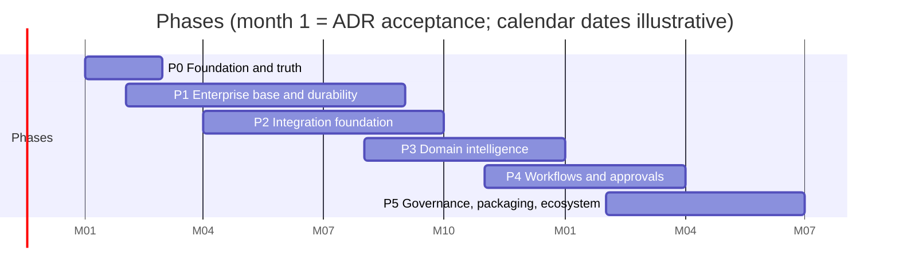
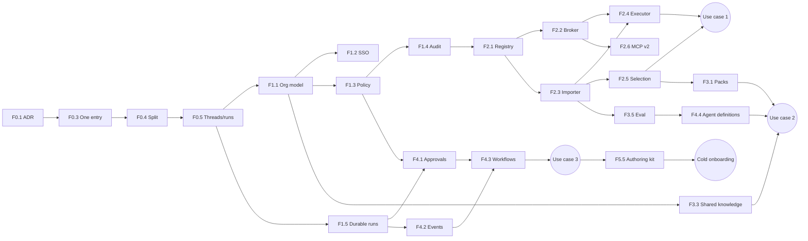

# Neuron 18-Month Strategic Roadmap

| | |
| --- | --- |
| Date | 2026-11-10 |
| Package | Document 11 of 14. The primary deliverable. |
| Status | Proposal. Each phase starts with ADRs; nothing is committed until they are accepted. |
| Evidence | Existing capabilities are from the architecture assessment. Complexity, scores and dates are my estimates [I]; none is measured. |

## 1. Planning assumptions

1. **Code output is not the constraint; evidence is.** The earliest plan in `docs/plans/` is dated 2026-09-08 and v1.1.0 was released on 2026-11-10, with no production use. The calendar below is therefore driven by gates that need a real environment, real applications and real users.
2. **One implementation stream.** Features inside a phase are ordered. Where two phases overlap in months, the earlier phase's remaining work has priority.
3. **Month 1 starts when the product-direction ADR (F0.1) is accepted.**
4. **Scope rule.** Nothing enters the plan because a competitor advertises it. Every feature traces to one of the first three use cases, to a security or governance foundation, or to the self-hosting position.
5. **Complexity:** S about a week, M two to four weeks, L more than a month of implementation and verification.

## 2. Phases at a glance

The phase structure follows the brief's suggestion with two changes: durable execution moves early (approvals and events depend on it), and governance is not left to the end (organisation, policy and audit come before the first integration).

| Phase | Months | Theme | Exit gate |
| --- | --- | --- | --- |
| 0 | 1 to 2 | Foundation and truth | A hosted deployment has run the load baseline with a real model; one entry point; thread and run tables live |
| 1 | 2 to 8 | Enterprise base and durable execution | Organisation model, SSO federation, policy as data, audit ledger and durable runs pass their security tests in the hosted environment |
| 2 | 4 to 9 | Integration foundation | **Use case 1:** a CRM onboarded through the pipeline; users act under their own credentials |
| 3 | 8 to 12 | Domain intelligence | **Use case 2:** an HR system onboarded with a domain pack and shared knowledge; no core change since use case 1 |
| 4 | 11 to 15 | Workflows and approvals | **Use case 3:** an event-triggered, cross-application flow with a second-person approval and a tested compensation |
| 5 | 14 to 18 | Governance, packaging, ecosystem | **Cold onboarding test** passed by an outsider; penetration test findings closed; installable package for customer cloud |

## 3. Prioritisation

### 3.1 Priority classes

- **P0** essential foundations and security
- **P1** core enterprise product capabilities
- **P2** valuable differentiation
- **P3** advanced and future capabilities (section 10; outside the 18 months)

### 3.2 Scores

Each feature is scored 1 to 5 on nine criteria. For the first four, higher is better. For the last five, higher means more cost or risk. The two sums are shown separately, because blending them into one number would suggest a precision these judgements do not have.

- Benefit criteria: **CV** enterprise customer value, **SD** strategic differentiation, **MD** market demand evidence, **TF** technical feasibility. Maximum 20.
- Burden criteria: **DE** development effort, **OC** operational complexity, **SR** security risk introduced, **IC** infrastructure cost, **LM** long-term maintenance. Maximum 25.

| ID | Feature | Priority | CV | SD | MD | TF | Benefit /20 | DE | OC | SR | IC | LM | Burden /25 |
| --- | --- | --- | --- | --- | --- | --- | --- | --- | --- | --- | --- | --- | --- |
| F0.1 | Product-direction ADR and doc corrections | P0 | 2 | 2 | 1 | 5 | **10** | 1 | 1 | 1 | 1 | 1 | **5** |
| F0.2 | Hosted deployment under load | P0 | 4 | 2 | 4 | 4 | **14** | 2 | 3 | 2 | 2 | 2 | **11** |
| F0.3 | Single entry point | P0 | 2 | 2 | 3 | 5 | **12** | 1 | 1 | 1 | 1 | 1 | **5** |
| F0.4 | Application factory and module split | P0 | 2 | 1 | 1 | 4 | **8** | 3 | 1 | 2 | 1 | 1 | **8** |
| F0.5 | Thread and run tables | P0 | 3 | 1 | 4 | 4 | **12** | 3 | 1 | 2 | 1 | 2 | **9** |
| F1.1 | Organisation, department and role model | P0 | 5 | 1 | 5 | 4 | **15** | 3 | 2 | 3 | 1 | 2 | **11** |
| F1.2 | Enterprise SSO by federation | P0 | 5 | 1 | 5 | 5 | **16** | 2 | 2 | 2 | 1 | 2 | **9** |
| F1.3 | Policy as data and decision point | P0 | 5 | 4 | 5 | 4 | **18** | 3 | 2 | 4 | 1 | 3 | **13** |
| F1.4 | Audit ledger | P0 | 5 | 3 | 5 | 4 | **17** | 2 | 2 | 2 | 2 | 2 | **10** |
| F1.5 | Durable runs and resumable streams | P0 | 4 | 2 | 5 | 3 | **14** | 5 | 3 | 3 | 2 | 3 | **16** |
| F2.1 | Application registry and manifest | P0 | 5 | 4 | 5 | 4 | **18** | 3 | 2 | 3 | 1 | 3 | **12** |
| F2.2 | Connection manager and credential broker | P0 | 5 | 5 | 5 | 3 | **18** | 4 | 3 | 5 | 2 | 4 | **18** |
| F2.3 | OpenAPI importer and capability catalogue | P1 | 5 | 4 | 5 | 4 | **18** | 3 | 1 | 3 | 1 | 3 | **11** |
| F2.4 | Capability executor | P1 | 5 | 3 | 4 | 4 | **16** | 3 | 2 | 4 | 1 | 3 | **13** |
| F2.5 | Dynamic capability selection | P1 | 4 | 3 | 4 | 3 | **14** | 3 | 1 | 3 | 1 | 2 | **10** |
| F2.6 | MCP client, second generation | P1 | 4 | 3 | 5 | 3 | **15** | 3 | 2 | 4 | 1 | 3 | **13** |
| F2.7 | Integration health | P1 | 3 | 1 | 4 | 5 | **13** | 1 | 1 | 1 | 1 | 1 | **5** |
| F3.1 | Domain packs | P1 | 4 | 5 | 3 | 3 | **15** | 4 | 1 | 3 | 1 | 3 | **12** |
| F3.2 | Model-assisted onboarding drafts | P2 | 3 | 4 | 2 | 3 | **12** | 3 | 1 | 3 | 2 | 2 | **11** |
| F3.3 | Shared, permission-aware knowledge | P1 | 4 | 2 | 5 | 4 | **15** | 3 | 1 | 4 | 1 | 2 | **11** |
| F3.4 | Context management and model routing | P1 | 3 | 2 | 4 | 4 | **13** | 3 | 1 | 2 | 1 | 3 | **10** |
| F3.5 | Per-application evaluation | P1 | 4 | 3 | 4 | 4 | **15** | 3 | 1 | 1 | 2 | 2 | **9** |
| F4.1 | Approval tiers and inbox | P0 | 5 | 4 | 5 | 4 | **18** | 3 | 2 | 4 | 1 | 2 | **12** |
| F4.2 | Event ingress and schedules | P1 | 4 | 2 | 5 | 4 | **15** | 3 | 2 | 4 | 1 | 2 | **12** |
| F4.3 | Multi-application workflows | P2 | 4 | 3 | 4 | 2 | **13** | 5 | 3 | 4 | 1 | 4 | **17** |
| F4.4 | Agent definitions, versions, templates | P1 | 4 | 2 | 5 | 4 | **15** | 3 | 1 | 3 | 1 | 2 | **10** |
| F5.1 | Administration console | P1 | 4 | 1 | 5 | 4 | **14** | 4 | 1 | 3 | 1 | 3 | **12** |
| F5.2 | Usage, cost allocation, quotas | P1 | 4 | 1 | 5 | 5 | **15** | 2 | 1 | 1 | 1 | 2 | **7** |
| F5.3 | Deployment packaging, availability, recovery | P1 | 5 | 3 | 4 | 4 | **16** | 3 | 3 | 2 | 2 | 3 | **13** |
| F5.4 | Neuron as an MCP server | P2 | 4 | 4 | 4 | 4 | **16** | 2 | 2 | 4 | 1 | 2 | **11** |
| F5.5 | Manifest and pack authoring kit | P2 | 3 | 3 | 3 | 5 | **14** | 2 | 1 | 1 | 1 | 2 | **7** |
| F5.6 | Penetration test and attestation readiness | P1 | 5 | 2 | 5 | 4 | **16** | 2 | 1 | 1 | 3 | 1 | **8** |

Reading the table:

- **F2.2 (credential broker)** ties for the highest benefit (18, with F1.3, F2.1 and F2.3) and has the highest burden (18). It is the feature most worth doing carefully.
- **F4.3 (multi-application workflows)** has the worst balance among planned features (benefit 13, burden 17). It is scoped small and comes late for that reason.
- Phase 0 items score low on benefit and are still first, because everything else is unverifiable without them.

## 4. Phase 0: Foundation and truth (months 1 to 2)

### F0.1 Product-direction ADR and documentation corrections
- **Business problem:** the repository's ADRs and `CLAUDE.md` describe a narrow chat service and forbid most of this roadmap.
- **Persona:** maintainers and coding agents.
- **Use case:** every later change needs an accepted basis.
- **Existing:** 14 ADRs; known documentation drift (assessment, section 8).
- **Proposed:** ADR 0015 recording the positioning, principles and non-goals from documents 1 and 4; fix the drift.
- **Architecture:** none. **Integration:** none. **Dependencies:** owner decision.
- **Security:** corrects the false "tools are read-only" statements.
- **Scalability:** n/a.
- **Open source / build or integrate:** n/a / build.
- **Complexity:** S. **Value:** Medium. **Priority:** P0.
- **Acceptance:** ADR 0015 accepted; each row of the assessment's discrepancy table is fixed or explicitly kept with a reason.

### F0.2 One hosted deployment under load
- **Business problem:** no capacity or reliability claim has evidence.
- **Persona:** operator; any prospective user.
- **Use case:** a place where design partners can try Neuron.
- **Existing:** `render.yaml` (marked not deployable), reference Compose stack, load test scripts.
- **Proposed:** resolve the TLS blocker; deploy; run the load baseline with a real model; exercise restore and rollback; publish dashboards.
- **Architecture:** current topology. **Integration:** managed Postgres, a model provider. **Dependencies:** none.
- **Security:** `verify-full` TLS to the database; secrets in the platform's store.
- **Scalability:** produces the baseline for every later target.
- **Open source / build or integrate:** existing stack / integrate hosting.
- **Complexity:** M. **Value:** High. **Priority:** P0.
- **Acceptance:** a release record with measured latency, error rate and concurrency for a real model; a timed restore; a timed rollback.

### F0.3 Single entry point
- **Business problem:** the Agent Server path runs the same graph without budgets, leases, rate limits, memory or knowledge.
- **Persona:** security reviewer.
- **Use case:** one set of guarantees to reason about.
- **Existing:** `langgraph.json`, `security/agent_server.py`, branches in `main_graph.py`.
- **Proposed:** retire the Agent Server path, keeping a development-only way to inspect the graph if wanted.
- **Architecture:** removes the import-time graph. **Integration:** none. **Dependencies:** F0.1.
- **Security:** removes the easiest route around controls.
- **Scalability:** n/a.
- **Open source / build or integrate:** n/a / build (remove).
- **Complexity:** S. **Value:** Medium. **Priority:** P0.
- **Acceptance:** no production route reaches the graph except through the run service; the security suite proves it.

### F0.4 Application factory and module split
- **Business problem:** three modules of 1,000 to 1,600 lines hold most behaviour and are critical-tier; every feature below would edit them.
- **Persona:** implementer and reviewer.
- **Use case:** small, reviewable changes under the 400-line PR budget.
- **Existing:** `agent_service.py`, `api/main.py`, `models/factory.py`.
- **Proposed:** an application factory; routers per area; run, thread and data-rights services; one audit helper. Behaviour-preserving.
- **Architecture:** as the assessment's P1 items 4 and 5. **Integration:** none. **Dependencies:** F0.3.
- **Security:** no behaviour change; existing suite must stay green.
- **Scalability:** n/a.
- **Open source / build or integrate:** n/a / build.
- **Complexity:** M. **Value:** Medium (enabling). **Priority:** P0.
- **Acceptance:** no module on the request path above an agreed size; all gates pass; an import-contract test covers every package.

### F0.5 Thread and run tables
- **Business problem:** conversations exist only as checkpoint blobs; listing is an N+1 over JSON metadata; there is no run record.
- **Persona:** end user (history), operator (run status).
- **Use case:** run status, cost per run, cheap listing.
- **Existing:** `thread_index.py`, `neuron_thread_meta`.
- **Proposed:** `threads` and `runs` tables written in the same transaction as the turn; idempotency key on run creation.
- **Architecture:** tables are authoritative for ownership and listing; checkpoints stay authoritative for agent state. **Integration:** none. **Dependencies:** F0.4.
- **Security:** one ownership field.
- **Scalability:** removes repeated full state reads.
- **Open source / build or integrate:** n/a / build.
- **Complexity:** M. **Value:** High (enabling). **Priority:** P0.
- **Acceptance:** thread listing makes a bounded number of queries; a retried run request with the same key returns the same run; ownership checks read one source.

## 5. Phase 1: Enterprise base and durable execution (months 2 to 8)

### F1.1 Organisation, department and role model
- **Business problem:** Neuron knows users only; an enterprise has organisations, departments and roles.
- **Persona:** organisation administrator.
- **Use case:** department-scoped agents, shared knowledge, per-department quotas.
- **Existing:** owner key per user; no organisation concept in code.
- **Proposed:** organisation and department tables; organisation id on every row; fixed role set mapped from IdP groups.
- **Architecture:** document 7, section 2. **Integration:** IdP group claims. **Dependencies:** F0.5.
- **Security:** cross-organisation isolation by SQL filters and row-level security, with isolation tests.
- **Scalability:** enables later shared deployments without a data migration.
- **Open source / build or integrate:** Keycloak organisations and groups / build the model, integrate membership.
- **Complexity:** M. **Value:** High. **Priority:** P0.
- **Acceptance:** two organisations in one test deployment cannot read each other's threads, knowledge, policies or audit, proven by tests at the SQL and API level.

### F1.2 Enterprise single sign-on by federation
- **Business problem:** enterprises require their own IdP.
- **Persona:** IT administrator.
- **Use case:** sign in with Entra, Okta or a SAML IdP.
- **Existing:** OIDC verification; Keycloak with a custom theme.
- **Proposed:** documented, tested federation of OIDC and SAML IdPs through the broker; group-to-role mapping; deactivation handling. SCIM is a follow-up.
- **Architecture:** no SAML code in Neuron. **Integration:** customer IdP. **Dependencies:** F1.1.
- **Security:** audience and issuer pinning as today; revocation of stored grants on deactivation (with F2.2).
- **Scalability:** n/a.
- **Open source / build or integrate:** Keycloak / integrate.
- **Complexity:** S. **Value:** High. **Priority:** P0.
- **Acceptance:** an end-to-end test signs in through a federated OIDC IdP and a SAML IdP; a user removed from a group loses the mapped role at next token.

### F1.3 Policy as data and the decision point
- **Business problem:** rules are spread across Python modules and cannot differ per organisation or depend on arguments.
- **Persona:** policy administrator; security reviewer.
- **Use case:** "credit notes above a threshold need a supervisor".
- **Existing:** `ToolSpec` scope and risk; `_ToolAuthorizationMiddleware`; taint logic.
- **Proposed:** one decision function with typed rule tables; outcomes allow, deny, require-approval with tier; default deny; dry-run mode; emergency stop per agent, application and organisation.
- **Architecture:** document 7, section 4. **Integration:** none now; Cedar or OPA later behind the same interface. **Dependencies:** F1.1.
- **Security:** critical tier; every rule type has allow and deny tests; fail closed when the store is unreachable.
- **Scalability:** rules cached per organisation with invalidation on change.
- **Open source / build or integrate:** Cedar, OPA / build the interface and a simple engine first.
- **Complexity:** M. **Value:** High. **Priority:** P0.
- **Acceptance:** existing tool gating behaviour is reproduced by rules with the old code path removed; an argument-conditioned rule and a data-label rule are demonstrated by tests; emergency stop denies within one decision.

### F1.4 Audit ledger
- **Business problem:** audit events are log lines; there is no queryable, complete action record.
- **Persona:** auditor; application owner.
- **Use case:** "what did the agent do to this record, for whom, approved by whom".
- **Existing:** audit events via structlog; content-free telemetry.
- **Proposed:** append-only table with the fields in document 7, section 8; hash chain per organisation; export; auditor role.
- **Architecture:** insert-only database grant. **Integration:** export to a customer's log platform. **Dependencies:** F1.1, F1.3.
- **Security:** no payloads by default; redacted summaries by data label.
- **Scalability:** time-partitioned.
- **Open source / build or integrate:** n/a / build.
- **Complexity:** M. **Value:** High. **Priority:** P0.
- **Acceptance:** every policy decision and capability call in the test suite produces exactly one record; the application role cannot update or delete; chain verification detects a removed row.

### F1.5 Durable runs, event log and resumable streams
- **Business problem:** a run dies with its process or its HTTP connection; approvals and events cannot wait.
- **Persona:** end user; operator.
- **Use case:** a run that survives a deploy; an approval answered the next day; a client that reconnects.
- **Existing:** in-process asyncio task; leases without heartbeat; Procrastinate for ingestion.
- **Proposed:** runs as queued jobs executed by a run worker; append-only run events; leases with heartbeat and fencing; stream as a read of the event log from an offset; user-facing run timeline.
- **Architecture:** document 5, section 10; ADR superseding the ADR 0005 non-goal. **Integration:** none. **Dependencies:** F0.5; the durable-execution spike (document 10, section 2.3).
- **Security:** the leak guard runs before events are persisted; mutating tools carry idempotency keys before resume is enabled.
- **Scalability:** separates run capacity from API capacity.
- **Open source / build or integrate:** Procrastinate, DBOS Transact, LangGraph checkpoints / decided by the spike.
- **Complexity:** L. **Value:** High. **Priority:** P0 for approvals and events; use case 1 does not wait for it.
- **Acceptance:** killing a worker mid-run leads to completion without a duplicate side effect; a client reconnects and receives missed events; a run waits 24 hours for an approval and resumes.

## 6. Phase 2: Integration foundation (months 4 to 9)

### F2.1 Application registry and manifest
- **Business problem:** connecting an application means editing an operator file and restarting.
- **Persona:** application owner.
- **Use case:** register a CRM and manage its lifecycle.
- **Existing:** `APP_MCP_SERVERS` file; hash pins.
- **Proposed:** registry records and versioned manifests (document 5, section 5); lifecycle states; import of existing MCP configuration.
- **Architecture:** control-plane tables and API. **Integration:** none. **Dependencies:** F1.1, F1.3, F1.4.
- **Security:** nothing callable until reviewed; changes audited.
- **Scalability:** manifests cached with invalidation.
- **Open source / build or integrate:** n/a / build.
- **Complexity:** M. **Value:** High. **Priority:** P0.
- **Acceptance:** an application is registered, published and retired through the API with no restart; unpublished capabilities are never offered to the model.

### F2.2 Connection manager and credential broker
- **Business problem:** each MCP server has one operator token; the agent cannot act as the user.
- **Persona:** end user (connect my account); security architect.
- **Use case:** the agent reads only the CRM accounts the user can see.
- **Existing:** `mcp_bearer_tokens` setting.
- **Proposed:** delegation modes B (per-user OAuth) and D (restricted service account) first, then A (token exchange); secrets interface with an encrypted Postgres backend and OpenBao; connect, disconnect and reconnect flows.
- **Architecture:** document 5, section 7; document 7, section 3. **Integration:** application OAuth servers, IdP, secrets backend. **Dependencies:** F2.1.
- **Security:** critical tier; credentials never in model context, state, logs or traces; resource-scoped tokens; revocation on deactivation.
- **Scalability:** token refresh with per-user locks; no shared mutable token state between workers.
- **Open source / build or integrate:** Nango (design reference), Keycloak token exchange, OpenBao / build the broker, integrate stores.
- **Complexity:** L. **Value:** High. **Priority:** P0.
- **Acceptance:** two users with different application permissions get different results from the same question; a test searches context, checkpoints, events, logs and traces for a planted token and finds none; disconnect makes the next call fail with "reconnect required".

### F2.3 OpenAPI importer and capability catalogue
- **Business problem:** each tool is hand-written code.
- **Persona:** application owner.
- **Use case:** turn an application's API document into reviewed capabilities.
- **Existing:** `ToolSpec`; MCP schema validation; pin tooling.
- **Proposed:** import, filter, classify, curate and pin, as document 6, section 5; catalogue with risk class, data labels, entity and idempotency fields.
- **Architecture:** catalogue generalises `ToolSpec`. **Integration:** OpenAPI 3.x documents. **Dependencies:** F2.1.
- **Security:** risk class never auto-lowered; identity parameters bound from the principal; drift suspends.
- **Scalability:** large specifications import as disabled candidates; nothing loads into context until selected.
- **Open source / build or integrate:** OpenAPI parser libraries / build the pipeline.
- **Complexity:** M. **Value:** High. **Priority:** P1.
- **Acceptance:** a real application's specification is imported; a reviewer enables a subset; a changed operation is suspended on re-import; no application-specific code is added.

### F2.4 Capability executor
- **Business problem:** calling arbitrary APIs safely needs shared handling of errors, limits and retries.
- **Persona:** end user (reliable actions).
- **Use case:** paginated list, rate-limited API, idempotent create.
- **Existing:** egress backend; tool timeout and failure isolation middleware; error taxonomy.
- **Proposed:** HTTP adapter for OpenAPI capabilities: validation, pagination styles, retries with idempotency keys, per-application rate limit and circuit breaker, error normalisation, response caps, connection reuse.
- **Architecture:** document 5, sections 4 and 12. **Integration:** applications. **Dependencies:** F2.2, F2.3.
- **Security:** every call through the decision point and the egress check; private hosts only by explicit per-application allow-list.
- **Scalability:** per-application concurrency limits.
- **Open source / build or integrate:** HTTP client in use / build.
- **Complexity:** M. **Value:** High. **Priority:** P1.
- **Acceptance:** failure-mode tests for timeout, 429, 5xx, partial page and duplicate submission pass; a mutating call is never sent twice with one key.

### F2.5 Dynamic capability selection
- **Business problem:** tools are compiled into the agent at start-up; a catalogue of hundreds cannot be loaded.
- **Persona:** end user.
- **Use case:** the right twenty capabilities for this request.
- **Existing:** fixed tool list; scope filtering per caller.
- **Proposed:** per-run capability set from the agent definition and catalogue search; stable prompt prefix; no mid-run removal.
- **Architecture:** document 6, section 5. **Integration:** none. **Dependencies:** F2.3.
- **Security:** selection is filtered by policy before the model sees anything.
- **Scalability:** bounds context size as catalogues grow.
- **Open source / build or integrate:** n/a / build.
- **Complexity:** M. **Value:** High. **Priority:** P1.
- **Acceptance:** with 300 capabilities published, context holds at most an agreed number of definitions; an evaluation shows the needed capability is found at an agreed rate, set from the first baseline.

### F2.6 MCP client, second generation
- **Business problem:** MCP servers are static, operator-authenticated and discovered once.
- **Persona:** application owner.
- **Use case:** connect a vendor's MCP server (for example an ITSM or iPaaS server) with the user's identity.
- **Existing:** `tools/mcp/` with pins, schema validation and egress control.
- **Proposed:** MCP servers as registry applications; per-user OAuth; re-discovery with pin review; connection reuse; health; enterprise-managed authorization when target IdPs support it.
- **Architecture:** one executor adapter. **Integration:** MCP servers. **Dependencies:** F2.1, F2.2.
- **Security:** pins stay mandatory; changed definitions suspend.
- **Scalability:** pooled sessions.
- **Open source / build or integrate:** official MCP SDK (in use) / extend.
- **Complexity:** M. **Value:** High. **Priority:** P1.
- **Acceptance:** a remote MCP server requiring OAuth is used by two users with different results; a changed tool definition is suspended, not silently accepted.

### F2.7 Integration health
- **Business problem:** an unreachable server silently contributes no tools.
- **Persona:** operator; application owner.
- **Use case:** see that the CRM connection is failing and why.
- **Existing:** readiness checks for core dependencies.
- **Proposed:** per-application status, error rate, latency, credential expiry counts, drift state; surfaced in the API and metrics.
- **Architecture:** metrics from the executor. **Integration:** none. **Dependencies:** F2.4.
- **Security:** no payloads in health data.
- **Scalability:** n/a.
- **Open source / build or integrate:** OpenTelemetry / build.
- **Complexity:** S. **Value:** Medium. **Priority:** P1.
- **Acceptance:** stopping a test application changes its status within a stated interval and the agent reports the capability as unavailable.

## 7. Phase 3: Domain intelligence (months 8 to 12)

### F3.1 Domain packs
- **Business problem:** the agent has no knowledge of what an application's entities and terms mean.
- **Persona:** application owner; domain expert.
- **Use case:** the agent uses the organisation's definition of "active customer" and never confuses CRM and HR concepts.
- **Existing:** one system prompt; knowledge bases.
- **Proposed:** pack storage, layering, namespacing, identity links, progressive loading and a `describe` capability, as document 6.
- **Architecture:** relational tables; no graph database. **Integration:** none. **Dependencies:** F2.3, F2.5.
- **Security:** activated pack text is pinned; packs never grant permissions.
- **Scalability:** only selected sections enter context.
- **Open source / build or integrate:** none equivalent / build.
- **Complexity:** L. **Value:** High. **Priority:** P1.
- **Acceptance:** the homonym, leakage and no-link tests in document 6, section 9, pass.

### F3.2 Model-assisted onboarding drafts
- **Business problem:** writing descriptions and packs by hand is the slow part of onboarding.
- **Persona:** application owner.
- **Use case:** a first draft of capability descriptions and a pack from the specification and user guide.
- **Existing:** none.
- **Proposed:** offline drafting job with no capabilities; review screens; acceptance-rate metric.
- **Architecture:** worker job. **Integration:** model provider. **Dependencies:** F3.1.
- **Security:** inputs are untrusted; drafts are inert until a person activates them; activation is audited.
- **Scalability:** n/a.
- **Open source / build or integrate:** n/a / build.
- **Complexity:** M. **Value:** Medium. **Priority:** P2.
- **Acceptance:** onboarding time with drafting is measured against the use case 1 baseline; a poisoned specification in the security suite cannot activate text or change policy.

### F3.3 Shared, permission-aware knowledge
- **Business problem:** knowledge bases are private to one user.
- **Persona:** department knowledge owner.
- **Use case:** an HR policy base readable by all employees, a finance base by finance only.
- **Existing:** Knowledge Engine; unused `grants` table; row-level security.
- **Proposed:** grants by group and department; organisation-scoped bases; the existing v1.2.0 sharing proposal (RAG-E09) aligned with the organisation model.
- **Architecture:** extends ADR 0014. **Integration:** IdP groups. **Dependencies:** F1.1; the RAG tracker protocol.
- **Security:** grants enforced in SQL and by row-level security; retrieved text stays untrusted and tainting.
- **Scalability:** grant joins indexed.
- **Open source / build or integrate:** Postgres row-level security / extend.
- **Complexity:** M. **Value:** High. **Priority:** P1.
- **Acceptance:** a user outside a granted group gets no chunks and no citations from the base, proven at the SQL level.

### F3.4 Context management and model routing
- **Business problem:** tool results are dropped after each run; one global model serves everything.
- **Persona:** end user; operator (cost).
- **Use case:** a follow-up question uses what the last turn found; classification uses a cheap model.
- **Existing:** history trimming; fallback models; three providers.
- **Proposed:** the prior research's improvements 4, 5 and 9: findings preserved through compaction, model-decided retrieval, a model registry with per-agent choice.
- **Architecture:** middleware and model factory split. **Integration:** providers. **Dependencies:** F0.4; F3.5 for safe rollout.
- **Security:** taint and labels survive compaction.
- **Scalability:** lower tokens per run.
- **Open source / build or integrate:** LangChain middleware / extend.
- **Complexity:** M. **Value:** Medium. **Priority:** P1.
- **Acceptance:** multi-turn evaluation improves or holds against baseline at lower token cost; metrics are labelled with the serving model.

### F3.5 Per-application evaluation
- **Business problem:** evaluations grade answers for one built-in agent; an onboarded application has no quality gate.
- **Persona:** application owner; agent owner.
- **Use case:** publishing is blocked until the application's cases pass.
- **Existing:** harness with baselines and confidence intervals.
- **Proposed:** evaluation cases stored with packs and agent definitions; trajectory checks (which capabilities, in what order, with what arguments); a recorded-response mode so cases run without the live application.
- **Architecture:** harness moved out of the request-path package. **Integration:** optional trace viewer. **Dependencies:** F2.3.
- **Security:** an adversarial set per application (injection through records and descriptions).
- **Scalability:** cases run in CI against recordings.
- **Open source / build or integrate:** existing harness / extend.
- **Complexity:** M. **Value:** High. **Priority:** P1.
- **Acceptance:** each published capability has at least one case; publish fails when cases fail.

## 8. Phase 4: Workflows and approvals (months 11 to 15)

### F4.1 Approval tiers and inbox
- **Business problem:** approval today means the same user confirming in a live run.
- **Persona:** approver (manager, role owner, administrator).
- **Use case:** a supervisor approves a credit note the next morning.
- **Existing:** `HumanInTheLoopMiddleware`; approvals route.
- **Proposed:** approval service with tiers 0 to 4, routing by policy, binding to an argument hash, expiry, single use, separation of duties; an inbox in the web client; notification hook.
- **Architecture:** document 7, section 7. **Integration:** notification by webhook or email relay. **Dependencies:** F1.3, F1.5.
- **Security:** critical tier; a changed argument invalidates the approval; approver cannot be the requester from tier 3.
- **Scalability:** waiting holds no worker.
- **Open source / build or integrate:** LangGraph interrupts (in use) / extend.
- **Complexity:** M. **Value:** High. **Priority:** P0 for any consequential write.
- **Acceptance:** tests for expiry, replay, argument tampering and self-approval all deny; the audit record names requester and approver.

### F4.2 Event ingress and schedules
- **Business problem:** work starts only when a user types.
- **Persona:** application owner.
- **Use case:** a new complaint ticket starts an investigation.
- **Existing:** periodic tasks inside the ingestion worker.
- **Proposed:** a signed webhook endpoint mapping events to runs under a service identity; schedules per agent; deduplication.
- **Architecture:** document 5, section 4. **Integration:** application webhooks; CloudEvents envelope accepted. **Dependencies:** F1.5, F2.1.
- **Security:** signature and timestamp checks; event payloads are untrusted and taint the run; unattended runs cannot perform consequential actions without an approver.
- **Scalability:** ingress only enqueues.
- **Open source / build or integrate:** Procrastinate periodic tasks / build.
- **Complexity:** M. **Value:** High. **Priority:** P1.
- **Acceptance:** a replayed event creates no second run; an unsigned event is rejected; an event-triggered run stops at the first tier 2 or higher action until a person decides.

### F4.3 Multi-application workflows with compensation
- **Business problem:** a business action spans several systems with no common transaction.
- **Persona:** process owner.
- **Use case:** credit note in ERP, ticket update, CRM note, with rollback of the first if a later step fails permanently.
- **Existing:** none.
- **Proposed:** workflow definitions as data: ordered steps, capability per step, approval tier, compensation; the agent fills inputs and handles exceptions; version pinning per instance.
- **Architecture:** document 5, section 11; steps are run events. **Integration:** customers' workflow engines for long processes. **Dependencies:** F1.5, F2.4, F4.1.
- **Security:** each step and compensation passes policy and audit.
- **Scalability:** instances are durable rows.
- **Open source / build or integrate:** DBOS or Temporal ideas; Arazzo as import format / build small.
- **Complexity:** L. **Value:** High for use case 3. **Priority:** P2.
- **Acceptance:** use case 3 passes failure injection at every step with no duplicate posting and correct compensation.

### F4.4 Agent definitions, versions and templates
- **Business problem:** one agent is compiled at start-up.
- **Persona:** agent owner.
- **Use case:** an HR assistant and a sales assistant with different capabilities and instructions.
- **Existing:** `agents/factory.py`; one prompt asset.
- **Proposed:** definition records with lifecycle and immutable versions; templates as content; a default agent per published application; an agent picker in the client.
- **Architecture:** document 6, section 7. **Integration:** none. **Dependencies:** F2.5, F3.5.
- **Security:** a definition can narrow policy, never widen it; publishing requires passing evaluations.
- **Scalability:** agents built per run from cached definitions.
- **Open source / build or integrate:** LangGraph assistants (concept) / build.
- **Complexity:** M. **Value:** High. **Priority:** P1. The minimal form (two definitions, no UI) is pulled forward for use case 2.
- **Acceptance:** two agents with different capability sets run on one deployment; a run records its definition version; rolling back republishes the prior version.

## 9. Phase 5: Governance, packaging and ecosystem (months 14 to 18)

### F5.1 Administration console
- **Business problem:** everything above is API-only.
- **Persona:** organisation administrator, application owner, auditor.
- **Use case:** connect an application, review capabilities, edit a threshold, search the audit ledger.
- **Existing:** end-user web client.
- **Proposed:** minimal screens over existing APIs: applications, capability review, policies, agents, approvals, audit, usage.
- **Architecture:** same web project. **Integration:** none. **Dependencies:** the APIs of phases 1 to 4.
- **Security:** role-gated; every change audited.
- **Scalability:** n/a.
- **Open source / build or integrate:** n/a / build.
- **Complexity:** L. **Value:** High. **Priority:** P1. Screens are added as each API lands, not all at the end.
- **Acceptance:** the cold onboarding test is completed in the console without direct API calls.

### F5.2 Usage, cost allocation and quotas
- **Business problem:** the ledger counts tokens per user; enterprises budget by department and need money figures.
- **Persona:** administrator; finance.
- **Use case:** cost per department, per agent, per completed workflow.
- **Existing:** token ledger with exactly-once settlement.
- **Proposed:** organisation, department, agent and application dimensions; price tables; quotas at each level.
- **Architecture:** ledger extension. **Integration:** export. **Dependencies:** F1.1, F4.4.
- **Security:** quotas fail closed as today.
- **Scalability:** aggregated views.
- **Open source / build or integrate:** n/a / extend.
- **Complexity:** S. **Value:** High. **Priority:** P1.
- **Acceptance:** a department quota stops new runs for that department only; reported cost reconciles with provider usage within a stated tolerance.

### F5.3 Deployment packaging, availability and recovery
- **Business problem:** only a Compose stack and an unfinished blueprint exist.
- **Persona:** customer operator.
- **Use case:** install in a customer cloud; run without internet with a self-hosted model.
- **Existing:** Dockerfile, Compose files, `render.yaml`.
- **Proposed:** a chart for Kubernetes or equivalent; sizing and upgrade guides; an offline installation path; documented recovery exercises.
- **Architecture:** document 8. **Integration:** managed Postgres, secrets backends. **Dependencies:** F0.2.
- **Security:** hardened defaults; private-network egress by explicit allow-list.
- **Scalability:** stage 2 topology documented.
- **Open source / build or integrate:** Helm / build.
- **Complexity:** M. **Value:** High. **Priority:** P1.
- **Acceptance:** a clean install, an upgrade across one release and a restore are each performed from the documentation by someone who did not write it.

### F5.4 Neuron as an MCP server
- **Business problem:** organisations standardised on another assistant still want governed access to their custom applications.
- **Persona:** user of Copilot, Claude or another MCP client.
- **Use case:** another assistant calls a Neuron capability and gets Neuron's policy, approvals and audit.
- **Existing:** MCP client only.
- **Proposed:** expose published capabilities, and optionally whole agents, as MCP tools with OAuth; A2A considered only if a partner requires it.
- **Architecture:** a second inbound door through the same run service. **Integration:** MCP clients. **Dependencies:** F1.3, F2.2, F4.1.
- **Security:** the caller is a user with a token; the same decision point applies; inbound tool arguments are untrusted.
- **Scalability:** as the API.
- **Open source / build or integrate:** official MCP SDK / build.
- **Complexity:** M. **Value:** Medium to High. **Priority:** P2.
- **Acceptance:** an external MCP client lists only capabilities the user may use; a mutating call triggers the same approval as in Neuron's own client.

### F5.5 Manifest and pack authoring kit
- **Business problem:** only the project knows how to onboard an application.
- **Persona:** customer developer; software vendor.
- **Use case:** a vendor ships a manifest and pack for its product.
- **Existing:** none.
- **Proposed:** published formats, a validator command, worked examples from the three use cases, a public repository for shared application packs.
- **Architecture:** none new. **Integration:** none. **Dependencies:** F2.1, F3.1.
- **Security:** shared packs are content, reviewed and pinned on import.
- **Scalability:** n/a.
- **Open source / build or integrate:** n/a / build.
- **Complexity:** S. **Value:** Medium. **Priority:** P2.
- **Acceptance:** the cold onboarding test (document 5, section 14) passes.

### F5.6 Penetration test and attestation readiness
- **Business problem:** security claims have no external evidence.
- **Persona:** buyer's security team.
- **Use case:** answer a security questionnaire with evidence.
- **Existing:** security suite, CodeQL, DAST, a deferred penetration test.
- **Proposed:** an external test focused on the broker, the decision point, approvals and isolation; a control mapping for SOC 2 and ISO 27001 that states which controls the software provides and which the operator must.
- **Architecture:** none. **Integration:** a testing firm. **Dependencies:** F2.2, F4.1 in the hosted environment.
- **Security:** this is the item.
- **Scalability:** n/a.
- **Open source / build or integrate:** n/a / buy the test.
- **Complexity:** S for the software; cost is external. **Value:** High. **Priority:** P1.
- **Acceptance:** all high and critical findings closed and retested; the control mapping published.

## 10. Beyond 18 months (P3)

| Item | Trigger to start |
| --- | --- |
| Multi-tenant hosted service | A funded decision to operate a service |
| Read-only database adapter | A design partner with a legacy system and no API |
| RPA bridge as a documented integration | Same, for applications with no data access at all |
| A2A interoperability | A partner's agents must delegate to Neuron |
| Knowledge graph over identity links | More than about ten applications with dense cross-links at one customer |
| Context-isolated read-only sub-agent | An evaluation showing a gain on long investigations |
| Content sync connectors with access lists | Demand for knowledge beyond uploaded documents |
| Customer-authored policy language (Cedar) | Customers asking to write rules themselves |
| Embeddable client for software vendors | A vendor committing to ship Neuron with its product |

## 11. Dependencies between features

## 12. Risks to the plan

| Risk | Effect | Response |
| --- | --- | --- |
| No design partner appears | Features are built to imagined needs | Use the open-source stand-in applications for the three use cases, and treat finding one real user as a phase 2 exit condition |
| Target applications lack OAuth | The user-ceiling claim weakens | Build mode D well, state its limits, and prioritise applications that support delegation |
| The durable-run change destabilises the tested request path | Regressions in the strongest area | Keep the synchronous path until the durable path passes the same suite; switch behind a setting |
| Scope creep toward connectors or a workflow builder | The plan doubles | Document 10's rejections are part of ADR 0015 |
| The roadmap outruns verification again | More releases "without a production environment" | Each phase gate is a hosted run with a recorded result |
| Standards shift (MCP authorization, A2A) | Rework | Keep both behind adapters; implement only what two target systems support |
